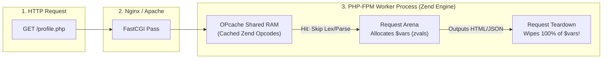

---
tags:
  - php
  - fundamentals
  - execution-model
  - variables
  - psr-12
---

# PHP Execution Model, Tags & Variables in PHP

#### TL;DR (Quick Revision)

**PHP Execution & Variables** = A **Shared-Nothing, per-request bytecode runtime** (Zend Engine + OPcache) where code lives inside `<?php ... ?>` tags and every variable is prefixed with a `$` sigil (`$user`), dynamically typed by default, and fortified at the file level with `declare(strict_types=1);`.
_(Python/Java Bridge: Unlike a long-running Java Spring Boot JVM or Python FastAPI worker where static/global variables stay in RAM across requests, PHP boots a fresh memory state for **every single HTTP request** and wipes 100% of variable memory the millisecond the response is sent.)_

> [!abstract] Core Idea
> PHP (**P**HP: **H**ypertext **P**reprocessor) is a server-side scripting language powered by the **Zend Engine**. Under the hood, PHP compiles `.php` source files into Zend bytecode (**Opcodes**), caches those opcodes in shared RAM via **OPcache** (so files aren't re-parsed on every request), executes the opcodes in an isolated per-request memory arena, outputs the HTTP response (HTML/JSON), and destroys all request variables immediately.

> [!question] Why Does PHP's Design Matter?
>
> - **Zero Cross-Request Memory Leaks**: Because every HTTP request gets a clean slate ("Shared-Nothing Architecture"), a memory leak or uncaught error in Request A cannot corrupt the in-memory state of Request B.
> - **Instant Development & CLI Tooling**: PHP includes a built-in development web server (`php -S localhost:8000`) and an interactive REPL (`php -a`), needing zero Tomcat/Gradle build steps during local development.
> - **Explicit Variable Disambiguation (`$`)**: Prefixing variables with `$` lets PHP distinguish variables (`$TAX`), constants (`TAX`), and functions (`TAX()`) in the same namespace, and allows direct variable interpolation inside strings (`"Hello $name"`).
> - **Opt-In Type Safety (`strict_types=1`)**: Adding `declare(strict_types=1);` at the top of a file transforms PHP from a permissive, type-juggling scripting language into a strict scalar type-checked language resembling Java and TypeScript.

#### Quick Comparison Table (Python / Java vs. PHP 8.4/8.5+)

| Concept / Operation           | Python / Java Equivalent                                  | PHP 8.4/8.5+ Syntax                                        | Key Difference / Gotcha                                                                           |
| :---------------------------- | :-------------------------------------------------------- | :--------------------------------------------------------- | :------------------------------------------------------------------------------------------------ |
| **Web Request State**         | Long-lived process (JVM / ASGI worker stays in RAM)       | Shared-Nothing (`php-fpm` worker resets per request)       | Static/global variables in PHP **do not persist** between two HTTP requests!                      |
| **Entry Point**               | `public static void main` / `if __name__ == "__main__":`  | Top-to-bottom execution inside `<?php` tag                 | Only code inside `<?php ... ?>` is executed; text outside is sent as raw output.                  |
| **Variable Declaration**      | `count = 10` (Py) / `int count = 10;` (Java)              | `$count = 10;`                                             | Every variable name **must** start with `$` (except constants). Semicolons `;` are mandatory.     |
| **Compile/Runtime Constants** | `final int MAX = 5;` (Java) / `MAX = 5` (Py)              | `const MAX = 5;` or `define('MAX', 5);`                    | Constants have **no `$` prefix**. `const` is compile-time; `define()` is runtime.                 |
| **Debug Inspection**          | `print(repr(x), type(x))`                                 | `var_dump($x);`                                            | Prints exact underlying C type (`int`, `float`, `string`), byte length, and value.                |
| **Variable Aliasing**         | Python binds names to object refs; Java copies primitives | Copy-on-Write values (`$b = $a`) vs Reference (`$b = &$a`) | Assigning `$b = $a` for primitives/arrays creates an independent logical copy unless `&` is used. |

---

## The Learning Concept

### What Problem Does It Solve?

When transitioning from **Python** or **Java** to PHP, three things immediately trip developers up:

1. **The Tag & Whitespace Trap**: PHP started as an HTML templating engine. Anything outside `<?php ... ?>` is immediately flushed as HTTP output. If you put a closing `?>` tag at the bottom of a pure PHP class file with a trailing newline, PHP sends that whitespace to the browser early, breaking subsequent HTTP headers (`Cannot modify header information - headers already sent`).
2. **Silent Type Coercion**: By default, PHP tries to "help" by silently converting strings like `"42px"` or `"100"` into integers when passed to functions expecting `int`.
3. **Variable Assignment Semantics**: Expecting `$b = $a` on an array or integer to mutate `$a` (or vice versa) without understanding PHP's `$` sigil and `&` reference operator.

Look at this **`// BAD`** legacy PHP script that mixes legacy habits:

```php
 <?php
// BAD - Leading space before <?php sends HTTP body early!
// BAD - Missing declare(strict_types=1); allows silent type coercion!

$price = "100"; // String, not int
define("TAX_RATE", 0.18);

function calculateTotal(int $amount): float {
    // Because strict_types is OFF, PHP silently coerces string "100" -> int 100!
    return $amount + ($amount * TAX_RATE);
}

echo calculateTotal($price);
?>

```

**Why this fails in production:** The leading space before `<?php` and the trailing newline after `?>` immediately flush whitespace to the HTTP response buffer, causing any later `header('Location: /login')` or `session_start()` call to crash. Furthermore, without `declare(strict_types=1);`, passing string `"100"` into `int $amount` silently coerces types instead of catching the bug.

Now look at the **`// GOOD`** modern **PHP 8.4/8.5 + _PHP: The Right Way_ (PSR-12 / PER)** solution:

```php
<?php

declare(strict_types=1);

// GOOD - File starts at byte 0 with <?php, enables strict_types=1,
// uses compile-time const, and OMITS the closing ?> tag in pure PHP files!

const TAX_RATE = 0.18;

function calculateTotal(int $amount): float
{
    return $amount + ($amount * TAX_RATE);
}

$price = 100; // Strictly an int
$total = calculateTotal($price);

var_dump($total); // float(118)
```

---

### How PHP Implements It Under the Hood

> [!tip] The 4-Stage Zend Engine Lifecycle & Memory Model
>
> 1. **Lexing & Parsing (`<?php` Mode Switching)**: When the PHP interpreter reads a `.php` file, it starts in "HTML passthrough mode" until it hits `<?php`. Everything inside `<?php ... ?>` is tokenized and parsed into an **Abstract Syntax Tree (AST)**.
> 2. **Zend Opcode Compilation & OPcache**: The Zend Engine compiles the AST into **Opcodes** (PHP's equivalent of Java `.class` bytecode or Python `.pyc`). In production, **OPcache** stores these compiled opcodes in shared RAM so subsequent HTTP requests skip file reading, lexing, and parsing entirely. _(Note: PHP 8.0+ also includes a **JIT (Just-In-Time) Compiler** inside OPcache that compiles hot opcodes directly into native x86/ARM machine code for CPU-intensive math, though standard DB/web I/O relies primarily on OPcache)._
> 3. **Isolated Request Execution (`zval` Containers)**: Every PHP variable (`$x`) is stored inside a C struct called a **`zval` (Zend Value)** containing the value, a type tag (`IS_LONG`, `IS_STRING`, `IS_ARRAY`), and a reference counter (`refcount`).
> 4. **Shared-Nothing Teardown**: The moment the script finishes (or calls `exit`), the Zend Engine frees every `zval` allocated during that request. The `php-fpm` worker process stays alive in RAM waiting for the next HTTP request, but **your PHP application variables are 100% wiped**.

#### Full Runnable Example

Save this as `01_basics.php` and run it via CLI (`php 01_basics.php`) or start PHP's built-in web server (`php -S localhost:8000`):

```php
<?php

declare(strict_types=1);

// 1. Compile-time constant (No $ sigil, cannot be reassigned)
const APP_ENV = 'production';

// 2. Standard variables (Always prefixed with $, dynamically typed variable containers)
$username        = 'valay';
$loginAttempts   = 3;
$isAuthenticated = true;

// 3. Value assignment (Copy-on-Write) vs Reference assignment (&)
$backupAttempts = $loginAttempts;    // Copies value: modifying $backupAttempts won't affect $loginAttempts
$refAttempts    = &$loginAttempts;   // Aliasing: $refAttempts and $loginAttempts point to the EXACT same zval!
$refAttempts++;                      // Increments BOTH $refAttempts and $loginAttempts to 4!

// 4. Built-in Magic Constants (Resolved at compile-time based on file location)
$currentLine = __LINE__;
$currentDir  = __DIR__;

// 5. Outputting with echo and inspecting types/memory with var_dump()
echo "App Environment: " . APP_ENV . PHP_EOL;
echo "User: {$username} | Line: {$currentLine}" . PHP_EOL;

var_dump($loginAttempts, $backupAttempts, $isAuthenticated);
```

**Output:**

```
App Environment: production
User: valay | Line: 21
int(4)
int(3)
bool(true)
```

---

### Visual Diagram: PHP Shared-Nothing Request Lifecycle vs. Java/Python



---

### Key Terminology (Syntax Decoder)

1. **`<?php ... ?>` and `<?= $var ?>` (PHP Opening, Closing & Short-Echo Tags)**:
   Tells the parser to enter and exit PHP execution mode.
   - **Rule (_PHP: The Right Way_ / PSR-1)**: Always use full `<?php` tags or short-echo `<?= $var ?>` (which is always enabled and is shorthand for `<?php echo $var; ?>`). **Never** use legacy short open tags `<?` (disabled by default). If a file contains **only PHP code**, **omit the closing `?>` tag** at the bottom of the file to prevent accidental trailing whitespace from corrupting HTTP headers.
     Syntax: `<?= $username ?>`

2. **`declare(strict_types=1);` (Per-File Strict Scalar Type Checking)**:
   Must be the **very first statement** in a `.php` file. By default (`strict_types=0`), passing `"123"` to `function foo(int $x)` silently coerces `"123"` into `123`. With `declare(strict_types=1);`, PHP throws a `TypeError` if the passed argument's exact type does not match the parameter type (with only one exception: an `int` may widen to a `float`).
   - **Crucial Engine Rule**: `strict_types=1` applies to **function calls made from inside that file** (the caller file), not the file where the function was defined!
     Syntax: `declare(strict_types=1);`

3. **`$variableName` (The Dollar Sigil & Identifier Rules)**:
   Every variable in PHP starts with `$`, followed by a letter (`a-z`, `A-Z`) or underscore `_`, followed by any number of letters, numbers, or underscores (`[a-zA-Z_\x80-\xff][a-zA-Z0-9_\x80-\xff]*`).
   - **Case Sensitivity Twist**: **Variable names (`$foo` vs `$FOO`) and constants are case-sensitive**, whereas PHP **keywords (`if`, `IF`), function names (`strlen` vs `STRLEN`), and class names are case-insensitive**! (Always write lowercase keywords and match exact function/class casing per PSR-12).
     Syntax: `$userId = 42;`

4. **`const` vs `define()` (Compile-Time vs Runtime Constants)**:
   Identifiers that hold immutable values and **never use a `$` sigil**.
   - `const DB_PORT = 3306;`: Defined at **compile-time**. Must be declared at the top-level scope or inside a `class`/`interface`, never inside an `if` block or function. Faster and preferred in modern PHP.
   - `define('DB_PORT', 3306);`: Defined at **runtime**. Can be called inside `if` statements or loops, and supports dynamic constant names, but cannot define class constants.
     Syntax: `const MAX_RETRIES = 3;`

5. **`echo` vs `print` vs `var_dump()` vs `print_r()` (Output & Debugging)**:
   - `echo`: Language construct (not a function, requires no parentheses) that outputs one or more strings separated by commas (`echo 'Hello ', $name;`) with **no return value** and **no automatic newline** (append `PHP_EOL` or `"\n"` for CLI newlines).
   - `print`: Language construct that outputs a single string and always returns `1` (slower/less flexible than `echo`).
   - `var_dump($var)`: Dumps the exact internal Zend type, length, and recursive structure (essential for debugging `bool(false)` vs `string(0) ""` vs `NULL`).
   - `print_r($var)`: Prints human-readable variable info, omiting exact types (ignores `false` and `null` visually!).
     Syntax: `var_dump($data);`

6. **`isset($var)`, `empty($var)`, and `unset($var)` (Variable State Constructs)**:
   - `isset($x)`: Returns `true` if `$x` exists **and is NOT `null`**. Does not trigger an "Undefined variable" warning.
   - `empty($x)`: Returns `true` if `$x` does not exist **or** its value is loosely falsy (`false`, `0`, `0.0`, `""`, `"0"`, `[]`, `null`). _Beware: `empty("0")` is `true`!_
   - `unset($x)`: Destroys the specified variable (or array key) from the current symbol table.
     Syntax: `if (isset($user)) { unset($user); }`

> [!important] Key Rules to Remember
>
> - **Omit Closing `?>` in Pure PHP Files** → Prevents accidental trailing newlines/spaces from triggering `Headers already sent` errors.
> - **`strict_types=1` Is Per-Caller-File** → Must be at the very top of every `.php` file; it enforces strict types on calls originating _from_ that file.
> - **Variables Have `$`, Constants Do Not** → `$TAX` looks up a variable; `TAX` looks up a constant.
> - **Shared-Nothing Means Zero In-Memory Persistence** → Never store user state in a static class property expecting it to survive to the next HTTP request; use Redis, a database, or `$_SESSION`.

---

## Edge Case Analysis (Python/Java Dev Traps & Security Gotchas)

### 1. The `empty("0")` Trap (A Classic Python/Java Dev Bug)

- **Problem**: In Python, `bool("0")` is `True` because `"0"` is a non-empty string. In PHP, `empty($var)` checks if a variable is loosely equal to `false` (`$var == false`). Because PHP treats the string `"0"` as falsy, `empty("0")` returns `true`! If a user submits `"0"` as a quantity or search query in a form and you validate it with `if (empty($input))`, PHP rejects valid input `"0"`.
- **Fix**: Only use `empty()` when `"0"` is genuinely considered empty. For string inputs, check `$input === ''` or `isset($input)`.

```php
<?php

declare(strict_types=1);

$quantityInput = "0"; // User ordered 0 additional items via form

// BAD - Rejects valid "0" input!
if (empty($quantityInput)) {
    echo "BAD: PHP thinks '0' is empty!" . PHP_EOL;
}

// GOOD - Explicitly check for null or empty string ''
if ($quantityInput === '') {
    echo "Input is blank" . PHP_EOL;
} else {
    echo "GOOD: Received valid input: {$quantityInput}" . PHP_EOL;
}
```

### 2. Variable Variables (`$$a`) & Dynamic Symbol Table Pollution (CTF Vulnerability)

- **Problem**: PHP supports **Variable Variables (`$$a`)**—using the _string value_ of one variable as the _variable name_ of another variable! If `$a = 'role'` and `$$a = 'admin'`, PHP dynamically creates `$role = 'admin'`. In CTF challenges and legacy code, developers loop over `$_GET` or `$_POST` using `$$key = $val` (or call `extract($_GET)`), allowing an attacker to pass `?isAdmin=1` in the URL and overwrite internal security variables like `$isAdmin`!
- **Fix**: Never use `$$key = $val` or `extract()` on user-controlled input. Use associative arrays (`$config[$key] = $val`) instead.

```php
<?php

declare(strict_types=1);

$isAdmin = false;

// Simulated attacker query parameters: ?isAdmin=1
$queryParams = ['isAdmin' => true];

// BAD (VULNERABLE CTF PATTERN) - Variable variables overwrite local scope!
foreach ($queryParams as $key => $value) {
    $$key = $value; // Dynamically resolves to $isAdmin = true!
}
var_dump($isAdmin); // bool(true) -> Authentication Bypassed!
```

### 3. `unset()` on a Reference (`&$ref`) Only Breaks the Binding

- **Problem**: C/C++ developers sometimes expect `unset($ref)` to destroy the underlying memory for all variables pointing to that reference. In PHP's Zend Engine, `unset($b)` only removes `$b` from the symbol table and decrements the `zval`'s reference count (`refcount`); `$a` remains completely intact.
- **Fix**: If you want to clear the value for _all_ variables sharing a reference, assign `$b = null;` instead of calling `unset($b)`.

```php
<?php

declare(strict_types=1);

$original = 'secret_token';
$alias = &$original; // Both point to the same zval (refcount = 2)

unset($alias);       // Only unbinds $alias; $original is untouched!
var_dump($original); // string(12) "secret_token"

$alias2 = &$original;
$alias2 = null;      // Modifies the shared zval to null for BOTH variables!
var_dump($original); // NULL
```

### 4. Function Scope Isolation (Why Global Variables Disappear Inside Functions)

- **Problem**: In Python or JavaScript, a function can freely _read_ variables declared at the top of the same file. In PHP, **functions have completely isolated local scope**! A variable declared at the top of a `.php` file is **invisible** inside a function unless passed as an argument (or imported via the legacy `global $var;` keyword, which is strongly discouraged).
- **Fix**: Always pass dependencies explicitly as function parameters, or use `const` for file-wide constants (constants _are_ globally visible inside functions).

```php
<?php

declare(strict_types=1);

$taxRate = 0.18;     // File-level global variable
const CURRENCY = 'INR'; // File-level constant

function formatPrice(float $amount, float $taxRate): string
{
    // Trying to access $taxRate without passing it as a parameter triggers:
    // Warning: Undefined variable $taxRate!
    // However, constants like CURRENCY are automatically visible in all scopes:
    $final = $amount * (1 + $taxRate);
    return CURRENCY . ' ' . $final;
}

echo formatPrice(1000.0, $taxRate) . PHP_EOL; // INR 1180
```

---

## Going Deeper (Intermediate -> Advanced & _PHP: The Right Way_ Integration)

### 1. _PHP: The Right Way_ — CLI, Built-in Server & PER Coding Style (PSR-1 / PSR-12)

According to **[PHP: The Right Way](https://phptherightway.com/)**, modern PHP development relies on three foundational workflow habits right from day one:

1. **Built-In Web Server & CLI SAPI**:
   PHP uses different **SAPIs (Server Application Programming Interfaces)** depending on where it runs (`cli` for terminal vs `fpm-fcgi` for production web servers).
   - **Check Version & Extensions**: `php -v` and `php -m`
   - **Interactive REPL**: `php -a`
   - **Lint Syntax Check (without executing)**: `php -l script.php`
   - **Built-In Local Dev Server**: `php -S localhost:8000 -t public/` (serves the `public/` folder locally with zero Apache/Nginx setup; never use `php -S` in production as it is single-threaded).
   - **CLI Arguments (`$argc` & `$argv`)**: Like C and Python's `sys.argv`, CLI scripts automatically receive `$argc` (argument count) and `$argv` (array of arguments where `$argv[0]` is the script filename).

2. **PHP-FIG Code Style (`PSR-1`, `PSR-12`, and `PER Coding Style`)**:
   Unlike Python (PEP 8) or Java, PHP standardization is maintained by the **PHP-FIG (Framework Interoperability Group)**:
   - **Indentation**: 4 spaces (never tabs).
   - **Braces**: Opening `{` for **Classes and Functions/Methods** goes on its **own new line** (Allman style), whereas opening `{` for **Control Structures (`if`, `for`, `while`, `match`)** goes on the **same line** with a space before `{` (K&R style).
   - **Naming**: `PascalCase` (`StudlyCaps`) for Class names, `camelCase` for method and variable names, and `UPPER_SNAKE_CASE` for constants.
   - **Keywords & Booleans**: Always lowercase (`true`, `false`, `null`, `int`, `string`).

### 2. How Frameworks (Laravel / Symfony) Use This Under the Hood

1. **The Front Controller Pattern (`public/index.php`)**:
   In legacy PHP, visiting `/login.php` and `/dashboard.php` executed separate `.php` files directly. In **Laravel and Symfony**, your web server points exclusively to `public/index.php`. Every single HTTP request boots `public/index.php`, which loads Composer's autoloader, inspects the URL, runs your Controller, returns the response, and tears down.
2. **Long-Running Runtimes (Laravel Octane / FrankenPHP / Swoole)**:
   Because standard PHP tears down the entire framework on every HTTP request, ultra-high-throughput apps optionally use **Laravel Octane** (powered by **FrankenPHP**, **RoadRunner**, or **Swoole**). These keep the booted PHP framework in RAM across requests just like Java Spring Boot or Node.js—which is why understanding PHP's memory lifecycle is essential when scaling modern PHP.

---

## Interview Corner

### Common Questions & Concise Answers

**Q1: How does PHP's "Shared-Nothing" execution model differ from Java (Spring Boot) or Python (FastAPI)?**
**A:** In Java or Python, the application boots once into a long-running process and handles thousands of HTTP requests inside the same shared memory space. In standard PHP (`php-fpm`), every HTTP request gets a completely isolated execution state where variables are allocated for that single request and 100% destroyed as soon as the response finishes, preventing cross-request memory leaks or state pollution.

**Q2: If PHP parses and compiles scripts on every request, isn't that slow? How does PHP solve this?**
**A:** Without caching, re-parsing `.php` files on every request would be slow. PHP solves this with **OPcache**, a built-in Zend Engine extension that compiles `.php` source code into **Zend Opcodes** (bytecode) once and stores them in shared memory (RAM), so subsequent requests execute pre-compiled bytecode immediately.

**Q3: What is the difference between `const` and `define()` in PHP?**
**A:** `const` defines a constant at **compile-time**, can be used inside classes/interfaces (`ClassName::CONST_NAME`), and must be declared at the top level of a scope. `define()` defines a constant at **runtime**, can be called conditionally inside `if` blocks or loops, and cannot be used to declare class constants.

**Q4: Why does PSR-12 recommend omitting the closing `?>` tag in files containing only PHP code?**
**A:** Anything outside `<?php ... ?>` tags—including a single invisible space or newline after a closing `?>` tag—is immediately buffered or flushed as part of the HTTP response body. If a required library file has trailing whitespace after `?>`, subsequent calls to `header()`, `setcookie()`, or `session_start()` will fail with `Cannot modify header information - headers already sent`.

**Q5: Does `declare(strict_types=1);` enforce strict typing inside the file where a function is defined, or the file where the function is called?**
**A:** It enforces strict typing in the **caller file** (where the function call is made). If File A defines `function add(int $a, int $b)` with `strict_types=1`, and File B (without `strict_types=1`) calls `add("1", "2")`, PHP will still coerce `"1"` and `"2"` into integers unless File B also declares `strict_types=1`.

---

### Interactive Revision Quiz

**Q1: What happens if you declare a variable `$counter = 0;` at the top of `index.php`, increment it (`$counter++`), and refresh the browser 5 times under standard PHP-FPM?**

- [ ] A) The 5th refresh prints `5` because global variables persist in PHP-FPM worker RAM.
- [ ] B) Every single refresh prints `1` because PHP's Shared-Nothing architecture destroys all script variables at the end of each HTTP request.
- [ ] C) It throws a `Fatal Error` because global variables are forbidden in PHP 8.4+.
- [ ] D) It prints `0` because `++` only works inside functions.

**Q2: What is the output of `var_dump(empty("0"), isset($undefinedVar));` in PHP?**

- [ ] A) `bool(false)` and `bool(false)`
- [ ] B) `bool(false)` and throws a Fatal Error
- [ ] C) `bool(true)` and `bool(false)`
- [ ] D) `bool(true)` and `bool(true)`

**Q3: Which of the following is TRUE regarding case sensitivity in PHP?**

- [ ] A) Both variable names (`$user`) and function names (`strlen()`) are case-sensitive.
- [ ] B) Neither variable names nor function names are case-sensitive.
- [ ] C) Function names are case-sensitive, but variable names are case-insensitive.
- [ ] D) Variable names (`$user` vs `$User`) are case-sensitive, while keywords (`if`, `IF`) and function names (`strlen` vs `STRLEN`) are case-insensitive.

**Q4: Given `$a = 10; $b = &$a; unset($b);`, what is the value of `$a` after `unset($b)` runs?**

- [ ] A) `10` (because `unset($b)` only removes the `$b` binding from the symbol table without destroying `$a`)
- [ ] B) `null` (because `$b` was a reference to `$a`)
- [ ] C) Throws an `Undefined variable $a` warning
- [ ] D) `0`

**Q5: Why is `foreach ($_GET as $k => $v) { $$k = $v; }` a severe security vulnerability?**

- [ ] A) It causes a SQL Injection in PDO.
- [ ] B) It uses Variable Variables (`$$k`) to dynamically create or overwrite local PHP variables in the current scope using attacker-controlled query parameters.
- [ ] C) It crashes OPcache by exhausting shared memory.
- [ ] D) It disables `declare(strict_types=1);` at runtime.

<details>
<summary>Show Quiz Answers & Explanations</summary>

1. **B** — Standard PHP-FPM uses a Shared-Nothing architecture; every HTTP request starts with `$counter = 0`, increments it to `1`, outputs the response, and wipes all variable memory.
2. **C** — In PHP, the string `"0"` is considered loosely falsy, so `empty("0")` returns `bool(true)`! Meanwhile, `isset($undefinedVar)` safely returns `bool(false)` without throwing a warning.
3. **D** — PHP variable names (`$foo` vs `$Foo`) are strictly case-sensitive, whereas built-in keywords and function/method names are resolved case-insensitively by the Zend Engine.
4. **A** — `unset()` on a reference variable only breaks the link between that variable name and the underlying `zval` container; `$a` still holds `10`.
5. **B** — `$$k = $v` evaluates the string inside `$k` as a PHP variable name (identical to `extract($_GET)`), allowing an attacker to pass `?isAuthorized=1` and overwrite internal security flags.

</details>

---

## Practice Exercises

### Exercise 1: Basic — Strict Types & CLI Inspector

Write a standalone CLI script (`inspect.php`) starting with `declare(strict_types=1);` that defines a compile-time constant `VERSION = '8.4'`, reads the first CLI argument from `$argv[1]` (defaulting to `'guest'` using `isset($argv[1])`), and uses `var_dump()` to display the exact types of `VERSION`, `$argc`, and the resolved username.

### Exercise 2: Python/Java-to-PHP Translation — Value vs Reference Swap

In Java, you cannot write a `swap(int a, int b)` method that swaps two primitive integers in the caller's scope because Java passes primitives exclusively by value. Write a PHP function `function swapInts(int &$a, int &$b): void` using PHP's `&` reference sigil that swaps two integer variables in-place, and verify the result with `var_dump()`.

### Exercise 3: Security / Framework Pattern — Fixing the `empty("0")` & `$$var` Vulnerability

Refactor the following vulnerable legacy snippet into safe, PSR-12 compliant PHP 8.4 code that properly accepts `"0"` as a valid discount code and eliminates the `$$key` variable-variable vulnerability:

```php
<?php
$role = 'user';
foreach ($_POST as $key => $val) {
    $$key = $val; // Vulnerable!
}
if (empty($discountAmount)) { // Rejects "0"!
    die("Discount amount is required!");
}
```

---

## Memory Trick / One-Liner

> [!tip] The "Whiteboard Per Request" Analogy
> Think of **Java/Python** web servers as a permanent office building where variables stay written on the lobby whiteboard for every visitor who walks in, whereas **PHP** gives every single HTTP visitor a brand-new disposable whiteboard (`$vars`), lets them read the laminated rulebook in shared RAM (**OPcache**), and shreds their whiteboard the millisecond they walk out the door!
> **Takeaway Formula:** **`<?php` + `declare(strict_types=1);` + `$sigil` + No closing `?>` = Clean, Strict, Modern PHP.**

---

## Warning Block (Best Practice)

> [!warning] Common Mistake (Avoid This!)
>
> ```php
> <?php
> // BAD - Missing strict_types, using global keyword, and closing ?> tag with trailing newline
> $appTax = 0.18;
>
> function getTax($amount) {
>     global $appTax; // Hidden global state dependency!
>     return $amount * $appTax;
> }
> ?>
>
> ```
>
> ```php
> <?php
>
> declare(strict_types=1);
>
> // GOOD - Strict types enabled, compile-time const or explicit parameter, PSR-12 braces, no closing ?>
> const APP_TAX = 0.18;
>
> function getTax(float $amount): float
> {
>     return $amount * APP_TAX;
> }
> ```
