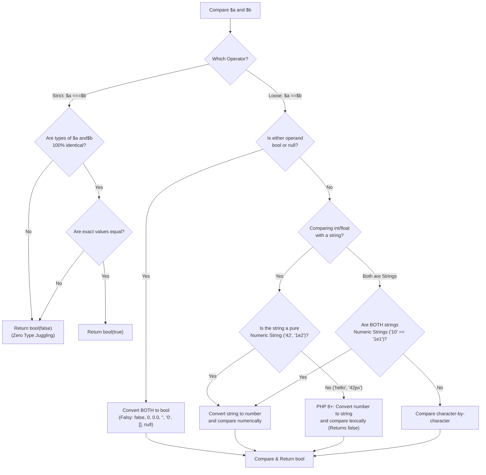

---
tags:
  - php
  - types
  - strings
  - type-juggling
  - utf-8
---

# Types, Strings & Type Juggling (== vs ===) in PHP

#### TL;DR (Quick Revision)

**PHP Type System & Strings** = **10 core data types** (4 scalar, 4 compound, 2 special) where strings use `.` for concatenation (never `+`), single quotes `'...'` are literal while double quotes `"..."` interpolate `$variables`, and `===` enforces strict type + value identity while `==` performs automatic **Type Juggling** (coercing operands into a common type at runtime).

> [!abstract] Core Idea
> PHP is dynamically typed at the variable container (`zval`) level but supports strict type declarations on function boundaries and class properties. Because HTTP requests (query parameters, form bodies, headers) arrive exclusively as strings, PHP historically introduced automatic **Type Juggling**—silently converting strings to numbers or booleans during arithmetic (`+`) and loose comparisons (`==`). Modern PHP (`8.4`/`8.5+`) tames this behavior using `declare(strict_types=1);`, strict identity operators (`===` / `!==`), and null-aware operators (`??`, `??=`, `?->`).

> [!question] Why Master PHP Types & Strings First?
>
> - **Eliminate Silent Arithmetic Corruption**: In PHP, `+` is exclusively arithmetic addition and `.` is exclusively string concatenation. Writing `"10" + "20"` yields the integer `30`, and `"10px" + 5` throws a `TypeError` (or warning), whereas `"10" . "20"` yields `"1020"`.
> - **Prevent Loose Comparison (`==`) Security Bypasses**: Comparing hashes, tokens, or roles with `==` instead of `===` can trigger numeric string coercion (such as `"0e12345" == "0e67890"` evaluating to `true` because both parse as scientific notation `0.0`).
> - **Write Safe Multibyte (UTF-8) Text Processing**: Standard PHP string functions (`strlen()`, `substr()`, `strpos()`) count raw **bytes**, not Unicode characters. Knowing when to use `mb_*` (`mb_strlen()`, `mb_substr()`, `mb_trim()`) prevents corrupted emojis and non-ASCII text.
> - **Concise Null & Fallback Handling**: Mastering the difference between the Null Coalescing Operator (`??`) and the Elvis Operator (`?:`) prevents `Undefined variable / array key` warnings and unintended falsy bugs.

#### Quick Reference Table: Loose (`==`) vs. Strict (`===`) & String Syntax in PHP 8.4/8.5+

| Operation / Concept         | Legacy / Loose PHP Syntax                   | Modern / Strict PHP 8.4/8.5+ Syntax           | Engine Behavior & Gotcha                                                                                               |
| :-------------------------- | :------------------------------------------ | :-------------------------------------------- | :--------------------------------------------------------------------------------------------------------------------- |
| **Equality Check**          | `$a == $b` / `$a != $b`                     | `$a === $b` / `$a !== $b`                     | `==` juggles types (`"42" == 42` is `true`); `===` requires identical type AND value (`"42" === 42` is `false`).       |
| **String Joining**          | `$a + $b` _(Wrong! Math only)_              | `$a . $b` or `"{$a}{$b}"`                     | `+` forces numeric conversion (`"5" + "5"` is `int(10)`); `.` forces string conversion (`5 . 5` is `"55"`).            |
| **Quote Parsing**           | `"literal string with no vars"`             | `'literal string'` vs `"Hello {$name}"`       | `'...'` parses zero variables and only escapes `\'` and `\\`. `"..."` parses `{$var}` and `\n`, `\t`, `\u{xxxx}`.      |
| **Default Value (Null)**    | `isset($x) ? $x : 'default'`                | `$x ?? 'default'`                             | `??` returns the right side **only** if the left side is `null` or does not exist (never triggers undefined warnings). |
| **Default Value (Falsy)**   | `$x ? $x : 'default'`                       | `$x ?: 'default'`                             | `?:` (Elvis) returns the right side if the left side is **any falsy value** (`""`, `"0"`, `0`, `false`, `null`).       |
| **Multibyte String Length** | `strlen('₹100')` $\rightarrow$ `6` (bytes!) | `mb_strlen('₹100')` $\rightarrow$ `4` (chars) | Standard `str*` functions operate on raw bytes (`₹` is 3 bytes in UTF-8); `mb_*` operates on UTF-8 code points.        |

---

## The Learning Concept

### What Problem Does It Solve?

In PHP, two operators cause 90% of beginner bugs and security vulnerabilities:

1. Using `+` instead of `.` when combining strings, or misunderstanding how PHP categorizes strings as **Numeric**, **Leading-Numeric**, or **Non-Numeric**.
2. Using loose comparison (`==`) or the Elvis operator (`?:`) when validating input, causing `"0"`, `0`, `false`, and `""` to collide unexpectedly.

Look at this **`// BAD`** PHP snippet that fails due to loose comparison and operator confusion:

```php
<?php
// BAD - Relying on loose == comparison, + on strings, and strlen() on UTF-8

$userIdInput = "42";         // Came from an HTTP query string
$promoCode   = "0";          // User submitted promo code "0"
$priceLabel  = "₹500";       // Contains 3-byte UTF-8 Rupee symbol (₹)

// 1. Loose comparison treats string "42" and int 42 (or even " 42.0 ") as equal!
if ($userIdInput == 42) {
    echo "Loose match passed!" . PHP_EOL;
}

// 2. Elvis operator (?:) treats "0" as falsy and overwrites the valid promo code!
$appliedPromo = $promoCode ?: 'NO_PROMO';
echo "Promo: " . $appliedPromo . PHP_EOL; // Prints NO_PROMO instead of 0!

// 3. strlen() counts bytes (3 bytes for ₹ + 3 bytes for 500 = 6 bytes, not 4 chars!)
echo "Character count: " . strlen($priceLabel) . PHP_EOL; // Prints 6!
```

**Why this fails:** First, `==` converts `"42"` (and even `" +42.00 "`) to the number `42`, which can bypass strict type boundaries. Second, `?:` checks for truthiness, and since `"0"` is falsy in PHP, it discards the user's input. Third, `strlen()` measures raw memory bytes rather than visible UTF-8 characters.

Now look at the **`// GOOD`** modern **PHP 8.4/8.5 + _PHP: The Right Way_** solution:

```php
<?php

declare(strict_types=1);

// GOOD - Explicit casting/validation, strict === comparison, ?? operator, and mb_* UTF-8 functions

$userIdInput = "42";
$promoCode   = "0";
$priceLabel  = "₹500";

// 1. Strictly compare type AND value (or explicitly cast/validate first)
$userId = (int)$userIdInput;
if ($userId === 42) {
    echo "Strict match: int(42) verified!" . PHP_EOL;
}

// 2. Null coalescing (??) only falls back if $promoCode is null or undefined (preserves "0"!)
$appliedPromo = $promoCode ?? 'NO_PROMO';
echo "Promo: {$appliedPromo}" . PHP_EOL; // Prints 0

// 3. mb_strlen() accurately counts UTF-8 characters
echo "Character count: " . mb_strlen($priceLabel, 'UTF-8') . PHP_EOL; // Prints 4
```

---

### How PHP Implements Types & Type Juggling Under the Hood

> [!tip] The 10 Core PHP Types & The 3 Numeric String States
>
> 1. **The 4 Scalar Types**:
>    - `bool`: `true` or `false` (case-insensitive).
>    - `int`: Platform-dependent signed integer (64-bit on modern 64-bit OS: $-9\times 10^{18}$ to $+9\times 10^{18}$; defined by `PHP_INT_MAX` and `PHP_INT_MIN`).Supports decimal (`42`), hex (`0x2A`), octal (`0o52`), binary (`0b101010`), and readable numeric separators (`1_000_000`). If an `int` overflows `PHP_INT_MAX`, PHP automatically widens it to a `float`!
>    - `float` (also displayed as `double` in `gettype()`): IEEE 754 64-bit double-precision floating-point (`10.5`, `1.2e3`). Never check floats for exact equality due to binary rounding (`0.1 + 0.2 !== 0.3`); use `abs($a - $b) < PHP_FLOAT_EPSILON`.
>    - `string`: A sequence of bytes (up to 2GB+) where each character index `$str[0]` accesses 1 raw byte.
> 2. **The 4 Compound Types & 2 Special Types**:
>    - Compound: `array` (ordered hash map), `object`, `callable`, and `iterable`.
>    - Special: `null` (variable with no value; the only value of type `null`) and `resource` (C-level external handle like a file descriptor or cURL session, largely replaced by opaque objects in PHP 8+).
> 3. **How the Zend Engine Classifies Strings During Math & Comparisons**:
>    - **Numeric String** (`"42"`, `" -3.14 "`, `"1e4"`): Completely valid number (optional whitespace allowed). Silently converts to `int` or `float` in `+` math and `==` comparisons.
>    - **Leading-Numeric String** (`"42px"`, `"10 apples"`): Starts with digits followed by text. In PHP 8+, `"42px" + 1` emits a **`Warning: A non-numeric value encountered`** and evaluates to `43`, while `"42px" == 42` evaluates to **`false`** (in PHP 7, `"42px" == 42` was `true`!).
>    - **Non-Numeric String** (`"hello"`, `""`): Contains no leading digits. In PHP 8+, `"hello" + 1` throws a fatal **`TypeError: Unsupported operand types: string + int`**, and `"hello" == 0` evaluates to **`false`** (fixing PHP 7's notorious `"hello" == 0` bug!).

#### Full Runnable Example

Run this script via `php 02_types_strings.php` to see how PHP 8.4/8.5 handles strings, Heredocs, Nowdocs, type casting, and strict vs. loose comparisons:

```php
<?php

declare(strict_types=1);

// 1. Readable integer literals & float precision
$maxBudget = 1_500_000; // int(1500000)
$taxRate   = 0.18;      // float(0.18)

// 2. Single-quoted (Literal) vs Double-quoted (Interpolated) strings
$service = 'AuthAPI';
$single  = 'Service: {$service}\n'; // Literal: prints {$service}\n as plain text
$double  = "Service: {$service} | Budget: {$maxBudget}\n"; // Interpolates variables & newline

echo $single . PHP_EOL;
echo $double;

// 3. Heredoc (<<<ID — interpolates like "") vs Nowdoc (<<<'ID' — literal like '')
// PHP 7.3+ allows indented closing identifiers!
$sqlQuery = <<<SQL
    SELECT id, username
    FROM users
    WHERE service = '{$service}'
    SQL;

$rawTemplate = <<<'TEXT'
    Raw Nowdoc: $service is NOT interpolated here, nor is \n escaped.
    TEXT;

echo $sqlQuery . PHP_EOL;
echo $rawTemplate . PHP_EOL;

// 4. String concatenation (. and .=) vs Arithmetic (+)
$portPrefix = "80";
$portSuffix = "80";
$fullPortString = $portPrefix . $portSuffix; // string(4) "8080"
$addedPortMath  = $portPrefix + $portSuffix; // int(160) -> + forces numeric addition!

var_dump($fullPortString, $addedPortMath);

// 5. Loose (==) vs Strict (===) & Spaceship (<=>)
var_dump(
    "100" == 100,      // bool(true)  -> Loose: numeric string "100" juggled to int 100
    "100" === 100,     // bool(false) -> Strict: string !== int
    "1e2" == "100",    // bool(true)  -> Loose: BOTH strings are numeric, so compared as numbers (100 == 100)!
    "1e2" === "100",   // bool(false) -> Strict: different string characters
    0 == "hello",      // bool(false) -> Fixed in PHP 8.0+! (Was true in PHP 7)
    10 <=> 20          // int(-1)     -> Spaceship returns -1 (left < right), 0 (equal), or 1 (left > right)
);
```

**Output:**

```
Service: {$service}\n
Service: AuthAPI | Budget: 1500000
SELECT id, username
FROM users
WHERE service = 'AuthAPI'
Raw Nowdoc: $service is NOT interpolated here, nor is \n escaped.
string(4) "8080"
int(160)
bool(true)
bool(false)
bool(true)
bool(false)
bool(false)
int(-1)
```

---

### Visual Diagram: How PHP 8.4/8.5+ Evaluates `$a == $b` vs `$a === $b`



---

### Key Terminology (Syntax Decoder)

1. **The 8 Exact Falsy Values in PHP (`(bool) $val === false`)**:
   When any value is cast to `bool` (via `(bool) $x`, `if ($x)`, `!$x`, or `$x ?: $default`), PHP evaluates **only these 8 values** as `false`:
   1. `false` (boolean false)
   2. `0` (integer zero)
   3. `-0` / `0.0` / `-0.0` (float zero)
   4. `""` (empty string)
   5. `"0"` (the string containing a single zero digit — **Notice: `"0.0"` and `"00"` are TRUTHY!**)
   6. `[]` (an array with zero elements)
   7. `null` (unset or null variable)
   8. `SimpleXMLElement` objects created from empty XML tags without attributes.
      _Everything else—including `"-1"`, `"false"`, `"0.0"`, `"00"`, and any standard object instance—is **TRUTHY** (`true`)!_
      Syntax: `var_dump((bool) "0", (bool) "0.0", (bool) "false"); // false, true, true`

2. **`{$var}` (Curly Brace String Interpolation)**:
   Inside double-quoted strings (`"..."`) or Heredocs (`<<<ID`), wrapping variables, array keys, or object properties in curly braces `{$user->name}` or `{$items['id']}` explicitly tells the PHP parser where the variable expression starts and ends.
   - **PHP 8.2+ Deprecation Rule**: Always write `"{$var}"` (dollar sign _inside_ the braces), never `"${var}"` (dollar sign outside braces, which was deprecated in PHP 8.2 and removed in PHP 9.0).
     Syntax: `$msg = "User {$user['name']} has {$count} items.";`

3. **`<<<IDENTIFIER` (Heredoc) vs. `<<<'IDENTIFIER'` (Nowdoc)**:
   Multi-line string literals that eliminate escaping quotes (`"` or `'`).
   - **Heredoc (`<<<HTML ... HTML;`)**: Works like a double-quoted string (`"..."`)—interpolates `$variables` and escape sequences.
   - **Nowdoc (`<<<'SQL' ... SQL;`)**: Notice the single quotes around the opening identifier! Works like a single-quoted string (`'...'`)—zero variable interpolation and zero escape sequences.
   - **Indentation Rule**: The closing identifier (`HTML;`) can be indented with spaces/tabs, and PHP automatically strips that matching leading indentation from every line of the string body.
     Syntax: `$html = <<<'EOD' ... EOD;`

4. **Explicit Type Casting (`(int)`, `(float)`, `(string)`, `(bool)`, `(array)`, `(object)`)**:
   Forces an immediate type conversion on the expression to its right.
   - `(int) "42px"` $\rightarrow$ `42` _(Note: Explicit `(int)` casting silently parses leading digits without throwing a warning, unlike `"42px" + 1`!)_
   - `(int) "hello"` $\rightarrow$ `0`
   - `(string) true` $\rightarrow$ `"1"`, whereas **`(string) false` $\rightarrow$ `""` (empty string!)** and `(string) null` $\rightarrow$ `""`.
   - **PHP 8.5 Deprecation**: Non-canonical cast names `(boolean)`, `(integer)`, `(double)`, and `(binary)` are **deprecated in PHP 8.5**! Always use the canonical short names: `(bool)`, `(int)`, `(float)`, `(string)`.
     Syntax: `$id = (int) $rawInput;`

5. **`??` & `??=` (Null Coalescing & Null Coalescing Assignment) vs. `?:` (Elvis Operator)**:
   - `$a ?? $b`: Evaluates to `$a` if `$a` is set and **not `null`**; otherwise evaluates to `$b`. Safe to use on undefined array keys (`$_GET['page'] ?? 1`) without triggering warnings.
   - `$a ??= 'default'`: Assigns `'default'` to `$a` only if `$a` is currently `null` or undefined.
   - `$a ?: $b` (Elvis / Short Ternary): Evaluates `$a` once and returns `$a` if `(bool) $a` is `true`; otherwise returns `$b`. Throws a warning if `$a` is an undefined variable/key, and treats `0`, `""`, and `"0"` as false!
     Syntax: `$page = $_GET['page'] ?? 1;`

6. **`?->` (Nullsafe Object Operator — PHP 8.0+)**:
   Short-circuits a chain of property accesses or method calls to `null` if any intermediate object is `null`, instead of crashing with `Attempt to read property on null`.
   Syntax: `$country = $user?->getProfile()?->address?->country ?? 'IN';`

7. **Type Inspection Functions (`get_debug_type()`, `is_*()`, `is_numeric()`, `ctype_digit()`)**:
   - `get_debug_type($x)` (PHP 8.0+): Returns the exact modern PHP type name (`"int"`, `"float"`, `"bool"`, `"null"`, or the exact `ClassName`), replacing legacy `gettype()` (which awkwardly returned `"integer"`, `"double"`, and `"NULL"`).
   - `is_int($x)`, `is_float($x)`, `is_string($x)`, `is_bool($x)`, `is_null($x)`, `is_scalar($x)`: Strictly checks the internal `zval` type.
   - `is_numeric($x)`: Returns `true` if `$x` is an `int`, `float`, or a valid **Numeric String** (`"42"`, `"-3.14"`, `"1e5"`).
   - `ctype_digit($str)`: Returns `true` **only** if `$str` is a non-empty `string` where every single character is an ASCII digit `0–9` (rejects negative signs, decimals, and scientific notation!).
     Syntax: `if (is_int($id)) { ... }`

> [!important] Key Rules to Remember
>
> - **Default to `===` and `!==` Everywhere** → Never use `==` or `!=` unless you intentionally want numeric strings and numbers to coerce.
> - **`. ` Joins Strings, `+` Adds Numbers** → Never use `+` on strings; `"a" + "b"` throws a fatal `TypeError` in PHP 8+.
> - **`(string) false` Is `""`, While `(string) true` Is `"1"`** → Echoing `false` outputs nothing (`""`), which is why you should always debug booleans with `var_dump($flag)`.
> - **Use `mb_*` for User-Facing Text** → Always use `mb_strlen()`, `mb_substr()`, `mb_strtolower()`, and PHP 8.4's `mb_trim()` when handling UTF-8 strings.

---

## Edge Case Analysis (Traps & Security Gotchas)

### 1. Magic Hash (`0e...`) & Dual-String Loose Comparison (`==`) Vulnerability

- **Problem**: Developers often know that comparing a string to an integer (`"42" == 42`) triggers type juggling, so they assume comparing **two strings** with `==` (`$str1 == $str2`) does a normal character-by-character comparison. **Wrong!** In PHP, if **both** operands of `==` are strings that look like valid numbers (including scientific notation `0e...`), PHP converts **both strings into floats** and compares them numerically! If an MD5 or SHA1 hash happens to start with `0e` followed strictly by digits (`0–9`), such as `md5('240610708')` $\rightarrow$ `"0e462097431906509019562988736854"`, PHP evaluates `"0e4620..." == "0e8304..."` as `0.0 == 0.0` $\rightarrow$ **`true`**!
- **Fix**: Always use strict `===` for general string comparisons, and use **`hash_equals($knownHash, $userHash)`** when comparing cryptographic hashes or tokens to prevent both type juggling and timing side-channel attacks.

```php
<?php

declare(strict_types=1);

$hashA = "0e462097431906509019562988736854"; // md5('240610708')
$hashB = "0e830400451993494058024219903391"; // md5('QNKCDZO')

// BAD (VULNERABLE) - Both strings match scientific notation 0 * 10^N = 0.0!
var_dump($hashA == $hashB); // bool(true) -> Authentication Bypassed!

// GOOD - Strict identity (===) or timing-safe hash_equals()
var_dump($hashA === $hashB);          // bool(false)
var_dump(hash_equals($hashA, $hashB)); // bool(false)
```

### 2. The `strpos()` Zero-Index Falsy Trap (And Its Modern `str_contains()` Cure)

- **Problem**: Legacy PHP code frequently used `strpos($haystack, $needle)` to check if a substring exists inside a string. `strpos()` returns the integer byte index (`0, 1, 2...`) where the substring starts, or `false` if not found. If the substring is at the **very beginning** of the string (index `0`), writing `if (strpos($str, 'admin'))` or `if (strpos($str, 'admin') != false)` evaluates `0` as falsy (`false`) and misses the match completely!
- **Fix**: In PHP 8.0+, use the dedicated boolean functions **`str_contains($haystack, $needle)`**, **`str_starts_with($haystack, $needle)`**, and **`str_ends_with($haystack, $needle)`**. If you actually need the index via `strpos()`, always check `strpos($str, $sub) !== false`.

```php
<?php

declare(strict_types=1);

$roleHeader = "admin:super_user";

// BAD - strpos() returns int(0) because "admin" starts at index 0, and 0 is falsy!
if (strpos($roleHeader, 'admin')) {
    echo "Admin detected (Never runs!)" . PHP_EOL;
}

// GOOD (Modern PHP 8.0+) - Returns a clean bool(true) or bool(false)
if (str_contains($roleHeader, 'admin') && str_starts_with($roleHeader, 'admin:')) {
    echo "GOOD: Admin header verified cleanly!" . PHP_EOL;
}
```

### 3. Incrementing Strings (`$str++`) vs. `str_increment()` (PHP 8.3 / 8.4 / 8.5 Evolution)

- **Problem**: Historically, PHP allowed Perl-style alphanumeric string incrementing via `++`: if `$s = "a"`, `$s++` produced `"b"`, and `"z"++` wrapped around to `"aa"`. However, if a string looked like `"1e0"` (`$s = "1e0"; $s++;`), PHP suddenly treated it as scientific notation float `1.0` and turned it into `float(2)` instead of `"1e1"`!
- **Fix**: Applying `++` to non-numeric strings was **soft-deprecated in PHP 8.3** and **fully deprecated (E_DEPRECATED) in PHP 8.5** (part of the _Path to Saner Increment/Decrement Operators_ RFC). Use PHP 8.3+'s explicit **`str_increment($str)`** and **`str_decrement($str)`** functions instead.

```php
<?php

declare(strict_types=1);

$invoiceCode = "INV99";

// GOOD (PHP 8.3 / 8.4 / 8.5+) - Explicit, predictable alphanumeric increment
$nextInvoice = str_increment($invoiceCode);
var_dump($nextInvoice); // string(6) "INV100"
```

### 4. `NAN` (Not-a-Number) Never Equals Anything—Not Even Itself!

- **Problem**: Invalid floating-point math operations like `acos(2)` or `sqrt(-1)` return the special float constant `NAN`. According to IEEE 754 rules enforced by PHP, `NAN == NAN` is `false` and `NAN === NAN` is **also `false`**!
- **Fix**: Never compare a variable against `NAN` using `==` or `===`. Always use **`is_nan($val)`** (and `is_infinite($val)` / `is_finite($val)` for `INF`).

```php
<?php

declare(strict_types=1);

$invalidCalc = sqrt(-1); // float(NAN)

var_dump($invalidCalc === NAN);    // bool(false) -> Trap!
var_dump(is_nan($invalidCalc));    // bool(true)  -> Correct check!
```

---

## Going Deeper (Intermediate -> Advanced & _PHP: The Right Way_ Integration)

### 1. _PHP: The Right Way_ — Working with UTF-8 at Every Layer

As emphasized in **[PHP: The Right Way — Working with UTF-8](https://phptherightway.com/#php_and_utf8)**, core PHP strings are raw byte arrays (`char[]` in C) with no built-in character encoding metadata:

1. **Enable the `mbstring` Extension**: Every production PHP installation must load `ext-mbstring`.
2. **Replace Byte Functions with `mb_*` Equivalents**:
   - `strlen($s)` $\rightarrow$ `mb_strlen($s)`
   - `substr($s, 0, 5)` $\rightarrow$ `mb_substr($s, 0, 5)`
   - `strpos($s, $n)` $\rightarrow$ `mb_strpos($s, $n)`
   - `strtolower($s)` / `strtoupper($s)` $\rightarrow$ `mb_strtolower($s)` / `mb_strtoupper($s)`
3. **PHP 8.4 New Multibyte Functions (`mb_trim`, `mb_ucfirst`)**:
   Prior to PHP 8.4, `trim()`, `ltrim()`, `rtrim()`, `ucfirst()`, and `lcfirst()` had **no multibyte equivalents**! Calling `trim()` only stripped ASCII whitespace (ignoring Unicode non-breaking spaces `\u{00A0}` or ideographic spaces `\u{3000}`), and `ucfirst("über")` failed to capitalize `ü`.
   **PHP 8.4 natively introduces:**
   - `mb_trim(string $string, ?string $characters = null, ?string $encoding = null): string`
   - `mb_ltrim(...)` and `mb_rtrim(...)`
   - `mb_ucfirst(string $string, ?string $encoding = null): string` and `mb_lcfirst(...)`

```php
<?php

declare(strict_types=1);

// PHP 8.4+ Native Multibyte Trim & Capitalization
$messyUnicode = "\u{00A0}\u{2003}übermensch\u{3000}"; // Surrounded by Unicode spaces

$cleaned = mb_ucfirst(mb_trim($messyUnicode));
var_dump($cleaned); // string(11) "Übermensch"
```

### 2. PHP 8.4 & 8.5 Type System Refinements

1. **`exit()` / `die()` Now Respects `strict_types=1` (PHP 8.4+)**:
   Before PHP 8.4, `exit()` was a special language parser token that ignored `declare(strict_types=1);`. As of **PHP 8.4**, `exit(string|int $status = 0): never` is a true function with the **`never` return type** that strictly enforces `string|int` types under `strict_types=1`.
2. **Consistent Object-to-Bool Loose Comparison (PHP 8.5+)**:
   In **PHP 8.5**, loosely comparing any non-comparable object (such as an `Enum` or `CurlHandle`) against a boolean variable (`$enum == $boolVar`) consistently evaluates `(bool) $object` (which is always `true`), fixing a legacy inconsistency where `$enum == true` was `true` while `$b = true; $enum == $b` returned `false`.
3. **Deprecation of Non-Standard Casts (PHP 8.5+)**:
   PHP 8.5 deprecates `(integer)`, `(boolean)`, `(double)`, and `(binary)` in favor of the standard `(int)`, `(bool)`, `(float)`, and `(string)` casts.

### 3. How Frameworks (Laravel / Symfony) Wrap Strings & Types

Both **Laravel** (`Illuminate\Support\Str` / `Str::of($str)`) and **Symfony** (`Symfony\Component\String\UnicodeString`) wrap PHP's `mb_*` and `str_*` functions into fluent, UTF-8-safe object pipelines so you never accidentally call a byte-level function on multibyte user input:

```php
<?php
// How Laravel's Stringable (Str::of) chains mb_* and str_* under the hood:
// Str::of('  ₹500 Discount  ')->trim()->replace('₹', 'INR ')->slug(); // "inr-500-discount"
```

---

## Interview Corner

### Common Questions & Concise Answers

**Q1: How did PHP 8.0+ change the behavior of loose comparison (`==`) between a number and a non-numeric string (such as `0 == "hello"`)?**
**A:** In PHP 7, comparing a number with any string converted the string to a number first, so `"hello"` became `0` and `0 == "hello"` evaluated to `true`. In PHP 8.0+, if the string is **not** a pure numeric string, PHP instead converts the number to a string (`0` $\rightarrow$ `"0"`) and compares `"0" == "hello"`, which safely evaluates to `false`.

**Q2: Why can `$hash1 == $hash2` evaluate to `true` even when both variables are strings containing completely different characters?**
**A:** When both operands of `==` are strings, PHP still checks if both strings are **Numeric Strings**. If both strings match scientific notation (`"0e12345"` and `"0e98765"`), PHP converts both strings to float `0.0` and evaluates `0.0 == 0.0` as `true`. Always use `===` or `hash_equals()`.

**Q3: What is the difference between the Null Coalescing operator (`??`) and the Elvis operator (`?:`)?**
**A:** `$a ?? $b` returns `$a` unless `$a` is **`null` or undefined** (suppressing undefined variable/key warnings). `$a ?: $b` returns `$a` unless `$a` is **loosely falsy** (`false`, `0`, `0.0`, `""`, `"0"`, `[]`, `null`) and **will** emit a warning if `$a` is undefined.

**Q4: What is the difference between `is_int()`, `is_numeric()`, and `ctype_digit()` when validating user input from `$_GET['id']`?**
**A:** All HTTP query values (`$_GET['id']`) arrive as `string`. Therefore, `is_int($_GET['id'])` will **always return `false`**! `is_numeric("42")` returns `true`, but also accepts floats and scientific notation (`"-3.14"`, `"1e5"`). `ctype_digit("42")` checks that the value is a `string` consisting exclusively of ASCII digits `0–9`.

**Q5: What is the difference between Heredoc and Nowdoc syntax in PHP?**
**A:** Heredoc (`<<<ID ... ID;`) behaves like a double-quoted string (`"..."`), parsing `$variables` and escape sequences like `\n`. Nowdoc (`<<<'ID' ... ID;`, with single quotes around the opening identifier) behaves like a single-quoted string (`'...'`), performing zero variable interpolation or escaping.

---

### Interactive Revision Quiz

**Q1: What is the exact output of `var_dump("10" + "20", "10" . "20");` in PHP 8.4/8.5?**

- [ ] A) `string(4) "1020"` and `string(4) "1020"`
- [ ] B) `int(30)` and `string(4) "1020"`
- [ ] C) Throws a `TypeError` on `"10" + "20"` when `declare(strict_types=1);` is enabled
- [ ] D) `int(30)` and `int(30)`

**Q2: Which of the following values evaluates to `true` (truthy) when cast with `(bool)` in PHP?**

- [ ] A) `"0"`
- [ ] B) `""`
- [ ] C) `"0.0"`
- [ ] D) `[]`

**Q3: What does `var_dump(0 == "0", 0 == "", 0 == "php");` output in PHP 8.4/8.5?**

- [ ] A) `bool(true)`, `bool(false)`, `bool(false)`
- [ ] B) `bool(true)`, `bool(true)`, `bool(true)`
- [ ] C) `bool(false)`, `bool(false)`, `bool(false)`
- [ ] D) `bool(true)`, `bool(true)`, `bool(false)`

**Q4: Why does `strlen("नमस्ते")` return `18` instead of `6`?**

- [ ] A) Because `strlen()` counts UTF-16 code units plus a null terminator.
- [ ] B) Because PHP strings are byte arrays and `strlen()` counts raw UTF-8 bytes (each Devanagari character is 3 bytes in UTF-8).
- [ ] C) Because double quotes automatically triple the length of non-ASCII strings.
- [ ] D) Because `declare(strict_types=1);` is missing.

**Q5: Given `$discount = "0";`, what are the values of `$a = $discount ?? "10";` and `$b = $discount ?: "10";`?**

- [ ] A) `$a` is `"10"` and `$b` is `"10"`
- [ ] B) `$a` is `"0"` and `$b` is `"0"`
- [ ] C) `$a` is `"0"` and `$b` is `"10"`
- [ ] D) `$a` is `"10"` and `$b` is `"0"`

<details>
<summary>Show Quiz Answers & Explanations</summary>

1. **B** — In PHP, `+` is strictly arithmetic addition (which converts pure numeric strings `"10"` and `"20"` to `int(30)`, even when `strict_types=1` is enabled, because `strict_types` only governs function/method call boundaries!), whereas `.` is string concatenation (`"1020"`).
2. **C** — Only `"0"` (single zero character) and `""` (empty string) are falsy strings in PHP. `"0.0"`, `"00"`, and `"false"` are non-empty strings other than `"0"`, so they evaluate to `bool(true)`!
3. **A** — `"0"` is a valid numeric string so `0 == "0"` is `true`. Neither `""` nor `"php"` is a numeric string, so in PHP 8.0+, `0` is converted to `"0"` and compared lexically (`"0" == ""` is `false`, `"0" == "php"` is `false`).
4. **B** — Standard `strlen()` returns the raw byte count of the string buffer; in UTF-8, each of the 6 Devanagari code points occupies 3 bytes ($6 \times 3 = 18$). Use `mb_strlen()` for character count.
5. **C** — `??` checks only for `null` or undefined (so `$a` keeps `"0"`), whereas `?:` checks for truthiness, and since `"0"` is falsy in PHP, `$b` falls back to `"10"`.

</details>

---

## Practice Exercises

### Exercise 1: Basic — The Strict Type & Null-Safe Inspector

Write a PHP 8.4+ script with `declare(strict_types=1);` that defines a function `formatBalance(?float $amount, string $currency = 'INR'): string`. Use the null coalescing operator (`??`) to default `$amount` to `0.0` if `null` is passed, and return an interpolated string `"Balance: {$currency} {$resolvedAmount}"`. Test it with `null`, `0.0`, and `1_250.75`.

### Exercise 2: Intermediate — Multibyte Username Sanitizer (PHP 8.4+)

Write a function `sanitizeUsername(string $rawInput): string` that uses PHP 8.4's `mb_trim()` and `mb_strtolower()` to clean a UTF-8 username, checks that its character count via `mb_strlen()` is between `3` and `20` characters, and verifies using `str_starts_with()` that it does not start with `'admin_'`.

### Exercise 3: Security / CTF Pattern — Fixing a Vulnerable Token & Query Validator

Audit and fix the 3 bugs in the following authentication snippet so it cannot be bypassed by magic hashes (`"0e..."`), properly accepts `"0"` as a valid `tier` parameter, and checks if `"bearer "` is at the start of `$authHeader`:

```php
<?php
// Fix all 3 bugs in this snippet!
$storedTokenHash = "0e462097431906509019562988736854";
$userTokenHash   = $_POST['token_hash'] ?: '';
$selectedTier    = $_GET['tier'] ?: 'default_tier';
$authHeader      = "bearer eyJhbGciOi...";

if ($userTokenHash == $storedTokenHash && strpos($authHeader, 'bearer ')) {
    echo "Access Granted to tier: " . $selectedTier;
}
```

---

## Memory Trick / One-Liner

> [!tip] The "Three Equals, One Dot, Two Question Marks" Rule
> Whenever your fingers reach for `+`, `==`, or `?:` in PHP, pause and switch to their safe siblings:
>
> - Need to join strings? **One Dot (`.`)**, never `+`.
> - Need to compare values? **Three Equals (`===`)**, never `==`.
> - Need a default fallback? **Two Question Marks (`??`)**, never `?:` (unless you genuinely want `"0"` and `0` wiped out!).
>   **Takeaway Formula:** **`===` for Identity + `.` for Concatenation + `??` for Null Fallbacks + `mb_*` for UTF-8.**

---

## Warning Block (Best Practice)

> [!warning] Common Mistake (Avoid This!)
>
> ```php
> <?php
> // BAD - Loose == comparison, legacy strpos() truthiness check, and byte-level strlen()
> function isValidAdminBio(string $bio, string$roleInput): bool
> {
>     if ($roleInput == 0) { // Bug in PHP 7, and still matches "0" or "0e12"!
>         return false;
>     }
>     if (strpos($bio, 'Admin:')) { // Bug: Returns 0 (falsy!) when "Admin:" is at index 0!
>         return strlen($bio) <= 100; // Bug: Counts UTF-8 bytes instead of characters!
>     }
>     return false;
> }
> ```
>
> ```php
> <?php
>
> declare(strict_types=1);
>
> // GOOD - Strict !== check, PHP 8+ str_starts_with(), and UTF-8 safe mb_strlen()
> function isValidAdminBio(string $bio, string$roleInput): bool
> {
>     if ($roleInput === '' || $roleInput === '0') {
>         return false;
>     }
>     if (str_starts_with($bio, 'Admin:')) {
>         return mb_strlen($bio, 'UTF-8') <= 100;
>     }
>     return false;
> }
> ```
