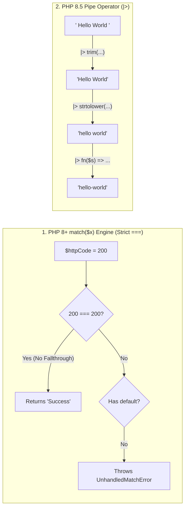

---
tags:
  - php
  - control-structures
  - match-expression
  - pipe-operator
  - loops
---

# Control Structures, Match & Pipe Operator in PHP

#### TL;DR (Quick Revision)

**PHP Control Structures & Flow** = Standard branching (`if`/`elseif`/`else`) and iteration (`foreach`, `for`, `while`, `do-while`) upgraded in modern PHP with the **strict, expression-based `match ()` construct** (replacing legacy `switch`) and the **PHP 8.5 Pipe Operator (`|>`)** for clean left-to-right data transformations.

> [!abstract] Core Idea
> Legacy PHP control flow suffered from three major pain points: `switch` used loose `==` comparisons with silent case fallthrough, `foreach` by reference (`&$val`) left a dangling pointer after the loop finished, and nested function calls (`array_values(array_filter(array_map(...)))`) had to be read inside-out. Modern PHP (`8.0–8.5+`) solves these with `match` (strict `===` comparison, returns a value, throws `UnhandledMatchError` if exhaustive cases are missed) and the PHP 8.5 Pipe Operator `|>` (passing the left-hand result directly into the right-hand callable).

> [!question] Why Master Modern PHP Control Flow?
>
> - **Eliminate `switch` Loose Type-Juggling Bugs**: `switch ($status)` uses `==` under the hood, meaning `case 0:` matches `"pending"` in legacy PHP or `"0"`, whereas `match ($status)` uses strict `===` identity[cite: 1].
> - **Write Expression-Driven Code**: Unlike `switch` or `if/else` statements, `match` is an **expression** that returns a value directly to a variable or `return` statement with zero `break;` boilerplate[cite: 1].
> - **Avoid the Infamous `foreach (&$value)` Memory Corruption Bug**: Understanding how PHP's loop reference binding persists after a `foreach` loop prevents silent overwriting of the last element of an array.
> - **Flatten Inside-Out Function Chains with `|>` (PHP 8.5+)**: The pipe operator `|>` turns unreadable nested calls like `strtoupper(trim($input))` into a clean, top-to-bottom pipeline: `$input |> trim(...) |> strtoupper(...)`[cite: 1].

#### Quick Reference Table: Legacy vs. Modern Control Flow in PHP 8.4/8.5+

| Operation / Concept     | Legacy / Error-Prone PHP             | Modern PHP 8.4/8.5+ (The Right Way)                     | Engine Behavior & Gotcha                                                                                                               |
| :---------------------- | :----------------------------------- | :------------------------------------------------------ | :------------------------------------------------------------------------------------------------------------------------------------- |
| **Multi-Way Branching** | `switch ($x) { case 1: ... break; }` | `$res = match ($x) { 1, 2 => 'A', default => 'B' };`    | `switch` uses loose `==` and falls through without `break`; `match` uses strict `===` and never falls through[cite: 1].                |
| **Else-If Keyword**     | `else if ($cond)` (2 words)          | `elseif ($cond)` (1 word — PSR-12)                      | PER / PSR-12 requires single-word `elseif` (moreover, two-word `else if` causes a syntax error in `:` template blocks!).               |
| **Array Iteration**     | `for ($i = 0; $i < count($a); $i++)` | `foreach ($items as $key => $val)`                      | Calling `count($a)` in a `for` condition re-evaluates on every iteration; `foreach` iterates internal hash buckets directly[cite: 1].  |
| **Nested Loop Exit**    | Flag variables (`$stopAll = true;`)  | `break 2;` or `continue 2;`                             | Accepts an integer depth specifying how many enclosing loops/switches to exit[cite: 1].                                                |
| **Function Chaining**   | `ucfirst(strtolower(trim($s)))`      | `$s \|> trim(...) \|> strtolower(...) \|> ucfirst(...)` | PHP 8.5 `\|>` passes the left expression as the single argument to the right callable[cite: 1].                                        |
| **File Inclusion**      | `include 'config.php';`              | `require_once __DIR__ . '/config.php';`                 | `include` only emits a Warning on missing files and keeps running; `require_once` throws a Fatal Error and prevents duplicate loading. |

---

## The Learning Concept

### What Problem Does It Solve?

In PHP, using a traditional `switch` statement on mixed types (like HTTP status codes, form strings, or boolean flags) or mutating an array with `foreach ($arr as &$val)` without unsetting `$val` produces bugs that are notoriously hard to spot during code review.

Look at this **`// BAD`** PHP snippet demonstrating both the `switch` loose-comparison trap and the `foreach` dangling-reference trap:

```php
<?php
// BAD - Legacy switch loose comparison + dangling foreach reference bug!

$httpCode = "200px"; // Invalid string input

// 1. switch uses loose (==) comparison and requires manual break statements!
switch ($httpCode) {
    case 200:
        $statusText = "OK";
        // Oops! Forgot break; -> silently falls through to case 404!
    case 404:
        $statusText = "Not Found";
        break;
    default:
        $statusText = "Unknown";
}

// 2. Dangling &$val reference after foreach loop corrupts the array!
$prices = [100, 200, 300];
foreach ($prices as &$val) {
    $val *= 2; // Doubles each price in-place: [200, 400, 600]
}
// DANGER: $val STILL points to$prices[2] (the last element, 600)!
// Reusing $val in a regular loop overwrites$prices[2] on every step!
foreach ($prices as $val) {
    // Iteration 1: $val = 200 (overwrites$prices[2] = 200)
    // Iteration 2: $val = 400 (overwrites$prices[2] = 400)
    // Iteration 3: $val = 400 (reads$prices[2], which is now 400!)
}
var_dump($prices); // [200, 400, 400] -> 600 was silently destroyed!
```

**Why this fails:** First, `switch` lacks fallthrough protection and uses loose `==` comparisons. Second, PHP does **not** create a new block scope for loops! When `foreach ($prices as &$val)` finishes, `$val` remains in the current scope as a reference to the last element (`$prices[2]`). Reusing `$val` immediately overwrites `$prices[2]`.

Now look at the **`// GOOD`** modern **PHP 8.4/8.5 + _PHP: The Right Way_** solution:

```php
<?php

declare(strict_types=1);

// GOOD - Strict match expression + array_map (or unset($val) after reference loop)

$httpCode = 200;

// 1. match uses strict (===) identity, returns a value directly, and never falls through!
$statusText = match ($httpCode) {
    200, 201 => 'Success',
    400, 422 => 'Client Error',
    404      => 'Not Found',
    500      => 'Server Error',
    default  => 'Unknown Status',
};

echo "Status: {$statusText}" . PHP_EOL;

// 2. If you use &$val in foreach, ALWAYS unset($val) immediately after the loop!
$prices = [100, 200, 300];
foreach ($prices as &$val) {
    $val *= 2;
}
unset($val); // Breaks the reference binding so $prices[2] can never be accidentally overwritten!

foreach ($prices as $val) {
    echo $val . ' '; // Safely outputs: 200 400 600
}
echo PHP_EOL;
```

---

### How PHP Implements Control Flow Under the Hood

> [!tip] 4 Core Rules of PHP's Execution Flow Engine
>
> 1. **No Block Scope for `if`, `for`, `foreach`, `while`, or `switch`**:
>    Unlike C++ or Java where a variable declared inside an `if { ... }` or `for { ... }` block dies at the closing `}`, **PHP only has Function Scope and File/Global Scope**! Any variable created inside an `if` branch or `foreach` loop remains alive in the surrounding function (or file) after the block ends.
> 2. **`match` Is a Strict Expression, Not a Statement**:
>    Introduced in PHP 8.0, `match ($subject) { ... };` evaluates to a value (so it **must end with a semicolon `;`** when assigned or returned). Each arm uses `=>`, supports comma-separated multiple conditions (`200, 201 => ...`), evaluates only a single expression per arm, and throws a fatal **`UnhandledMatchError`** if no arm matches and no `default` arm is provided.
> 3. **`foreach` Iterates over Copy-on-Write Hash Buckets**:
>    In PHP, `foreach ($array as $key => $value)` iterates over the internal doubly-linked order list of the PHP array. Because PHP uses **Copy-on-Write (CoW)**, `$value` is a value copy by default—modifying `$value` inside the loop does **not** mutate `$array` unless you explicitly write `foreach ($array as $key => &$value)`[cite: 1].
> 4. **The PHP 8.5 Pipe Operator (`|>`) Desugars Left-to-Right Calls**:
>    Introduced in **PHP 8.5**, `$value |> callable(...)` evaluates `$value` on the left and passes it as the **first (and only) argument** to the callable on the right, returning the result to the next `|>` stage in the pipeline without temporary `$step1`, `$step2` variables[cite: 1].

#### Full Runnable Example

Run this script via `php 03_control_flow.php` to see `if/elseif`, `match` with true-branch expressions, `foreach` array destructuring, multi-level `break 2`, and the PHP 8.5 Pipe Operator (`|>`)[cite: 1]:

```php
<?php

declare(strict_types=1);

// 1. Standard match() expression with multiple keys per arm (strict ===)
$role = 'editor';
$permissions = match ($role) {
    'admin', 'superadmin' => ['read', 'write', 'delete'],
    'editor', 'author'    => ['read', 'write'],
    'viewer'              => ['read'],
    default               => [],
};

// 2. Advanced match(true) pattern for range/boolean conditions!
$score = 88;
$grade = match (true) {
    $score >= 90 => 'A+',
    $score >= 80 => 'A',
    $score >= 70 => 'B',
    default      => 'C',
};
echo "Role perms: " . implode(', ', $permissions) . " | Grade: {$grade}" . PHP_EOL;

// 3. foreach with Symmetric Array Destructuring
$users = [
    ['id' => 1, 'name' => 'Valay', 'active' => true],
    ['id' => 2, 'name' => 'Arushi', 'active' => false],
    ['id' => 3, 'name' => 'Raavi', 'active' => true],
];

foreach ($users as ['id' => $id, 'name' => $name, 'active' => $isActive]) {
    if (!$isActive) {
        continue; // Skip inactive users
    }
    echo "Active User #{$id}: {$name}" . PHP_EOL;
}

// 4. Multi-level break (break 2 exits BOTH the inner AND outer loop!)
$matrix = [
    [10, 20, 30],
    [40, 99, 60],
    [70, 80, 90],
];

foreach ($matrix as $rowIndex => $row) {
    foreach ($row as $colIndex => $cell) {
        if ($cell === 99) {
            echo "Found target 99 at [{$rowIndex}][{$colIndex}] — aborting both loops!" . PHP_EOL;
            break 2; // Immediately breaks out of 2 enclosing loop levels!
        }
    }
}

// 5. PHP 8.5 Pipe Operator (|>) with First-Class Callables (...)
$rawTitle = "   PHP 8.5 Pipe Operator Mastery   ";

$slug = $rawTitle
    |> trim(...)
    |> strtolower(...)
    |> (fn(string $s): string => str_replace(' ', '-', $s));

echo "Generated Slug: {$slug}" . PHP_EOL;
```

**Output:**

```
Role perms: read, write | Grade: A
Active User #1: Valay
Active User #3: Raavi
Found target 99 at [1][1] — aborting both loops!
Generated Slug: php-8.5-pipe-operator-mastery
```

---

### Visual Diagram: `switch` vs `match` & PHP 8.5 Pipe Operator (`|>`)



---

### Key Terminology (Syntax Decoder)

1. **`elseif` vs `else if` (PSR-12 / PER Standard)**:
   In standard curly-brace `{}` blocks, PHP allows both `elseif` and `else if`. However, **PSR-12 / PER Coding Style strictly requires single-word `elseif`**, because two-word `else if` triggers a fatal **Parse Error** when used inside alternative colon syntax (`if ($a): ... elseif ($b): ... endif;`).
   Syntax: `if ($a) { ... } elseif ($b) { ... } else { ... }`

2. **`match ($subject) { ... };` (Strict Match Expression — PHP 8.0+)**:
   Evaluates `$subject` once and compares it against each arm using **strict identity (`===`)**[cite: 1].
   - **Key Rules**:
     1. Must be terminated with a semicolon `;` after the closing brace `}`.
     2. Multiple conditions on a single arm are separated by commas (`'a', 'b' => 1`), replacing `switch`'s stacked `case 'a': case 'b':`.
     3. Never falls through to the next arm (no `break` keyword needed or allowed).
     4. Throws an `UnhandledMatchError` exception if no arm matches and `default => ...` is omitted.
        Syntax: `$label = match ($status) { 1 => 'Active', 0 => 'Pending', default => 'Invalid' };`

3. **`|> ` (The Pipe Operator — PHP 8.5+)**:
   Passes the value of the left-hand expression as the single argument into the right-hand callable[cite: 1].
   - **How Multi-Argument Functions Work with `|>`**: Because `|>` passes only **1 argument** (the piped value), if you want to pipe into a multi-argument function like `str_replace('-', '_', $pipedStr)` or `array_filter($pipedArr, $callback)`, wrap that step in an arrow function: `|> (fn($s) => str_replace('-', '_', $s))`.
   - **Precedence**: `|>` executes left-to-right and has lower precedence than arithmetic/comparison operators (`+`, `.`, `===`), but higher precedence than `??` and assignment `=`.
     Syntax: `$result = $input |> trim(...) |> strtoupper(...);`

4. **`break N;` and `continue N;` (Multi-Level Loop Control)**:
   Both `break` and `continue` accept an optional constant integer argument (`break 2;`, `continue 2;`) that tells PHP how many levels of enclosing loops (`for`, `foreach`, `while`, `do-while`, or `switch`) to break out of or skip to the next iteration of[cite: 1].
   Syntax: `break 2;`

5. **Alternative Syntax for Control Structures (`:` and `endif;` / `endforeach;`)**:
   Designed specifically for native PHP HTML view templates so you don't have to hunt down cryptic closing `}` braces mixed into HTML tags. Replaces the opening `{` with a colon `:` and the closing `}` with `endif;`, `endforeach;`, `endfor;`, `endwhile;`, or `endswitch;`.
   Syntax:

   ```php
   <?php if ($isLoggedIn): ?>
       <p>Welcome back!</p>
   <?php endif; ?>
   ```

6. **`require`, `require_once`, `include`, and `include_once` (File Inclusion Constructs)**:
   Language constructs (no parentheses needed!) that evaluate another file at that point in execution:
   - **`include` / `include_once`**: If the file does not exist, PHP emits a non-fatal **`E_WARNING`** and **continues executing the script**! (Only use for optional view partials).
   - **`require` / `require_once`**: If the file does not exist, PHP throws a fatal **`Error` (CompileError)** and **halts execution immediately**.
   - **Why `__DIR__` Is Mandatory**: Relative paths like `require_once 'config.php';` resolve relative to the **entry script's current working directory (`getcwd()`)**, not the current file's folder! Always anchor paths with `__DIR__`: `require_once __DIR__ . '/config.php';`.

> [!important] Key Rules to Remember
>
> - **Prefer `match` Over `switch`** → `match` guarantees strict `===` comparisons, prevents accidental case fallthrough, and forces exhaustive handling via `UnhandledMatchError`[cite: 1].
> - **Always `unset($val)` After `foreach ($arr as &$val)`** → Leaving a loop reference variable bound will corrupt the last element of the array if `$val` is ever assigned to again.
> - **Never Put `count($arr)` Inside a `for` Loop Condition** → Writing `for ($i = 0; $i < count($arr); $i++)` calls `count()` on every single iteration; cache `$len = count($arr);` before the loop or use `foreach`.
> - **`switch` Counts as a Loop for `continue`!** → Inside a `switch` nested inside a `foreach`, writing `continue;` behaves like `break;` (exiting only the `switch`) and emits a PHP Warning! You must write **`continue 2;`** to skip to the next iteration of the outer `foreach` loop.

---

## Edge Case Analysis (Traps & Security Gotchas)

### 1. The `continue` Inside `switch` Inside `foreach` Trap

- **Problem**: In almost every other language, writing `continue;` inside a `switch` statement that lives inside a `for`/`foreach` loop skips to the next iteration of the **outer loop**. In PHP, the Zend Engine internally treats **`switch` itself as a loop structure** for the purposes of `break` and `continue`! Therefore, writing `continue;` inside a `switch` merely breaks out of the `switch` (executing the rest of the loop body!) and triggers:
  `Warning: "continue" targeting switch is equivalent to "break". Did you mean to use "continue 2"?`
- **Fix**: Either replace the `switch` with a `match` expression, or explicitly write **`continue 2;`** to target the outer loop.

```php
<?php

declare(strict_types=1);

$items = ['valid', 'skip_me', 'also_valid'];

foreach ($items as $item) {
    switch ($item) {
        case 'skip_me':
            // BAD: continue; only exits the switch and emits a PHP Warning!
            // GOOD: continue 2; exits the switch (level 1) AND skips the foreach iteration (level 2)!
            continue 2;
    }
    echo "Processed: {$item}" . PHP_EOL;
}
```

### 2. The `match (true)` Pattern vs. `match ($var)` Inversion Trap

- **Problem**: Developers love using `match (true)` to evaluate boolean expressions (`match (true) { $age >= 18 => 'Adult', default => 'Minor' }`). However, if you accidentally write `match ($age) { $age >= 18 => 'Adult' }`, PHP evaluates `$age >= 18` to `bool(true)` and then compares `$age === true`! Because an integer like `25` is not strictly identical (`===`) to `bool(true)`, the match arm **always fails**!
- **Fix**: When match arms contain boolean expressions (`>=`, `<`, `str_starts_with()`, etc.), the subject inside `match (...)` **must** be `match (true)`, never `match ($var)`.

```php
<?php

declare(strict_types=1);

$age = 25;

// BAD - Compares int(25) === bool(true), which is ALWAYS false!
$badResult = match ($age) {
    $age >= 18 => 'Adult',
    default    => 'Minor', // Always hits default!
};

// GOOD - Compares bool(true) === bool(true)!
$goodResult = match (true) {
    $age >= 18 => 'Adult',
    default    => 'Minor',
};

var_dump($badResult, $goodResult); // string(5) "Minor", string(5) "Adult"
```

### 3. Modifying an Array Inside `foreach` (Value Copy vs Reference)

- **Problem**: Because `foreach ($items as $key => $val)` operates on a Copy-on-Write snapshot of the array, appending or removing elements from `$items` inside the loop body (`$items[] = 'new'`) does **not** cause the active `foreach` loop to visit the newly added elements. Conversely, mutating `$val` directly (`$val = strtoupper($val)`) only mutates the temporary loop variable, leaving `$items` unchanged.
- **Fix**: To mutate array elements in-place during a `foreach` without creating a dangling `&$val` reference, assign directly to the key: **`$items[$key] = strtoupper($val);`**.

```php
<?php

declare(strict_types=1);

$names = ['valay', 'arushi'];

// GOOD - Mutate via $names[$key] to avoid needing &$val and unset($val) altogether!
foreach ($names as $index => $name) {
    $names[$index] = ucfirst($name);
}

var_dump($names); // ['Valay', 'Arushi']
```

### 4. Local File Inclusion (LFI) & Remote Code Execution via `include` / `require` (CTF Vulnerability)

- **Problem**: In PHP, `include` and `require` don't just read a file—they **parse and execute any `<?php ... ?>` tags inside that file**! Even if an attacker uploads a file named `avatar.jpg` containing `<?php system($_GET['cmd']); ?>`, passing `?page=uploads/avatar.jpg` to `include $_GET['page'];` will execute the embedded PHP payload as server code! Worse, attackers can use PHP stream wrappers like `?page=php://filter/convert.base64-encode/resource=config.php` to dump your source code in Base64[cite: 1].
- **Fix**: **Never** pass user input directly into `include`, `require`, `include_once`, or `require_once`. Always map user input through a strict `match` allowlist of hardcoded file paths!

```php
<?php

declare(strict_types=1);

$requestedTab = $_GET['tab'] ?? 'dashboard';

// BAD (CRITICAL LFI / RCE VULNERABILITY) - Attacker passes ?tab=../../../../etc/passwd or php://filter!
// include __DIR__ . '/views/' . $requestedTab . '.php';

// GOOD - Strict match() allowlist guarantees only known files can ever be loaded!
$viewFile = match ($requestedTab) {
    'dashboard' => __DIR__ . '/views/dashboard.php',
    'settings'  => __DIR__ . '/views/settings.php',
    'profile'   => __DIR__ . '/views/profile.php',
    default     => __DIR__ . '/views/404.php',
};
```

---

## Going Deeper (Intermediate -> Advanced & _PHP: The Right Way_ Integration)

### 1. PHP 8.5 Pipe Operator (`|>`) Deep Dive

Before **PHP 8.5**, transforming data through 4 sequential steps required one of three awkward choices:

1. **Inside-Out Nesting**: `array_sum(array_map('intval', array_filter(explode(',', $csv))))` (you have to read from the rightmost inner parenthesis outward).
2. **Temporary Variable Clutter**: `$a = explode(...); $b = array_filter($a); $c = array_map(..., $b);`
3. **Custom Wrapper Classes**: Wrapping scalars/arrays into framework `Collection` or `Stringable` objects.

With **PHP 8.5's native Pipe Operator (`|>`)**, any expression can be piped through any sequence of PHP callables (first-class callables `func(...)`, arrow functions `fn($x) => ...`, static methods `Class::method(...)`, or invokable objects) with zero object wrapper overhead[cite: 1]:

```php
<?php

declare(strict_types=1);

$rawCsvScores = " 10, 25, , 40, invalid, 50 ";

// Clean, top-to-bottom native PHP 8.5 pipeline:
$totalScore = $rawCsvScores
    |> (fn(string $csv): array => explode(',', $csv))
    |> (fn(array $parts): array => array_map(trim(...), $parts))
    |> (fn(array $parts): array => array_filter($parts, is_numeric(...)))
    |> (fn(array $nums): array => array_map(intval(...), $nums))
    |> array_sum(...);

var_dump($totalScore); // int(125)
```

### 2. _PHP: The Right Way_ — Native PHP Templates vs. Compiled Engines (Blade / Twig)

As highlighted in **[PHP: The Right Way — Templating](https://phptherightway.com/#templating)**, PHP itself was born as a templating language using alternative control structure syntax (`if (...): ... endif;`, `foreach (...): ... endforeach;`, and `<?= htmlspecialchars($var) ?>`).
Modern frameworks like **Laravel (Blade)** and **Symfony (Twig)** compile clean template tags directly down into this exact native PHP alternative syntax cached on disk:

- Blade's `@if ($user->isAdmin())` compiles to `<?php if($user->isAdmin()): ?>`
- Blade's `@endforeach` compiles to `<?php endforeach; ?>`
- Blade's `{{ $title }}` compiles to `<?php echo e($title); ?>` (`htmlspecialchars()`)

Understanding PHP's alternative colon syntax (`:` / `endif;`) means you can debug compiled framework view caches (`storage/framework/views/*.php`) effortlessly!

---

## Interview Corner

### Common Questions & Concise Answers

**Q1: What are the four main differences between `switch` and `match` in PHP 8+?**
**A:**

1. **Comparison**: `switch` uses loose comparison (`==`), whereas `match` uses strict identity (`===`)[cite: 1].
2. **Return Value**: `match` is an expression that returns a value directly; `switch` is a statement.
3. **Fallthrough**: `switch` falls through to subsequent cases unless `break;` is used; `match` arms never fall through and support comma-separated keys (`1, 2 => 'val'`).
4. **Exhaustiveness**: `match` throws an `UnhandledMatchError` if no condition matches and `default` is omitted, whereas `switch` silently does nothing.

**Q2: Why is `foreach ($arr as &$val)` dangerous if you don't call `unset($val)` afterward?**
**A:** Because PHP loops do not have isolated block scope, `$val` remains alive after the `foreach` loop finishes and continues pointing as a reference to the **last element** of `$arr`. Any subsequent assignment to `$val` (including using `$val` as the loop variable in a second `foreach` loop!) will silently overwrite the last element of `$arr`.

**Q3: What is the difference between `include`, `require`, `include_once`, and `require_once`?**
**A:** If a target file is missing, `include` emits a non-fatal Warning (`E_WARNING`) and continues script execution, whereas `require` throws a fatal `CompileError` and halts the script immediately. The `_once` variants (`include_once` / `require_once`) check whether the file has already been included during the current request and skip it to prevent "Cannot redeclare function/class" fatal errors.

**Q4: What happens if you write `continue;` inside a `switch` statement that is nested inside a `foreach` loop?**
**A:** In PHP, `switch` is treated as a loop-like construct by `continue`. Therefore, `continue;` inside a `switch` only exits the `switch` block (identical to `break;`) and emits a compiler Warning. To skip to the next iteration of the outer `foreach` loop, you must write `continue 2;`.

**Q5: How does the PHP 8.5 Pipe Operator (`|>`) work, and what restriction does it have on callables?**
**A:** `$left |> $right` evaluates `$left` and passes the result as the **single argument** to the callable `$right`[cite: 1]. Because the callable on the right must accept the piped value as its first required parameter, functions that take multiple parameters (or take the subject in the 2nd/3rd position, like `explode(',', $str)`) must be wrapped in a lightweight arrow function: `|> (fn($s) => explode(',', $s))`.

---

### Interactive Revision Quiz

**Q1: What is the result of the following `match` expression in PHP 8.4/8.5?**

```php
$input = "200";
$result = match ($input) {
    200 => "OK",
    404 => "Not Found",
};
```

- [ ] A) `$result` is `"OK"` because `"200"` matches `200`.
- [ ] B) `$result` is `null` because no arm matched.
- [ ] C) It throws a fatal `UnhandledMatchError` because `match` uses strict `===` comparison (`"200" !== 200`) and there is no `default` arm.
- [ ] D) It throws a `ParseError` because `break;` is missing.

**Q2: What is the output of this code snippet?**

```php
$nums = [1, 2, 3];
foreach ($nums as &$n) {
    $n *= 10;
}
foreach ($nums as $n) {}
echo implode(',', $nums);
```

- [ ] A) `10,20,30`
- [ ] B) `10,20,20`
- [ ] C) `1,2,3`
- [ ] D) Throws a Fatal Reference Error

**Q3: Inside a `foreach` loop containing a `switch` statement, which statement correctly skips the rest of the current `foreach` iteration and moves to the next element?**

- [ ] A) `continue;`
- [ ] B) `break;`
- [ ] C) `continue 2;`
- [ ] D) `break 2;`

**Q4: Which syntax is valid in PHP 8.5 using the Pipe Operator (`|>`)?**

- [ ] A) `$clean = " hello " |> trim(...) |> strtoupper(...);`
- [ ] B) `$clean = " hello " |> trim() |> strtoupper();`
- [ ] C) `$clean = " hello " -> trim(...) -> strtoupper(...);`
- [ ] D) `$clean = " hello " => trim(...) => strtoupper(...);`

**Q5: Why should you write `elseif` (one word) instead of `else if` (two words) in PHP?**

- [ ] A) Because `else if` is a syntax error inside standard `{}` blocks in PHP 8.4+.
- [ ] B) Because `else if` executes twice as slowly in the Zend Engine.
- [ ] C) Because PSR-12 / PER Coding Style mandates `elseif`, and `else if` causes a fatal Parse Error when used with PHP's alternative colon syntax (`if (...): ... endif;`).
- [ ] D) Because `else if` uses loose comparison while `elseif` uses strict comparison.

<details>
<summary>Show Quiz Answers & Explanations</summary>

1. **C** — `match` uses strict identity (`===`), so string `"200"` does not match integer `200`. Because there is no `default` arm, PHP throws an `UnhandledMatchError`[cite: 1].
2. **B** — After the first `foreach`, `$nums` is `[10, 20, 30]`, and `$n` is still a reference to `$nums[2]`. In the second `foreach ($nums as $n)`, Iteration 1 assigns `$n = 10` (`$nums` becomes `[10, 20, 10]`), Iteration 2 assigns `$n = 20` (`$nums` becomes `[10, 20, 20]`), and Iteration 3 reads `$nums[2]` (which is now `20`) and assigns `$n = 20`, leaving `10,20,20`!
3. **C** — Because PHP treats `switch` as level 1 for loop control constructs, `continue 2;` is required to target the outer `foreach` loop (level 2)[cite: 1].
4. **A** — PHP 8.5's pipe operator `|>` requires a valid callable on the right-hand side (such as PHP 8.1+ first-class callable syntax `trim(...)` or an arrow function `fn($x) => ...`), whereas `trim()` would immediately execute `trim()` with 0 arguments and fail[cite: 1].
5. **C** — PER / PSR-12 enforces single-word `elseif`, and using `else if` inside colon-delimited template blocks (`if ($a): ... else if ($b): ... endif;`) is a syntax error in PHP.

</details>

---

## Practice Exercises

### Exercise 1: Basic — Strict HTTP Router with `match`

Write a function `resolveRoute(string $method, string $path): string` using `declare(strict_types=1);` and a `match` expression on the array pair `[$method, $path]` (yes, `match` can strictly compare arrays like `match ([$method, $path]) { ['GET', '/users'] => ... }`!). Map `['GET', '/users']` to `'UserController@index'`, `['POST', '/users']` to `'UserController@store'`, and use `default` to return `'Error404Controller'`.

### Exercise 2: Intermediate — PHP 8.5 Pipe Operator (`|>`) Sanitizer Pipeline

Given an array of messy tags `$rawTags = ["  PHP 8.5 ", "", "LARAVEL  ", "  ", "cti_security "];`, write a single PHP 8.5 `|>` pipeline that:

1. Trims every string using `array_map(trim(...), ...)`.
2. Filters out empty strings `""` using `array_filter(..., fn(string $s): bool => $s !== '')`.
3. Converts every remaining tag to lowercase.
4. Re-indexes the array cleanly using `array_values(...)`.

### Exercise 3: Security / Bug Hunt — Fix the 3 Control-Flow Bugs

Audit and fix the 3 control-flow bugs in this legacy order processor (1: `switch` loose comparison + `continue` inside `switch`, 2: dangling `&$order` reference, 3: LFI vulnerability in `include`):

```php
<?php
$orders = [
    ['id' => 1, 'status' => 'cancelled', 'total' => 500],
    ['id' => 2, 'status' => 0,           'total' => 1000],
];

foreach ($orders as &$order) {
    switch ($order['status']) {
        case 'cancelled': continue; // Bug 1: Inside switch + loose comparison matches status 0 in PHP 7!
    }
    $order['total'] *= 1.18;
}
// Bug 2: Missing unset($order) before reusing $order!

$exportFormat = $_GET['format'] ?? 'json';
// Bug 3: LFI vulnerability!
include "exporters/{$exportFormat}.php";
```

---

## Memory Trick / One-Liner

> [!tip] The "Match for Branches, Pipe for Chains, Unset for Refs" Mantra
>
> - Branching on values? Reach for **`match ($x)`** (strict `===`, returns a value, zero `break;` bugs)[cite: 1].
> - Chaining transformations? Reach for **`|>`** (left-to-right flow, zero nested parentheses)[cite: 1].
> - Looping with `&$val`? Put **`unset($val);`** on the very next line (or mutate `$arr[$key]` directly!).
>   **Takeaway Formula:** **`match` > `switch` + `|>` > Nested Calls + `require_once __DIR__` > `include`.**

---

## Warning Block (Best Practice)

> [!warning] Common Mistake (Avoid This!)
>
> ```php
> <?php
> // BAD - Calling count() on every iteration, using switch with loose ==, and unanchored include
> include 'helpers.php';
>
> for ($i = 0; $i < count($records); $i++) {
>     switch ($records[$i]['type']) {
>         case 1:
>             processPrimary($records[$i]);
>             break;
>     }
> }
> ```
>
> ```php
> <?php
>
> declare(strict_types=1);
>
> // GOOD - Anchored require_once with __DIR__, direct foreach, and strict match() expression
> require_once __DIR__ . '/helpers.php';
>
> foreach ($records as $record) {
>     match ($record['type']) {
>         1       => processPrimary($record),
>         default => null,
>     };
> }
> ```
