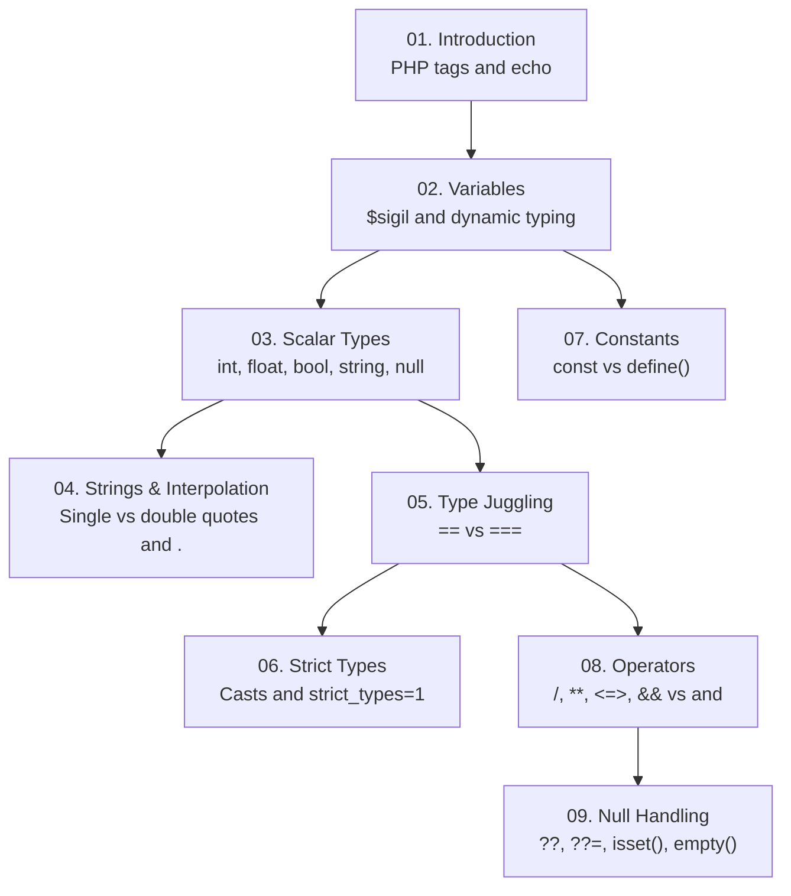

---
tags:
  - php
  - overview
  - foundations
  - beginner
---

# 01. Foundations — Overview

## Concept Map

## Cheat-Sheet Table

| Note                          | Core Rule                                                         | Watch Out For                                                                 |
| ----------------------------- | ----------------------------------------------------------------- | ----------------------------------------------------------------------------- |
| `01. Introduction`            | Code runs inside `<?php`; text outside prints literally           | Omit closing `?>` in pure-PHP files; `echo` adds no spaces/newlines           |
| `02. Variables`               | Every variable starts with `$` and is case-sensitive              | `$Pages` and `$pages` are different; never start with a digit                 |
| `03. Scalar Types`            | `int`, `float`, `bool`, `string`, plus `null`                     | `echo false` prints nothing; `4.0` is `float`; use `var_dump()`               |
| `04. Strings & Interpolation` | `'...'` is literal; `"..."` expands `{$var}` and `\n`; `.` joins  | `"Book" + "1"` throws `TypeError`; use `{$var}` before letters                |
| `05. Type Juggling`           | Default to `===` and `!==` (no type conversion)                   | `0 == false` and `"01" == "1"` are `true`; `0 == "Dune"` is `false` in PHP 8+ |
| `06. Strict Types`            | `declare(strict_types=1);` at line 2 blocks silent arg conversion | Applies per file; `(int) "Dune"` silently returns `0`                         |
| `07. Constants`               | No `$` sigil; `const` for top-level, `define()` for runtime/`if`  | Constants do not interpolate inside `"..."`; join with `.`                    |
| `08. Operators`               | Use `&&`/`\|\|`, `intdiv()`, `**`, and `<=>` (`-1`, `0`, `1`)     | `$ok = true and false;` sets `$ok` to `true`; no `1 < $x < 5` chaining        |
| `09. Null Handling`           | `??` and `isset()` only treat `null`/undefined as missing         | `empty(0)` and `empty("")` are `true`, while `0 ?? 5` keeps `0`               |

## Folder Boss Quiz (Notes 01–09)

**Q1 (Notes 01 & 04): What does `<?php $n = 2; echo 'Book$n', "\n", "Book {$n}nd";` print?**

- [ ] A) `Book 2` and `Book 2nd` on two lines
- [ ] B) `Book $n` and `Book 2nd` on two lines
- [ ] C) `Book $n\nBook 2nd` on one line
- [ ] D) A syntax error because single and double quotes cannot be mixed in `echo`

**Q2 (Notes 02 & 03): You run `$a = 4.0; $b =$a; $a = 9; var_dump($b);`. What does PHP print?**

- [ ] A) `int(4)`
- [ ] B) `float(4)`
- [ ] C) `int(9)`
- [ ] D) `float(9)`

**Q3 (Notes 03 & 05): Which expression evaluates to `bool(true)` in PHP 8.4?**

- [ ] A) `0 == "Dune"`
- [ ] B) `412 === "412"`
- [ ] C) `"01" == "1"`
- [ ] D) `null === ""`

**Q4 (Notes 04 & 07): With `const LIMIT = 50;`, what does `echo "Max: LIMIT" . "!";` output?**

- [ ] A) `Max: 50!`
- [ ] B) `Max: LIMIT!`
- [ ] C) `Max: !`
- [ ] D) A syntax error

**Q5 (Notes 05 & 06): With `declare(strict_types=1);` on line 2, what happens when you run `echo intdiv((int) "10", 3);`?**

- [ ] A) Throws a `TypeError` because `"10"` started as a string
- [ ] B) Prints `3`
- [ ] C) Prints `3.3333333333333`
- [ ] D) Prints `0`

**Q6 (Notes 06 & 07): Which line causes a syntax error or fatal error in PHP 8.4?**

- [ ] A) `if (true) { define("MODE", "dev"); }`
- [ ] B) `if (true) { const MODE = "dev"; }`
- [ ] C) `$x = (int) "Dune";`
- [ ] D) `$_book = 1;`

**Q7 (Notes 03 & 08): What does `var_dump(10 / 4, 10 <=> 4);` print?**

- [ ] A) `int(2)` and `int(1)`
- [ ] B) `float(2.5)` and `int(1)`
- [ ] C) `float(2.5)` and `int(-1)`
- [ ] D) `int(2)` and `bool(true)`

**Q8 (Notes 08 & 09): What does `$ok = false || true; $bad = false or true; var_dump($ok, $bad);` output?**

- [ ] A) `bool(true)` and `bool(true)`
- [ ] B) `bool(true)` and `bool(false)`
- [ ] C) `bool(false)` and `bool(true)`
- [ ] D) `bool(false)` and `bool(false)`

**Q9 (Notes 05 & 09): With `$pages = 0;`, which check evaluates to `false`?**

- [ ] A) `isset($pages)`
- [ ] B) `empty($pages)`
- [ ] C) `$pages == false`
- [ ] D) `$pages === false`

**Q10 (Notes 02, 06 & 09): You run `$raw = ""; $pages = $raw ?? 100; var_dump($pages, empty($pages));` with no warnings. What prints?**

- [ ] A) `int(100)` and `bool(false)`
- [ ] B) `string(0) ""` and `bool(true)`
- [ ] C) `string(0) ""` and `bool(false)`
- [ ] D) `NULL` and `bool(true)`

 
◈ View Answers & Explanations

1. **B** — Single quotes keep `$n` literal (`Book $n`), `"\n"` adds a newline, and double quotes interpolate `{$n}` into `Book 2nd`.

2. **B** — `4.0` is a `float`, `$b =$a` copies `4.0` into `$b`, and changing `$a` later leaves `$b` at `float(4)`.

3. **C** — Two numeric strings compared with `==` are compared as numbers (`1 == 1`), which is `true`. In PHP 8+, `0 == "Dune"` is `false`, and `===` rejects mismatched types in B and D.

4. **B** — Constants do not interpolate inside double quotes, so `LIMIT` prints literally as `Max: LIMIT!`.

5. **B** — `(int) "10"` explicitly casts `"10"` to `int(10)` before `intdiv()` receives it, so `intdiv(10, 3)` returns `3` with no `TypeError`.

6. **B** — `const` is resolved at compile time and cannot be placed inside an `if` block; `define()` works inside `if`, `(int) "Dune"` returns `0`, and `$_book` is a valid variable name.

7. **B** — `/` returns `float(2.5)` when numbers do not divide evenly, and `10 <=> 4` returns `int(1)` because the left side is larger.

8. **B** — `||` has higher precedence than `=`, so `$ok = (false \vert{}\vert{} true)` becomes `true`; `or` has lower precedence than `=`, so `($bad = false) or true` sets `$bad` to `false`.

9. **D** — `0 === false` is `false` because `int` and `bool` are different types. `isset(0)`, `empty(0)`, and `0 == false` are all `true`.

10. **B** — `??` only falls back on `null` or undefined, so `$pages` keeps `string(0) ""`, and `empty("")` returns `bool(true)`.

