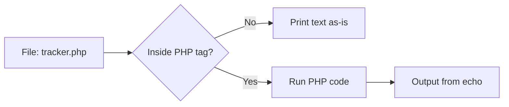

---
tags:
  - php
  - introduction
  - beginner
---

# Introduction

## TL;DR

PHP is a **server-side** scripting language: it runs on a server (or in your terminal) before a web browser ever sees the page. Inside a `.php` file, PHP prints any text outside an opening **PHP tag** (`<?php`) literally as plain text, and runs only the code inside.

> [!NOTE] Prerequisites: None
> New terms: server-side, PHP tag, echo, syntax error

> [!abstract] Core Idea
> A `.php` file outputs text outside `<?php ... ?>` literally and executes only the code inside `<?php ... ?>`.
> PHP's `php script.php` works like Python's `python script.py`, except PHP uses `<?php` to enter code mode and `;` to end every statement like Java.

## Mental Model

Think of a `.php` file like a form letter with highlighted instruction boxes. A printer copies every ordinary word onto the page as-is, and only runs the instructions inside a highlighted `<?php` box to fill in dynamic text.



## Windows Setup & Minimal Example

On Windows, download the **x64 Non-Thread-Safe** ZIP from [php.net](https://www.php.net/downloads.php), extract it to `C:\php`, add `C:\php` to your Windows `PATH`, and confirm in PowerShell with `php -v` (it should print `PHP 8.4.x`).

Save this as `tracker.php` and run `php tracker.php`:

```php
<?php

echo "Book Tracker\n";
echo "Books: ", 0;
```

Expected output:

```text
Book Tracker
Books: 0
```

- `<?php` ▸ **PHP tag**: switches PHP into code mode; it must be followed by a space or newline.
- `echo` ▸ built-in output command (not a regular function) that prints one or more comma-separated values with no automatic spaces or newlines.
- `;` ▸ ends each statement, just like in Java.
- No closing `?>` ▸ pure-PHP files leave `?>` off at the end so accidental trailing spaces are not printed.

## Compare

| Tag            | Meaning                              | Typical use                        |
| -------------- | ------------------------------------ | ---------------------------------- |
| `<?php ... ?>` | Standard PHP tag                     | Running one or more PHP statements |
| `<?= ... ?>`   | Short echo tag (`<?php echo ... ?>`) | Printing one value inside HTML     |

## ◈ Edge Case Analysis

✗ **Mistake 1:** Closing a pure-PHP file with `?>` followed by blank lines or spaces, which PHP prints as unintended output.

```php
<?php
echo "Done";
?>

```

✓ **Fix:** Omit the closing `?>` tag in files that contain only PHP code.

```php
<?php
echo "Done";
```

✗ **Mistake 2:** Omitting the space or newline right after `<?php`, which causes a **syntax error** (an error where PHP stops because code breaks a grammar rule).

```php
<?phpecho "Hi";
```

✓ **Fix:** Always put a space or newline immediately after `<?php`.

```php
<?php echo "Hi";
```

✗ **Mistake 3:** Expecting `echo` to add spaces or newlines automatically like Python's `print()`, which instead glues values together on one line.

```php
<?php
echo "Book", 1;
```

✓ **Fix:** Include spaces and `"\n"` inside your text whenever you want spacing or line breaks.

```php
<?php
echo "Book ", 1, "\n";
```

## Try It

- 1. Write a pure-PHP script (no closing `?>`) that prints `Book Tracker` on line 1 and `Ready` on line 2 using one `echo` statement.
- 2. Write a short HTML snippet that uses `<?= ... ?>` to print `1984` inside `<p>...</p>` tags.

<details>
<summary>◈ View Solution</summary>

1.

```php
<?php

echo "Book Tracker\n", "Ready\n";
```

2.

```php
<p><?= "1984" ?></p>
```

</details>

## Topic Mastery Quiz

**Q1: When a user visits a `.php` web page, where does the PHP code run?**

- [ ] A) On the server before the browser receives the page
- [ ] B) Inside the browser's JavaScript engine
- [ ] C) Inside the user's Windows PowerShell window
- [ ] D) Only after the user clicks a button on the page

**Q2: What does `<?php echo "Book", 1;` print?**

- [ ] A) `Book 1` followed by a newline
- [ ] B) `Book1` followed by a newline
- [ ] C) `Book1` with no space and no trailing newline
- [ ] D) A syntax error because `echo` only takes one value

**Q3: Why should a pure-PHP file omit the closing `?>` tag?**

- [ ] A) Closing `?>` is removed in PHP 8.4
- [ ] B) It prevents accidental trailing spaces or blank lines from being printed as output
- [ ] C) `php script.php` refuses to run files that contain `?>`
- [ ] D) Omitting `?>` makes `echo` add automatic newlines

**Q4: What happens when you run `<?phpecho "Hi";` with no space after `<?php`?**

- [ ] A) PHP prints `Hi` normally
- [ ] B) PHP prints `<?phpecho "Hi";` as plain text
- [ ] C) PHP stops with a syntax error
- [ ] D) PHP ignores the line and exits silently

**Q5: Which tag is a built-in shorthand for `<?php echo "Dune" ?>`?**

- [ ] A) `<?= "Dune" ?>`
- [ ] B) `<? "Dune" ?>`
- [ ] C) `<?echo "Dune" ?>`
- [ ] D) `<php= "Dune" ?>`

**Q6: You run `php -v` in PowerShell after installing PHP on Windows. What does a version line like `PHP 8.4.x` confirm?**

- [ ] A) A web server is running on port 80
- [ ] B) PHP is installed and available on your system `PATH`
- [ ] C) Your `tracker.php` file has no syntax errors
- [ ] D) Short echo tags are disabled

<details>
<summary>◈ View Answers & Explanations</summary>

1. **A** — PHP is a server-side language that executes on the server before sending output to the browser. B, C, and D describe client-side or local terminal behavior.
2. **C** — `echo` prints comma-separated values directly with no automatic spaces or newlines. A and B wrongly add spacing or newlines; D is false because `echo` accepts multiple comma-separated values.
3. **B** — Any spaces or blank lines after `?>` sit outside PHP mode and are printed literally. A, C, and D are false.
4. **C** — `<?php` must be followed by a space or newline, so `<?phpecho` causes a syntax error. A, B, and D do not happen.
5. **A** — `<?= ... ?>` is the short echo tag equivalent to `<?php echo ... ?>`. B, C, and D are invalid or non-equivalent syntax.
6. **B** — `php -v` prints the installed PHP version when `C:\php` is reachable on `PATH`. A, C, and D are unrelated to `php -v`.

</details>

## One-Liner

> [!tip] PHP's On/Off Switch

> [!quote] Sources
>
> - [PHP Manual — PHP tags](https://www.php.net/manual/en/language.basic-syntax.phptags.php)
> - [PHP Manual — echo](https://www.php.net/manual/en/function.echo.php)
> - [PHP Manual — Manual installation on Windows](https://www.php.net/manual/en/install.windows.manual.php)
