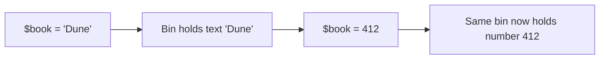

---
tags:
  - php
  - variables
  - beginner
---

# Variables

## TL;DR

Every PHP variable starts with a `$` **sigil** (a prefix symbol marking a variable) and needs no type keyword before it. PHP uses **dynamic typing**, meaning the same variable can hold text now and a number later.

> [!NOTE] Prerequisites: 01
> New terms: sigil, dynamic typing, undefined variable

> [!abstract] Core Idea
> A PHP variable is a `$name` container created on first assignment (`=`) that can change its value type at any time.
> PHP variables work like Python variables (dynamically typed, no type keyword), except every variable name must start with `$` and cannot be used without it.

## Mental Model

Think of a PHP variable like a labeled storage bin with a `$` sticker on the front. You can put a book title in the bin today and swap it for a page count tomorrow without buying a new bin—as long as you always call the bin by its `$` sticker and exact letter case.



## Minimal Example

Save this as `variables.php` and run `php variables.php`:

```php
<?php

$title = "Dune";
$pages = 412;
$copy = $pages;
$pages = 500;
$title = 1965;

echo $title, "\n";
echo $copy;
```

Expected output:

```text
1965
412
```

- `$title` ▸ `$` is PHP's variable **sigil**; the name after `$` must start with a letter or `_` (never a digit).
- `$copy = $pages;` ▸ copies the current value (`412`) into `$copy`, so changing `$pages` to `500` later does not change `$copy`.
- `$title = 1965;` ▸ replaces `"Dune"` with `1965` because of **dynamic typing** (a variable's value type can change freely).
- `echo $title, "\n";` ▸ prints the latest value in `$title` (`1965`) followed by a newline.

## ◈ Edge Case Analysis

✗ **Mistake 1:** Leaving off the `$` sigil when assigning or reading a variable, which causes a **syntax error** and stops the script.

```php
<?php
title = "Dune";
```

✓ **Fix:** Always write `$` in front of every variable name, both when assigning and when reading it.

```php
<?php
$title = "Dune";
```

✗ **Mistake 2:** Changing letter case (such as `$Pages` instead of `$pages`), because PHP variable names are case-sensitive; PHP treats `$Pages` as an **undefined variable** (a variable read before any value is assigned), prints a warning, and outputs nothing.

```php
<?php
$pages = 412;
echo $Pages;
```

✓ **Fix:** Match the exact uppercase and lowercase letters of the variable name everywhere.

```php
<?php
$pages = 412;
echo $pages;
```

✗ **Mistake 3:** Starting a variable name with a digit right after `$`, which causes a syntax error immediately.

```php
<?php
$1stBook = "Dune";
```

✓ **Fix:** Begin the name after `$` with a letter or an underscore `_`.

```php
<?php
$firstBook = "Dune";
```

## Try It

- 1. Create a variable `$_bookId` set to `101`, copy it into `$backupId`, reassign `$_bookId` to `202`, and `echo` both separated by a space.
- 2. Create `$status` set to `"reading"`, overwrite it with `1`, and `echo` `$status`.

<details>
<summary>◈ View Solution</summary>

1.

```php
<?php

$_bookId = 101;
$backupId = $_bookId;
$_bookId = 202;

echo $_bookId, " ", $backupId;
```

2.

```php
<?php

$status = "reading";
$status = 1;

echo $status;
```

</details>

## Topic Mastery Quiz

**Q1: Which of the following is an invalid PHP variable name?**

- [ ] A) `$_book`
- [ ] B) `$book2`
- [ ] C) `$2ndBook`
- [ ] D) `$Book_Title`

**Q2: You run `$book = "Dune";` and then `$book = 412;` on the next line. What happens?**

- [ ] A) PHP throws a type error because `$book` already holds text
- [ ] B) `$book` is updated to hold `412` because PHP uses dynamic typing
- [ ] C) PHP converts `412` back to `"Dune"`
- [ ] D) PHP creates a second variable named `$book2`

**Q3: You set `$pageCount = 300;` and then run `echo $pagecount;` in PHP 8.4. What happens?**

- [ ] A) It prints `300` because variable names are case-insensitive
- [ ] B) PHP treats `$pagecount` as an undefined variable, emits a warning, and prints nothing for it
- [ ] C) It prints `0` without any warning
- [ ] D) It prints `$pagecount` as literal text

**Q4: What happens if you write `title = "1984";` without a `$`?**

- [ ] A) PHP treats `title` as a regular variable
- [ ] B) PHP creates a variable named `$title` automatically
- [ ] C) PHP stops with a syntax error
- [ ] D) PHP prints `1984`

**Q5: Which character is allowed immediately after `$` at the start of a PHP variable name?**

- [ ] A) A digit like `1`
- [ ] B) A hyphen `-`
- [ ] C) An underscore `_`
- [ ] D) A space

**Q6: What does `<?php $a = 5; $b =$a; $a = 9; echo$b;` print?**

- [ ] A) `5`
- [ ] B) `9`
- [ ] C) `59`
- [ ] D) Nothing, because `$b` was overwritten

<details>
<summary>◈ View Answers & Explanations</summary>

1. **C** — A variable name after `$` must start with a letter or `_`, never a digit. A, B, and D all follow PHP naming rules.
2. **B** — Dynamic typing lets a variable switch from text to a number on reassignment. A, C, and D do not happen.
3. **B** — PHP variable names are case-sensitive, so `$pagecount` is a separate undefined variable that emits a warning and produces no output. A, C, and D are false.
4. **C** — Missing the `$` sigil on an assignment breaks PHP's syntax rules and triggers a syntax error. A, B, and D do not happen.
5. **C** — Only letters or `_` may appear right after `$`. Digits, hyphens, and spaces are invalid as the first character after `$`.
6. **A** — `$b =$a` copies the value `5` into `$b`, so reassigning `$a = 9` later leaves `$b` untouched at `5`.

</details>

## One-Liner > [!tip] The Dollar Rule > **Every PHP variable wears a `$` sigil, respects exact letter case, and can change value types anytime.**

> [!quote] Sources
>
> - [PHP Manual — Variable Basics](https://www.php.net/manual/en/language.variables.basics.php)
> - [PHP Manual — Variables](https://www.php.net/manual/en/language.variables.php)
