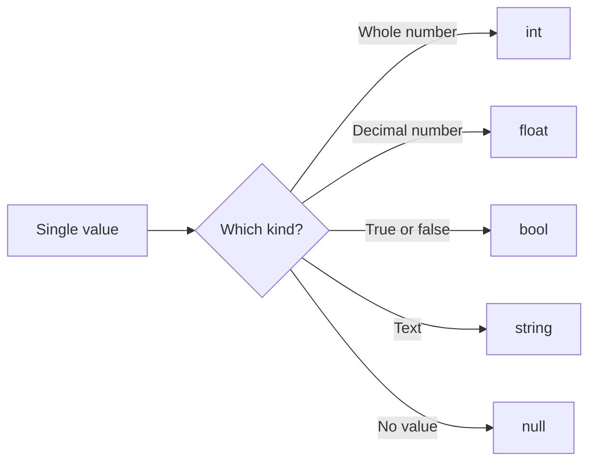

---
tags:
  - php
  - scalar-types
  - beginner
---

# Scalar Types

## TL;DR

Every value in PHP has a built-in type. Single values belong to one of four **scalar types** (`int` for whole numbers, `float` for decimals, `bool` for `true`/`false`, and `string` for text), while **null** is a special type meaning "no value at all".

> [!NOTE] Prerequisites: 01, 02
> New terms: scalar type, null, var_dump()

> [!abstract] Core Idea
> A PHP variable holds a single value of type `int`, `float`, `bool`, `string`, or `null`, and `var_dump()` prints both its type and its value.
> PHP's scalar types match Python's `int`, `float`, `bool`, `str`, and `None`, except PHP writes `null` and `echo` hides `false` and `null`.

## Mental Model

Think of a Book Tracker entry card with five stamp boxes: whole pages (`int`), a decimal rating (`float`), a finished checkbox (`bool`), a title line (`string`), or an empty stamp (`null` meaning "not set yet"). Calling `var_dump()` is like holding the card under a scanner that prints both the box label and what is written inside.



## Minimal Example

Save this as `scalar_types.php` and run `php scalar_types.php`:

```php
<?php

$pages = 412;
$rating = 4.8;
$finished = true;
$title = "Dune";
$notes = null;

var_dump($pages, $rating, $finished, $title, $notes);
```

Expected output:

```text
int(412)
float(4.8)
bool(true)
string(4) "Dune"
NULL
```

- `$pages = 412;` ▸ `int` stores whole numbers with no decimal point.
- `$rating = 4.8;` ▸ `float` stores numbers written with a decimal point.
- `$finished = true;` ▸ `bool` stores only `true` or `false`.
- `$title = "Dune";` ▸ `string` stores text; **var_dump()** (a built-in inspection command that prints type and value) shows `string(4)` for the 4 characters in `"Dune"`.
- `$notes = null;` ▸ **null** means "no value"; `var_dump()` prints it in uppercase as `NULL`.

## Compare

| Command      | Prints `true` as | Prints `false` as | Prints `null` as | Shows type? |
| ------------ | ---------------- | ----------------- | ---------------- | ----------- |
| `echo`       | `1`              | _(nothing)_       | _(nothing)_      | No          |
| `var_dump()` | `bool(true)`     | `bool(false)`     | `NULL`           | Yes         |

## ◈ Edge Case Analysis

✗ **Mistake 1:** Using `echo` to inspect `false` or `null`, which prints nothing at all and looks identical to empty text.

```php
<?php
$finished = false;
echo $finished;
```

✓ **Fix:** Use `var_dump()` when debugging so PHP prints `bool(false)` or `NULL` clearly.

```php
<?php
$finished = false;
var_dump($finished);
```

✗ **Mistake 2:** Expecting `echo true;` to print the word `true`, when `echo` actually outputs `1`.

```php
<?php
$finished = true;
echo $finished;
```

✓ **Fix:** Use `var_dump()` whenever you want to confirm a value is `bool(true)` rather than the number `1`.

```php
<?php
$finished = true;
var_dump($finished);
```

✗ **Mistake 3:** Writing `4.0` and expecting an `int`, when any number with a decimal point becomes a `float` (`float(4)`).

```php
<?php
$rating = 4.0;
var_dump($rating);
```

✓ **Fix:** Leave out the decimal point (`4`) when you want an `int`.

```php
<?php
$rating = 4;
var_dump($rating);
```

## Try It

- 1. Store a book's `$year` (`1965`), `$price` (`12.5`), `$isRead` (`false`), and `$reviewer` (`null`), then print all four types and values with one `var_dump()` call.
- 2. Run `echo` on `$isRead` and then `var_dump($isRead)` to observe the difference in output.

<details>
<summary>◈ View Solution</summary>

1.

```php
<?php

$year = 1965;
$price = 12.5;
$isRead = false;
$reviewer = null;

var_dump($year, $price, $isRead, $reviewer);
```

2.

```php
<?php

$isRead = false;
echo $isRead;
var_dump($isRead);
```

</details>

## Topic Mastery Quiz

**Q1: Which of these is a `float` in PHP rather than an `int`?**

- [ ] A) `412`
- [ ] B) `0`
- [ ] C) `4.0`
- [ ] D) `-10`

**Q2: What does `<?php echo false;` print to the screen?**

- [ ] A) `false`
- [ ] B) `0`
- [ ] C) `NULL`
- [ ] D) Nothing (empty output)

**Q3: What does `<?php var_dump("412");` print?**

- [ ] A) `int(412)`
- [ ] B) `string(3) "412"`
- [ ] C) `412`
- [ ] D) `string(4) "412"`

**Q4: Why is `null` NOT listed as one of the four scalar types?**

- [ ] A) `null` is a special type meaning "no value at all"
- [ ] B) `null` is a shortcut for the `int` value `0`
- [ ] C) `null` is only allowed inside `echo`
- [ ] D) `null` is another name for `string`

**Q5: You run `<?php echo true;` in your terminal. What appears?**

- [ ] A) `true`
- [ ] B) `bool(true)`
- [ ] C) `1`
- [ ] D) Nothing

**Q6: Which call prints `NULL`?**

- [ ] A) `echo null;`
- [ ] B) `var_dump(null);`
- [ ] C) `var_dump(false);`
- [ ] D) `echo false;`

<details>
<summary>◈ View Answers & Explanations</summary>

1. **C** — Any number written with a decimal point (even `.0`) has type `float`. A, B, and D have no decimal point, so they are `int`.
2. **D** — `echo` outputs nothing for `false`. A, B, and C are not printed by `echo false;`.
3. **B** — Quotes make `"412"` a 3-character `string`, so `var_dump()` prints `string(3) "412"`. A, C, and D are wrong.
4. **A** — The four scalar types are `int`, `float`, `bool`, and `string`; `null` is its own special type representing no value. B, C, and D are false.
5. **C** — `echo` prints `true` as `1`. A, B, and D do not match `echo true;`.
6. **B** — `var_dump(null)` outputs `NULL`. A and D print nothing, and C prints `bool(false)`.

</details>

## One-Liner

> [!tip] Magnifying Glass Rule
> **Use `echo` for user output, and `var_dump()` whenever you want to see a value's real type.**

> [!quote] Sources
>
> - [PHP Manual — Types Introduction](https://www.php.net/manual/en/language.types.intro.php)
> - [PHP Manual — var_dump](https://www.php.net/manual/en/function.var-dump.php)
