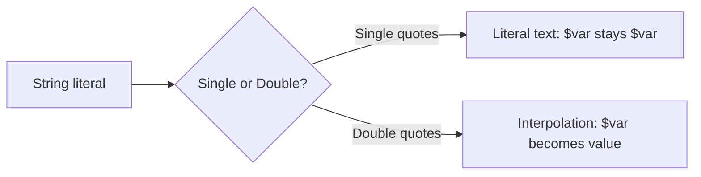

---
tags:
  - php
  - strings
  - beginner
---

# Strings & Interpolation

## TL;DR

PHP gives you two everyday ways to write text strings: single quotes (`'...'`) keep characters literal, while double quotes (`"..."`) perform **interpolation** (replacing `$variables` inside the string with their values). To join separate strings together, PHP uses the `.` **concatenation** operator instead of `+`.

> [!NOTE] Prerequisites: 01, 02, 03
> New terms: interpolation, concatenation, escape sequence

> [!abstract] Core Idea
> Single quotes keep text literal, double quotes expand variables and `\n`, and `.` joins strings together.
> PHP's `"Book: {$title}"` works like Python's `f"Book: {title}"`, except PHP uses `.` instead of `+` to join strings because `+` is strictly for math.

## Mental Model

Think of `'...'` as a laminated sign where every character stays exactly as printed, and `"..."` as a fill-in-the-blank form where `$title` is swapped for its value and **escape sequences** (backslash codes like `\n` for a new line) are activated. The `.` operator acts like tape that sticks two strings end-to-end.



## Minimal Example

Save this as `strings.php` and run `php strings.php`:

```php
<?php

$title = "Dune";
$count = 3;

echo 'Title: $title\n';
echo "\n";
echo "Title: {$title}\n";
echo "Read " . $count . " books\n";
```

Expected output:

```text
Title: $title\n
Title: Dune
Read 3 books
```

- `'Title: $title\n'` ▸ single quotes treat `$title` and `\n` as plain text, not a variable or newline.
- `"Title: {$title}\n"` ▸ double quotes turn `\n` into a newline and replace `{$title}` with `Dune`.
- `{$title}` ▸ curly braces clearly mark where a variable name starts and ends inside double quotes.
- `.` ▸ **concatenation** operator that joins strings end-to-end (and `.=` appends onto an existing string variable).

## Compare

| Feature                    | Single quotes (`'...'`) | Double quotes (`"..."`)  |
| -------------------------- | ----------------------- | ------------------------ |
| Replaces `$var` with value | No (prints `$var`)      | Yes                      |
| Processes `\n` and `\t`    | No (prints `\n`)        | Yes                      |
| Escapes `\'` and `\\`      | Yes                     | Yes (plus `\"` and `\$`) |

## ◈ Edge Case Analysis

✗ **Mistake 1:** Using `+` to join strings like in Python or JavaScript, which causes a `TypeError` in PHP 8.4 when the strings are not numbers.

```php
<?php
echo "Book: " + "Dune";
```

✓ **Fix:** Always use the `.` operator to join strings in PHP.

```php
<?php
echo "Book: " . "Dune";
```

✗ **Mistake 2:** Placing letters immediately after an interpolated variable without curly braces, which makes PHP look for a non-existent variable `$countth` and emit a warning.

```php
<?php
$count = 4;
echo "Book $countth";
```

✓ **Fix:** Wrap the variable in `{...}` so PHP knows where the variable name ends.

```php
<?php
$count = 4;
echo "Book {$count}th";
```

✗ **Mistake 3:** Putting `\n` inside single quotes expecting a line break, which prints the literal characters `\n` instead.

```php
<?php
echo 'Line 1\nLine 2';
```

✓ **Fix:** Use double quotes whenever you want `\n` or `\t` to act as a newline or tab.

```php
<?php
echo "Line 1\nLine 2";
```

## Try It

- 1. Store `$book = "1984"` and `$pages = 328`, then print `1984 (328 pages)` on its own line using double quotes and `{...}` interpolation.
- 2. Build the exact same output using single quotes and `.` concatenation (plus `"\n"` at the end).

<details>
<summary>◈ View Solution</summary>

1.

```php
<?php

$book = "1984";
$pages = 328;

echo "{$book} ({$pages} pages)\n";
```

2.

```php
<?php

$book = "1984";
$pages = 328;

echo $book . ' (' . $pages . ' pages)' . "\n";
```

</details>

## Topic Mastery Quiz

**Q1: With `$title = "Dune";`, what does `echo 'Book: $title';` print?**

- [ ] A) `Book: Dune`
- [ ] B) `Book: $title`
- [ ] C) `Book: {$title}`
- [ ] D) A syntax error

**Q2: What happens if you run `<?php echo "Book: " . "Dune";` vs `<?php echo "Book: " + "Dune";`?**

- [ ] A) Both print `Book: Dune`
- [ ] B) The first prints `Book: Dune`; the second throws a `TypeError`
- [ ] C) The first throws a syntax error; the second prints `Book: Dune`
- [ ] D) Both throw a `TypeError`

**Q3: With `$n = 2;`, why does `echo "Item {$n}nd";` work while `echo "Item $nnd";` triggers a warning?**

- [ ] A) `$n` only works inside curly braces
- [ ] B) Without braces, PHP reads `$nnd` as one undefined variable name
- [ ] C) Double quotes cannot hold numbers without braces
- [ ] D) `nd` is a reserved keyword in PHP

**Q4: What does `echo 'A\nB';` output?**

- [ ] A) `A` and `B` on two separate lines
- [ ] B) `AB`
- [ ] C) `A\nB` literally on one line
- [ ] D) `A B` with a space

**Q5: Which operator appends `"!"` onto an existing string variable `$msg`?**

- [ ] A) `$msg += "!";`
- [ ] B) `$msg .= "!";`
- [ ] C) `$msg &= "!";`
- [ ] D) `$msg := "!";`

**Q6: Which escape sequence inside double quotes prints a literal `$` instead of starting a variable?**

- [ ] A) `$$`
- [ ] B) `\$`
- [ ] C) `/$`
- [ ] D) `{$}`

<details>
<summary>◈ View Answers & Explanations</summary>

1. **B** — Single quotes do not interpolate variables, so `$title` is printed literally. A, C, and D do not happen.
2. **B** — `.` concatenates strings, whereas `+` is strictly arithmetic and throws a `TypeError` on non-numeric strings in PHP 8.4.
3. **B** — PHP reads variable names as long as valid name characters continue, so `$nnd` is parsed as an undefined variable. `{...}` isolates `$n`.
4. **C** — Single quotes do not process `\n` as a newline escape sequence, so `A\nB` prints literally.
5. **B** — `.=` is PHP's concatenation assignment operator. `+=` is for numbers, and `&=` / `:=` are not string concatenation.
6. **B** — `\$` inside double quotes escapes the dollar sign so it prints as `$`. A, C, and D are invalid for escaping `$`.

</details>

## One-Liner > [!tip] Quotes & Glue Rule > **Single quotes stay literal, double quotes expand `{$vars}` and `\n`, and `.` glues strings together.**

> [!quote] Sources
>
> - [PHP Manual — Strings](https://www.php.net/manual/en/language.types.string.php)
> - [PHP Manual — String Operators](https://www.php.net/manual/en/language.operators.string.php)
