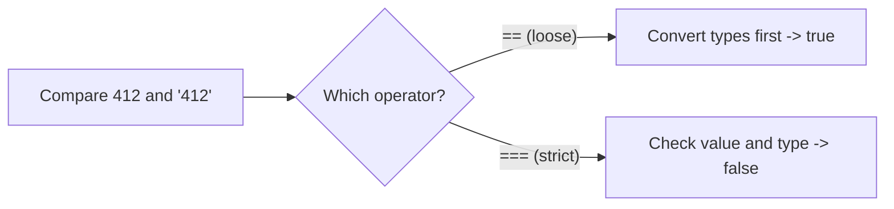

---
tags:
  - php
  - type-juggling
  - beginner
---

# Type Juggling

## TL;DR

PHP can automatically convert a value from one type to another based on how you use it—this is called **type juggling**. You see it most with **loose comparison** (`==`), which converts types before checking equality, unlike `===` which checks both value and type.

> [!NOTE] Prerequisites: 01, 02, 03, 04
> New terms: type juggling, loose comparison, strict comparison

> [!abstract] Core Idea
> **Type juggling** converts values automatically in math or `==` checks, while **strict comparison** (`===` and `!==`) requires both the value and the type to match.
> PHP's `==` vs `===` works just like JavaScript's `==` vs `===` (and unlike Python's `==`, where `1 == "1"` is always `False`).

## Mental Model

Think of `==` like a flexible librarian who says "text `'412'` and number `412` mean the same page count," whereas `===` is a strict barcode scanner that rejects them unless both the value and its type tag match.



## Minimal Example

Save this as `juggling.php` and run `php juggling.php`:

```php
<?php

$pages = 412;
$formPages = "412";

var_dump($pages == $formPages);
var_dump($pages === $formPages);
var_dump("10" + 5);
var_dump(0 == "Dune");
```

Expected output:

```text
bool(true)
bool(false)
int(15)
bool(false)
```

- `$pages == $formPages` ▸ **loose comparison** (`==`) converts the numeric string `"412"` to a number and returns `bool(true)`.
- `$pages === $formPages` ▸ **strict comparison** (`===`) sees `int` vs `string`, skips conversion, and returns `bool(false)`.
- `"10" + 5` ▸ `+` triggers numeric **type juggling**, turning `"10"` into `10` and returning `int(15)`.
- `0 == "Dune"` ▸ in PHP 8+, comparing a number to a non-numeric string converts the number to a string (`"0" == "Dune"`), returning `bool(false)`.

## Compare

| Operator | Name         | Converts types? | `412` vs `"412"` | `0` vs `false` | `null` vs `""` |
| -------- | ------------ | --------------- | ---------------- | -------------- | -------------- |
| `==`     | Loose equal  | Yes             | `true`           | `true`         | `true`         |
| `===`    | Strict equal | No              | `false`          | `false`        | `false`        |

## ◈ Edge Case Analysis

✗ **Mistake 1:** Using `==` when checking for `0`, `false`, `""`, or `null`, because `0 == false` and `null == ""` both evaluate to `true` and hide missing values.

```php
<?php
$rating = 0;
var_dump($rating == false); // bool(true)
```

✓ **Fix:** Use `===` and `!==` by default so `0`, `false`, `""`, and `null` never match each other.

```php
<?php
$rating = 0;
var_dump($rating === false); // bool(false)
```

✗ **Mistake 2:** Using `==` on text codes like `"01" == "1"`, which PHP treats as numbers and reports as `true` even though the strings are different.

```php
<?php
var_dump("01" == "1"); // bool(true)
```

✓ **Fix:** Use `===` whenever comparing strings or IDs where exact characters matter.

```php
<?php
var_dump("01" === "1"); // bool(false)
```

✗ **Mistake 3:** Assuming `+` converts any string to a number because `"10" + 5` works; non-numeric text like `"Dune" + 5` throws a `TypeError` in PHP 8.4.

```php
<?php
echo "Dune" + 5;
```

✓ **Fix:** Only use `+` on numbers or verified numeric values, and use `.` when joining text.

```php
<?php
echo "Dune " . 5;
```

## Try It

- 1. Predict what `var_dump(0 === false, 0 == false, null == "");` outputs, then verify it in PHP.
- 2. Check `"007" == "7"` vs `"007" === "7"` with `var_dump()` to see why strict comparison protects book IDs.

<details>
<summary>◈ View Solution</summary>

1.

```php
<?php

var_dump(0 === false, 0 == false, null == "");
// bool(false), bool(true), bool(true)
```

2.

```php
<?php

var_dump("007" == "7");   // bool(true)
var_dump("007" === "7");  // bool(false)
```

</details>

## Topic Mastery Quiz

**Q1: What does `var_dump(412 === "412");` print in PHP 8.4?**

- [ ] A) `bool(true)`
- [ ] B) `bool(false)`
- [ ] C) `int(412)`
- [ ] D) A `TypeError`

**Q2: What does `var_dump(0 == "Dune");` output in PHP 8.4?**

- [ ] A) `bool(true)`
- [ ] B) `bool(false)`
- [ ] C) `int(0)`
- [ ] D) A syntax error

**Q3: Why does `var_dump("01" == "1");` return `bool(true)`?**

- [ ] A) `==` strips leading zeros from all strings permanently
- [ ] B) Both strings look numeric, so `==` compares them as numbers
- [ ] C) `===` and `==` behave identically on strings
- [ ] D) `"01"` is an `int`, not a `string`

**Q4: Which comparison evaluates to `false`?**

- [ ] A) `0 == false`
- [ ] B) `null == ""`
- [ ] C) `"01" == "1"`
- [ ] D) `null === ""`

**Q5: What happens when you run `<?php echo "Book" + 1;` in PHP 8.4?**

- [ ] A) Prints `Book1`
- [ ] B) Prints `1`
- [ ] C) Throws a `TypeError`
- [ ] D) Prints `Book 1`

**Q6: Which operator should be your default for checking equality in PHP?**

- [ ] A) `=`
- [ ] B) `==`
- [ ] C) `===`
- [ ] D) `.`

<details>
<summary>◈ View Answers & Explanations</summary>

1. **B** — `===` checks both value and type; `int` and `string` are different types, so it returns `bool(false)`.
2. **B** — In PHP 8+, comparing a number to a non-numeric string converts the number to a string (`"0" == "Dune"`), which is `bool(false)`.
3. **B** — When both sides of `==` are numeric strings, PHP compares them numerically (`1 == 1`). A, C, and D are false.
4. **D** — `null === ""` is `false` because `null` and `string` are different types. A, B, and C are all `true` under loose `==`.
5. **C** — `+` cannot convert non-numeric `"Book"` to a number, so PHP 8.4 throws a `TypeError`.
6. **C** — `===` avoids surprise type conversions and should be your default equality check. `=` is assignment, `==` converts types, and `.` joins strings.

</details>

## One-Liner

> [!tip] Strict By Default
> **Use `===` and `!==` by default so PHP never surprises you by turning apples into oranges.**

> [!quote] Sources
>
> - [PHP Manual — Type Juggling](https://www.php.net/manual/en/language.types.type-juggling.php)
> - [PHP Manual — Comparison Operators](https://www.php.net/manual/en/language.operators.comparison.php)
> - [PHP Manual — Type Comparison Tables](https://www.php.net/manual/en/types.comparisons.php)
