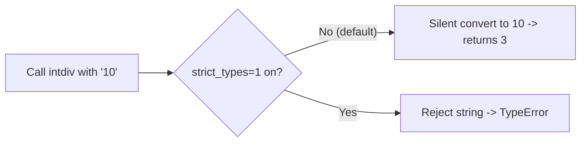

---
tags:
  - php
  - strict-types
  - beginner
---

# Strict Types

## TL;DR

Instead of letting PHP convert types behind your back, **type casting** lets you convert a value on purpose (like `(int) "412"`). Turning on **strict mode** with `declare(strict_types=1);` at the top of a file makes PHP reject mismatched argument types in function calls instead of silently converting them.

> [!NOTE] Prerequisites: 01, 02, 03, 04, 05
> New terms: type casting, strict mode, TypeError

> [!abstract] Core Idea
> Put `declare(strict_types=1);` at the top of a file to block silent conversions in calls, and use explicit casts like `(int)` when you want a conversion.
> PHP's `(int) $x` cast looks like Java's `(int) x` cast, and `declare(strict_types=1);` acts like a per-file switch that enforces exact types on function arguments.

## Mental Model

Think of **strict mode** like an airport gate that refuses to guess what is in your bag, and **type casting** like packing your books into the exact labeled box (`(int)`, `(string)`, `(float)`, `(bool)`) before you walk through.



## Minimal Example

Save this as `strict.php` and run `php strict.php`:

```php
<?php
declare(strict_types=1);

$input = "412";
$pages = (int) $input;

var_dump($pages);
echo intdiv($pages, 100), "\n";
echo intdiv($input, 100);
```

Expected output:

```text
int(412)
4
Fatal error: Uncaught TypeError: intdiv(): Argument #1 ($num1) must be of type int, string given
```

- `declare(strict_types=1);` ▸ turns on **strict mode** for function calls made from this file (must be the first statement).
- `(int) $input` ▸ **type casting**: creates an `int` (`412`) from `$input` without changing `$input` itself.
- `intdiv($pages, 100)` ▸ succeeds and prints `4` because `$pages` is an `int`.
- `intdiv($input, 100)` ▸ throws a **TypeError** (a fatal error when a value's type does not match what a function requires) because `$input` is a `string`.

## Compare

| Mode                       | Applies to           | `intdiv("10", 3)`              | `intdiv((int) "10", 3)` |
| -------------------------- | -------------------- | ------------------------------ | ----------------------- |
| Default (`strict_types=0`) | Current file's calls | Silently converts `"10"` → `3` | Returns `3`             |
| `declare(strict_types=1);` | Current file's calls | Throws `TypeError`             | Returns `3`             |

## ◈ Edge Case Analysis

✗ **Mistake 1:** Placing `declare(strict_types=1);` after another statement, which causes a fatal error because PHP requires it to be the very first statement in the file.

```php
<?php
$title = "Dune";
declare(strict_types=1);
```

✓ **Fix:** Always write `declare(strict_types=1);` immediately after `<?php`.

```php
<?php
declare(strict_types=1);
$title = "Dune";
```

✗ **Mistake 2:** Thinking `(int) $input` changes `$input` itself, when `$input` actually stays a `string`.

```php
<?php
$input = "412";
(int) $input;
var_dump($input); // still string(3) "412"
```

✓ **Fix:** Assign the cast result to a variable when you want to keep the converted value.

```php
<?php
$input = "412";
$pages = (int) $input;
```

✗ **Mistake 3:** Casting non-numeric text like `(int) "Dune"`, which silently turns into `0` instead of raising an error.

```php
<?php
var_dump((int) "Dune"); // int(0)
```

✓ **Fix:** Only cast strings that you have verified contain numeric text.

```php
<?php
var_dump((int) "412"); // int(412)
```

## Try It

- 1. Enable `declare(strict_types=1);`, cast `$rawRating = "4.8"` to a `float`, and inspect both `$rawRating` and the new variable with `var_dump()`.
- 2. Cast `0`, `""`, and `"Dune"` to `(bool)` and print them with `var_dump()` to see which ones become `false` vs `true`.

<details>
<summary>◈ View Solution</summary>

1.

```php
<?php
declare(strict_types=1);

$rawRating = "4.8";
$rating = (float) $rawRating;

var_dump($rawRating, $rating);
```

2.

```php
<?php
declare(strict_types=1);

var_dump((bool) 0, (bool) "", (bool) "Dune");
// bool(false), bool(false), bool(true)
```

</details>

## Topic Mastery Quiz

**Q1: Where must `declare(strict_types=1);` be placed in a PHP file?**

- [ ] A) Anywhere before the first function call
- [ ] B) As the very first statement right after `<?php`
- [ ] C) Inside every `echo` statement
- [ ] D) At the bottom of the file

**Q2: With `declare(strict_types=1);` enabled, what happens when you run `echo intdiv("10", 3);`?**

- [ ] A) Prints `3`
- [ ] B) Prints `3.33`
- [ ] C) Throws a `TypeError`
- [ ] D) Silently converts `"10"` to `0`

**Q3: What does `$x = "412"; (int) $x; var_dump($x);` print?**

- [ ] A) `int(412)`
- [ ] B) `string(3) "412"`
- [ ] C) `bool(true)`
- [ ] D) `NULL`

**Q4: What does `var_dump((int) "Dune");` output?**

- [ ] A) `int(0)`
- [ ] B) `NULL`
- [ ] C) A `TypeError`
- [ ] D) `string(4) "Dune"`

**Q5: If you turn on `declare(strict_types=1);` in `a.php`, does it automatically enable strict mode inside another file `b.php`?**

- [ ] A) Yes, for the entire project
- [ ] B) No, `strict_types=1` applies per file to calls made from that file
- [ ] C) Yes, but only for `string` values
- [ ] D) Only if `b.php` has no `<?php` tag

**Q6: Which expression converts the `int` `412` into a `string` explicitly?**

- [ ] A) `string($pages)`
- [ ] B) `(string) 412`
- [ ] C) `412->string`
- [ ] D) `cast(412, string)`

<details>
<summary>◈ View Answers & Explanations</summary>

1. **B** — `declare(strict_types=1);` must be the very first statement in the file after `<?php`, or PHP throws a fatal error.
2. **C** — In strict mode, PHP refuses to convert `"10"` to `int` for `intdiv()` and throws a `TypeError`.
3. **B** — `(int) $x` does not mutate `$x` in place unless reassigned, so `$x` remains `string(3) "412"`.
4. **A** — Casting a non-numeric string like `"Dune"` with `(int)` silently produces `0`.
5. **B** — `strict_types=1` is strictly per-file and governs function calls made from within that file.
6. **B** — `(string) 412` is PHP's explicit cast syntax. A, C, and D are invalid syntax.

</details>

## One-Liner

> [!tip] Explicit Over Magic
> **Turn on `declare(strict_types=1);` at line 2, and use `(int)` / `(string)` casts whenever you mean to convert.**

> [!quote] Sources
>
> - [PHP Manual — Type Declarations (Strict typing)](https://www.php.net/manual/en/language.types.declarations.php)
> - [PHP Manual — Type Juggling (Type Casting)](https://www.php.net/manual/en/language.types.type-juggling.php)
> - [PHP Manual — declare](https://www.php.net/manual/en/control-structures.declare.php)
