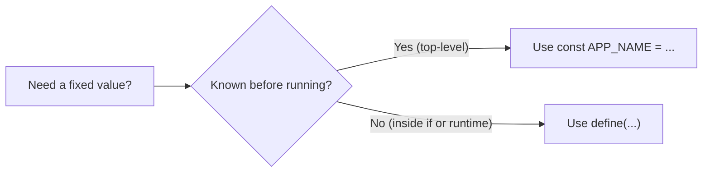

---
tags:
  - php
  - constants
  - beginner
---

# Constants

## TL;DR

A **constant** is a named, read-only value that cannot be changed or removed once set—ideal for fixed settings like an app name or book limit. Unlike variables, constants never wear a `$` sigil, are uppercase by convention, and are created with `const` or `define()`.

> [!NOTE] Prerequisites: 01, 02, 03, 04
> New terms: constant, compile time

> [!abstract] Core Idea
> Constants store fixed, `$`-free values that cannot be reassigned anywhere in your script.
> PHP's `const MAX_BOOKS = 50;` is like Java's `final` constant (and unlike Python's all-caps convention, PHP actually blocks reassignment).

## Mental Model

Think of a variable as a whiteboard you can erase and rewrite, and a **constant** as an engraved brass plaque bolted to the Book Tracker wall: no `$` sticker, permanent once mounted, and readable from anywhere in the building.



## Minimal Example

Save this as `constants.php` and run `php constants.php`:

```php
<?php

const APP_NAME = "Book Tracker";
define("MAX_BOOKS", 50);

echo APP_NAME, " (max ", MAX_BOOKS, ")\n";
echo "App: " . APP_NAME;
```

Expected output:

```text
Book Tracker (max 50)
App: Book Tracker
```

- `const APP_NAME = "Book Tracker";` ▸ creates a constant at **compile time** (when PHP prepares the script before running it line-by-line).
- `define("MAX_BOOKS", 50);` ▸ creates a constant while the script is running.
- `APP_NAME` / `MAX_BOOKS` ▸ written without `$`; uppercase with underscores is the standard style.
- `"App: " . APP_NAME` ▸ constants do not expand inside `"..."`, so join them with `.` or pass them to `echo` with commas.

## Compare

| Feature                           | `const`           | `define()`        |
| --------------------------------- | ----------------- | ----------------- |
| Defined when                      | Compile time      | Runtime           |
| Allowed inside `if` blocks?       | No (syntax error) | Yes               |
| Preferred for top-level settings? | Yes               | Only when dynamic |

## ◈ Edge Case Analysis

✗ **Mistake 1:** Writing a constant name inside double quotes expecting interpolation, which prints the constant's name literally instead of its value.

```php
<?php
const MAX_BOOKS = 50;
echo "Limit: MAX_BOOKS"; // prints Limit: MAX_BOOKS
```

✓ **Fix:** Join the constant with `.` outside the quotes (or use commas in `echo`).

```php
<?php
const MAX_BOOKS = 50;
echo "Limit: " . MAX_BOOKS;
```

✗ **Mistake 2:** Placing `const` inside an `if` block, which causes a syntax error because `const` is processed at compile time.

```php
<?php
if (true) {
    const MODE = "dev"; // syntax error
}
```

✓ **Fix:** Use `define()` whenever a constant must be created conditionally at runtime.

```php
<?php
if (true) {
    define("MODE", "dev");
}
```

✗ **Mistake 3:** Trying to reassign a constant like a variable, which causes a syntax error because constants are read-only.

```php
<?php
const MAX_BOOKS = 50;
MAX_BOOKS = 100; // syntax error
```

✓ **Fix:** Use a `$variable` instead of a constant if the value needs to change later.

```php
<?php
$maxBooks = 50;
$maxBooks = 100;
```

## Try It

- 1. Define a top-level constant `DEFAULT_PAGES` set to `250` using `const`, then print `Default: 250` using `.` concatenation.
- 2. Define `APP_VERSION` set to `"1.0"` using `define()`, then print it with `var_dump()`.

<details>
<summary>◈ View Solution</summary>

1.

```php
<?php

const DEFAULT_PAGES = 250;
echo "Default: " . DEFAULT_PAGES;
```

2.

```php
<?php

define("APP_VERSION", "1.0");
var_dump(APP_VERSION);
```

</details>

## Topic Mastery Quiz

**Q1: Which of the following correctly defines a top-level constant in PHP?**

- [ ] A) `const $MAX_BOOKS = 50;`
- [ ] B) `const MAX_BOOKS = 50;`
- [ ] C) `MAX_BOOKS = 50;`
- [ ] D) `define(MAX_BOOKS, 50);`

**Q2: With `const APP = "Book Tracker";`, what does `echo "Welcome to APP";` print?**

- [ ] A) `Welcome to Book Tracker`
- [ ] B) `Welcome to APP`
- [ ] C) A syntax error
- [ ] D) `Welcome to `

**Q3: Why does putting `const MODE = "dev";` inside an `if` block fail?**

- [ ] A) `const` only accepts numbers, not strings
- [ ] B) `const` is evaluated at compile time, not inside runtime `if` blocks
- [ ] C) Constants cannot be used inside any braces
- [ ] D) `MODE` is a reserved PHP keyword

**Q4: What happens if you try to change a constant's value with `MAX_BOOKS = 100;`?**

- [ ] A) It silently updates `MAX_BOOKS` to `100`
- [ ] B) It creates a variable named `$MAX_BOOKS`
- [ ] C) It causes a syntax error because constants cannot be reassigned
- [ ] D) It sets `MAX_BOOKS` to `null`

**Q5: How do you define a constant whose value is only decided inside an `if` block at runtime?**

- [ ] A) Use `const` without `;`
- [ ] B) Use `define("NAME", $value);`
- [ ] C) Prefix the constant with `$`
- [ ] D) Wrap `const` in double quotes

**Q6: Which statement prints `PHP_VERSION` (a built-in PHP constant) correctly inside a message?**

- [ ] A) `echo "Version: PHP_VERSION";`
- [ ] B) `echo "Version: {$PHP_VERSION}";`
- [ ] C) `echo "Version: " . PHP_VERSION;`
- [ ] D) `echo "Version: $PHP_VERSION";`

<details>
<summary>◈ View Answers & Explanations</summary>

1. **B** — Constants never start with `$`, and `define()` requires the name as a string (`"MAX_BOOKS"`). A, C, and D are invalid.
2. **B** — Constants do not interpolate inside double quotes, so `APP` prints as literal text.
3. **B** — `const` is resolved at compile time and cannot sit inside conditional `if` blocks; use `define()` there instead.
4. **C** — Constants are read-only and cannot be reassigned; `MAX_BOOKS = 100;` is a syntax error.
5. **B** — `define()` runs at runtime and is valid inside `if` blocks. A, C, and D do not work.
6. **C** — Concatenating `PHP_VERSION` with `.` evaluates the constant. A prints literal text, and B and D look for an undefined variable `$PHP_VERSION`.

</details>

## One-Liner

    > [!tip] Brass Plaque Rule > **Constants wear no `$`, never change once set, and must be joined with `.` instead of placed inside quotes.**

> [!quote] Sources
>
> - [PHP Manual — Constants](https://www.php.net/manual/en/language.constants.php)
> - [PHP Manual — Constant Syntax](https://www.php.net/manual/en/language.constants.syntax.php)
