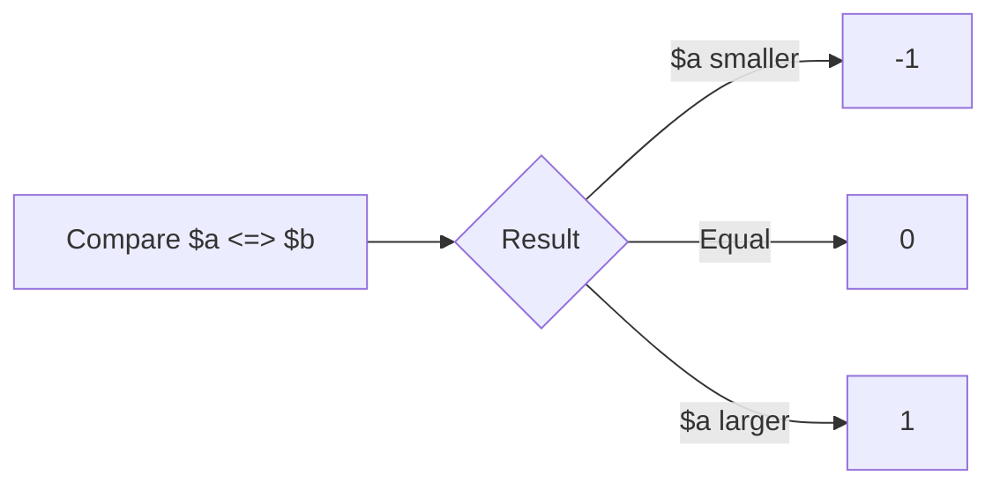

---
tags:
  - php
  - operators
  - beginner
---

# Operators

## TL;DR

PHP's arithmetic (`+`, `-`, `*`, `/`, `%`, `**`), comparison (`<`, `>`), and boolean logic (`&&`, `||`, `!`) operators work much like Java's, plus a **spaceship operator** (`<=>`) that compares two values and returns `-1`, `0`, or `1`. Pay close attention to **operator precedence** (the order PHP evaluates operators when parentheses are omitted), especially between `&&`/`||` and the word forms `and`/`or`.

> [!NOTE] Prerequisites: 01, 02, 03, 05
> New terms: spaceship operator, operator precedence

> [!abstract] Core Idea
> Use `&&` and `||` for boolean logic, `/` for decimal-capable division, and `<=>` for three-way comparisons.
> PHP's math and `&&`/`||` operators mirror Java's, except `/` returns a `float` when numbers do not divide evenly and `**` does exponentiation like Python's `**`.

## Mental Model

Think of `<=>` as a Book Tracker balance scale: it tilts left (`-1`) if the first book is shorter, sits level (`0`) if equal, or tilts right (`1`) if the first book is longer. Meanwhile, think of `=` vs `and`/`or` like traffic priority—`=` yields to `&&`, but `=` cuts right in front of `and`.



## Minimal Example

Save this as `operators.php` and run `php operators.php`:

```php
<?php

$a = 328;
$b = 412;

var_dump(10 / 4);
var_dump(2 ** 3);
var_dump($a <=> $b);
var_dump($a > 200 && $b > 200);
```

Expected output:

```text
float(2.5)
int(8)
int(-1)
bool(true)
```

- `10 / 4` ▸ `/` performs standard division and returns `float(2.5)` when there is a remainder (use `intdiv()` for integer division).
- `2 ** 3` ▸ `**` raises `2` to the power of `3` (`8`).
- `$a <=> $b` ▸ **spaceship operator**: returns `-1` when `$a < $b`, `0` when equal, and `1` when `$a > $b`.
- `&&` ▸ logical AND (`||` is OR, `!` is NOT); evaluates before `=` assignment.

## Compare

| Operator     | Meaning          | Precedence vs `=` | Safe in `$ok = $a && $b;`? |
| ------------ | ---------------- | ----------------- | -------------------------- |
| `&&`, `\|\|` | Logical AND / OR | Higher than `=`   | Yes                        |
| `and`, `or`  | Logical AND / OR | Lower than `=`    | No (`=` runs first!)       |

## ◈ Edge Case Analysis

✗ **Mistake 1:** Writing `$ok = true and false;` expecting `$ok` to be `false`, because `=` has higher **operator precedence** than `and`, so PHP runs `($ok = true) and false;` and leaves `$ok` as `true`.

```php
<?php
$ok = true and false;
var_dump($ok); // bool(true)
```

✓ **Fix:** Always use `&&` and `||` instead of `and` and `or`.

```php
<?php
$ok = true && false;
var_dump($ok); // bool(false)
```

✗ **Mistake 2:** Expecting `10 / 4` to return `2` like Java integer division, when PHP actually returns `float(2.5)`.

```php
<?php
var_dump(10 / 4); // float(2.5)
```

✓ **Fix:** Call `intdiv(10, 4)` when you want whole-number integer division (`int(2)`).

```php
<?php
var_dump(intdiv(10, 4)); // int(2)
```

✗ **Mistake 3:** Chaining comparisons like `1 < $x < 5` (valid in Python), which causes a syntax error in PHP because comparison operators cannot sit directly next to each other.

```php
<?php
$x = 3;
var_dump(1 < $x < 5); // syntax error
```

✓ **Fix:** Join separate comparisons with `&&`.

```php
<?php
$x = 3;
var_dump(1 < $x && $x < 5); // bool(true)
```

## Try It

- 1. Given `$bookA = 250` and `$bookB = 250`, print the result of `$bookA <=> $bookB` using `var_dump()`.
- 2. Check whether `$pages = 310` is between `200` and `400` (inclusive) using `>=`, `<=`, and `&&`.

<details>
<summary>◈ View Solution</summary>

1.

```php
<?php

$bookA = 250;
$bookB = 250;
var_dump($bookA <=> $bookB); // int(0)
```

2.

```php
<?php

$pages = 310;
var_dump($pages >= 200 && $pages <= 400); // bool(true)
```

</details>

## Topic Mastery Quiz

**Q1: What does `var_dump(412 <=> 328);` print?**

- [ ] A) `-1`
- [ ] B) `0`
- [ ] C) `1`
- [ ] D) `bool(true)`

**Q2: What does `$result = true and false; var_dump($result);` print?**

- [ ] A) `bool(false)`
- [ ] B) `bool(true)`
- [ ] C) `NULL`
- [ ] D) A syntax error

**Q3: What does `var_dump(10 / 4);` output in PHP 8.4?**

- [ ] A) `int(2)`
- [ ] B) `float(2.5)`
- [ ] C) `int(3)`
- [ ] D) `string(3) "2.5"`

**Q4: What happens when you run `10 < $pages < 500` in PHP?**

- [ ] A) Evaluates to `true` when `$pages` is `200`
- [ ] B) Evaluates to `false` always
- [ ] C) Fails with a syntax error
- [ ] D) Returns `1`

**Q5: Which expression calculates 3 raised to the power of 4 (`81`)?**

- [ ] A) `3 ^ 4`
- [ ] B) `3 ** 4`
- [ ] C) `3 * 4`
- [ ] D) `3 <=> 4`

**Q6: Which operator pair has higher precedence than `=` assignment?**

- [ ] A) `and`, `or`
- [ ] B) `&&`, `||`
- [ ] C) Both pairs have higher precedence than `=`
- [ ] D) Neither pair has higher precedence than `=`

<details>
<summary>◈ View Answers & Explanations</summary>

1. **C** — In `412 <=> 328`, the left value is greater than the right value, so `<=>` returns `int(1)`.
2. **B** — `=` has higher precedence than `and`, so PHP evaluates `($result = true) and false;`, storing `bool(true)` in `$result`.
3. **B** — `/` performs decimal-capable division in PHP, returning `float(2.5)` when there is a remainder.
4. **C** — PHP does not allow chained comparisons like `10 < $pages < 500`; split them with `&&`.
5. **B** — `**` is PHP's exponentiation operator (`3 ** 4 === 81`). `^` is bitwise XOR, `*` multiplies, and `<=>` compares.
6. **B** — `&&` and `||` bind tighter than `=`, whereas `and` and `or` bind looser than `=`.

</details>

## One-Liner

> [!tip] Precedence & Scale Rule
> **Use `&&`/`||` instead of `and`/`or`, `intdiv()` for whole division, and `<=>` when you need `-1`, `0`, or `1`.**

> [!quote] Sources
>
> - [PHP Manual — Operator Precedence](https://www.php.net/manual/en/language.operators.precedence.php)
> - [PHP Manual — Logical Operators](https://www.php.net/manual/en/language.operators.logical.php)
> - [PHP Manual — Comparison Operators](https://www.php.net/manual/en/language.operators.comparison.php)
