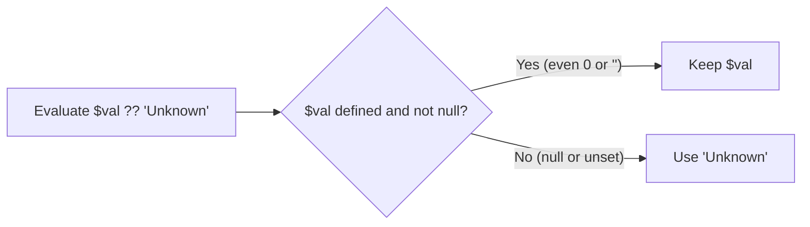

---
tags:
  - php
  - null-handling
  - beginner
---

# Null Handling

## TL;DR

Reading an undefined or `null` variable can trigger warnings or break your output. PHP gives you **null coalescing** (`??` and `??=`) to supply safe defaults without warnings, plus `isset()` and `empty()` to check whether a variable is set or considered empty.

> [!NOTE] Prerequisites: 01, 02, 03, 05, 08
> New terms: null coalescing, falsy

> [!abstract] Core Idea
> Use `??`, `??=`, and `isset()` to check strictly for "exists and is not `null`", and use `empty()` only when `0`, `""`, and `false` should also count as missing.
> PHP's `$x ?? "default"` works like JavaScript's `x ?? "default"` (unlike Python's `x or "default"`, which also replaces `0` and `""`).

## Mental Model

Think of a Book Tracker shelf slot: `isset()` asks "Is there a card in this slot (and not blank `null`)?" even if the rating written on it is `0`, while `empty()` asks "Is the slot missing, `null`, or zeroed/blank?" Meanwhile, `??` hands you a backup value only when the slot is missing or `null`.



## Minimal Example

Save this as `null_handling.php` and run `php null_handling.php`:

```php
<?php

$subtitle = null;
$rating = 0;

echo $subtitle ?? "No subtitle", "\n";
echo $rating ?? 5, "\n";

$subtitle ??= "Part 1";
echo $subtitle, "\n";

var_dump(isset($rating), empty($rating));
```

Expected output:

```text
No subtitle
0
Part 1
bool(true)
bool(true)
```

- `$subtitle ?? "No subtitle"` ▸ **null coalescing**: returns `"No subtitle"` because `$subtitle` is `null` (and emits no warning if a variable is undefined).
- `$rating ?? 5` ▸ returns `0` (not `5`) because `0` is not `null`.
- `$subtitle ??= "Part 1";` ▸ assigns `"Part 1"` only because `$subtitle` is `null` (or undefined).
- `isset($rating)` / `empty($rating)` ▸ `isset(0)` is `true` (defined and not `null`), while `empty(0)` is `true` because `0` is **falsy** (a value treated as `false` in boolean checks, such as `0`, `"0"`, `""`, `false`, and `null`).
- Note on `?->` ▸ for objects (covered in Folder 04), `$book?->title` safely returns `null` when `$book` is `null` instead of crashing.

## Compare

| Value of `$x`             | `isset($x)` | `empty($x)` | `$x ?? "fallback"` |
| ------------------------- | ----------- | ----------- | ------------------ |
| Undefined                 | `false`     | `true`      | `"fallback"`       |
| `null`                    | `false`     | `true`      | `"fallback"`       |
| `0`, `"0"`, `""`, `false` | `true`      | `true`      | keeps `$x`         |
| `"Dune"`                  | `true`      | `false`     | `"Dune"`           |

## ◈ Edge Case Analysis

✗ **Mistake 1:** Using `empty($rating)` when `0` is a valid rating, because `empty(0)` returns `true` and treats zero as missing.

```php
<?php
$rating = 0;
var_dump(empty($rating)); // bool(true)
```

✓ **Fix:** Use `isset($rating)` or `$rating !== null` whenever `0`, `"0"`, or `""` are valid values.

```php
<?php
$rating = 0;
var_dump(isset($rating)); // bool(true)
```

✗ **Mistake 2:** Expecting `"" ?? "Untitled"` to return `"Untitled"`, when `??` keeps `""` because an empty string is not `null`.

```php
<?php
$title = "";
echo $title ?? "Untitled"; // prints nothing ("")
```

✓ **Fix:** Check `$title === ""` explicitly when empty strings should also trigger a default.

```php
<?php
$title = "";
echo $title === "" ? "Untitled" : $title;
```

✗ **Mistake 3:** Passing a raw expression like `isset(1 + 1)` instead of a variable, which causes a syntax error because `isset()` and `empty()` only accept variables.

```php
<?php
var_dump(isset(1 + 1)); // syntax error
```

✓ **Fix:** Store expressions in a `$variable` first, or compare directly with `!== null`.

```php
<?php
$sum = 1 + 1;
var_dump(isset($sum)); // bool(true)
```

## Try It

- 1. Given `$pages = 0` and `$notes = null`, use `??` to print `$pages` (with fallback `100`) and `$notes` (with fallback `"None"`).
- 2. Use `??=` to set `$author = "Unknown"` only when `$author` is `null`, then verify with `isset($author)`.

<details>
<summary>◈ View Solution</summary>

1.

```php
<?php

$pages = 0;
$notes = null;

echo $pages ?? 100, "\n";    // 0
echo $notes ?? "None", "\n"; // None
```

2.

```php
<?php

$author = null;
$author ??= "Unknown";

var_dump(isset($author)); // bool(true)
```

</details>

## Topic Mastery Quiz

**Q1: With `$copies = 0;`, what does `echo $copies ?? 10;` print?**

- [ ] A) `10`
- [ ] B) `0`
- [ ] C) Nothing
- [ ] D) A warning

**Q2: For `$title = "";`, what do `isset($title)` and `empty($title)` return?**

- [ ] A) `true` and `true`
- [ ] B) `true` and `false`
- [ ] C) `false` and `true`
- [ ] D) `false` and `false`

**Q3: What happens if you run `$x =$undefinedVar ?? "default";` without defining `$undefinedVar`?**

- [ ] A) PHP throws an undefined variable warning and sets `$x` to `null`
- [ ] B) PHP sets `$x` to `"default"` with no warning
- [ ] C) PHP stops with a syntax error
- [ ] D) PHP sets `$x` to `false`

**Q4: With `$tag = "sci-fi"; $tag ??= "general";`, what is `$tag` afterward?**

- [ ] A) `"general"`
- [ ] B) `"sci-fi"`
- [ ] C) `null`
- [ ] D) `true`

**Q5: Why does `isset(5 + 5)` fail with a syntax error?**

- [ ] A) `isset()` only accepts `string` variables
- [ ] B) `isset()` only checks variables (not expressions like `5 + 5`)
- [ ] C) `isset()` requires two arguments
- [ ] D) `isset()` was removed in PHP 8.4

**Q6: Which value makes BOTH `isset($v)` return `false` AND `empty($v)` return `true`?**

- [ ] A) `0`
- [ ] B) `""`
- [ ] C) `false`
- [ ] D) `null`

<details>
<summary>◈ View Answers & Explanations</summary>

1. **B** — `??` only falls back when the left side is `null` or undefined; `0` is neither, so it prints `0`.
2. **A** — `""` is defined and not `null` (`isset` is `true`), and `""` is falsy (`empty` is `true`).
3. **B** — `??` suppresses the undefined-variable warning and evaluates to `"default"`.
4. **B** — `??=` only assigns when the variable is `null` or undefined, so `"sci-fi"` stays unchanged.
5. **B** — `isset()` is a language construct that only inspects variables (or array keys/properties), never arbitrary expressions.
6. **D** — `0`, `""`, and `false` all have `isset($v) === true`; only `null` (or an undefined variable) gives `isset === false` and `empty === true`.

</details>

## One-Liner

> [!tip] Null vs Empty Rule
> **Use `??` and `isset()` for `null`/missing checks; use `empty()` only when `0`, `""`, and `false` also count as empty.**

> [!quote] Sources
>
> - [PHP Manual — isset](https://www.php.net/isset)
> - [PHP Manual — empty](https://www.php.net/empty)
> - [PHP Manual — Null Coalescing Operator](https://www.php.net/manual/en/language.operators.comparison.php)
