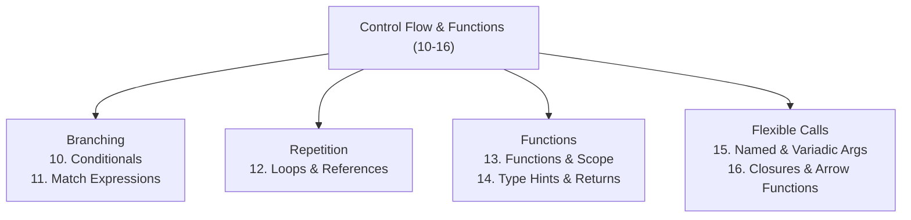

---
tags:
  - php
  - overview
  - beginner
---

# Overview: Control Flow & Functions

## TL;DR

This folder covers how PHP makes decisions, repeats work over data, and packages logic into reusable functions. Together, these tools let your Book Tracker filter shelves, validate inputs, and transform book lists cleanly.

> [!NOTE] Prerequisites: 10, 11, 12, 13, 14, 15, 16
> New terms: None (all terms introduced in notes 10 through 16)

> [!abstract] Core Idea
> Control flow steers which code runs and how often, while typed functions and closures package that logic with clear inputs and outputs.
> In Python, `if`/`for`/`def`/`lambda` play the same roles, except PHP requires parentheses around conditions, `$` sigils, and explicit `use ($var)` for multi-line closures.

## Concept Map

## Folder Cheat Sheet

| Note                             | Core Syntax / Tool                      | Key Rule to Remember                                                               |
| -------------------------------- | --------------------------------------- | ---------------------------------------------------------------------------------- |
| `10. Conditionals`               | `if`, `elseif`, `switch`                | `switch` uses loose `==` and needs `break` to prevent **fallthrough**              |
| `11. Match Expressions`          | `match ($x) { ... }`                    | Uses strict `===`, returns a value, throws `UnhandledMatchError` if no arm matches |
| `12. Loops & References`         | `foreach ($items as &$item)`            | Always call `unset($item)` after a **reference** loop                              |
| `13. Functions & Scope`          | `function foo() {}`                     | Functions have **local scope**; outer variables are not visible by default         |
| `14. Type Hints & Returns`       | `?string`, `int\|string`, `void`        | Nullable `?T` allows `T` or `null`; `void` functions cannot return a value         |
| `15. Named & Variadic Args`      | `name: $val`, `...$items`               | Variadic `...$items` packs extra arguments into an array                           |
| `16. Closures & Arrow Functions` | `function () use ($x)`, `fn($x) => ...` | `fn()` auto-captures outer variables by value; `function ()` needs `use ($x)`      |

## Boss Quiz

**Q1: What happens when you run `match (1) { '1' => 'str', 1 => 'int' }` in PHP 8.4?**

- [ ] A) Returns `'str'` because `1 == '1'`
- [ ] B) Returns `'int'` because `match` uses strict `===`
- [ ] C) Throws `UnhandledMatchError`
- [ ] D) Falls through and returns `'int'` after `'str'`

**Q2: Inside `foreach ($books as &$book) { ... }`, what bug happens if you forget `unset($book)` and later assign `$book = 'Other'`?**

- [ ] A) A syntax error is thrown
- [ ] B) `$books[0]` is overwritten with `'Other'`
- [ ] C) The last element of `$books` is overwritten with `'Other'`
- [ ] D) Nothing happens because `$book` is local to the loop

**Q3: Why does a regular multi-line closure `function ($b) { return $b['pages'] >= $min; }` fail to see `$min`?**

- [ ] A) Closures cannot read integer variables
- [ ] B) PHP functions have **local scope** unless you add `use ($min)`
- [ ] C) `$min` must be passed by reference
- [ ] D) Only arrow functions can return booleans

**Q4: Which return type allows a function to return either a `string` or `null`?**

- [ ] A) `void`
- [ ] B) `?string`
- [ ] C) `string&null`
- [ ] D) `nullable string`

**Q5: In `function tagBooks(string $shelf, string ...$titles): void`, what type is `$titles` inside the function?**

- [ ] A) `string`
- [ ] B) `object`
- [ ] C) `array`
- [ ] D) `null`

**Q6: How does `fn($b) => $b['pages'] > $min` differ from `function ($b) use ($min) { ... }`?**

- [ ] A) `fn()` automatically captures `$min` by value from the outer scope
- [ ] B) `fn()` modifies `$min` in the outer scope by reference
- [ ] C) `fn()` allows multiple statements inside braces
- [ ] D) `fn()` cannot be passed to array functions

◈ View Answers & Explanations

1. **B** - `match` compares using strict `===`, so integer `1` skips `'1'` and matches `1 => 'int'`. A confuses `match` with `switch`, C only occurs when no arm matches, and `match` never falls through (D).

2. **C** - After a `foreach` by **reference**, `$book` remains linked to the last element of `$books`, so reassigning `$book` mutates that last element. It does not affect `$books[0]` (B), throw a syntax error (A), or stay isolated (D).

3. **B** - PHP functions and standard closures do not automatically inherit outer variables; you must explicitly list `use ($min)`. A, C, and D are false.

4. **B** - `?string` is shorthand for `string|null`. `void` (A) means no return value, while C and D are invalid syntax.

5. **C** - A **variadic parameter** (`...$titles`) collects any remaining arguments into an indexed `array`. It is never a single `string` (A), `object` (B), or `null` (D).

6. **A** - Arrow functions (`fn()`) automatically capture outer variables by value, so they cannot modify `$min` (B), are limited to a single expression (C), and work as normal callables (D).

> [!quote] Sources
>
> - [match - PHP Manual](https://www.php.net/manual/en/control-structures.match.php)
> - [foreach - PHP Manual](https://www.php.net/manual/en/control-structures.foreach.php)
> - [Arrow Functions - PHP Manual](https://www.php.net/manual/en/functions.arrow.php)
