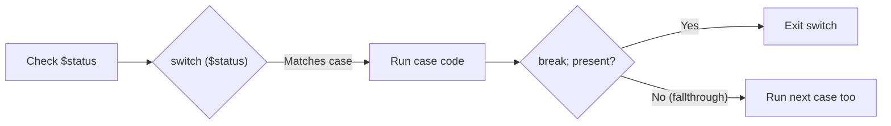

---
tags:
  - php
  - conditionals
  - beginner
---

# Conditionals

## TL;DR

PHP's `if`, `elseif`, and `else` pick one branch to run based on true/false conditions, while `switch` jumps to a matching `case` value. Watch out for two PHP quirks: `switch` uses loose comparison (`==`) and suffers from **fallthrough** (sliding into the next `case`) if you forget `break;`.

> [!NOTE] Prerequisites: 01, 02, 03, 05, 08
> New terms: fallthrough, truthy

> [!abstract] Core Idea
> Use `if`/`elseif`/`else` with `===` for general conditions, and remember `switch` compares with `==` and falls through without `break;`.
> PHP's `if` and `switch` look like Java's, except PHP writes `elseif` as one word (like Python's `elif`) and `switch` uses loose `==` comparison.

## Mental Model

Think of `if`/`elseif`/`else` as a Book Tracker librarian checking rules from top to bottom and stopping at the first match, while `switch` is a mailroom chute that drops you into a slot—unless you close the `break;` door at the bottom, you keep sliding into the slots below.



## Minimal Example

Save this as `conditionals.php` and run `php conditionals.php`:

```php
<?php

$pages = 412;
$status = "reading";

if ($pages >= 500) {
    echo "Long book\n";
} elseif ($pages >= 200) {
    echo "Medium book\n";
} else {
    echo "Short book\n";
}

switch ($status) {
    case "reading":
        echo "In progress";
        break;
    default:
        echo "Other";
}

?>
```

Expected output:

```text
Medium book
In progress
```

- `elseif` ▸ one word works everywhere in PHP; `else if` (two words) only works with `{}` braces.
- `switch ($status)` ▸ compares `$status` against each `case` using loose `==` comparison.
- `break;` ▸ exits the `switch` immediately so execution does not fall through into `default`.
- `if ($x)` ▸ any **truthy** value (any value that is not falsy, such as non-zero numbers or non-empty text) enters the `if` branch.

## Compare

| Feature         | `if / elseif / else`                      | `switch`                                    |
| --------------- | ----------------------------------------- | ------------------------------------------- |
| Comparison type | Whatever you write (`===`, `>`, `&&`)     | Loose `==` only                             |
| Needs `break;`? | No (exits after matching branch)          | Yes (otherwise **fallthrough**)             |
| Best for        | Ranges, multiple variables, strict checks | Simple fixed values (or `match` in Note 11) |

## ◈ Edge Case Analysis

✗ **Mistake 1:** Forgetting `break;` inside a `switch` `case`, which causes **fallthrough** and runs the following `case` or `default` block too.

```php
<?php
$tier = 1;
switch ($tier) {
    case 1:
        echo "Gold ";
    default:
        echo "Member";
} // prints Gold Member

?>
```

✓ **Fix:** End every non-empty `case` block with `break;`.

```php
<?php
$tier = 1;
switch ($tier) {
    case 1:
        echo "Gold";
        break;
    default:
        echo "Member";
}

?>
```

✗ **Mistake 2:** Using `switch` when exact types matter, because `switch` uses loose `==` and matches `"01"` to `case 1:`.

```php
<?php
$code = "01";
switch ($code) {
    case 1:
        echo "Matched 1"; // runs!
        break;
}

?>
```

✓ **Fix:** Use `if / elseif` with `===` whenever types must match strictly.

```php
<?php
$code = "01";
if ($code === 1) {
    echo "Matched 1";
}
```

✗ **Mistake 3:** Writing `else if` (two words) in colon-style template blocks (`if ($a): ... else if ($b): ... endif;`), which triggers a syntax error.

```php
<?php
if (false):
    echo "A";
else if (true): // syntax error
    echo "B";
endif;
```

✓ **Fix:** Always write `elseif` as a single word.

```php
<?php
if (false):
    echo "A";
elseif (true):
    echo "B";
endif;
```

## Try It

- 1. Write an `if / elseif / else` block for `$rating` (`4.5`) that prints `"Top pick"` for `>= 4.5`, `"Good"` for `>= 3.0`, and `"Skip"` otherwise.
- 2. Write a `switch` on `$code = "B"` that prints `"Book"` for `"B"`, `"Audio"` for `"A"`, and `"Unknown"` for `default`, with `break;` on each case.

<details>
<summary>◈ View Solution</summary>

1.

```php
<?php

$rating = 4.5;
if ($rating >= 4.5) {
    echo "Top pick";
} elseif ($rating >= 3.0) {
    echo "Good";
} else {
    echo "Skip";
}
```

2.

```php
<?php

$code = "B";
switch ($code) {
    case "B":
        echo "Book";
        break;
    case "A":
        echo "Audio";
        break;
    default:
        echo "Unknown";
}
```

</details>

## Topic Mastery Quiz

**Q1: What does `switch (0) { case "Dune": echo "A"; break; case 0: echo "B"; break; }` print in PHP 8.4?**

- [ ] A) `A`
- [ ] B) `B`
- [ ] C) `AB`
- [ ] D) Nothing

**Q2: What happens if you omit `break;` at the end of `case 1:` in a `switch`?**

- [ ] A) PHP stops with a syntax error
- [ ] B) Execution falls through and runs the next `case` (or `default`) too
- [ ] C) PHP exits the `switch` automatically
- [ ] D) `default` is skipped

**Q3: Why does `switch ("01") { case 1: echo "Yes"; break; }` print `Yes`?**

- [ ] A) `switch` uses strict `===` comparison
- [ ] B) `switch` uses loose `==` comparison, and `"01" == 1` is `true`
- [ ] C) `switch` converts all strings to `0`
- [ ] D) `case 1:` always runs first

**Q4: When does `else if` (two words) cause a syntax error in PHP?**

- [ ] A) Never, it always fails in PHP 8.4
- [ ] B) Inside `{}` curly-brace `if` blocks
- [ ] C) Inside colon-style `if (...): ... endif;` blocks
- [ ] D) When paired with `===`

**Q5: Which value is **truthy** inside `if ($val)`?**

- [ ] A) `0`
- [ ] B) `""`
- [ ] C) `"0"`
- [ ] D) `"Dune"`

**Q6: Which structure should you pick when checking a numeric range like `$pages >= 200 && $pages < 500`?**

- [ ] A) `if / elseif / else`
- [ ] B) `switch ($pages)` with `case >= 200:`
- [ ] C) `isset($pages)`
- [ ] D) `echo $pages`

<details>
<summary>◈ View Answers & Explanations</summary>

1. **B** — In PHP 8+, `0 == "Dune"` is `false`, so `case "Dune":` does not match; `0 == 0` is `true`, so `case 0:` prints `B`.
2. **B** — Without `break;`, `switch` falls through into the next `case` or `default` block and runs it too.
3. **B** — `switch` compares with loose `==`, which treats the numeric string `"01"` as equal to `1`.
4. **C** — Two-word `else if` works inside `{}` blocks, but causes a syntax error in colon-style `if ...: ... endif;` syntax; one-word `elseif` works in both.
5. **D** — `"Dune"` is a non-empty, non-`"0"` string so it is truthy; `0`, `""`, and `"0"` are all falsy.
6. **A** — `if / elseif / else` supports range comparisons and `&&`, whereas `switch` only compares single values with `==`.

</details>

## One-Liner

> [!tip] Branch & Break Rule
> **Write `elseif` as one word, prefer `if` with `===` for strict checks, and never forget `break;` in `switch`.**

> [!quote] Sources
>
> - [PHP Manual — if / elseif](https://www.php.net/manual/en/control-structures.elseif.php)
> - [PHP Manual — switch](https://www.php.net/manual/en/control-structures.switch.php)
