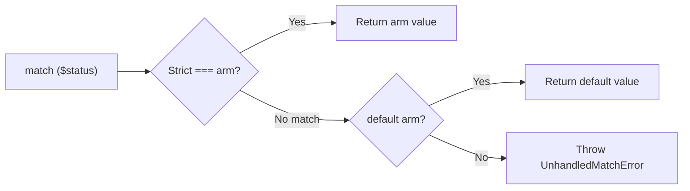

---
tags:
  - php
  - match-expressions
  - beginner
---

# Match Expressions

## TL;DR

Introduced in PHP 8, `match` is a cleaner alternative to `switch` that compares values strictly (`===`), never falls through, and returns a value directly. Each **match arm** (`value => result`) maps one or more inputs to a single result expression, and the whole `match` block ends with `;`.

> [!NOTE] Prerequisites: 01, 02, 05, 10
> New terms: match arm, UnhandledMatchError

> [!abstract] Core Idea
> `match` returns a value using strict `===` comparison with no `break;` needed, and throws an error if nothing matches without `default`.
> PHP's `match` is like Java's switch expression (or Python's `match`), except it uses `=>` arms, checks strictly with `===`, and rejects unmatched inputs loudly.

## Mental Model

Think of `match` as a Book Tracker lookup table: you feed in a status code on the left, it checks each `=>` row using strict `===`, hands back the single label on the right, and refuses to guess if the code is missing from the table.



## Minimal Example

Save this as `match.php` and run `php match.php`:

```php
<?php

$code = "R";

$label = match ($code) {
    "R" => "Reading",
    "D", "F" => "Finished",
    default => "Queued",
};

echo $label;
```

Expected output:

```text
Reading
```

- `$label = match ($code) { ... };` ▸ `match` evaluates to a value, so the closing `}` must end with `;`.
- `=>` ▸ separates the input value on the left from the single result expression on the right.
- `"D", "F" => "Finished"` ▸ comma-separated values in one arm act like logical OR (matches `"D"` or `"F"`).
- `default => "Queued"` ▸ catches any value that did not match an earlier arm.

## Compare

| Feature                       | `switch`                    | `match`                      |
| ----------------------------- | --------------------------- | ---------------------------- |
| Comparison                    | Loose `==`                  | Strict `===`                 |
| Returns a value directly?     | No                          | Yes (ends with `;`)          |
| Needs `break;`?               | Yes (otherwise fallthrough) | No (never falls through)     |
| Missing `default` on no match | Does nothing silently       | Throws `UnhandledMatchError` |

## ◈ Edge Case Analysis

✗ **Mistake 1:** Omitting `default` when an unexpected value can arrive, which throws an **UnhandledMatchError** (a fatal error when no arm matches and no `default` arm exists) instead of returning `null`.

```php
<?php
$code = "X";
$label = match ($code) {
    "R" => "Reading",
}; // Fatal error: Uncaught UnhandledMatchError
```

✓ **Fix:** Include a `default => ...` arm whenever inputs are not strictly guaranteed to match.

```php
<?php
$code = "X";
$label = match ($code) {
    "R" => "Reading",
    default => "Unknown",
};
```

✗ **Mistake 2:** Forgetting the semicolon `;` after the closing `}` of a `match` expression, which causes a syntax error.

```php
<?php
$label = match (1) {
    1 => "One"
} // syntax error
```

✓ **Fix:** Always end `match (...) { ... };` with a semicolon.

```php
<?php
$label = match (1) {
    1 => "One",
};
```

✗ **Mistake 3:** Expecting `"1"` to match `1 => "One"`, which fails because `match` compares with strict `===` (`"1" === 1` is `false`).

```php
<?php
echo match ("1") {
    1 => "One",
    default => "Other",
}; // prints Other
```

✓ **Fix:** Cast the input (such as `(int) $input`) or match the exact string `"1"`.

```php
<?php
echo match ((int) "1") {
    1 => "One",
    default => "Other",
}; // prints One
```

## Try It

- 1. Write a `match` expression on `$stars = 5` that returns `"Favorite"` for `5`, `"Good"` for `3, 4`, and `"Okay"` as `default`, then `echo` it.
- 2. Use `match (true)` with `$pages = 412` to return `"Long"` (`$pages >= 400`), `"Medium"` (`$pages >= 200`), or `"Short"` (`default`).

<details>
<summary>◈ View Solution</summary>

1.

```php
<?php

$stars = 5;
$verdict = match ($stars) {
    5 => "Favorite",
    3, 4 => "Good",
    default => "Okay",
};

echo $verdict;
```

2.

```php
<?php

$pages = 412;
$size = match (true) {
    $pages >= 400 => "Long",
    $pages >= 200 => "Medium",
    default => "Short",
};

echo $size;
```

</details>

## Topic Mastery Quiz

**Q1: What does `echo match ("01") { 1 => "One", default => "Other" };` print?**

- [ ] A) `One`
- [ ] B) `Other`
- [ ] C) `01`
- [ ] D) A syntax error

**Q2: What happens if `match ($x)` has no `default` arm and `$x` matches none of the listed arms?**

- [ ] A) It evaluates to `null`
- [ ] B) It evaluates to `false`
- [ ] C) It throws an `UnhandledMatchError`
- [ ] D) It skips the assignment silently

**Q3: Why does `$x = match ($a) { 1 => "A" }` (without `;` at the end) fail?**

- [ ] A) `match` is an expression, so the statement must end with `;`
- [ ] B) `match` requires at least two arms
- [ ] C) `match` cannot be assigned to a variable
- [ ] D) `match` requires `break;` inside every arm

**Q4: How do you make two values (`"D"` and `"F"`) return the same result in `match`?**

- [ ] A) Stack two `case` lines without `break;`
- [ ] B) Separate the values with a comma: `"D", "F" => "Finished",`
- [ ] C) Join them with `\vert{}\vert{}`: `"D" \vert{}\vert{} "F" => "Finished",`
- [ ] D) Repeat `default` twice

**Q5: Which statement about `match` vs `switch` is TRUE?**

- [ ] A) `match` uses loose `==` comparison, while `switch` uses `===`
- [ ] B) `match` falls through unless you write `break;`
- [ ] C) `match` compares strictly with `===` and never falls through
- [ ] D) `switch` returns a value directly into a variable

**Q6: You write `$r = match (true) { 1 => "A", default => "B" };`. What is `$r`?**

- [ ] A) `"A"`, because `1` is truthy
- [ ] B) `"B"`, because `true === 1` is `false`
- [ ] C) `true`
- [ ] D) `UnhandledMatchError`

<details>
<summary>◈ View Answers & Explanations</summary>

1. **B** — `match` uses strict `===`, and `"01" === 1` is `false`, so it falls into `default` and prints `Other`.
2. **C** — A `match` expression must be exhaustive; if no arm matches and there is no `default`, PHP throws an `UnhandledMatchError`.
3. **A** — Unlike `switch`, `match` is an expression, so `$x = match (...) { ... };` is an assignment statement and requires a trailing `;`.
4. **B** — Comma-separated expressions on the left side of `=>` act as logical OR in a single match arm.
5. **C** — `match` uses `===` and has no fallthrough; `switch` uses `==`, needs `break;`, and does not return a value.
6. **B** — `match` checks `true === 1`, which is `false` under strict comparison, so it selects `default => "B"`.

</details>

## One-Liner

> [!tip] Strict Lookup Rule

> [!quote] Sources
>
> - [PHP Manual — match](https://www.php.net/manual/en/control-structures.match.php)
> - [PHP Manual — switch](https://www.php.net/manual/en/control-structures.switch.php)
