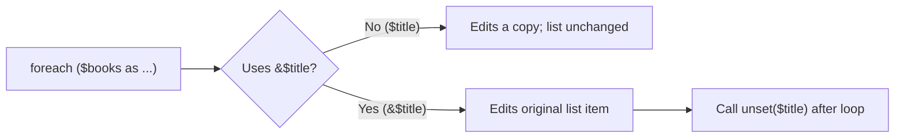

---
tags:
  - php
  - loops
  - foreach
  - beginner
---

# Loops & Foreach

## TL;DR

PHP's `for` and `while` loops work just like Java's, while **foreach** (a loop built to step through every item in a list) gives you each value—and optionally its key with `$key => $val`. By default `foreach` hands you a copy of each item, so edits to `$val` only change the original list if you prefix it with `&$val`.

> [!NOTE] Prerequisites: 01, 02, 04, 10
> New terms: foreach, reference (&)

> [!abstract] Core Idea
> Use `foreach ($items as $key => $val)` to read lists, and add `&$val` (followed by `unset($val);`) only when editing items in place.
> PHP's `for` and `while` match Java's syntax, while `foreach ($books as $i => $title)` works like Python's `for i, title in enumerate(books):` with the list written first.

## Mental Model

Think of `foreach` as a Book Tracker clerk walking down a shelf: normally the clerk copies each title onto a sticky note (`$title`), so crossing out the sticky note leaves the book untouched. Adding `&$title` lets the clerk edit the actual book label—just remember to drop the marker (`unset($title);`) when the walk ends.



## Minimal Example

Save this as `loops.php` and run `php loops.php`:

```php
<?php

$books = ["Dune", "1984"];

foreach ($books as $index => $title) {
    echo "{$index}: {$title}\n";
}

foreach ($books as &$title) {
    $title = "Book: " . $title;
}
unset($title);

echo $books[0];
```

Expected output:

```text
0: Dune
1: 1984
Book: Dune
```

- `foreach ($books as $index => $title)` ▸ steps through `$books`, storing each position in `$index` and value in `$title` (omit `$index =>` if you only need `$title`).
- `&$title` ▸ **reference (&)**: links `$title` directly to the real slot inside `$books` instead of making a copy.
- `unset($title);` ▸ detaches `$title` from the last item in `$books` once the loop finishes.
- `for` / `while` ▸ work identically to Java (`break;` exits the loop early; `continue;` skips to the next iteration).

## Compare

| Loop form               | `$v` holds               | Editing `$v` changes `$arr`? | Needs `unset($v);` after? |
| ----------------------- | ------------------------ | ---------------------------- | ------------------------- |
| `foreach ($arr as $v)`  | A copy of each value     | No                           | No                        |
| `foreach ($arr as &$v)` | A reference to each slot | Yes                          | Yes                       |

## ◈ Edge Case Analysis

✗ **Mistake 1:** Forgetting `unset($title);` after a `&$title` loop and then reusing `$title` in a second `foreach` loop, which silently overwrites the last element of `$books`.

```php
<?php
$nums = [1, 2, 3];
foreach ($nums as &$n) { $n *= 2; }
foreach ($nums as $n) {} // $nums is now [2, 4, 4]!
```

✓ **Fix:** Always call `unset($n);` right after any `foreach (... as &$n)` loop.

```php
<?php
$nums = [1, 2, 3];
foreach ($nums as &$n) { $n *= 2; }
unset($n);
foreach ($nums as $n) {} // $nums stays [2, 4, 6]
```

✗ **Mistake 2:** Editing `$title` inside a plain `foreach ($books as $title)` loop expecting the original list to change, when it actually stays untouched.

```php
<?php
$pages = [100, 200];
foreach ($pages as $p) { $p += 10; }
echo $pages[0]; // still 100
```

✓ **Fix:** Use `&$p` (plus `unset($p);`) when modifying elements in place.

```php
<?php
$pages = [100, 200];
foreach ($pages as &$p) { $p += 10; }
unset($p);
echo $pages[0]; // 110
```

✗ **Mistake 3:** Assuming loop variables vanish after `foreach` ends (like block-scoped variables in Java); in PHP, `$p` still exists after the loop.

```php
<?php
foreach ([10, 20] as $p) {}
echo $p; // prints 20
```

✓ **Fix:** Do not assume `foreach` creates a private variable scope; use distinct names or `unset()` when done.

```php
<?php
foreach ([10, 20] as $pageItem) {}
```

## Try It

- 1. Loop over `$pages = [120, 300, 412]` with `foreach` and print each page count on its own line.
- 2. Use `foreach ($pages as &$p)` to add `5` bonus pages to every item, call `unset($p);`, and `var_dump($pages)`.

<details>
<summary>◈ View Solution</summary>

1.

```php
<?php

$pages = [120, 300, 412];
foreach ($pages as $p) {
    echo $p, "\n";
}
```

2.

```php
<?php

$pages = [120, 300, 412];
foreach ($pages as &$p) {
    $p += 5;
}
unset($p);

var_dump($pages);
```

</details>

## Topic Mastery Quiz

**Q1: You run `$a = [1, 2]; foreach ($a as $v) {$v = 99; } echo $a[0];`. What prints?**

- [ ] A) `99`
- [ ] B) `1`
- [ ] C) `0`
- [ ] D) A syntax error

**Q2: What does `$a = [1, 2, 3]; foreach ($a as &$v) {} foreach ($a as$v) {} var_dump($a);` leave in `$a`?**

- [ ] A) `[1, 2, 3]`
- [ ] B) `[1, 2, 2]`
- [ ] C) `[3, 3, 3]`
- [ ] D) `[1, 1, 1]`

**Q3: How do you access both the index/key and the value in a `foreach` loop?**

- [ ] A) `foreach ($key,$val in $books)`
- [ ] B) `foreach ($books as $key =>$val)`
- [ ] C) `foreach ($books =>$key, $val)`
- [ ] D) `foreach ($books as $key :$val)`

**Q4: What does `foreach ([10, 20] as $n) {} echo$n;` print?**

- [ ] A) Nothing, and emits an undefined variable warning
- [ ] B) `10`
- [ ] C) `20`
- [ ] D) `30`

**Q5: Why should you call `unset($v);` immediately after `foreach ($arr as &$v)`?**

- [ ] A) To delete the entire `$arr` from memory
- [ ] B) To detach `$v` from the last element of `$arr` so later uses of `$v` do not mutate `$arr`
- [ ] C) Because PHP throws a syntax error without `unset($v);`
- [ ] D) To sort `$arr` in ascending order

**Q6: Which statement skips the rest of the current loop iteration and jumps to the next one?**

- [ ] A) `break;`
- [ ] B) `continue;`
- [ ] C) `unset();`
- [ ] D) `match;`

<details>
<summary>◈ View Answers & Explanations</summary>

1. **B** — Without `&`, `$v` is a copy of each item, so setting `$v = 99` leaves `$a[0]` unchanged at `1`.
2. **B** — After the first loop, `$v` remains a reference to `$a[2]`. In the second loop, `$v` is overwritten with `1`, then `2`, and finally `$a[2]` (which is now `2`), leaving `[1, 2, 2]`.
3. **B** — PHP's key-value `foreach` syntax is `foreach ($array as $key =>$value)`.
4. **C** — `foreach` does not create a separate block scope in PHP, so `$n` still holds the last value (`20`) after the loop finishes.
5. **B** — `unset($v)` breaks the lingering reference link between `$v` and the final slot of `$arr` without deleting `$arr`.
6. **B** — `continue;` skips to the next iteration, while `break;` exits the loop completely.

</details>

## One-Liner

> [!tip] Reference & Unset Rule > **Use `foreach ($arr as $k =>$v)` to read safely, and always pair `&$v` with `unset($v);` when editing in place.**

> [!quote] Sources
>
> - [PHP Manual — foreach](https://www.php.net/manual/en/control-structures.foreach.php)
> - [PHP Manual — for](https://www.php.net/manual/en/control-structures.for.php)
> - [PHP Manual — unset](https://www.php.net/manual/en/function.unset.php)
