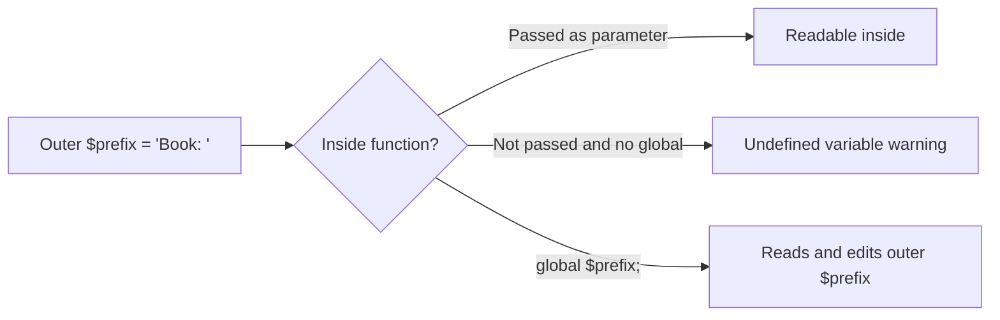

---
tags:
  - php
  - functions
  - scope
  - beginner
---

# Functions & Scope

## TL;DR

You define a reusable function in PHP with `function name($param) { return ...; }`. Variables created inside a function live in **local scope** (invisible outside), while variables outside live in **global scope**—and unlike Python, PHP functions cannot even _read_ global variables unless you pass them as arguments or declare `global $var;`.

> [!NOTE] Prerequisites: 01, 02, 04, 07
> New terms: local scope, global scope

> [!abstract] Core Idea
> PHP functions isolate their **local scope** completely: outer variables are invisible inside unless passed as parameters or imported with `global`.
> PHP's `function` works like Python's `def`, except PHP uses `{}` braces, blocks reading outer globals without `global`, and treats function names as case-insensitive.

## Mental Model

Think of a PHP function as a soundproof Book Tracker back room. You can slide a book card under the door as an argument and get a result back via `return`, but the clerk inside cannot see the whiteboard out in the main hall (**global scope**) unless you open the `global` window.



## Minimal Example

Save this as `functions.php` and run `php functions.php`:

```php
<?php

$prefix = "Book: ";

function formatBook($prefix, $title) {
    $label = $prefix . $title;
    return $label;
}

echo formatBook($prefix, "Dune");
```

Expected output:

```text
Book: Dune
```

- `function formatBook($prefix, $title)` ▸ declares a function; if you omit `return`, PHP returns `null` automatically.
- `$label` ▸ exists only in **local scope** inside `formatBook()` and cannot be read outside it.
- `$prefix` ▸ the parameter receives a copy of `"Book: "`; without passing `$prefix` (or writing `global $prefix;`), `formatBook()` cannot see the outer `$prefix`.
- Function names ▸ unlike `$variables` (case-sensitive), PHP function names are case-insensitive (`FormatBook(...)` calls the same function).

## Compare

| Mechanism        | Where value comes from | Survives after call?      | Recommended?        |
| ---------------- | ---------------------- | ------------------------- | ------------------- |
| Parameter (`$x`) | Passed in by caller    | No (fresh each call)      | Yes (cleanest)      |
| `global $x;`     | Outer script's `$x`    | Yes (edits outer `$x`)    | Avoid when possible |
| `static $x = 0;` | Retained across calls  | Yes (private to function) | For simple counters |

## ◈ Edge Case Analysis

✗ **Mistake 1:** Reading a global variable inside a function without passing it or using `global`, which triggers an `Undefined variable` warning and evaluates to `null` (unlike Python).

```php
<?php
$site = "Book Tracker";
function showSite() {
    echo $site; // Warning: Undefined variable $site
}
showSite();
```

✓ **Fix:** Pass outer values into the function as parameters.

```php
<?php
$site = "Book Tracker";
function showSite($site) {
    echo $site;
}
showSite($site);
```

✗ **Mistake 2:** Forgetting `return` in a function whose result you assign or `echo`, which silently yields `null`.

```php
<?php
function addPages($a, $b) {
    $sum = $a + $b;
}
var_dump(addPages(100, 200)); // NULL
```

✓ **Fix:** Always include `return` when the caller expects a value back.

```php
<?php
function addPages($a, $b) {
    return $a + $b;
}
var_dump(addPages(100, 200)); // int(300)
```

✗ **Mistake 3:** Declaring two functions whose names differ only in letter case, which causes a fatal `Cannot redeclare` error because function names are case-insensitive.

```php
<?php
function addBook() {}
function AddBook() {} // Fatal error: Cannot redeclare AddBook()
```

✓ **Fix:** Give every function a distinct name.

```php
<?php
function addBook() {}
function removeBook() {}
```

## Try It

- 1. Write a function `totalPages($p1, $p2)` that returns `$p1 + $p2`, then `echo` `totalPages(328, 412)`.
- 2. Write a function `nextId()` using `static $id = 0;` that increments `$id` by `1` and returns it, then call it twice to see `1` and `2`.

<details>
<summary>◈ View Solution</summary>

1.

```php
<?php

function totalPages($p1, $p2) {
    return $p1 + $p2;
}

echo totalPages(328, 412); // 740
```

2.

```php
<?php

function nextId() {
    static $id = 0;
    $id++;
    return $id;
}

echo nextId(), "\n"; // 1
echo nextId(), "\n"; // 2
```

</details>

## Topic Mastery Quiz

**Q1: You define `$x = 10;` outside a function and write `function f() { return $x; } echo f();`. What happens?**

- [ ] A) Prints `10`
- [ ] B) Emits an `Undefined variable` warning and returns `null` (prints nothing)
- [ ] C) Causes a syntax error
- [ ] D) Prints `0`

**Q2: What does `function f() { $a = 5; } var_dump(f());` print?**

- [ ] A) `int(5)`
- [ ] B) `NULL`
- [ ] C) `bool(false)`
- [ ] D) A `TypeError`

**Q3: Which statement about PHP function names vs variable names is TRUE?**

- [ ] A) Both function names and variable names are case-sensitive
- [ ] B) Variable names are case-sensitive, while function names are case-insensitive
- [ ] C) Function names are case-sensitive, while variable names are case-insensitive
- [ ] D) Both are case-insensitive

**Q4: Inside `function bump() { static $n = 1; echo $n; $n++; }`, what does calling `bump(); bump();` print?**

- [ ] A) `11`
- [ ] B) `12`
- [ ] C) `23`
- [ ] D) `Undefined variable` warning

**Q5: You write `$count = 1; function inc() { global $count; $count += 5; } inc(); echo $count;`. What prints?**

- [ ] A) `1`
- [ ] B) `5`
- [ ] C) `6`
- [ ] D) Nothing

**Q6: Which way of giving a function access to `$site = "Tracker";` is recommended in clean PHP?**

- [ ] A) Pass `$site` as a function parameter
- [ ] B) Use `global $site;` inside every function
- [ ] C) Omit `$` on `$site`
- [ ] D) Leave it out and let PHP find it automatically

<details>
<summary>◈ View Answers & Explanations</summary>

1. **B** — Unlike Python, PHP functions cannot read outer global variables without `global $x;` or a parameter, so `$x` inside `f()` is an undefined local variable (`null`).
2. **B** — A function without a `return` statement implicitly returns `null`, which `var_dump()` prints as `NULL`.
3. **B** — `$var` and `$Var` are different variables, whereas `formatBook()` and `FormatBook()` refer to the exact same function.
4. **B** — A `static` local variable keeps its value between calls to that function, so the first call prints `1` and increments to `2`, and the second prints `2`.
5. **C** — `global $count;` links the local `$count` to the outer `$count`, so `$count += 5` updates the outer variable to `6`.
6. **A** — Passing values as parameters keeps functions predictable and self-contained without hidden dependencies on global state.

</details>

## One-Liner

> [!tip] Soundproof Room Rule
> **PHP functions cannot see outer variables unless you pass them in—and any function without `return` hands back `null`.**

> [!quote] Sources
>
> - [PHP Manual — User-defined functions](https://www.php.net/manual/en/functions.user-defined.php)
> - [PHP Manual — Variable scope](https://www.php.net/manual/en/language.variables.scope.php)
