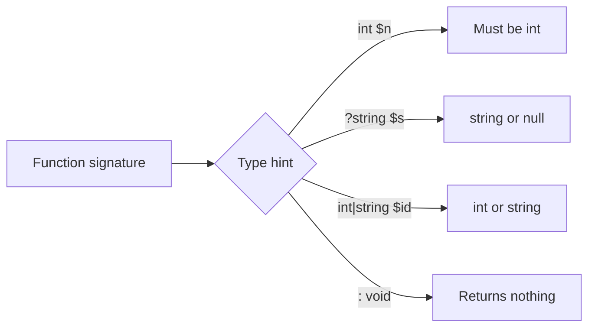

---
tags:
  - php
  - type-hints
  - beginner
---

# Type Hints

## TL;DR

PHP lets you declare expected types on function parameters and return values—for example, `function label(int $pages): string`. You can allow `null` with a **nullable type** (`?string`), accept multiple types with a **union type** (`int|string`), or mark "returns nothing" with `: void`.

> [!NOTE] Prerequisites: 03, 06, 13
> New terms: nullable type, union type

> [!abstract] Core Idea
> Type hints declare and enforce what types a function accepts and returns (strictly when `declare(strict_types=1);` is active).
> PHP's `function f(int $a): string` works like Python's `def f(a: int) -> str:` and Java's `String f(int a)`, except PHP enforces the types at runtime.

## Mental Model

Think of type hints as labeled slots on a Book Tracker intake chute: `int $pages` only accepts whole-number cards, `?string $note` accepts either a text card or a blank `null` card, and `: void` means the chute is one-way and hands nothing back.



## Minimal Example

Save this as `type_hints.php` and run `php type_hints.php`:

```php
<?php
declare(strict_types=1);

function logBook(string $title, int|float $rating, ?string $note = null): void {
    echo "{$title} ({$rating}) - ", $note ?? "No note", "\n";
}

logBook("Dune", 4.8);
logBook("1984", 5, "Classic");
```

Expected output:

```text
Dune (4.8) - No note
1984 (5) - Classic
```

- `string $title` ▸ parameter types go _before_ the parameter name.
- `int|float $rating` ▸ **union type**: accepts either an `int` or a `float`.
- `?string $note = null` ▸ **nullable type**: accepts either a `string` or `null` (defaulting to `null`).
- `: void` ▸ return type goes _after_ `)` with `:`; `void` means the function must not return a value.

## Compare

| Syntax        | Meaning                           | Example                 |
| ------------- | --------------------------------- | ----------------------- |
| `?string`     | `string` or `null`                | `?string $note = null`  |
| `int\|string` | Either `int` or `string`          | `int\|string $bookId`   |
| `: void`      | Returns no value (`return;` only) | `function save(): void` |

## ◈ Edge Case Analysis

✗ **Mistake 1:** Writing `string $note = null` without `?` or `|null`; in PHP 8.4, implicitly nullable parameters are deprecated and emit a warning.

```php
<?php
function logNote(string $note = null): void {} // Deprecated in PHP 8.4
```

✓ **Fix:** Always mark nullable parameters explicitly with `?string` or `string|null`.

```php
<?php
function logNote(?string $note = null): void {}
```

✗ **Mistake 2:** Writing `return null;` inside a `: void` function, which causes a fatal error because `void` forbids returning any value—even `null`.

```php
<?php
function saveBook(): void {
    return null; // Fatal error
}
```

✓ **Fix:** Use a bare `return;` (with no value) or omit `return` in `: void` functions.

```php
<?php
function saveBook(): void {
    return;
}
```

✗ **Mistake 3:** Putting the return type before `function` like in Java, which causes a syntax error.

```php
<?php
string function getTitle() { // syntax error
    return "Dune";
}
```

✓ **Fix:** Place the return type after the parameter list using a colon `:`.

```php
<?php
function getTitle(): string {
    return "Dune";
}
```

## Try It

- 1. Write a strict-mode function `formatId(int|string $id): string` that returns `"ID: {$id}"`, and test it with `101` and `"B-7"`.
- 2. Write `printNote(?string $note): void` that prints `$note ?? "Empty"` and returns early with `return;` if `$note === null`.

<details>
<summary>◈ View Solution</summary>

1.

```php
<?php
declare(strict_types=1);

function formatId(int|string $id): string {
    return "ID: {$id}";
}

echo formatId(101), "\n", formatId("B-7");
```

2.

```php
<?php
declare(strict_types=1);

function printNote(?string $note): void {
    if ($note === null) {
        echo "Empty\n";
        return;
    }
    echo $note, "\n";
}
```

</details>

## Topic Mastery Quiz

**Q1: Which function signature is valid without deprecation warnings in PHP 8.4?**

- [ ] A) `function f(string $s = null): void`
- [ ] B) `function f(?string $s = null): void`
- [ ] C) `string function f(?string $s = null)`
- [ ] D) `function f(string? $s = null): void`

**Q2: What happens if a `: void` function executes `return null;`?**

- [ ] A) It works normally and returns `null`
- [ ] B) PHP throws a fatal error because `: void` forbids returning any value
- [ ] C) PHP converts `null` to `""`
- [ ] D) It prints `NULL`

**Q3: What does the parameter type `int|string $id` allow?**

- [ ] A) Only values that are both `int` and `string`
- [ ] B) Either an `int` or a `string`
- [ ] C) Any scalar type including `bool`
- [ ] D) `int`, `string`, or `null`

**Q4: With `declare(strict_types=1);` enabled, what happens when you call `function f(int $n): int { return$n; } f("5");`?**

- [ ] A) Returns `5`
- [ ] B) Returns `"5"`
- [ ] C) Throws a `TypeError`
- [ ] D) Emits a deprecation warning only

**Q5: Where does a function's return type go in PHP?**

- [ ] A) Before `function`
- [ ] B) Inside the parameter parentheses
- [ ] C) After `)` preceded by a colon `:`
- [ ] D) After `{` on the first line of the body

**Q6: Which return statement IS allowed inside a `: void` function?**

- [ ] A) `return;`
- [ ] B) `return null;`
- [ ] C) `return false;`
- [ ] D) `return 0;`

<details>
<summary>◈ View Answers & Explanations</summary>

1. **B** — `?string $s = null` explicitly marks the parameter as nullable; A triggers a PHP 8.4 deprecation, C puts the return type in the wrong place, and D puts `?` on the wrong side.
2. **B** — A `: void` function cannot return any value, not even `null`; only a bare `return;` is allowed.
3. **B** — `int|string` is a union type accepting either `int` or `string` (not `bool` or `null` unless listed).
4. **C** — With `strict_types=1`, passing `"5"` (`string`) to an `int` parameter throws a `TypeError`.
5. **C** — PHP return types follow the parameter list after a colon, such as `function title(): string`.
6. **A** — `return;` exits a `: void` function early without returning a value; returning `null`, `false`, or `0` causes a fatal error.

</details>

## One-Liner

> [!tip] Explicit Contracts Rule
> **Put parameter types before `$name`, return types after `):`, and `?` before any type that allows `null`.**

> [!quote] Sources
>
> - [PHP Manual — Type Declarations](https://www.php.net/manual/en/language.types.declarations.php)
> - [PHP 8.4 — Deprecate implicitly nullable parameter types](https://www.php.net/releases/8.4/en.php)
