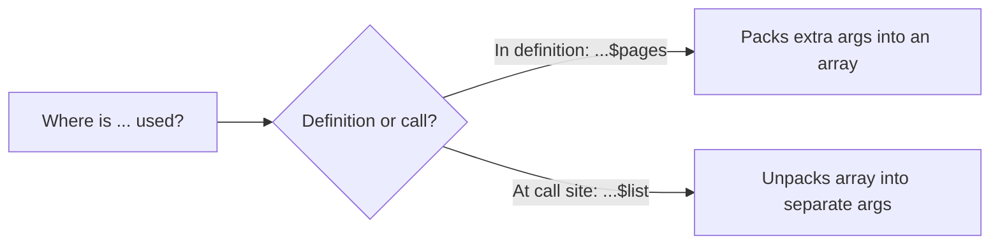

---
tags:
  - php
  - named-arguments
  - variadics
  - beginner
---

# Named Arguments & Variadics

## TL;DR

**Named arguments** (`paramName: value`) let you pass arguments by parameter name in any order and skip optional defaults in the middle. A **variadic parameter** (`...$args`) at the end of a function signature collects zero or more extra arguments into one list—and the same `...` at a call site unpacks a list back into separate arguments.

> [!NOTE] Prerequisites: 12, 13, 14
> New terms: named argument, variadic parameter

> [!abstract] Core Idea
> Put positional arguments before `name: $value` arguments, and use `...$args` last in a signature to pack extras or `...$list` at a call to unpack them.
> PHP's `name: $val` and `...$args` work like Python's `name=val` and `*args`, except PHP uses `:` instead of `=` for named arguments and `...` for both packing and unpacking.

## Mental Model

Think of **named arguments** as labeled envelopes in a Book Tracker mailroom: you can drop them in any order because the label on the front says which slot they belong to. A **variadic parameter** (`...$pages`) is a catch-all bin at the end of the counter that sweeps up any number of extra items.



## Minimal Example

Save this as `args.php` and run `php args.php`:

```php
<?php
declare(strict_types=1);

function addBook(string $title, int $pages = 200, bool $read = false): string {
    $status = $read ? "Read" : "Unread";
    return "{$title} ({$pages}p) - {$status}";
}

function sumPages(int ...$pages): int {
    return array_sum($pages);
}

echo addBook("Dune", read: true), "\n";
$list = [328, 412];
echo sumPages(100, ...$list);
```

Expected output:

```text
Dune (200p) - Read
840
```

- `addBook("Dune", read: true)` ▸ **named argument** `read: true` skips the optional `$pages` parameter and sets `$read` directly (written without `$`).
- `int ...$pages` ▸ **variadic parameter**: collects any number of `int` arguments into `$pages` (must be the last parameter, with no default value).
- `sumPages(100, ...$list)` ▸ `...$list` at the call site unpacks `[328, 412]` into individual arguments `328, 412`.

## Compare

| Where `...` appears | Name               | What it does                    | Example                 |
| ------------------- | ------------------ | ------------------------------- | ----------------------- |
| Function definition | Variadic parameter | Packs arguments into an array   | `function f(int ...$n)` |
| Function call       | Argument unpacking | Spreads an array into arguments | `f(...$list)`           |

## ◈ Edge Case Analysis

✗ **Mistake 1:** Placing a positional argument after a named argument, which triggers a fatal compile-time error.

```php
<?php
echo addBook(read: true, "Dune"); // Fatal error
```

✓ **Fix:** Always write all positional arguments before any named arguments.

```php
<?php
echo addBook("Dune", read: true);
```

✗ **Mistake 2:** Putting `$` on a named argument label (`$read: true`), which causes a syntax error.

```php
<?php
echo addBook("Dune", $read: true); // syntax error
```

✓ **Fix:** Write the parameter name without `$`, followed by a colon `:`.

```php
<?php
echo addBook("Dune", read: true);
```

✗ **Mistake 3:** Putting another parameter after `...$pages` or giving `...$pages` a default value (`= []`), both of which cause a syntax error.

```php
<?php
function bad(int ...$pages = []): void {} // syntax error
```

✓ **Fix:** Keep the variadic parameter last with no `= ...` default value.

```php
<?php
function good(string $label, int ...$pages): void {}
```

## Try It

- 1. Write `bookTag(string $title, string $genre = "Fiction", int $year = 2024): string` and call it passing `"Dune"` positionally and `year: 1965` by name (skipping `$genre`).
- 2. Call `sumPages(...[120, 200, 80])` (from the example above) to unpack a list of page counts.

<details>
<summary>◈ View Solution</summary>

1.

```php
<?php
declare(strict_types=1);

function bookTag(string $title, string $genre = "Fiction", int $year = 2024): string {
    return "{$title} [{$genre}, {$year}]";
}

echo bookTag("Dune", year: 1965); // Dune [Fiction, 1965]
```

2.

```php
<?php
declare(strict_types=1);

function sumPages(int ...$pages): int {
    return array_sum($pages);
}

echo sumPages(...[120, 200, 80]); // 400
```

</details>

## Topic Mastery Quiz

**Q1: Which call to `function f(string $a, int $b = 1, bool$c = false)` is INVALID?**

- [ ] A) `f("x", c: true)`
- [ ] B) `f(c: true, a: "x")`
- [ ] C) `f(c: true, "x")`
- [ ] D) `f("x", 2, true)`

**Q2: What does `sumPages(int ...$pages)` receive if you call `sumPages()` with zero arguments?**

- [ ] A) A `TypeError`
- [ ] B) `$pages` is `null`
- [ ] C) `$pages` is an empty list `[]`
- [ ] D) A syntax error

**Q3: How do you pass `$pages = 412` as a named argument to `addBook($title,$pages)`?**

- [ ] A) `addBook("Dune", $pages: 412)`
- [ ] B) `addBook("Dune", pages = 412)`
- [ ] C) `addBook("Dune", pages: 412)`
- [ ] D) `addBook("Dune", pages => 412)`

**Q4: What happens if you pass `addBook("Dune", 412, pages: 500)`?**

- [ ] A) `500` silently overwrites `412`
- [ ] B) PHP throws an Error because `$pages` was passed both positionally and by name
- [ ] C) `412` is kept and `500` is ignored
- [ ] D) PHP prints `412500`

**Q5: Which function signature is valid in PHP 8.4?**

- [ ] A) `function logAll(string ...$items, int$limit): void`
- [ ] B) `function logAll(string ...$items = []): void`
- [ ] C) `function logAll(int $limit, string ...$items): void`
- [ ] D) `function logAll(string ...$items, ...$extra): void`

**Q6: What does `...$nums` do inside `sumPages(10, ...$nums)` when `$nums = [20, 30]`?**

- [ ] A) Wraps `[20, 30]` inside another nested list
- [ ] B) Unpacks `[20, 30]` so `sumPages` receives `10, 20, 30`
- [ ] C) Converts `[20, 30]` into a string `"2030"`
- [ ] D) Deletes `10`

<details>
<summary>◈ View Answers & Explanations</summary>

1. **C** — Positional arguments (`"x"`) cannot follow named arguments (`c: true`). A, B, and D are all valid calls.
2. **C** — A variadic parameter collects zero or more arguments into an array, so calling `sumPages()` gives `$pages = []`.
3. **C** — Named arguments use `paramName: value` without `$`, `=`, or `=>`.
4. **B** — Passing the same parameter both positionally and by name throws a fatal `Error` (`Named parameter $pages overwrites previous argument`).
5. **C** — A variadic parameter must be the final parameter and cannot have an explicit default value. A, B, and D all violate these rules.
6. **B** — At a call site, `...$nums` spreads the array elements out as individual arguments (`10, 20, 30`).

</details>

## One-Liner

> [!tip] Position Before Name, Splat Last
> **Put positional arguments before `name: value`, and keep `...$args` last in signatures (or use `...$list` at calls to unpack).**

> [!quote] Sources
>
> - [PHP Manual — Function Arguments](https://www.php.net/manual/en/functions.arguments.php)
