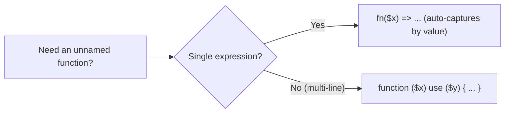

---
tags:
  - php
  - closures
  - arrow-functions
  - later
---

# Closures & Arrow Functions

## TL;DR

A **closure** is an unnamed function you can store in a variable or pass to another function—it requires `use ($x)` to read outer variables. An **arrow function** (`fn($x) => ...`) is a compact one-expression closure that returns automatically and captures outer variables by value without `use`.

> [!NOTE] Prerequisites: 13, 14
> New terms: closure, arrow function, callable

> [!abstract] Core Idea
> Use `function (...) use ($x) { ... };` for multi-line closures, and `fn(...) => ...;` for single-expression callbacks.
> PHP's `fn($x) => $x * 2` is like JavaScript's `x => x * 2` (or Python's `lambda`), except PHP requires `fn` and captures outer variables by value only.

## Mental Model

Think of a **closure** as a sealed Book Tracker task card you hand to a helper: with `function ()`, you must write every outer note you want copied onto the card inside `use (...)`; with `fn() =>`, the helper automatically takes a photocopy of any outer variable you mention.



## Minimal Example

Save this as `closures.php` and run `php closures.php`:

```php
<?php
declare(strict_types=1);

$minPages = 300;

$isLong = function (int $pages) use ($minPages): bool {
    return $pages >= $minPages;
};

$tag = fn(int $pages): string => $isLong($pages) ? "Long" : "Short";

function describe(int $pages, callable $formatter): string {
    return $formatter($pages);
}

echo describe(412, $tag);
```

Expected output:

```text
Long
```

- `$isLong = function (int $pages) use ($minPages): bool { ... };` ▸ **closure** stored in `$isLong` (ends with `;`); `use ($minPages)` copies `$minPages` from the outer scope.
- `fn(int $pages): string => ...` ▸ **arrow function**: no `{}` braces, no `return` keyword, and `$isLong` is captured automatically by value.
- `callable $formatter` ▸ **callable** type hint accepts any function or closure that can be invoked with `()`.

## Compare

| Feature                    | Closure (`function ()`)            | Arrow function (`fn()`)               |
| -------------------------- | ---------------------------------- | ------------------------------------- |
| Body                       | Multi-line `{ ... }` with `return` | Single expression (implicit `return`) |
| Outer variables            | Must list in `use ($x)`            | Captured automatically by value       |
| Can mutate outer variable? | Only with `use (&$x)`              | No (always by value)                  |

## ◈ Edge Case Analysis

✗ **Mistake 1:** Reading an outer variable inside `function () { ... }` without `use ($var)`, which triggers an `Undefined variable` warning and evaluates to `null`.

```php
<?php
$tax = 10;
$addTax = function (int $p): int {
    return $p + $tax; // Warning: Undefined variable $tax
};
```

✓ **Fix:** List outer variables in `use ($tax)` before the `: returnType`.

```php
<?php
$tax = 10;
$addTax = function (int $p) use ($tax): int {
    return $p + $tax;
};
```

✗ **Mistake 2:** Trying to increment an outer counter inside an arrow function (`fn() => $count++`), which leaves the outer `$count` unchanged because arrow functions capture by value.

```php
<?php
$count = 0;
$inc = fn() => $count++;
$inc();
echo $count; // still 0
```

✓ **Fix:** Use a regular closure with `use (&$count)` when you need to modify an outer variable.

```php
<?php
$count = 0;
$inc = function () use (&$count): void { $count++; };
$inc();
echo $count; // 1
```

✗ **Mistake 3:** Forgetting the trailing semicolon `;` after assigning a closure to a variable, which causes a syntax error.

```php
<?php
$f = function (): int { return 1; } // syntax error
```

✓ **Fix:** Always end a closure assignment with `;` after the closing `}`.

```php
<?php
$f = function (): int { return 1; };
```

## Try It

- 1. Store an arrow function in `$isShort` that takes `int $pages` and returns `true` when `$pages < 200`, then test it with `var_dump($isShort(150))`.
- 2. Write a closure `$bump` with `use (&$total)` that adds `$pages` to `$total = 100`, call `$bump(50)`, and `echo $total`.

<details>
<summary>◈ View Solution</summary>

1.

```php
<?php
declare(strict_types=1);

$isShort = fn(int $pages): bool => $pages < 200;
var_dump($isShort(150)); // bool(true)
```

2.

```php
<?php
declare(strict_types=1);

$total = 100;
$bump = function (int $pages) use (&$total): void {
    $total += $pages;
};

$bump(50);
echo $total; // 150
```

</details>

## Topic Mastery Quiz

**Q1: With `$rate = 2; $fn = function ($x) { return$x * $rate; }; echo$fn(5);`, what happens?**

- [ ] A) Prints `10`
- [ ] B) Emits an `Undefined variable` warning for `$rate` inside the closure
- [ ] C) Prints `5`
- [ ] D) Throws a `TypeError`

**Q2: What does `$x = 1; $fn = fn() => $x++;$fn(); echo $x;` print?**

- [ ] A) `2`
- [ ] B) `1`
- [ ] C) `0`
- [ ] D) A syntax error

**Q3: Where does `: int` go in a closure that uses `use ($tax)`?**

- [ ] A) `function ($p): int use ($tax) { ... }`
- [ ] B) `function ($p) use ($tax): int { ... }`
- [ ] C) `use ($tax) function ($p): int { ... }`
- [ ] D) Closures cannot have return types

**Q4: How many expressions can an arrow function (`fn() => ...`) contain?**

- [ ] A) Any number inside `{ ... }`
- [ ] B) Exactly one expression, whose value is returned automatically
- [ ] C) Two expressions separated by `;`
- [ ] D) Zero expressions

**Q5: Which closure definition actually modifies `$count = 0` in the outer scope when called?**

- [ ] A) `$f = fn() => $count++;`
- [ ] B) `$f = function () use ($count) {$count++; };`
- [ ] C) `$f = function () use (&$count) { $count++; };`
- [ ] D) `$f = function ($count) {$count++; };`

**Q6: Which parameter type hint accepts any function or closure?**

- [ ] A) `function`
- [ ] B) `callable`
- [ ] C) `closure`
- [ ] D) `void`

<details>
<summary>◈ View Answers & Explanations</summary>

1. **B** — Regular closures (`function ()`) do not see outer variables unless listed in `use ($rate)`, so `$rate` is undefined inside.
2. **B** — Arrow functions capture outer variables by value, so `$x++` only increments the inner copy and outer `$x` stays `1`.
3. **B** — The return type (`: int`) always follows the `use (...)` clause right before `{`.
4. **B** — Arrow functions (`fn(...) => expr`) only allow a single expression and implicitly return its result.
5. **C** — Passing `&$count` into `use (&$count)` creates a reference to the outer `$count`; A, B, and D all work on copies.
6. **B** — `callable` is PHP's built-in parameter type hint for anything that can be called with `()`.

</details>

## One-Liner > [!tip] Capture Rule > **Use `fn() =>` for one-line auto-captured callbacks, and `function () use (&$x)` when you need multiple lines or outer mutations.**

> [!quote] Sources
>
> - [PHP Manual — Anonymous functions](https://www.php.net/manual/en/functions.anonymous.php)
> - [PHP Manual — Arrow Functions](https://www.php.net/manual/en/functions.arrow.php)
