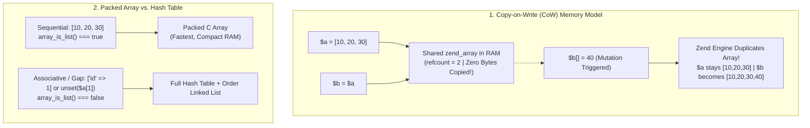

---
tags:
  - php
  - arrays
  - hash-map
  - spl
  - generators
---

# PHP Arrays (The List + Dict Hybrid) & SPL in PHP

#### TL;DR (Quick Revision)

**PHP `array`** = A single, unified **ordered hash map** data structure (`[...]`) where every element is a `key => value` pair with `int` or `string` keys, passed by value using **Copy-on-Write (CoW)** memory optimization, and extended by PHP 8.4's `array_find()` family, **Generators (`yield`)**, and the **Standard PHP Library (SPL)**.

> [!abstract] Core Idea
> Unlike languages that separate sequential lists, associative dictionaries, stacks, and queues into distinct types, PHP unifies all of them into a single compound type: the [`array`](https://www.php.net/manual/en/language.types.array.php)[cite: 1]. Under the hood, every PHP array is an **ordered hash table** combined with a doubly-linked list (preserving exact insertion order) — though the Zend Engine automatically optimizes contiguous `0 .. n-1` integer-indexed arrays into compact **"Packed Arrays"** in C memory.

> [!question] Why Master PHP Arrays, Generators & SPL?
>
> - **Understand Key Coercion Before It Corrupts Data**: PHP array keys can **only** be `int` or `string` ([PHP Manual: Array Keys](https://www.php.net/manual/en/language.types.array.php#language.types.array.syntax.modifying)). Floats, booleans, `null`, and numeric strings like `"42"` are silently cast into integers or strings, which can overwrite existing keys!
> - **Leverage Copy-on-Write (CoW) Performance**: Passing a 100,000-element array to a function (`process($hugeArray)`) copies **zero bytes** of array data in RAM until the function actually mutates the array[cite: 1].
> - **Write Clean Functional Pipelines**: Mastering [`array_map()`](https://www.php.net/manual/en/function.array-map.php), [`array_filter()`](https://www.php.net/manual/en/function.array-filter.php), [`array_reduce()`](https://www.php.net/manual/en/function.array-reduce.php), and PHP 8.4's new [`array_find()`](https://www.php.net/releases/8.4/en.php#array_find) eliminates verbose loop boilerplate[cite: 1].
> - **Process Gigabytes of Data in `< 1 MB` of RAM**: Replacing massive arrays with **[Generators (`yield`)](https://phptherightway.com/#generators)** and **[SPL Data Structures](https://phptherightway.com/#standard_php_library)** prevents `Fatal error: Allowed memory size exhausted`.

#### Quick Reference Table: Legacy / Trap Array Patterns vs. Modern PHP 8.4/8.5+

| Operation / Concept       | Legacy / Error-Prone PHP                         | Modern PHP 8.4/8.5+ (The Right Way)       | Engine Behavior & Verifiable Source                                                                                                                                                                                          |
| :------------------------ | :----------------------------------------------- | :---------------------------------------- | :--------------------------------------------------------------------------------------------------------------------------------------------------------------------------------------------------------------------------- |
| **Array Declaration**     | `array(1, 2, 3)`                                 | `[1, 2, 3]` or `['id' => 1]`              | Short syntax `[...]` is the PSR-12 standard ([PHP Arrays](https://www.php.net/manual/en/language.types.array.php))[cite: 1].                                                                                                 |
| **Membership Check**      | `in_array($val, $arr)` _(Loose `==`!)_           | `in_array($val, $arr, true)`              | Without the 3rd arg `true`, `in_array()` uses loose `==` comparison ([`in_array` Docs](https://www.php.net/manual/en/function.in-array.php)).                                                                                |
| **Key Existence Check**   | `isset($arr[$k])` _(Fails on `null`)_            | `array_key_exists($k, $arr)` or `isset()` | `isset()` returns `false` if `$arr[$k] === null`; [`array_key_exists()`](https://www.php.net/manual/en/function.array-key-exists.php) returns `true`.                                                                        |
| **Merging Lists vs Maps** | `$a + $b` _(Drops right-side duplicates!)_       | `[...$a, ...$b]` or `array_merge($a, $b)` | `+` (Union) keeps the **left** key on collision; `[...$a, ...$b]` and [`array_merge()`](https://www.php.net/manual/en/function.array-merge.php) overwrite string keys from the **right** and re-index integer keys[cite: 1]. |
| **Finding First Match**   | `foreach` loop with temporary `$found` var       | `array_find($arr, fn($x) => ...)`         | Native in **PHP 8.4+** along with `array_find_key()`, `array_any()`, and `array_all()` ([PHP 8.4 Release](https://www.php.net/releases/8.4/en.php#array_find))[cite: 1].                                                     |
| **First / Last Value**    | `reset($arr)` / `end($arr)` _(Mutates pointer!)_ | `array_first($arr)` / `array_last($arr)`  | Native in **PHP 8.5+** without mutating the internal array pointer ([PHP 8.5 Release](https://www.php.net/releases/8.5/en.php)).                                                                                             |

---

## The Learning Concept

### What Problem Does It Solve?

Because PHP arrays serve as both sequential lists (`[10, 20, 30]`) and associative dictionaries (`['role' => 'admin']`), three classic bugs happen when developers treat PHP arrays like strict lists:

1. **Silent Key Casting Overwrites**: Using `"1"`, `1.9`, `true`, and `1` as keys in the same array silently casts all four keys to integer `1`, destroying the first three values ([PHP Manual: Key Casting](https://www.php.net/manual/en/language.types.array.php)).
2. **`array_filter()` Preserves Sparse Keys**: Filtering `[10, 20, 30]` to remove `20` leaves indices `[0 => 10, 2 => 30]` (missing index `1`!). Encoding that sparse array with `json_encode()` outputs a JSON **object** `{"0":10,"2":30}` instead of a JSON **array** `[10,30]`!
3. **Loose `in_array()` Security Bypasses**: Calling `in_array($input, $allowedRoles)` without `$strict = true` uses loose `==` comparison.

Look at this **`// BAD`** PHP snippet demonstrating all three traps:

```php
<?php
// BAD - Key collision, loose in_array(), and sparse array_filter() gap!

// 1. All 4 keys silently coerce to int(1) and overwrite each other!
$collision = [
    1    => 'First',
    '1'  => 'Second', // String '1' casts to int(1)
    1.99 => 'Third',  // Float 1.99 truncates to int(1)
    true => 'Fourth', // Bool true casts to int(1)
];
var_dump(count($collision)); // int(1) -> Only [1 => 'Fourth'] survived!

// 2. Loose in_array() without 3rd argument (true) uses == type juggling!
$allowedIds = [100, 200, 300];
if (in_array("200", $allowedIds)) { // Loosely matches string "200" == int 200!
    echo "Loose in_array passed!" . PHP_EOL;
}

// 3. array_filter() leaves a gap at index 0, breaking sequential list indexing!
$scores = [0, 85, 92];
$nonZero = array_filter($scores); // Preserves keys: [1 => 85, 2 => 92]
echo json_encode($nonZero) . PHP_EOL; // Prints {"1":85,"2":92} (JSON Object, NOT JSON Array!)
```

**Why this fails:** First, the Zend Engine forces all array keys to `int` or `string`. Second, `in_array()` defaults to `$strict = false`. Third, [`array_filter()`](https://www.php.net/manual/en/function.array-filter.php) preserves original keys, turning sequential lists (`array_is_list() === true`) into associative sparse maps (`array_is_list() === false`).

Now look at the **`// GOOD`** modern **PHP 8.4/8.5 + _PHP: The Right Way_** solution:

```php
<?php

declare(strict_types=1);

// GOOD - Strict in_array(..., true), explicit array_filter callback + array_values(), and PHP 8.4 array_find()

$allowedIds = [100, 200, 300];

// 1. Always pass true as the 3rd argument to in_array() and array_search()!
var_dump(in_array("200", $allowedIds, true)); // bool(false) -> Strict === check!

// 2. Re-index with array_values() after array_filter() to guarantee a contiguous 0..n-1 list!
$scores = [0, 85, 92];
$validScores = array_values(array_filter($scores, fn(int $s): bool => $s > 0));

var_dump(array_is_list($validScores)); // bool(true) (PHP 8.1+ list validator)
echo json_encode($validScores) . PHP_EOL; // Prints [85,92] (Valid JSON Array!)

// 3. PHP 8.4+ array_find() and array_any() replace manual foreach search loops
$firstHighScorer = array_find($validScores, fn(int $s): bool => $s >= 90);
var_dump($firstHighScorer); // int(92)
```

---

### How PHP Implements Arrays & Copy-on-Write Under the Hood

> [!tip] Inside the Zend Engine `zend_array` (HashTable) & Copy-on-Write
>
> 1. **Packed Arrays vs. Hash Maps**:
>    In C (`zend_types.h`), every PHP array is a `zend_array` struct ([PHP Internals Book: HashTables](https://www.phpinternalsbook.com/php7/internal_types/hashtables.html)):
>    - **Packed Array (Sequential List)**: If keys are sequential integers starting at `0` (`0, 1, 2...`), PHP skips the hash table lookup array entirely and stores elements contiguously like a C array. You can verify if an array is a true sequential list using PHP 8.1+'s [`array_is_list($arr)`](https://www.php.net/manual/en/function.array-is-list.php).
>    - **Hash Table (Associative Map)**: The moment you use a string key (`'name' => 'Valay'`), a negative key, or delete a middle element (`unset($arr[1])`), PHP converts the array into a full Hash Table with collision chains while maintaining insertion order.
> 2. **The 5 Exact Key Coercion Rules ([PHP Manual](https://www.php.net/manual/en/language.types.array.php))**:
>    - Strings containing valid decimal integers without leading `+` or `0` (`"8"`, `"-5"`) are cast to **`int`** (`8`, `-5`). However, `"08"` and `"+8"` stay **`string`**!
>    - `float` keys are truncated to **`int`** (`8.7` $\rightarrow$ `8`), and in **PHP 8.1+**, float-to-int key conversion that loses fractional precision emits a **Deprecation Notice**!
>    - `bool` keys are cast to **`int`** (`true` $\rightarrow$ `1`, `false` $\rightarrow$ `0`).
>    - `null` keys are cast to the empty **`string`** `""` (and **deprecated in PHP 8.5** — [PHP 8.5 Deprecations](https://www.php.net/releases/8.5/en.php)!).
>    - `array` and `object` cannot be used as keys in standard arrays (throws `TypeError: Illegal offset type`; use `SplObjectStorage` or `WeakMap` for object keys).
> 3. **Copy-on-Write (CoW) Memory Sharing**:
>    When you assign `$copy = $originalArray;` or pass `$originalArray` into a function by value, PHP does **not** duplicate the array in memory. Instead, it points both variables to the same `zend_array` in RAM and increments `refcount = 2`[cite: 1]. Only when you **mutate** one of them (`$copy[] = 'new'`) does the Zend Engine duplicate the array buffer ("Copy-on-Write")[cite: 1].

#### Full Runnable Example

Run this script via `php 04_arrays.php` to see list vs. associative arrays, array unpacking (`...`), destructuring, `array_map` / `array_filter` / `array_reduce`, and PHP 8.4/8.5 array helpers[cite: 1]:

```php
<?php

declare(strict_types=1);

// 1. Sequential List vs Associative Array & Appending ($arr[])
$roles = ['viewer', 'editor'];
$roles[] = 'admin'; // Appends to the end (index 2) — faster than array_push() for 1 item!

$user = [
    'id'     => 101,
    'handle' => 'valay',
    'roles'  => $roles,
];

// 2. Spread / Unpacking Operator (...) — works on both lists and string-keyed arrays (PHP 8.1+)
$defaults = ['theme' => 'dark', 'notifications' => true, 'role' => 'guest'];
$custom   = ['role' => 'admin', 'notifications' => false];
$settings = [...$defaults, ...$custom]; // Later keys overwrite earlier keys!

// 3. Symmetric Array Destructuring (List & Associative)
[$firstRole, , $thirdRole] = $roles; // Skips index 1 ('editor')
['handle' => $username, 'id' => $userId] = $user;
echo "User #{$userId} ({$username}): {$firstRole} -> {$thirdRole} | Theme: {$settings['theme']}" . PHP_EOL;

// 4. Functional Trio: array_map, array_filter, array_reduce
// Note parameter order trap:
// - array_map($callback, $array)    -> Callback FIRST!
// - array_filter($array, $callback) -> Array FIRST!
// - array_reduce($array, $callback, $initial) -> Array FIRST!
$orders = [
    ['id' => 1, 'status' => 'paid',    'amount' => 500],
    ['id' => 2, 'status' => 'pending', 'amount' => 300],
    ['id' => 3, 'status' => 'paid',    'amount' => 1200],
];

$paidOrders = array_values(array_filter($orders,
    fn(array $o): bool => $o['status'] === 'paid'
));

$paidAmountsWithTax = array_map(
    fn(array $o): float => $o['amount'] * 1.18, $paidOrders
);

$totalRevenue = array_reduce($paidAmountsWithTax,
    fn(float $carry, float $item): float => $carry + $item,
    0.0
);

echo "Total Paid Revenue (incl. 18% GST): ₹{$totalRevenue}" . PHP_EOL;

// 5. PHP 8.4 array_find(), array_find_key(), array_any(), array_all()
$firstBigOrder = array_find($orders, fn(array $o): bool => $o['amount'] >= 1000);
$hasPending    = array_any($orders, fn(array $o): bool => $o['status'] === 'pending');
$allPositive   = array_all($orders, fn(array $o): bool => $o['amount'] > 0);

// 6. PHP 8.5 array_first() and array_last() (returns null on empty array, never mutates pointer!)
$firstOrder = array_first($orders);
$lastOrder  = array_last($orders);

var_dump($firstBigOrder['id'], $hasPending, $allPositive, $firstOrder['id'], $lastOrder['id']);
```

**Output:**

```
User #101 (valay): viewer -> admin | Theme: dark
Total Paid Revenue (incl. 18% GST): ₹2006
int(3)
bool(true)
bool(true)
int(1)
int(3)
```

---

### Visual Diagram: Copy-on-Write (CoW) & Packed vs. Associative Array Internals



---

### Key Terminology (Syntax Decoder)

1. **`$arr[] = $val` vs. [`array_push($arr, $val)`](https://www.php.net/manual/en/function.array-push.php)**:
   Appends `$val` to the end of `$arr`, assigning it the next available integer key (`max_int_key + 1`, or `0` if no integer keys exist).
   - **Performance Rule**: For appending a single item, always use `$arr[] = $val;` because it avoids the overhead of a function call. Only use `array_push($arr, $v1, $v2, ...$more)` when appending multiple items at once[cite: 1].
     Syntax: `$logs[] = 'User logged in';`

2. **[`isset($arr['key'])`](https://www.php.net/manual/en/function.isset.php) vs. [`array_key_exists('key', $arr)`](https://www.php.net/manual/en/function.array-key-exists.php)**:
   Both check if a key is present in an array without emitting an `Undefined array key` warning, with one critical difference:
   - If `$arr = ['token' => null];`, **`isset($arr['token'])` returns `false`**, whereas **`array_key_exists('token', $arr)` returns `true`**!
     Syntax: `if (array_key_exists('token', $payload)) { ... }`

3. **Array Union (`$a + $b`) vs. [`array_merge($a, $b)`](https://www.php.net/manual/en/function.array-merge.php) vs. Unpacking (`[...$a, ...$b]`)**:
   - **`$a + $b` (Array Union Operator)**: For any duplicate key (integer **or** string!), the value from the **left-hand array (`$a`) wins** and the right-hand value is ignored! (`[10, 20] + [30, 40, 50]` yields `[10, 20, 50]` because keys `0` and `1` already exist on the left!).
   - **`array_merge($a, $b)` and `[...$a, ...$b]`**: For **string keys**, the **right-hand array (`$b`) wins** (overwriting `$a`). For **integer keys**, values are **appended and re-indexed from `0`**!
     Syntax: `$merged = [...$defaults, ...$overrides];`

4. **[`explode($separator, $str)`](https://www.php.net/manual/en/function.explode.php) & [`implode($separator, $arr)`](https://www.php.net/manual/en/function.implode.php)**:
   - `explode(',', 'a,b,c')`: Splits a string by a non-empty delimiter into an `array` (`['a', 'b', 'c']`). _(Gotcha: `explode(',', '')` on an empty string returns `[""]` — a 1-element array containing an empty string, **not** `[]`!)_
   - `implode(', ', ['a', 'b', 'c'])`: Joins array elements into a single `string` (`"a, b, c"`).
     Syntax: `$tags = explode(',', $csvLine);`

5. **PHP 8.4 Array Find Functions ([`array_find`](https://www.php.net/manual/en/function.array-find.php), [`array_find_key`](https://www.php.net/manual/en/function.array-find-key.php), [`array_any`](https://www.php.net/manual/en/function.array-any.php), [`array_all`](https://www.php.net/manual/en/function.array-all.php))**:
   Introduced in **[PHP 8.4](https://www.php.net/releases/8.4/en.php#array_find)**[cite: 1]:
   - `array_find(array $array, callable $callback): mixed`: Returns the **value** of the first element for which `$callback($value, $key)` returns `true`, or `null` if none match.
   - `array_find_key(array $array, callable $callback): int|string|null`: Returns the **key** of the first matching element, or `null`.
   - `array_any(array $array, callable $callback): bool`: Short-circuits and returns `true` if **at least one** element satisfies the callback.
   - `array_all(array $array, callable $callback): bool`: Short-circuits and returns `true` if **every** element satisfies the callback.
     Syntax: `$admin = array_find($users, fn(User $u): bool => $u->isAdmin());`

6. **PHP 8.5 [`array_first(array $array)`](https://www.php.net/releases/8.5/en.php) & [`array_last(array $array)`](https://www.php.net/releases/8.5/en.php)**:
   Introduced in **PHP 8.5** to retrieve the first or last **value** of an array (returning `null` if the array is empty) without modifying the array's internal pointer (replacing legacy `reset()` / `end()`, or verbose `$arr[array_key_first($arr)] ?? null`).
   Syntax: `$latestItem = array_last($events);`

7. **Sorting Functions (`sort`, `rsort`, `asort`, `ksort`, `usort`, `uasort`)**:
   All PHP sort functions **mutate the array in-place** and return `true` (never assign `$arr = sort($arr);` or `$arr` becomes `bool(true)`!) ([PHP Sorting Arrays](https://www.php.net/manual/en/array.sorting.php)):
   - `sort($arr)` / `rsort($arr)` / `usort($arr, $fn)`: Sorts values and **destroys keys** (re-indexes to `0 .. n-1`).
   - `asort($arr)` / `arsort($arr)` / `uasort($arr, $fn)`: Sorts values and **preserves `key => value` associations**.
   - `ksort($arr)` / `krsort($arr)` / `uksort($arr, $fn)`: Sorts by **keys** and preserves associations.
     Syntax: `usort($users, fn(array $a, array $b): int => $a['age'] <=> $b['age']);`

> [!important] Key Rules to Remember
>
> - **Watch the Argument Order in `array_map` vs `array_filter`** → `array_map($fn, $arr)` takes the **callback first** (so you can pass multiple arrays at the end), whereas `array_filter($arr, $fn)` and `array_find($arr, $fn)` take the **array first**!
> - **Never Assign the Return Value of `sort()` / `usort()`** → They mutate the array by reference and return `true`; writing `$a = sort($a);` overwrites your array with `bool(true)`.
> - **`unset($arr[$i])` Leaves an Index Gap** → Deleting index `1` from `[10, 20, 30]` leaves `[0 => 10, 2 => 30]`. Use `array_values($arr)` or `array_splice($arr, $i, 1)` if you need contiguous `0 .. n-1` keys.
> - **Always Pass `true` to `in_array($needle, $haystack, true)` and `array_search()`** → Enforces strict `===` comparison and prevents type-juggling bugs.

---

## Edge Case Analysis (Traps & Security Gotchas)

### 1. The `unset()` + `json_encode()` Object vs. Array Serialization Trap

- **Problem**: When building REST APIs in PHP, `json_encode($arr)` only outputs a JSON list `[...]` if the PHP array is a strict sequential list (`0, 1, 2, ...` with zero gaps, i.e., [`array_is_list($arr)`](https://www.php.net/manual/en/function.array-is-list.php) is `true`). If you call `unset($arr[0])` or `array_filter($arr)` on a list, key `0` is removed while key `1` remains `1`. Because the keys no longer start at `0` sequentially, `json_encode()` serializes the array as a JSON object `{"1": ...}`, crashing frontend `.map()` calls!
- **Fix**: Always wrap filtered or `unset()`-modified lists in [`array_values()`](https://www.php.net/manual/en/function.array-values.php) before returning or encoding them, or use [`array_splice($arr, $index, 1)`](https://www.php.net/manual/en/function.array-splice.php) to remove elements and re-index simultaneously.

```php
<?php

declare(strict_types=1);

$items = ['apple', 'banana', 'cherry'];
unset($items[0]); // Leaves keys: [1 => 'banana', 2 => 'cherry']

// BAD - Keys do not start at 0, so json_encode outputs a JSON Object!
var_dump(array_is_list($items));     // bool(false)
echo json_encode($items) . PHP_EOL;  // {"1":"banana","2":"cherry"}

// GOOD - array_values() resets keys to [0 => 'banana', 1 => 'cherry']
$cleanList = array_values($items);
var_dump(array_is_list($cleanList)); // bool(true)
echo json_encode($cleanList) . PHP_EOL; // ["banana","cherry"]
```

### 2. The `array_filter($arr)` Without Callback Falsy-Erasure Trap

- **Problem**: If you call `array_filter($arr)` with **no callback function**, PHP removes every element that loosely evaluates to `false` (`(bool) $val === false`) ([`array_filter` Docs](https://www.php.net/manual/en/function.array-filter.php)). That means valid values like integer `0`, float `0.0`, string `"0"`, and boolean `false` are silently wiped out alongside `null` and `""`!
- **Fix**: Always pass an explicit arrow function callback (`fn($v): bool => $v !== null && $v !== ''`) when filtering arrays that can legitimately contain `0` or `"0"`.

```php
<?php

declare(strict_types=1);

$temperatures = [25, 0, -5, null, 12]; // 0°C is a valid temperature reading!

// BAD - Omitting callback strips 0 alongside null!
$badFiltered = array_values(array_filter($temperatures));
var_dump($badFiltered); // [25, -5, 12] -> 0°C was deleted!

// GOOD - Explicit strict callback preserves 0
$goodFiltered = array_values(array_filter($temperatures,
    fn(?int $temp): bool => $temp !== null
));
var_dump($goodFiltered); // [25, 0, -5, 12]
```

### 3. The `explode(',', '')` Empty-String Trap

- **Problem**: When parsing an optional comma-separated query parameter (like `?tags=`), if `$rawTags = ""`, calling `explode(',', $rawTags)` does **not** return an empty array `[]`—it returns `[""]` (an array of length `1` containing an empty string)! Consequently, `count($tags)` is `1` and `empty($tags)` is `false`!
- **Fix**: Check `$rawTags === '' ? [] : explode(',', $rawTags)`, or filter empty segments.

```php
<?php

declare(strict_types=1);

$rawTags = ""; // User passed empty ?tags= parameter

// BAD - explode(',', '') returns [""] (count is 1, not 0!)
$badTags = explode(',', $rawTags);
var_dump(count($badTags), $badTags); // int(1), [0 => ""]

// GOOD - Guard against empty string before calling explode()
$goodTags = $rawTags === '' ? [] : explode(',', $rawTags);
var_dump(count($goodTags), $goodTags); // int(0), []
```

### 4. Mass Assignment / Parameter Injection via `array_merge($_POST)` (Security Gotcha)

- **Problem**: In web controllers, merging raw request arrays directly into model attributes (`$userData = [...$defaults, ...$_POST];` or `array_merge($user, $_POST)`) allows an attacker to inject extra keys like `is_admin=1` or `balance=999999` in the HTTP request body and overwrite protected keys!
- **Fix**: Intersect incoming input against an explicit allowlist of keys using [`array_intersect_key($input, array_flip($allowedKeys))`](https://www.php.net/manual/en/function.array-intersect-key.php) before merging.

```php
<?php

declare(strict_types=1);

$existingUser = ['username' => 'valay', 'bio' => 'Dev', 'role' => 'user'];
$attackerPost = ['bio' => 'Updated bio', 'role' => 'admin']; // Attacker injected 'role'!

// GOOD - Strictly whitelist allowed keys using array_intersect_key + array_flip
$allowedFields = ['username', 'bio'];
$safeInput = array_intersect_key($attackerPost, array_flip($allowedFields));

$updatedUser = [...$existingUser, ...$safeInput];
var_dump($updatedUser['role']); // string(4) "user" -> 'admin' injection blocked!
```

---

## Going Deeper (Intermediate -> Advanced & _PHP: The Right Way_ Integration)

### 1. _PHP: The Right Way_ — Generators (`yield`) for Zero-Memory Streaming

As detailed in **[PHP: The Right Way — Generators](https://phptherightway.com/#generators)** and the **[Official PHP Manual on Generators](https://www.php.net/manual/en/language.generators.overview.php)**, building a standard PHP array of 1,000,000 rows in memory consumes ~40–100+ MB of RAM.
A **Generator function** looks like a normal function, except instead of building an array and calling `return $array;`, it **`yield`s** values one at a time on demand (returning an internal `Generator` object that implements `Iterator`):

```php
<?php

declare(strict_types=1);

/**
 * Yields 1,000,000 rows lazily using < 1 KB of RAM!
 * Return type hint can be Generator or iterable.
 */
function generateLogIds(int $limit): Generator
{
    for ($i = 1; $i <= $limit; $i++) {
        // Pauses execution here on each step and resumes on next foreach iteration!
        // You can also yield key => value pairs: yield "id_{$i}" => $i;
        yield $i;
    }
}

$sum = 0;
foreach (generateLogIds(1_000) as $id) {
    $sum += $id;
}
echo "Generator sum: {$sum}" . PHP_EOL; // 500500
```

- **Yield Delegation (`yield from`)**: Inside a generator, `yield from $anotherGeneratorOrArray;` streams all values from a sub-generator or array directly without manual inner loops.

### 2. _PHP: The Right Way_ — Standard PHP Library (SPL) Data Structures & `WeakMap`

As covered in **[PHP: The Right Way — Standard PHP Library (SPL)](https://phptherightway.com/#standard_php_library)** and the **[SPL Data Structures Manual](https://www.php.net/manual/en/spl.datastructures.php)**, when you need specialized data structures or object-keyed maps, PHP provides dedicated C-backed classes:

- **[`SplDoublyLinkedList`](https://www.php.net/manual/en/class.spldoublylinkedlist.php)**, **[`SplStack`](https://www.php.net/manual/en/class.splstack.php)**, and **[`SplQueue`](https://www.php.net/manual/en/class.splqueue.php)**: True linked lists, LIFO stacks, and FIFO queues (avoiding the $O(N)$ re-indexing penalty of `array_shift($arr)` on large PHP arrays!).
- **[`SplMinHeap`](https://www.php.net/manual/en/class.splminheap.php)**, **[`SplMaxHeap`](https://www.php.net/manual/en/class.splmaxheap.php)**, and **[`SplPriorityQueue`](https://www.php.net/manual/en/class.splpriorityqueue.php)**: True $O(\log N)$ binary heaps for priority scheduling and graph algorithms (Dijkstra/A\*).
- **[`SplObjectStorage`](https://www.php.net/manual/en/class.splobjectstorage.php)** & **[`WeakMap` (PHP 8.0+)](https://www.php.net/manual/en/class.weakmap.php)**: Because standard PHP arrays only allow `int|string` keys, `WeakMap` lets you use **Objects as keys** (`$cache[$userObject] = $computedData`) without preventing the Garbage Collector from freeing `$userObject` when it goes out of scope!

```php
<?php

declare(strict_types=1);

// Using SplMinHeap for O(log N) priority extraction
$minHeap = new SplMinHeap();
$minHeap->insert(50);
$minHeap->insert(10);
$minHeap->insert(30);

echo "Lowest value in O(1): " . $minHeap->extract() . PHP_EOL; // 10
```

### 3. How Frameworks (Laravel / Symfony) Wrap Arrays (`Collection` & `LazyCollection`)

In **Laravel** (`Illuminate\Support\Collection` via `collect($arr)`) and **Doctrine**, PHP's inconsistent `array_map($fn, $arr)` vs `array_filter($arr, $fn)` parameter order is unified into fluent object methods (`collect($orders)->filter(...)->map(...)->values()`), while **`LazyCollection`** wraps PHP **Generators (`yield`)** so you can chain `.filter()->map()` over gigabyte CSV files or database cursors in constant memory!

---

## Interview Corner

### Common Questions & Concise Answers

**Q1: How is a PHP `array` implemented internally in the Zend Engine, and what is a "Packed Array"?**
**A:** Every PHP array is implemented as an **ordered hash table (`zend_array`)** that combines hash buckets for $O(1)$ key lookup with a doubly-linked list to maintain insertion order. When an array uses only sequential integer keys starting from `0` (`0, 1, 2...`), the Zend Engine optimizes it into a **Packed Array**, skipping the hash lookup table and storing values contiguously in memory like a C array.

**Q2: What happens in memory when you pass a 50MB PHP array into a function by value (`function readData(array $data)`)?**
**A:** Thanks to **Copy-on-Write (CoW)**, passing an array by value does **not** duplicate the 50MB array in RAM[cite: 1]. Instead, PHP increments the `refcount` on the existing `zend_array` structure ($O(1)$ operation). The array is only duplicated in memory if `$data` is actually mutated inside the function[cite: 1].

**Q3: What is the difference between `isset($arr['key'])` and `array_key_exists('key', $arr)`?**
**A:** If `'key'` exists in `$arr` and its value is `null` (`['key' => null]`), `isset($arr['key'])` returns **`false`**, whereas `array_key_exists('key', $arr)` returns **`true`**. Additionally, `isset()` is a language construct (slightly faster and works on chained sub-keys like `isset($a['b']['c'])`), whereas `array_key_exists()` is a function that checks only a single level.

**Q4: How does the Array Union operator (`$a + $b`) differ from `array_merge($a, $b)` and `[...$a, ...$b]`?**
**A:** With `$a + $b`, if the same key (whether `int` or `string`) exists in both arrays, the value from the **left array (`$a`) is kept** and the right value is ignored. With `array_merge($a, $b)` and `[...$a, ...$b]`, duplicate **string keys** are overwritten by the **right array (`$b`)**, while **integer keys** are never overwritten—they are appended and re-indexed starting from `0`[cite: 1].

**Q5: Why is `array_shift($arr)` slow on large arrays in PHP, and what should you use instead?**
**A:** Because [`array_shift()`](https://www.php.net/manual/en/function.array-shift.php) removes the first element (`index 0`) and **re-indexes every remaining integer key** from `0` to `N - 1`, making it an $O(N)$ operation. For true $O(1)$ FIFO queue operations, use `SplQueue` (`$queue->dequeue()`), or iterate with an index pointer (`$i++`).

---

### Interactive Revision Quiz

**Q1: How many elements does `$arr = [1 => 'a', '1' => 'b', 1.8 => 'c', true => 'd'];` contain, and what is `$arr[1]`?**

- [ ] A) 4 elements; `$arr[1]` is `'a'`
- [ ] B) 2 elements; `$arr[1]` is `'c'`
- [ ] C) 1 element; `$arr[1]` is `'d'`
- [ ] D) Throws a `TypeError` because booleans and floats cannot be array keys

**Q2: What is the output of `$a = [10, 20]; $b = [30, 40, 50]; var_dump($a + $b);`?**

- [ ] A) `[10, 20, 30, 40, 50]`
- [ ] B) `[30, 40, 50]`
- [ ] C) `[10, 20, 50]`
- [ ] D) `[40, 60, 50]`

**Q3: What is the difference in parameter order between `array_map()` and `array_filter()`?**

- [ ] A) Both take `($array, $callback)`.
- [ ] B) Both take `($callback, $array)`.
- [ ] C) `array_map($callback, $array)` takes the callback first, while `array_filter($array, $callback)` takes the array first.
- [ ] D) `array_map($array, $callback)` takes the array first, while `array_filter($callback, $array)` takes the callback first.

**Q4: Which PHP 8.4 function returns the VALUE of the first element in `$users` that satisfies a callback condition (or `null` if none match)?**

- [ ] A) `array_search($users, $fn)`
- [ ] B) `array_first($users, $fn)`
- [ ] C) `array_find($users, $fn)`
- [ ] D) `array_filter_first($users, $fn)`

**Q5: What happens if you run `$nums = [3, 1, 2]; $nums = sort($nums); var_dump($nums);`?**

- [ ] A) `array(3) { [0]=> int(1) [1]=> int(2) [2]=> int(3) }`
- [ ] B) `bool(true)` (because `sort()` sorts `$nums` in-place by reference and returns `true`, overwriting `$nums`!)
- [ ] C) `NULL`
- [ ] D) Throws a `TypeError`

<details>
<summary>Show Quiz Answers & Explanations</summary>

1. **C** — In PHP, keys `'1'`, `1.8`, and `true` are all cast to integer key `1`, overwriting the same slot sequentially until only `[1 => 'd']` remains ([PHP Manual: Array Key Casting](https://www.php.net/manual/en/language.types.array.php)).
2. **C** — The array union operator (`+`) keeps the left-hand array's values for any matching keys (`0 => 10` and `1 => 20` beat `0 => 30` and `1 => 40`), and only adds key `2 => 50` from `$b` because key `2` did not exist in `$a`!
3. **C** — `array_map(callable $callback, array $array, array ...$arrays)` puts the callback first so it can accept variadic arrays at the end, whereas `array_filter(array $array, ?callable $callback = null)` puts the array first because the callback is optional.
4. **C** — Introduced in **[PHP 8.4](https://www.php.net/releases/8.4/en.php#array_find)**, `array_find($array, $callback)` returns the first matching value, while `array_find_key()` returns the first matching key[cite: 1]. (`array_first($array)` in PHP 8.5 takes no callback and simply returns the first element of the array).
5. **B** — All native PHP sorting functions (`sort()`, `usort()`, `asort()`, `ksort()`) mutate the passed array in-place by reference and return `true`. Assigning `$nums = sort($nums)` destroys the array and replaces `$nums` with `bool(true)`!

</details>

---

## Practice Exercises

### Exercise 1: Basic — Associative Merging & PHP 8.4 `array_find()`

Write a PHP 8.4+ script with `declare(strict_types=1);` that merges `$defaultConfig = ['host' => 'localhost', 'port' => 3306, 'debug' => false]` with `$envConfig = ['port' => 5432, 'debug' => true]` using the spread operator (`[...]`). Then, given an array of server ports `$ports = [80, 443, 8080, 8443]`, use `array_find()` to locate the first port greater than `1000` and `array_all()` to verify all ports are `< 65536`[cite: 1].

### Exercise 2: Intermediate — Fixing a Sparse JSON API Response

Given `$products = [['id' => 1, 'stock' => 5], ['id' => 2, 'stock' => 0], ['id' => 3, 'stock' => 12]]`, write a pipeline that:

1. Filters out products where `'stock'` is `0` using `array_filter()`.
2. Sorts the remaining products in descending order of `'stock'` using `usort()` and the spaceship operator (`<=>`).
3. Verifies the result is a contiguous sequential list using `array_is_list()` and prints its `json_encode()` output.

### Exercise 3: Advanced / Performance — Memory-Safe CSV Line Generator (`yield`)

Write a generator function `readValidLines(array $simulatedFileLines): Generator` that loops over an array of strings, trims each line, skips empty lines or comment lines starting with `'#'` (`str_starts_with()`), and `yield`s `lineNumber => cleanedLine`. Iterate over the generator with `foreach ($gen as $lineNum => $text)` and print the results.

---

## Memory Trick / One-Liner

> [!tip] The "Map Callback First, Filter Array First, Re-Index Before JSON" Rule
>
> - Calling **`array_map($fn, $arr)`**? **M**ap = **M**ethod (callback) first!
> - Calling **`array_filter($arr, $fn)`** or **`array_find($arr, $fn)`**? **F**ilter / **F**ind = **F**ull array first!
> - Sending a filtered array to `json_encode()`? Wrap it in **`array_values()`** so missing keys don't turn your JSON `[...]` list into a `{...}` object!
>   **Takeaway Formula:** **`[...]` Unpacking + `in_array(..., true)` + `array_find()` + `array_values()` + `yield` Generators = Peak PHP Array Mastery.**

---

## Warning Block (Best Practice)

> [!warning] Common Mistake (Avoid This!)
>
> ```php
> <?php
> // BAD - Loose in_array(), assigning sort() return value, and encoding sparse array_filter() output
> $roles = ['admin', 'editor', 'viewer'];
> if (in_array(0, $roles)) { // Loose check in PHP 7 or numeric string traps!
>     // ...
> }
>
> $scores = [50, 0, 90, 20];
> $nonZero = array_filter($scores); // Leaves gap at key 1: [0 => 50, 2 => 90, 3 => 20]
> $sorted  = sort($nonZero);        // BUG: $sorted is now bool(true), NOT the array!
> ```
>
> ```php
> <?php
>
> declare(strict_types=1);
>
> // GOOD - Strict in_array(..., true), explicit filter callback, array_values(), and in-place sort()
> $roles = ['admin', 'editor', 'viewer'];
> if (in_array('admin', $roles, true)) {
>     // Safe strict identity check
> }
>
> $scores = [50, 0, 90, 20];
> $nonZero = array_values(array_filter($scores, fn(int $s): bool => $s > 0));
> sort($nonZero); // Mutates $nonZero in-place to [20, 50, 90]
> ```
