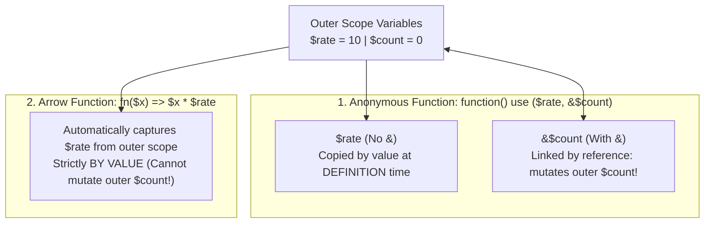

---
tags:
  - php
  - functions
  - type-hints
  - closures
  - datetime
---

# Functions, Type Hints, Closures & DateTime in PHP

#### TL;DR (Quick Revision)

**PHP Functions & Closures** = First-class execution units supporting **strict parameter/return type declarations** (`?Type`, `A|B` Union, `A&B` Intersection, `void`, `never`, `mixed`), **Named Arguments**, **Variadics (`...$args`)**, and two distinct anonymous function forms: **Standard Closures (`function () use ($x) {}`)** requiring explicit scope capture and **Arrow Functions (`fn() => expr`)** featuring automatic by-value lexical scope capture.

> [!abstract] Core Idea
> In PHP, standard functions (`function foo()`) live in the global or namespace symbol table and have **completely isolated local variable scope**—meaning variables outside a function cannot be read unless passed as parameters or explicitly captured into an anonymous [`Closure`](https://www.php.net/manual/en/class.closure.php) via `use ($var)` (or auto-captured by value via an [`fn() =>`](https://www.php.net/manual/en/functions.arrow.php) arrow function). Combined with `declare(strict_types=1);`, PHP 8.1+ First-Class Callable syntax (`strlen(...)`), PHP 8.4's nullable parameter rules, PHP 8.5's `#[\NoDiscard]` attribute, and **[PHP: The Right Way's `DateTimeImmutable`](https://phptherightway.com/#date_and_time)**, modern PHP functions provide bulletproof type and state safety.

> [!question] Why Master PHP Functions, Closures & `DateTimeImmutable`?
>
> - **Total Boundary Type Safety**: Using Union (`int|float`), Nullable (`?string`), `void`, `never`, and DNF (`(A&B)|null`) types with `declare(strict_types=1);` catches invalid arguments at the exact moment a function is called.
> - **Avoid the Closure Scope Trap**: Understanding why `function () { return $outerVar; }` fails with `Undefined variable $outerVar`—and knowing when to use `use ($outerVar)` vs. `use (&$outerVar)` vs. `fn() => $outerVar`—is essential for callbacks, middleware, and routes (`Route::get('/', fn() => ...)`).
> - **Self-Documenting Calls with Named Arguments**: Passing `createUser(name: 'Valay', isAdmin: false, sendEmail: true)` eliminates boolean flag confusion and lets you skip optional default parameters in the middle of a signature ([PHP Named Arguments](https://www.php.net/manual/en/functions.arguments.php#functions.named-arguments)).
> - **Eliminate Mutable Date Bugs**: Replacing legacy `strtotime()` and mutable `DateTime` with [`DateTimeImmutable`](https://www.php.net/manual/en/class.datetimeimmutable.php) prevents a function from accidentally mutating a timestamp shared across your application.

#### Quick Reference Table: Legacy vs. Modern PHP 8.4/8.5+ Functions & Callables

| Concept / Feature            | Legacy / Error-Prone PHP                               | Modern PHP 8.4/8.5+ (The Right Way)     | Engine Rule & Official Docs                                                                                                                                                                                                |
| :--------------------------- | :----------------------------------------------------- | :-------------------------------------- | :------------------------------------------------------------------------------------------------------------------------------------------------------------------------------------------------------------------------- |
| **Nullable Parameter**       | `function f(string $s = null)` _(Deprecated in 8.4!)_  | `function f(?string $s = null)`         | **[PHP 8.4 Deprecation](https://www.php.net/releases/8.4/en.php#deprecate-implicitly-nullable-types)**: Implicitly nullable types (`Type $x = null`) are deprecated; you **must** write `?Type $x = null` or `Type\|null`! |
| **Anonymous Callback**       | `function ($x) use ($factor) { return $x * $factor; }` | `fn(int $x): int => $x * $factor`       | **[Arrow Functions](https://www.php.net/manual/en/functions.arrow.php)** auto-capture `$factor` from outer scope **by value**.                                                                                             |
| **Passing Function as Arg**  | `array_map('trim', $arr)` _(String callable)_          | `array_map(trim(...), $arr)`            | **[First-Class Callables (PHP 8.1+)](https://www.php.net/manual/en/functions.first_class_callable_syntax.php)**: `fnName(...)` creates a type-safe `Closure` object supporting IDE refactoring.                            |
| **Must-Use Return Value**    | Silent bug if caller ignores return value              | `#[\NoDiscard] function withTax(): int` | **[PHP 8.5 `#[\NoDiscard]`](https://www.php.net/releases/8.5/en.php)**: Emits a Warning if caller discards the return value without `(void)` cast.                                                                         |
| **Date & Time Manipulation** | `new DateTime()` _(Mutates in-place!)_                 | `new DateTimeImmutable()`               | **[PHP: The Right Way — Date and Time](https://phptherightway.com/#date_and_time)**: `DateTimeImmutable::modify()` returns a **new** instance instead of mutating the original.                                            |

---

## The Learning Concept

### What Problem Does It Solve?

Three major bugs hit developers when writing functions, closures, and date logic in PHP:

1. **The PHP 8.4 Implicit Nullable Deprecation & Missing `use ()` Scope**: Writing `function greet(string $name = null)` triggers a deprecation warning in PHP 8.4+ because `?string` is missing ([PHP 8.4 Release Docs](https://www.php.net/releases/8.4/en.php#deprecate-implicitly-nullable-types)). Meanwhile, trying to read an outer variable inside an anonymous `function () {}` without `use ($var)` triggers an `Undefined variable` warning.
2. **Arrow Function By-Value Mutation Trap**: Assuming `fn() => $counter++` modifies `$counter` in the outer scope (arrow functions capture outer variables **by value**, not by reference!).
3. **The Mutable `DateTime` Side-Effect Bug**: Passing a `DateTime` object to a helper function or calling `$dueDate = $invoiceDate->modify('+30 days')` mutates `$invoiceDate` itself in-place!

Look at this **`// BAD`** PHP snippet demonstrating all three traps:

```php
<?php
// BAD - Implicit nullable parameter (Deprecated in PHP 8.4), missing closure use(),
// and mutable DateTime corrupting the original date!

// 1. Deprecated in PHP 8.4: string $prefix = null without ?string
function formatTag(string $tag, string $prefix = null): string {
    return ($prefix ?? '#') . $tag;
}

// 2. Standard anonymous function CANNOT see $multiplier without use ($multiplier)!
$multiplier = 10;
$numbers = [1, 2, 3];
$scaled = array_map(function (int $n): int {
    return $n * $multiplier; // Warning: Undefined variable $multiplier!
}, $numbers);

// 3. Mutable DateTime modifies $orderDate in-place!
$orderDate   = new DateTime('2026-11-15');
$arrivalDate = $orderDate->modify('+7 days');
// BUG: Both $orderDate AND $arrivalDate are now 2026-11-22!
echo "Order: " . $orderDate->format('Y-m-d') . " | Arrival: " . $arrivalDate->format('Y-m-d') . PHP_EOL;
```

**Why this fails:** In PHP, anonymous functions (`function () {}`) do not automatically inherit variables from the parent scope. Furthermore, the legacy [`DateTime`](https://www.php.net/manual/en/class.datetime.php) class mutates its internal timestamp whenever `.modify()`, `.add()`, or `.setTime()` is called, corrupting every variable referencing that object.

Now look at the **`// GOOD`** modern **PHP 8.4/8.5 + _PHP: The Right Way_** solution:

```php
<?php

declare(strict_types=1);

// GOOD - Explicit ?string nullable type, fn() => arrow function auto-capture,
// and DateTimeImmutable for side-effect-free date arithmetic!

// 1. PHP 8.4+ compliant explicit nullable parameter (?string)
function formatTag(string $tag, ?string $prefix = null): string
{
    return ($prefix ?? '#') . $tag;
}

// 2. Arrow function (fn =>) automatically captures $multiplier by value from outer scope!
$multiplier = 10;
$numbers    = [1, 2, 3];
$scaled     = array_map(fn(int $n): int => $n * $multiplier, $numbers);
var_dump($scaled); // [10, 20, 30]

// 3. DateTimeImmutable returns a brand-new instance on modify() / add()!
$tz          = new DateTimeZone('Asia/Kolkata');
$orderDate   = new DateTimeImmutable('2026-11-15 10:00:00', $tz);
$arrivalDate = $orderDate->modify('+7 days');

// $orderDate remains 2026-11-15 while $arrivalDate is 2026-11-22!
echo "Order: {$orderDate->format('Y-m-d')} | Arrival: {$arrivalDate->format('Y-m-d')}" . PHP_EOL;
```

---

### How PHP Implements Functions, Type Checking & Closures Under the Hood

> [!tip] 4 Core Mechanics of the Zend Function & Closure Engine
>
> 1. **Compile-Time Function Hoisting vs. Conditional Functions**:
>    Top-level named functions (`function helper() {}`) are registered in the Zend function table at **compile time**, so you can call them before their declaration line in the same file ([PHP User-Defined Functions](https://www.php.net/manual/en/functions.user-defined.php)). _(Note: Always declare functions before calling them per PSR-12)._
> 2. **Complete Type System Coverage ([PHP Type Declarations](https://www.php.net/manual/en/language.types.declarations.php))**:
>    - **Nullable (`?int`)**: Shorthand for `int|null`.
>    - **Union Types (`int|float|string`)**: Accepts any type in the union (PHP 8.0+).
>    - **Intersection Types (`Iterator&Countable`)**: Object must implement **all** listed interfaces/classes (PHP 8.1+).
>    - **Disjunctive Normal Form / DNF Types (`(Iterator&Countable)|null`)**: Combines intersections and unions wrapped in parentheses (PHP 8.2+).
>    - **Standalone Literal Types (`true`, `false`, `null`)**: Allows return types like `int|false` (used by `strpos()`) or `: true` (PHP 8.2+).
>    - **Special Return-Only Types (`void` and `never`)**:
>      - `: void` means the function returns nothing (`return;` with no value is allowed; `return null;` throws a fatal error! Calling a `void` function in an expression evaluates to `null`).
>      - `: never` (PHP 8.1+) means the function **never returns** normally—it **must** throw an exception, call `exit()` / `die()`, or enter an infinite loop (calling `return;` inside a `: never` function throws a fatal `TypeError`!).
> 3. **How `Closure` Objects Work (`function () use ($x)` vs `fn() =>`)**:
>    Every anonymous function or arrow function in PHP is NOT just a function pointer—it compiles into an instance of the built-in final class **[`Closure`](https://www.php.net/manual/en/class.closure.php)**:
>    - **Multi-line Anonymous Function (`function ($a) use ($x, &$y) { ... }`)**: Cannot see any outer variable unless listed in `use (...)`. Variables in `use ($x)` are copied **by value at the moment the closure is defined** (not when it is called!), unless prefixed with `&` (`use (&$y)`).
>    - **Single-Expression Arrow Function (`fn($a) => $a + $x`)**: Automatically captures needed outer variables **by value** (you cannot mutate outer scalar/array variables from inside an `fn() =>` arrow function!).
> 4. **First-Class Callable Syntax (`strlen(...)` — PHP 8.1+)**:
>    Writing `strlen(...)`, `$obj->method(...)`, or `MyClass::staticMethod(...)` with literal three dots `(...)` as the argument list creates a `Closure` object wrapping that function/method without executing it ([PHP First-Class Callables](https://www.php.net/manual/en/functions.first_class_callable_syntax.php)).

#### Full Runnable Example

Run this script via `php 05_functions_datetime.php` to see strict union/nullable types, named arguments, variadic unpacking (`...`), closures vs. arrow functions, PHP 8.5 `#[\NoDiscard]`, and `DateTimeImmutable`:

```php
<?php

declare(strict_types=1);

// 1. Named Arguments, Default Parameters, and Union Types (int|float)
function calculateInvoice(
    int|float $subtotal,
    float $taxRate = 0.18,
    float $discount = 0.0,
    bool $roundResult = true,
): float {
    $taxed = ($subtotal - $discount) * (1 + $taxRate);
    return $roundResult ? round($taxed, 2) : $taxed;
}

// Named arguments let us skip $taxRate (uses default 0.18) and pass arguments in any order!
$finalBill = calculateInvoice(subtotal: 1000, discount: 100.0, roundResult: true);
echo "Final Bill: ₹{$finalBill}" . PHP_EOL;

// 2. Variadic Parameters (...$numbers) & Argument Unpacking
function sumAll(string $label, int ...$numbers): string
{
    // Inside the function, $numbers is a packed array of ints: int[]
    return "{$label}: " . array_sum($numbers);
}

$scores = [40, 50, 60];
echo sumAll('Batch Total', 10, 20, ...$scores) . PHP_EOL; // Unpacks $scores into arguments!

// 3. Anonymous Closure with use ($byVal, &$byRef) vs Arrow Function (fn =>)
$taxMultiplier = 1.18;
$callCount     = 0;

$priceCalculator = function (float $price) use ($taxMultiplier, &$callCount): float {
    $callCount++; // Mutates outer $callCount because of &$callCount reference!
    return round($price * $taxMultiplier, 2);
};

echo "Calc 1: " . $priceCalculator(500.0) . " | Calls: {$callCount}" . PHP_EOL;

// 4. First-Class Callable Syntax (...) + PHP 8.5 #[\NoDiscard] Attribute
#[\NoDiscard("This function returns a new array; it does not mutate in-place!")]
function appendAuditLog(array $logs, string $entry): array
{
    $logs[] = $entry;
    return $logs;
}

$auditTrail = appendAuditLog(['BOOT'], 'AUTH_SUCCESS');
$upperTrail = array_map(strtolower(...), $auditTrail); // First-class callable syntax!
echo "Logs: " . implode(', ', $upperTrail) . PHP_EOL;

// 5. PHP: The Right Way — DateTimeImmutable, DateInterval & DatePeriod
$ist      = new DateTimeZone('Asia/Kolkata');
$start    = new DateTimeImmutable('2026-11-01 09:00:00', $ist);
$interval = new DateInterval('P7D'); // Period of 7 Days (ISO 8601 duration)
$end      = $start->add(new DateInterval('P21D'));

$billingCycles = new DatePeriod($start, $interval, $end);
$dates = [];
foreach ($billingCycles as $cycleDate) {
    $dates[] = $cycleDate->format('Y-m-d');
}
echo "Weekly Cycles: " . implode(' -> ', $dates) . PHP_EOL;
```

**Output:**

```
Final Bill: ₹1062
Batch Total: 180
Calc 1: 590 | Calls: 1
Logs: boot, auth_success
Weekly Cycles: 2026-11-01 -> 2026-11-08 -> 2026-11-15
```

---

### Visual Diagram: Closure `use ($val)` vs `use (&$ref)` vs Arrow Function `fn() =>`



---

### Key Terminology (Syntax Decoder)

1. **`?Type` (Explicit Nullable Type) vs. PHP 8.4 Deprecation**:
   Prefixing any single type with `?` (`?string`, `?int`, `?User`) allows either that type or `null`.
   - **PHP 8.4 Rule ([RFC: Deprecate Implicitly Nullable Parameter Types](https://wiki.php.net/rfc/deprecate-implicitly-nullable-types))**: Writing `function foo(string $bar = null)` without the `?` (or `string|null`) was a legacy PHP 7.0 quirk. In **PHP 8.4+**, it emits a **Deprecation Notice**! Always write `function foo(?string $bar = null)` or `string|null $bar = null`.
     Syntax: `function findUser(?int $id = null): ?array`

2. **`void` vs. `never` vs. `mixed` Return Types ([PHP Type Declarations](https://www.php.net/manual/en/language.types.declarations.php))**:
   - **`: void`**: Function succeeds without returning a value. You may use bare `return;` to exit early, but `return null;` throws a compile-time Fatal Error!
   - **`: never` (PHP 8.1+)**: Subtype of every type (bottom type). Indicates the function never returns control to the caller because it always throws an exception (`throw new RuntimeException()`) or terminates (`exit()`).
   - **`: mixed` (PHP 8.0+)**: Top type equivalent to `object|resource|array|string|float|int|bool|null`. Explicitly documents that a function can accept or return any value (cannot be combined with `?mixed`).
     Syntax: `function abort(int $code): never { http_response_code($code); exit(1); }`

3. **Variadic Parameters (`...$items`) vs. Argument Unpacking (`fn(...$arr)`)**:
   - **In a Function Signature (`function logEvents(string $level, string ...$messages)`)**: Packs all remaining passed arguments into an array named `$messages` ([PHP Variable-length Argument Lists](https://www.php.net/manual/en/functions.arguments.php#functions.variable-arg-list)).
   - **In a Function Call (`logEvents('INFO', ...$msgArray)`)**: Unpacks an array or `Traversable` into individual positional or named arguments! If `$msgArray` has string keys (`['subtotal' => 500, 'taxRate' => 0.18]`), unpacking `calculateInvoice(...$msgArray)` passes them as **Named Arguments**!
     Syntax: `function sum(int ...$nums): int { return array_sum($nums); }`

4. **`function () use ($var)` vs. `fn() =>` (Closures & Lexical Scope)**:
   - **[Anonymous Functions](https://www.php.net/manual/en/functions.anonymous.php)**: Support multi-line bodies `{ ... }`, require `use ($var)` to import variables from the enclosing scope, and support `use (&$var)` to mutate outer variables.
   - **[Arrow Functions (PHP 7.4+)](https://www.php.net/manual/en/functions.arrow.php)**: Single-expression syntax `fn(params): ReturnType => expression`. Automatically captures outer variables **by value** (even when nested: `fn($a) => fn($b) => $a + $b + $outer`).
   - **`static function ()` / `static fn() =>`**: Prefixing a closure with `static` inside a class method prevents the closure from automatically binding `$this` (saving memory and preventing accidental circular object references when storing closures!).
     Syntax: `$addTax = fn(float $p): float => $p * (1 + $tax);`

5. **First-Class Callable Syntax (`callableExpr(...)` — [PHP 8.1+](https://www.php.net/manual/en/functions.first_class_callable_syntax.php))**:
   Replaces ugly legacy string/array callables like `'strlen'` or `[$this, 'handle']` with `strlen(...)`, `$this->handle(...)`, or `User::validate(...)`. It returns a genuine `Closure` instance, respects the current scope/visibility at the moment of creation, and works with static analysis tools (PHPStan / Psalm).
   Syntax: `$validator = $this->validateEmail(...);`

6. **`#[\NoDiscard]` Attribute & `(void)` Cast ([PHP 8.5+](https://www.php.net/releases/8.5/en.php))**:
   Introduced in **PHP 8.5** to prevent bugs with immutable methods or pure functions where a developer calls a function expecting it to mutate in-place and forgets to assign the return value:
   - Adding `#[\NoDiscard("Optional reason")]` above a function/method causes PHP 8.5 to emit a **Warning** if the caller invokes the function without using its return value!
   - If a caller _intentionally_ wants to ignore the return value of a `#[\NoDiscard]` function, PHP 8.5 introduces the **`(void)` cast** (`(void) appendAuditLog($logs, 'PING');`) to silence the warning explicitly.
     Syntax: `#[\NoDiscard] function withHeader(string $k, string $v): self`

7. **`static $cache = null;` (Function-Scoped Static Variables)**:
   Declaring `static $count = 0;` _inside_ a function causes `$count` to initialized only once on the first call and retain its value across multiple calls to that function **during the same HTTP request** ([PHP Variable Scope: Static Variables](https://www.php.net/manual/en/language.variables.scope.php#language.variables.scope.static)). _(Remember Note 01: it still resets at the end of the HTTP request!)._
   Syntax: `static $memo = [];`

> [!important] Key Rules to Remember
>
> - **`use ($x)` Captures at Definition Time, Not Call Time!** → If `$x = 10;`, you define `$fn = function () use ($x) { return $x; };`, and then change `$x = 99;`, calling `$fn()` still returns **`10`** unless you used `use (&$x)`!
> - **Named Arguments Bind to Parameter Names** → When writing library functions, renaming a parameter (`$userId` $\rightarrow$ `$id`) is a **breaking change** for callers using named arguments (`getUser(userId: 5)`).
> - **Never Put Optional Parameters Before Required Parameters** → Writing `function foo(int $a = 1, int $b)` is deprecated since PHP 8.0+ because `$a` cannot be omitted positionally.
> - **Always Use `DateTimeImmutable` Over `DateTime`** → `DateTime` is mutable by reference and causes silent timestamp corruption when passed between functions.

---

## Edge Case Analysis (Traps & Security Gotchas)

### 1. The Closure `use ($var)` Early-Binding Trap (Loop & State Bug)

- **Problem**: Developers often assume `function () use ($status)` reads the value of `$status` when the closure is **executed**. In PHP, `use ($status)` copies the value of `$status` into the `Closure` object at the exact line where the closure is **created** ([PHP Anonymous Functions](https://www.php.net/manual/en/functions.anonymous.php)). If `$status` changes later in the function before the closure runs, the closure still sees the old stale value!
- **Fix**: Either pass the variable as a parameter when invoking the closure, or bind by reference `use (&$status)` if the closure genuinely needs to read the live mutated state at call time.

```php
<?php

declare(strict_types=1);

$status = 'pending';

// Captures $status BY VALUE right now ('pending')!
$checkByValue = function () use ($status): string {
    return "By-Value sees: {$status}";
};

// Captures $status BY REFERENCE (&$status) — reads live value when called!
$checkByRef = function () use (&$status): string {
    return "By-Ref sees: {$status}";
};

$status = 'completed'; // Mutated AFTER closures were defined!

echo $checkByValue() . PHP_EOL; // Prints: By-Value sees: pending (Trap!)
echo $checkByRef() . PHP_EOL;   // Prints: By-Ref sees: completed
```

### 2. Named Arguments + Variadic Unpacking Injection Trap (Security Gotcha)

- **Problem**: In PHP 8.0+, unpacking an associative array into a function call (`myFunc(...$userArray)`) maps string keys directly to **Named Arguments** ([PHP Named Arguments](https://www.php.net/manual/en/functions.arguments.php#functions.named-arguments)). If you unpack an untrusted array (like JSON request data) into a function (`createAccount(...$requestData)`), an attacker can supply `"isAdmin": true` in their JSON payload and bind directly to your function's `bool $isAdmin = false` default parameter!
- **Fix**: Never unpack untrusted associative arrays directly into function calls with `...$input`, or strip non-whitelisted keys first.

```php
<?php

declare(strict_types=1);

function registerUser(string $username, string $email, bool $isAdmin = false): array
{
    return ['username' => $username, 'email' => $email, 'isAdmin' => $isAdmin];
}

// Simulated attacker JSON payload containing an unexpected named argument key!
$untrustedPayload = [
    'username' => 'attacker',
    'email'    => 'pwn@ctf.local',
    'isAdmin'  => true, // Maps directly to bool $isAdmin parameter when unpacked!
];

// BAD (VULNERABLE) - Unpacking associative array invokes Named Arguments!
$badUser = registerUser(...$untrustedPayload);
var_dump($badUser['isAdmin']); // bool(true) -> Privilege Escalation!

// GOOD - Pass explicit positional/named arguments from validated keys
$safeUser = registerUser(
    username: (string) ($untrustedPayload['username'] ?? ''),
    email:    (string) ($untrustedPayload['email'] ?? ''),
);
var_dump($safeUser['isAdmin']); // bool(false)
```

### 3. String Callables vs. First-Class Callables (`callable` Security Trap)

- **Problem**: In PHP, the `callable` type accepts plain strings (`"system"`, `"exec"`, `"phpinfo"`). If a function accepts a user-supplied string and calls `$callback($data)` (or validates it only with `is_callable($input)`), an attacker can pass `"system"` as the callback string and achieve **Remote Code Execution (RCE)**!
- **Fix**: Type-hint callback parameters as **`Closure`** instead of `callable` whenever possible! Unlike `callable`, a `Closure` type hint **rejects** strings (`"system"`) and arrays, accepting **only** genuine anonymous functions, arrow functions, and First-Class Callables (`fn(...)`) ([`Closure` vs `callable` Docs](https://www.php.net/manual/en/class.closure.php)).

```php
<?php

declare(strict_types=1);

// GOOD - Type-hinting Closure (instead of callable) rejects string names like "system"!
function transformData(string $input, Closure $transformer): string
{
    return $transformer($input);
}

// Passing strtoupper(...) creates a safe Closure instance:
echo transformData('hello', strtoupper(...)) . PHP_EOL; // HELLO

// Trying to pass a raw string "system" throws a fatal TypeError!
// transformData('whoami', 'system'); -> TypeError: must be of type Closure, string given!
```

### 4. The `DateTime::createFromFormat()` Current-Time Bleed Trap

- **Problem**: When parsing a date string without a time component using `DateTimeImmutable::createFromFormat('Y-m-d', '2026-11-15')`, PHP fills in the missing hours, minutes, and seconds using the **current system clock** (`18:11:42`) instead of `00:00:00`! Comparing two dates parsed a second apart with `==` or `<=>` will fail because their hidden timestamps differ!
- **Fix**: Prefix the format string with `!` (**`'!Y-m-d'`**) or append `|`: in [`DateTimeImmutable::createFromFormat()`](https://www.php.net/manual/en/datetimeimmutable.createfromformat.php), `!` resets all unparsed time fields to the Unix epoch (`00:00:00`)!

```php
<?php

declare(strict_types=1);

// BAD - Without '!', hours/minutes/seconds default to current clock time (e.g. 18:11:45)!
$dateWithCurrentClock = DateTimeImmutable::createFromFormat('Y-m-d', '2026-11-15');

// GOOD - Leading '!' resets all unparsed time components to 00:00:00!
$midnightDate = DateTimeImmutable::createFromFormat('!Y-m-d', '2026-11-15');

echo "Without ! : " . $dateWithCurrentClock->format('Y-m-d H:i:s') . PHP_EOL;
echo "With !    : " . $midnightDate->format('Y-m-d H:i:s') . PHP_EOL;
```

---

## Going Deeper (Intermediate -> Advanced & _PHP: The Right Way_ Integration)

### 1. _PHP: The Right Way_ — Mastering `DateTimeImmutable`, `DateInterval` & Timezones

As emphasized in **[PHP: The Right Way — Date and Time](https://phptherightway.com/#date_and_time)**, you should stop using procedural `date()`, `time()`, and `strtotime()` for business logic and rely on PHP's object-oriented Date/Time API:

1. **Always Prefer [`DateTimeImmutable`](https://www.php.net/manual/en/class.datetimeimmutable.php)**: Every mutation method (`modify()`, `add()`, `sub()`, `setTimezone()`, `setTime()`) returns a **new** `DateTimeImmutable` instance, making it safe to pass across services and entities. (Both `DateTime` and `DateTimeImmutable` implement [`DateTimeInterface`](https://www.php.net/manual/en/class.datetimeinterface.php), so type-hint `DateTimeInterface` or `DateTimeImmutable` in your functions!).
2. **Comparison Operators Work Directly on `DateTimeInterface` Objects**:
   You can compare two `DateTimeImmutable` objects directly using `<`, `>`, `<=`, `>=`, `==`, and `<=>`—PHP automatically accounts for their respective `DateTimeZone` offsets when comparing!
3. **PHP 8.3 / 8.4 Date/Time Upgrades**:
   - **Specific Date/Time Exceptions (PHP 8.3+)**: Invalid date strings or intervals throw specific exceptions like [`DateMalformedStringException`](https://www.php.net/manual/en/class.datemalformedstringexception.php) and `DateMalformedIntervalStringException` instead of generic `Exception`.
   - **Microsecond & Timestamp Helpers (PHP 8.4+)**: [`DateTimeImmutable::createFromTimestamp(int|float $timestamp)`](https://www.php.net/releases/8.4/en.php) accepts both integer Unix timestamps and float timestamps with microseconds (`1763210000.543210`), plus `$dt->getMicrosecond()` and `$dt->setMicrosecond()`.

```php
<?php

declare(strict_types=1);

// Comparing dates across different timezones accurately
$mumbaiTime = new DateTimeImmutable('2026-11-15 18:30:00', new DateTimeZone('Asia/Kolkata'));
$utcTime    = new DateTimeImmutable('2026-11-15 13:00:00', new DateTimeZone('UTC'));

// Both represent the exact same instant in time (IST is UTC+05:30)!
var_dump($mumbaiTime == $utcTime);  // bool(true) -> Same Unix timestamp!
var_dump($mumbaiTime === $utcTime); // bool(false) -> Different object instances in RAM!

// Calculating exact difference with diff() -> returns DateInterval
$deadline = $mumbaiTime->modify('+45 days');
$diff     = $mumbaiTime->diff($deadline);
echo $diff->format('Remaining: %a total days (%m month, %d days)') . PHP_EOL;
```

### 2. PHP 8.5 Closures in Constant Expressions & `#[\NoDiscard]`

**[PHP 8.5](https://www.php.net/releases/8.5/en.php)** introduces two major upgrades for functional programming in PHP:

1. **Static Closures & First-Class Callables in Constant Expressions**:
   In PHP 8.5+, you can now use `static function () {}`, `static fn() => ...`, and first-class callables (`strtolower(...)`) as **default parameter values**, **constant values**, **class property defaults**, and **Attribute arguments**!
2. **`#[\NoDiscard]` for Functional & Immutable APIs**:
   Adding `#[\NoDiscard]` to functions or methods ensures callers don't accidentally ignore returned values from pure functions (like `DateTimeImmutable` or array helpers).

```php
<?php

declare(strict_types=1);

// PHP 8.5+: Default parameter value can now be a static Closure or First-Class Callable!
function normalizeItems(
    array $items,
    Closure $normalizer = static fn(string $s): string => strtolower(trim($s)),
): array {
    return array_map($normalizer, $items);
}

var_dump(normalizeItems(['  ADMIN ', ' USER  '])); // ['admin', 'user']
```

### 3. How Frameworks (Laravel / Symfony) Use Closures & `Carbon`

1. **`Carbon` Is Just a Subclass of `DateTime` / `DateTimeImmutable`**:
   In Laravel and Symfony, the popular **`Carbon\CarbonImmutable`** library directly extends PHP's native `DateTimeImmutable`, adding convenience methods (`CarbonImmutable::now()->addDays(7)->isWeekend()`) on top of the exact native engine you just learned.
2. **Routing, Middleware & Transaction Callbacks**:
   When you write `DB::transaction(function () use ($order) { ... })` or `Route::get('/ping', fn() => ['status' => 'ok'])` in Laravel/Symfony, the framework inspects your `Closure` object (even reading its parameter type hints via Reflection for Dependency Injection!) and executes it inside a wrapper.

---

## Interview Corner

### Common Questions & Concise Answers

**Q1: What is the difference between a standard anonymous function (`function () {}`) and an arrow function (`fn() =>`) in PHP?**
**A:**

1. **Scope Capture**: Standard anonymous functions have isolated scope and require `use ($var)` to import outer variables (supporting both by-value `use ($v)` and by-reference `use (&$v)`). Arrow functions (`fn() =>`) automatically capture outer variables **by value**.
2. **Body Syntax**: Standard anonymous functions take a `{ ... }` block with multiple statements and explicit `return`, whereas arrow functions only accept a **single expression** whose result is implicitly returned.

**Q2: What changed in PHP 8.4 regarding nullable function parameters like `function process(string $data = null)`?**
**A:** In **[PHP 8.4](https://www.php.net/releases/8.4/en.php#deprecate-implicitly-nullable-types)**, implicitly nullable parameter types (`Type $param = null`) are **deprecated** and emit an `E_DEPRECATED` notice at compile time. You must explicitly mark the type as nullable using `?string $data = null` or `string|null $data = null`.

**Q3: What is the difference between the `: void` and `: never` return types in PHP?**
**A:** A `: void` function completes execution normally without returning a value (using `return;` or reaching the closing `}`). A `: never` function (PHP 8.1+) guarantees that execution will **never return** to the caller because it unconditionally throws an exception, calls `exit()`/`die()`, or loops forever.

**Q4: Why should you prefer type-hinting `Closure` over `callable` for callback parameters?**
**A:** The `callable` pseudo-type accepts raw strings (like `'system'` or `'unlink'`) and arrays, which can lead to Remote Code Execution if user input reaches the parameter, and incurs runtime string-lookup overhead. Type-hinting `Closure` strictly requires an actual `Closure` instance (created via `function () {}`, `fn() =>`, or first-class callable syntax `myFunc(...)`), guaranteeing type and security safety.

**Q5: Why does _PHP: The Right Way_ recommend `DateTimeImmutable` over `DateTime`?**
**A:** Because `DateTime` is mutable: calling `$date->modify('+1 day')` modifies the `$date` object in-place, silently mutating every other variable or entity holding a reference to that object. [`DateTimeImmutable`](https://www.php.net/manual/en/class.datetimeimmutable.php) never modifies itself and always returns a brand-new `DateTimeImmutable` instance when modified.

---

### Interactive Revision Quiz

**Q1: What is the output of the following PHP closure snippet?**

```php
$tax = 10;
$calc = function (int $price) use ($tax): int {
    return $price + $tax;
};
$tax = 50;
echo $calc(100);
```

- [ ] A) `150`
- [ ] B) `110`
- [ ] C) Throws an `Undefined variable $tax` warning
- [ ] D) `100`

**Q2: What happens when you run this arrow function code in PHP 8.4/8.5?**

```php
$count = 0;
$increment = fn() => $count++;
$increment();
$increment();
echo $count;
```

- [ ] A) Outputs `2` because arrow functions capture variables by reference.
- [ ] B) Outputs `0` because arrow functions (`fn() =>`) capture outer variables **by value**, so `$count++` only increments a local copy inside each call!
- [ ] C) Throws a `ParseError` because `++` is forbidden inside arrow functions.
- [ ] D) Outputs `1`.

**Q3: Which parameter declaration emits a Deprecation Notice in PHP 8.4+?**

- [ ] A) `function connect(?string $host = null)`
- [ ] B) `function connect(string|null $host = null)`
- [ ] C) `function connect(string $host = null)`
- [ ] D) `function connect(string $host = 'localhost')`

**Q4: What does `DateTimeImmutable::createFromFormat('!Y-m-d', '2026-11-15')` do differently because of the `!` prefix?**

- [ ] A) It throws an exception if the date is in the past.
- [ ] B) It resets all unparsed time parts (hours, minutes, seconds) to `00:00:00` (Unix epoch) instead of filling them with the current system clock time.
- [ ] C) It returns a mutable `DateTime` object instead of `DateTimeImmutable`.
- [ ] D) It parses the date in UTC regardless of server timezone.

**Q5: In PHP 8.5, what happens if you call a function marked with `#[\NoDiscard]` without assigning or returning its result?**

- [ ] A) PHP silently ignores it unless `strict_types=1` is enabled.
- [ ] B) PHP emits a Warning alerting you that the return value of a `#[\NoDiscard]` function was discarded (unless explicitly cast with `(void)`).
- [ ] C) PHP automatically assigns the result to `$_`.
- [ ] D) PHP deletes the function from the symbol table.

<details>
<summary>Show Quiz Answers & Explanations</summary>

1. **B** — `use ($tax)` copies the value of `$tax` (`10`) into the `Closure` at the exact time the closure is **defined**. Changing `$tax = 50` afterward has zero effect on `$calc` unless `use (&$tax)` was used!
2. **B** — Arrow functions (`fn() =>`) always capture outer variables **by value** ([PHP Arrow Functions Manual](https://www.php.net/manual/en/functions.arrow.php)). Incrementing `$count++` inside the arrow function only modifies the temporary copy inside that invocation; the outer `$count` remains `0`!
3. **C** — In **[PHP 8.4](https://www.php.net/releases/8.4/en.php#deprecate-implicitly-nullable-types)**, `string $host = null` (an implicitly nullable type without `?` or `|null`) is deprecated.
4. **B** — Without `!`, `createFromFormat('Y-m-d', ...)` populates the missing `H:i:s` fields using the current wall-clock time; adding `!` resets all unparsed fields to `00:00:00` ([`createFromFormat` Docs](https://www.php.net/manual/en/datetimeimmutable.createfromformat.php)).
5. **B** — Introduced in **[PHP 8.5](https://www.php.net/releases/8.5/en.php)**, `#[\NoDiscard]` emits a warning whenever the caller discards the return value without using it or casting it to `(void)`.

</details>

---

## Practice Exercises

### Exercise 1: Basic — Named Arguments, Variadics & First-Class Callables

Write a PHP 8.4+ function `buildUrl(string $host, string $path = '/', bool $secure = true, string ...$queryParts): string` using `declare(strict_types=1);`. Have it construct `"https://{$host}{$path}"` (or `"http://"` if `$secure` is `false`), and if `$queryParts` is non-empty, join them with `'&'` and append `"?..."`. Call it using Named Arguments and pass `buildUrl(...)` as a First-Class Callable into a variable `$urlMaker`.

### Exercise 2: Intermediate — Request-Scoped Memoization Closure

Write a factory function `createMemoizedMultiplier(int $factor): Closure` that keeps a private `$cache = []` array in its scope and returns a `Closure` (`function (int $n) use ($factor, &$cache): int`). When called with `$n`, if `$n` exists in `$cache` (`array_key_exists()`), return the cached value immediately; otherwise compute `$n * $factor`, store it in `$cache[$n]`, and return it.

### Exercise 3: Real-World _PHP: The Right Way_ Pattern — Subscription Expiry Calculator

Write a function `isSubscriptionActive(string $startDateIso, int $planDays, DateTimeImmutable $now): bool` that:

1. Parses `$startDateIso` (`'2026-11-01'`) at midnight UTC using `DateTimeImmutable::createFromFormat('!Y-m-d', $startDateIso, new DateTimeZone('UTC'))`.
2. Adds `$planDays` using `new DateInterval("P{$planDays}D")`.
3. Returns `true` if the calculated expiry date is strictly greater than `$now` (`$expiry > $now`).

---

## Memory Trick / One-Liner

> [!tip] The "Question the Null, Arrow the Value, Freeze the Date" Rule
>
> - Defaulting a parameter to `null` in PHP 8.4+? Put a **Question Mark (`?Type $x = null`)** in front!
> - Need a quick callback that reads outer variables? **Arrow Function (`fn() =>`)** auto-captures by value; need to mutate an outer variable? **Standard Closure (`function () use (&$x)`)**!
> - Working with dates? **Freeze the Date (`DateTimeImmutable`)** and prefix `createFromFormat('!Y-m-d', ...)` with **`!`**!
>   **Takeaway Formula:** **`?Type` Explicit Nullables + `fn() =>` Auto-Capture + `func(...)` Callables + `DateTimeImmutable` = Bulletproof PHP Functions.**

---

## Warning Block (Best Practice)

> [!warning] Common Mistake (Avoid This!)
>
> ```php
> <?php
> // BAD - Implicit nullable (Deprecated in 8.4), raw callable string, and mutable DateTime!
> function scheduleJob(callable $task, DateTime $runAt, string $label = null): DateTime
> {
>     $task($label);
>     return $runAt->modify('+1 hour'); // BUG: Mutates caller's $runAt object in-place!
> }
> ```
>
> ```php
> <?php
>
> declare(strict_types=1);
>
> // GOOD - Closure type hint, DateTimeImmutable, explicit ?string nullable, and #[\NoDiscard]
> #[\NoDiscard("Returns the newly scheduled DateTimeImmutable instance")]
> function scheduleJob(
>     Closure $task,
>     DateTimeImmutable $runAt,
>     ?string $label = null,
> ): DateTimeImmutable {
>     $task($label ?? 'default');
>     return $runAt->modify('+1 hour'); // Returns a new instance; caller's $runAt is untouched!
> }
> ```
