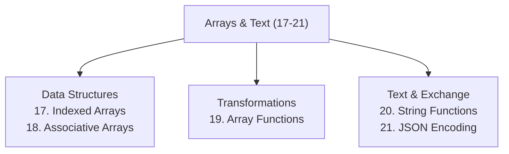

---
tags:
  - php
  - overview
  - beginner
---

# Overview: Arrays & Text

## TL;DR

This folder covers how PHP stores lists and key-value records, transforms them with built-in array functions, cleans and splits text, and converts data to and from JSON.

> [!NOTE] Prerequisites: 17, 18, 19, 20, 21
> New terms: None (all terms introduced in notes 17 through 21)

> [!abstract] Core Idea
> PHP uses one unified `array` type for both ordered lists and key-value maps, paired with dedicated functions for transforming arrays, cleaning strings, and serializing **JSON**.
> Unlike Python's separate `list` and `dict`, PHP arrays handle both jobs, while string and JSON tools use function calls rather than object methods.

## Concept Map

## Folder Cheat Sheet

| Note                     | Core Syntax / Tool                                   | Key Rule to Remember                                                                          |
| ------------------------ | ---------------------------------------------------- | --------------------------------------------------------------------------------------------- |
| `17. Indexed Arrays`     | `$list = ['a', 'b']`, `$list[] = 'c'`                | `unset($list[0])` leaves a gap; `array_values()` re-indexes                                   |
| `18. Associative Arrays` | `['title' => 'Dune']`, `['title' => $t] = $book`     | Missing keys trigger a warning; use `??` for safe defaults                                    |
| `19. Array Functions`    | `array_map()`, `array_filter()`, `array_reduce()`    | `array_filter()` preserves original keys; `array_map()` takes callback first                  |
| `20. String Functions`   | `trim()`, `explode()`, `implode()`, `str_contains()` | `explode("", $str)` throws `ValueError`; `str_contains($haystack, $needle)` is case-sensitive |
| `21. JSON Encoding`      | `json_encode()`, `json_decode($j, true)`             | Pass `true` for associative arrays and `JSON_THROW_ON_ERROR` for loud failures                |

## Boss Quiz

**Q1: After `unset($books[0])` on `['Dune', '1984']`, what is `$books[0]`?**

- [ ] A) `'1984'`
- [ ] B) `null` with no warning
- [ ] C) Undefined array key `0` (only key `1` exists)
- [ ] D) `''`

**Q2: What is the parameter order of `array_map()` vs `array_filter()`?**

- [ ] A) Both take `($array, $callback)`
- [ ] B) Both take `($callback, $array)`
- [ ] C) `array_map($callback, $array)` and `array_filter($array, $callback)`
- [ ] D) `array_map($array, $callback)` and `array_filter($callback, $array)`

**Q3: What does `array_filter([10, 20, 30], fn($n) => $n > 15)` return?**

- [ ] A) `[0 => 20, 1 => 30]`
- [ ] B) `[1 => 20, 2 => 30]`
- [ ] C) `[20, 30]`
- [ ] D) `[true, true]`

**Q4: What happens if you call `explode("", "Dune")` in PHP 8.4?**

- [ ] A) Returns `['D', 'u', 'n', 'e']`
- [ ] B) Returns `['Dune']`
- [ ] C) Throws a `ValueError`
- [ ] D) Returns `false`

**Q5: What does `trim("  Dune   Messiah  ")` return?**

- [ ] A) `"Dune Messiah"`
- [ ] B) `"Dune   Messiah"`
- [ ] C) `"DuneMessiah"`
- [ ] D) `"  Dune   Messiah"`

**Q6: What does `json_decode('{"title":"Dune"}')` return if you omit the second argument?**

- [ ] A) `['title' => 'Dune']`
- [ ] B) A `stdClass` object
- [ ] C) `null`
- [ ] D) `'{"title":"Dune"}'`

◈ View Answers & Explanations

1. **C** - `unset()` removes key `0` without **re-indexing**, so key `0` no longer exists and `'1984'` stays at key `1`. You would need `array_values()` to shift `'1984'` to `0` (A).

2. **C** - `array_map()` takes the **callback** first and the array second, while `array_filter()` takes the array first and the **callback** second. A, B, and D swap one or both.

3. **B** - `array_filter()` keeps the original keys (`1` and `2`), rather than re-indexing from `0` (A, C) or returning booleans (D).

4. **C** - Passing an empty **delimiter** `""` to `explode()` throws a `ValueError` in PHP 8+. It does not split into characters (A), return the string (B), or return `false` (D).

5. **B** - `trim()` only strips **whitespace** from the outer start and end, leaving the three middle spaces intact. A and C alter middle spaces, and D leaves leading spaces.

6. **B** - `json_decode()` defaults to `$associative = false`, returning a `stdClass` object instead of an associative array (A). C only occurs on failure or JSON `null`, and D is the input string.

> [!quote] Sources
>
> - [Arrays - PHP Manual](https://www.php.net/manual/en/language.types.array.php)
> - [String Functions - PHP Manual](https://www.php.net/manual/en/ref.strings.php)
> - [json_decode - PHP Manual](https://www.php.net/manual/en/function.json-decode.php)
