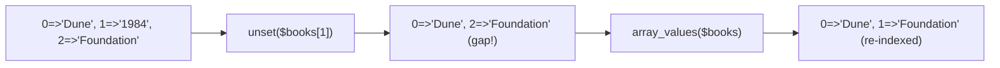

---
tags:
  - php
  - arrays
  - beginner
---

# Indexed Arrays

## TL;DR

An **indexed array** stores an ordered list of values numbered starting at `0`. You append items with `$books[] = "Dune";`, measure length with `count()`, check membership with `in_array()`, and—unlike Python lists—assigning `$b = $a;` makes an independent copy of the list.

> [!NOTE] Prerequisites: 02, 03, 05, 12
> New terms: indexed array, re-indexing

> [!abstract] Core Idea
> Use `[...]` to create an indexed array, `$arr[] = $val` to append, `in_array(..., true)` for strict membership checks, and `array_values()` to close gaps after `unset()`.
> PHP's `[...]` list works like Python's `list`, except `$b = $a;` copies the array by value and `unset($a[1])` leaves a hole in the index numbers.

## Mental Model

Think of an indexed array like numbered Book Tracker shelf slots (`0, 1, 2...`). Appending (`$books[] = ...`) adds to the next open slot, while removing slot `1` with `unset()` leaves slot `1` missing—you must call `array_values()` to slide the books back into `0, 1` without gaps.



## Minimal Example

Save this as `indexed_arrays.php` and run `php indexed_arrays.php`:

```php
<?php
declare(strict_types=1);

$books = ["Dune", "1984"];
$books[] = "Foundation";

echo count($books), "\n";
var_dump(in_array("Dune", $books, true));

unset($books[1]);
$books = array_values($books);
echo $books[1];
```

Expected output:

```text
3
bool(true)
Foundation
```

- `["Dune", "1984"]` ▸ creates an **indexed array** with keys `0` and `1`.
- `$books[] = "Foundation";` ▸ empty `[]` appends to the end at index `2`.
- `count($books)` ▸ returns the number of elements (`3`).
- `in_array("Dune", $books, true)` ▸ checks whether `"Dune"` exists in `$books`; passing `true` enforces strict `===` comparison.
- `unset($books[1]);` + `array_values($books)` ▸ `unset()` removes key `1` and leaves a gap (`0, 2`), while `array_values()` performs **re-indexing** (renumbering remaining items cleanly to `0, 1, 2...`).

## Compare

| Call                       | Comparison used      | `in_array("01", [1, 2], ...)` |
| -------------------------- | -------------------- | ----------------------------- |
| `in_array($v, $arr)`       | Loose `==` (default) | `true`                        |
| `in_array($v, $arr, true)` | Strict `===`         | `false`                       |

## ◈ Edge Case Analysis

✗ **Mistake 1:** Reading `$books[1]` after `unset($books[1])` without re-indexing, which emits an `Undefined array key 1` warning and evaluates to `null`.

```php
<?php
$books = ["Dune", "1984", "Foundation"];
unset($books[1]);
echo $books[1]; // Warning: Undefined array key 1
```

✓ **Fix:** Call `$books = array_values($books);` after `unset()` whenever you need contiguous `0, 1, 2...` indices.

```php
<?php
$books = ["Dune", "1984", "Foundation"];
unset($books[1]);
$books = array_values($books);
echo $books[1]; // Foundation
```

✗ **Mistake 2:** Omitting the `true` strict flag in `in_array()`, which uses loose `==` and matches `"01"` to `1`.

```php
<?php
$ids = [1, 2, 3];
var_dump(in_array("01", $ids)); // bool(true)
```

✓ **Fix:** Always pass `true` as the third argument to `in_array()` so types must match.

```php
<?php
$ids = [1, 2, 3];
var_dump(in_array("01", $ids, true)); // bool(false)
```

✗ **Mistake 3:** Expecting `$copy = $books; $copy[] = "It";` to mutate `$books` (like in Python or JS), when `$books` stays unchanged because PHP copies arrays by value.

```php
<?php
$books = ["Dune"];
$copy = $books;
$copy[] = "It";
echo count($books); // 1 (not 2)
```

✓ **Fix:** Reassign `$books` directly or pass/alias with `&` only when shared mutation is intended.

```php
<?php
$books = ["Dune"];
$books[] = "It";
echo count($books); // 2
```

## Try It

- 1. Create `$pages = [200, 328]`, append `412` using `$pages[] = ...`, and `echo` `count($pages)`.
- 2. Remove `328` with `unset($pages[1])`, re-index with `array_values()`, and check `in_array(412, $pages, true)` with `var_dump()`.

<details>
<summary>◈ View Solution</summary>

1.

```php
<?php
declare(strict_types=1);

$pages = [200, 328];
$pages[] = 412;
echo count($pages); // 3
```

2.

```php
<?php
declare(strict_types=1);

$pages = [200, 328, 412];
unset($pages[1]);
$pages = array_values($pages);

var_dump(in_array(412, $pages, true)); // bool(true)
echo $pages[1]; // 412
```

</details>

## Topic Mastery Quiz

**Q1: After `$a = ["A", "B", "C"]; unset($a[1]);`, what does `echo $a[1];` do in PHP 8.4?**

- [ ] A) Prints `"C"`
- [ ] B) Emits an `Undefined array key 1` warning and prints nothing
- [ ] C) Prints `"B"`
- [ ] D) Throws a `TypeError`

**Q2: What does `var_dump(in_array("01", [1, 2], true));` output?**

- [ ] A) `bool(true)`
- [ ] B) `bool(false)`
- [ ] C) `int(0)`
- [ ] D) A syntax error

**Q3: You run `$x = [10, 20]; $y =$x; $y[] = 30; echo count($x);`. What prints?**

- [ ] A) `3`
- [ ] B) `2`
- [ ] C) `1`
- [ ] D) `0`

**Q4: How do you append `"Dune"` to the end of `$books` without calling a function?**

- [ ] A) `$books.append("Dune");`
- [ ] B) `$books[] = "Dune";`
- [ ] C) `$books[+] = "Dune";`
- [ ] D) `append($books, "Dune");`

**Q5: After `$a = ["A", "B", "C"]; unset($a[0]);$a = array_values($a);`, what is `$a[0]`?**

- [ ] A) `null`
- [ ] B) `"A"`
- [ ] C) `"B"`
- [ ] D) `"C"`

**Q6: Which function returns the number of elements in an indexed array?**

- [ ] A) `len($arr)`
- [ ] B) `length($arr)`
- [ ] C) `count($arr)`
- [ ] D) `size($arr)`

<details>
<summary>◈ View Answers & Explanations</summary>

1. **B** — `unset($a[1])` deletes key `1` without re-indexing, so `$a[1]` no longer exists and triggers an `Undefined array key 1` warning.
2. **B** — Passing `true` enables strict `===` comparison, and `"01" === 1` is `false`.
3. **B** — PHP assigns arrays by value, so appending `30` to `$y` leaves `$x` at length `2`.
4. **B** — `$books[] = "Dune";` appends to the next available integer index. A, C, and D are invalid PHP.
5. **C** — `unset($a[0])` leaves keys `1 => "B"` and `2 => "C"`; `array_values($a)` re-indexes them to `0 => "B"` and `1 => "C"`.
6. **C** — `count($arr)` returns the number of items in an array (unlike Python's `len()` or Java's `.length`).

</details>

## One-Liner

> [!tip] Copy & Gap Rule

> [!quote] Sources
>
> - [PHP Manual — Arrays](https://www.php.net/manual/en/language.types.array.php)
> - [PHP Manual — in_array](https://www.php.net/manual/en/function.in-array.php)
> - [PHP Manual — array_values](https://www.php.net/manual/en/function.array-values.php)
