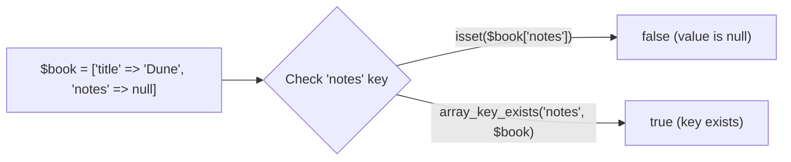

---
tags:
  - php
  - associative-arrays
  - beginner
---

# Associative Arrays

## TL;DR

An **associative array** maps string keys to values using the fat arrow `=>`, such as `["title" => "Dune", "pages" => 412]`. Use `array_key_exists()` when a key's value might be `null`, `isset()` or `??` for non-null checks, and **destructuring** (`["title" => $t] = $book;`) to unpack keys straight into variables.

> [!NOTE] Prerequisites: 04, 09, 17
> New terms: associative array, destructuring

> [!abstract] Core Idea
> Associative arrays pair named keys with values via `=>`, `array_key_exists()` finds keys even when their value is `null`, and `["key" => $var]` unpacks fields cleanly.
> PHP's associative array works like Python's `dict` (and Java's `HashMap`), except it uses `[...]` with `=>` instead of `{...}` with `:`.

## Mental Model

Think of an associative array as a Book Tracker index card with labeled fields (`"title"`, `"pages"`, `"notes"`). Calling `isset($book["notes"])` asks "Is there a non-blank note written here?", while `array_key_exists("notes", $book)` asks "Does the `"notes"` line exist on this card, even if it is blank (`null`)?"



## Minimal Example

Save this as `assoc_arrays.php` and run `php assoc_arrays.php`:

```php
<?php
declare(strict_types=1);

$book = [
    "title" => "Dune",
    "pages" => 412,
    "notes" => null,
];

["title" => $title, "pages" => $pages] = $book;
echo "{$title} ({$pages}p)\n";

var_dump(isset($book["notes"]));
var_dump(array_key_exists("notes", $book));
```

Expected output:

```text
Dune (412p)
bool(false)
bool(true)
```

- `"title" => "Dune"` ▸ `=>` pairs the key `"title"` with the value `"Dune"`.
- `["title" => $title, "pages" => $pages] = $book;` ▸ **destructuring**: unpacks matching keys from `$book` directly into `$title` and `$pages`.
- `isset($book["notes"])` ▸ returns `false` because `"notes"` holds `null` (and returns `false` with no warning if a key is missing).
- `array_key_exists("notes", $book)` ▸ returns `true` because the `"notes"` key exists, even though its value is `null`.

## Compare

| Key state in `$arr` | `isset($arr[$k])` | `array_key_exists($k, $arr)` |
| ------------------- | ----------------- | ---------------------------- |
| `"title" => "Dune"` | `true`            | `true`                       |
| `"notes" => null`   | `false`           | `true`                       |
| `"isbn"` missing    | `false`           | `false`                      |

## ◈ Edge Case Analysis

✗ **Mistake 1:** Writing `$book['title']` inside double quotes without curly braces, which causes a syntax error.

```php
<?php
$book = ["title" => "Dune"];
echo "Book: $book['title']"; // syntax error
```

✓ **Fix:** Wrap associative array lookups in `{...}` inside double-quoted strings.

```php
<?php
$book = ["title" => "Dune"];
echo "Book: {$book['title']}";
```

✗ **Mistake 2:** Reading a missing key directly (`$book["isbn"]`), which emits an `Undefined array key "isbn"` warning and evaluates to `null`.

```php
<?php
$book = ["title" => "Dune"];
echo $book["isbn"]; // Warning: Undefined array key "isbn"
```

✓ **Fix:** Provide a fallback with `??` (or check with `isset()` first).

```php
<?php
$book = ["title" => "Dune"];
echo $book["isbn"] ?? "N/A";
```

✗ **Mistake 3:** Using `isset($book["notes"])` to test whether a key exists when `null` is a valid value; `isset()` returns `false` for `null` values.

```php
<?php
$book = ["notes" => null];
var_dump(isset($book["notes"])); // bool(false)
```

✓ **Fix:** Use `array_key_exists("notes", $book)` when a `null` value should still count as an existing key.

```php
<?php
$book = ["notes" => null];
var_dump(array_key_exists("notes", $book)); // bool(true)
```

## Try It

- 1. Create `$book = ["title" => "1984", "year" => 1949]`, add `"rating" => 4.9`, and print `"1984 (1949)"` using `{...}` interpolation.
- 2. Destructure `"title"` into `$t` and `"rating"` into `$r`, and test `isset($book["author"])` vs `$book["author"] ?? "Unknown"`.

<details>
<summary>◈ View Solution</summary>

1.

```php
<?php
declare(strict_types=1);

$book = ["title" => "1984", "year" => 1949];
$book["rating"] = 4.9;

echo "{$book['title']} ({$book['year']})";
```

2.

```php
<?php
declare(strict_types=1);

$book = ["title" => "1984", "year" => 1949, "rating" => 4.9];
["title" => $t, "rating" => $r] = $book;

var_dump(isset($book["author"])); // bool(false)
echo $book["author"] ?? "Unknown"; // Unknown
```

</details>

## Topic Mastery Quiz

**Q1: With `$book = ["title" => "Dune", "notes" => null];`, what do `isset($book["notes"])` and `array_key_exists("notes", $book)` return?**

- [ ] A) `true` and `true`
- [ ] B) `false` and `true`
- [ ] C) `true` and `false`
- [ ] D) `false` and `false`

**Q2: Which line prints `Dune` without a syntax error?**

- [ ] A) `echo "Book: $book['title']";`
- [ ] B) `echo "Book: {$book['title']}";`
- [ ] C) `echo "Book: $book->title";`
- [ ] D) `echo 'Book: {$book["title"]}';`

**Q3: After `["pages" => $p] = ["title" => "Dune", "pages" => 412];`, what is `$p`?**

- [ ] A) `"Dune"`
- [ ] B) `412`
- [ ] C) `["pages" => 412]`
- [ ] D) `null`

**Q4: What happens when you run `echo $book["isbn"] ?? "None";` if `"isbn"` is not in `$book`?**

- [ ] A) Emits an `Undefined array key` warning and prints `None`
- [ ] B) Prints `None` with no warning
- [ ] C) Throws a fatal error
- [ ] D) Prints `0`

**Q5: Which syntax creates an associative array in PHP?**

- [ ] A) `{"title": "Dune"}`
- [ ] B) `["title" => "Dune"]`
- [ ] C) `["title": "Dune"]`
- [ ] D) `("title" => "Dune")`

**Q6: How do you swap `$a` and `$b` in one line using array destructuring?**

- [ ] A) `[$b, $a] = [$a, $b];`
- [ ] B) `[$a => $b] = [$b => $a];`
- [ ] C) `swap($a, $b);`
- [ ] D) `$a, $b =$b, $a;`

<details>
<summary>◈ View Answers & Explanations</summary>

1. **B** — `isset()` returns `false` when the value is `null`, whereas `array_key_exists()` returns `true` because the key `"notes"` is present.
2. **B** — String-keyed array lookups inside double quotes must be wrapped in `{...}`. A is a syntax error, C is object syntax, and D uses single quotes so it prints literally.
3. **B** — Keyed destructuring `["pages" => $p]` pulls the value at key `"pages"` (`412`) into `$p`, regardless of key order.
4. **B** — `??` safely checks whether the key exists and is not `null` without emitting an undefined-key warning.
5. **B** — PHP uses square brackets `[...]` with fat arrows `=>` for associative arrays. A, C, and D are invalid PHP.
6. **A** — Indexed destructuring `[$b, $a] = [$a, $b];` unpacks the two values into the variables in one statement.

</details>

## One-Liner > [!tip] Key & Brace Rule > **Pair keys with `=>`, wrap `{$arr['key']}` in braces inside double quotes, and use `array_key_exists()` when `null` values matter.**

> [!quote] Sources
>
> - [PHP Manual — Arrays](https://www.php.net/manual/en/language.types.array.php)
> - [PHP Manual — array_key_exists](https://www.php.net/manual/en/function.array-key-exists.php)
> - [PHP Manual — isset](https://www.php.net/isset)
