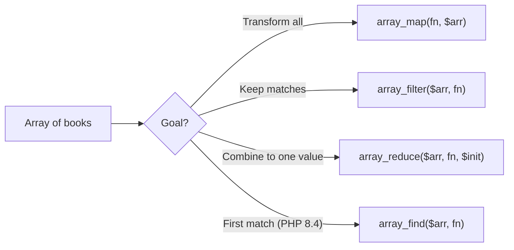

---
tags:
  - php
  - array-functions
  - beginner
---

# Array Functions

## TL;DR

Instead of writing manual `foreach` loops to transform, filter, or total a list, PHP provides built-in functions that accept a **callback** (a function or arrow function passed as an argument): `array_map()`, `array_filter()`, `array_reduce()`, and PHP 8.4's `array_find()`. Watch one classic PHP quirk: `array_map()` takes the callback _first_, while the others take the array _first_.

> [!NOTE] Prerequisites: 16, 17, 18
> New terms: callback, accumulator

> [!abstract] Core Idea
> Use `array_map()` to transform every item, `array_filter()` to keep matching items, `array_reduce()` to fold into one value, and `array_find()` (PHP 8.4) to get the first match.
> PHP's `array_map`, `array_filter`, and `array_reduce` mirror Python's `map`, `filter`, and `reduce`, except PHP returns plain arrays immediately and `array_filter()` keeps original keys.

## Mental Model

Think of a Book Tracker assembly line: `array_map()` stamps every book card into a new format, `array_filter()` keeps only matching cards (with their original shelf numbers), `array_reduce()` sums all pages into one total, and `array_find()` stops the belt the instant it spots the first match.



## Minimal Example

Save this as `array_funcs.php` and run `php array_funcs.php`:

```php
<?php
declare(strict_types=1);

$pages = [180, 412, 328];

$doubled = array_map(fn(int $p): int => $p * 2, $pages);
$long = array_filter($pages, fn(int $p): bool => $p >= 300);
$total = array_reduce($pages, fn(int $acc, int $p): int => $acc + $p, 0);
$firstLong = array_find($pages, fn(int $p): bool => $p >= 300);

echo $total, "\n", $firstLong;
```

Expected output:

```text
920
412
```

- `array_map(fn(...) => ..., $pages)` ▸ **callback** comes _first_, array comes _second_; returns `[360, 824, 656]`.
- `array_filter($pages, fn(...) => ...)` ▸ array comes _first_; preserves original keys (`[1 => 412, 2 => 328]`).
- `array_reduce($pages, fn(int $acc, int $p) => ..., 0)` ▸ folds `$pages` into one value using `$acc` (the **accumulator**, carrying the running result from step to step, starting at `0`).
- `array_find($pages, fn(...) => ...)` ▸ added in PHP 8.4; returns the first matching value (`412`) and stops early, or `null` if nothing matches.

## Compare

| Function                         | Argument order | Preserves keys?      | Returns               |
| -------------------------------- | -------------- | -------------------- | --------------------- |
| `array_map($fn, $arr)`           | Callback first | Yes (for 1 array)    | Transformed array     |
| `array_filter($arr, $fn)`        | Array first    | Yes (may leave gaps) | Filtered array        |
| `array_reduce($arr, $fn, $init)` | Array first    | N/A                  | Single value          |
| `array_find($arr, $fn)`          | Array first    | N/A                  | First match or `null` |

## ◈ Edge Case Analysis

✗ **Mistake 1:** Passing the array first to `array_map($pages, $fn)` (to match `array_filter`), which throws a `TypeError` because `array_map()` expects the callback first.

```php
<?php
$pages = [100, 200];
$res = array_map($pages, fn($p) => $p + 1); // TypeError
```

✓ **Fix:** Put the callback first in `array_map($fn, $arr)`.

```php
<?php
$pages = [100, 200];
$res = array_map(fn($p) => $p + 1, $pages);
```

✗ **Mistake 2:** Reading `$long[0]` after `array_filter()` removed index `0`, which emits an `Undefined array key 0` warning because `array_filter()` preserves original keys.

```php
<?php
$long = array_filter([180, 412], fn($p) => $p >= 300);
echo $long[0]; // Warning: Undefined array key 0 (key is 1)
```

✓ **Fix:** Wrap the result in `array_values()` whenever you need contiguous `0, 1, 2...` keys.

```php
<?php
$long = array_values(array_filter([180, 412], fn($p) => $p >= 300));
echo $long[0]; // 412
```

✗ **Mistake 3:** Calling `array_filter($scores)` without a callback expecting only `null` to be dropped, when it actually drops all falsy values (`0`, `""`, `"0"`, `false`, `null`).

```php
<?php
$ratings = [0, 5, null];
var_dump(array_filter($ratings)); // drops 0 too!
```

✓ **Fix:** Pass an explicit callback like `fn($v): bool => $v !== null` when `0` or `""` should remain.

```php
<?php
$ratings = [0, 5, null];
var_dump(array_filter($ratings, fn($v): bool => $v !== null));
```

## Try It

- 1. Use `array_map()` to add `10` bonus pages to every number in `[100, 200, 300]`.
- 2. Use `array_find()` (PHP 8.4) on `[120, 250, 410]` to get the first book with `>= 200` pages, then `echo` it.

<details>
<summary>◈ View Solution</summary>

1.

```php
<?php
declare(strict_types=1);

$updated = array_map(fn(int $p): int => $p + 10, [100, 200, 300]);
var_dump($updated); // [110, 210, 310]
```

2.

```php
<?php
declare(strict_types=1);

$found = array_find([120, 250, 410], fn(int $p): bool => $p >= 200);
echo $found ?? "None"; // 250
```

</details>

## Topic Mastery Quiz

**Q1: Which of these four functions takes the callback as its FIRST argument instead of the array?**

- [ ] A) `array_filter()`
- [ ] B) `array_reduce()`
- [ ] C) `array_map()`
- [ ] D) `array_find()`

**Q2: After `$res = array_filter([10, 50, 80], fn($n) =>$n > 20);`, what is `array_key_exists(0, $res)`?**

- [ ] A) `true`, because `array_filter()` re-indexes keys from `0`
- [ ] B) `false`, because `array_filter()` preserves original keys (`1` and `2`)
- [ ] C) `null`
- [ ] D) A `TypeError`

**Q3: In PHP 8.4, what does `array_find([10, 20], fn($n) => $n > 100)` return?**

- [ ] A) `false`
- [ ] B) `[]`
- [ ] C) `null`
- [ ] D) Throws `UnhandledMatchError`

**Q4: What does `array_filter([0, 4, null, "", 5])` (with no callback) return?**

- [ ] A) `[0 => 0, 1 => 4, 3 => "", 4 => 5]`
- [ ] B) `[1 => 4, 4 => 5]`
- [ ] C) `[4, 5]` (re-indexed to `0, 1`)
- [ ] D) A `TypeError`

**Q5: What does the third argument (`0`) in `array_reduce($pages, fn($acc,$p) => $acc +$p, 0)` set?**

- [ ] A) The maximum number of items to loop over
- [ ] B) The starting value of the accumulator `$acc`
- [ ] C) The index to start from
- [ ] D) The fallback if the callback throws

**Q6: Which call sums `[10, 20, 30]` to `60`?**

- [ ] A) `array_map(fn($a, $b) =>$a + $b, [10, 20, 30])`
- [ ] B) `array_reduce([10, 20, 30], fn($acc, $n) =>$acc + $n, 0)`
- [ ] C) `array_filter([10, 20, 30], fn($n) => $n > 0)`
- [ ] D) `array_find([10, 20, 30], fn($n) => $n === 60)`

<details>
<summary>◈ View Answers & Explanations</summary>

1. **C** — `array_map($callback, $array)` takes the callback first; `array_filter`, `array_reduce`, and `array_find` all take the array first.
2. **B** — `array_filter()` preserves original keys, so `10` (key `0`) is removed and the result has keys `1 => 50, 2 => 80`.
3. **C** — `array_find()` returns `null` when no element satisfies the callback.
4. **B** — Without a callback, `array_filter()` removes all falsy values (`0`, `null`, `""`) and preserves the remaining keys (`1 => 4, 4 => 5`).
5. **B** — The third parameter of `array_reduce()` is the initial value passed into `$acc` on the first iteration.
6. **B** — `array_reduce()` folds all elements into a single accumulated value (`0 + 10 + 20 + 30 = 60`).

</details>

## One-Liner

> [!tip] Order & Keys Rule
> **Put the callback first only in `array_map()`, and wrap `array_filter()` in `array_values()` when you need `0, 1, 2...` keys.**

> [!quote] Sources
>
> - [PHP Manual — array_map](https://www.php.net/manual/en/function.array-map.php)
> - [PHP Manual — array_filter](https://www.php.net/manual/en/function.array-filter.php)
> - [PHP Manual — array_find (PHP 8.4)](https://www.php.net/manual/en/function.array-find.php)
