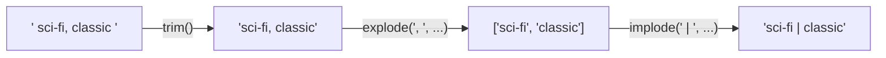

---
tags:
  - php
  - strings
  - beginner
---

# String Functions

## TL;DR

PHP gives you built-in functions to inspect, clean, split, and join text without writing manual loops. You can check whether text contains a word, strip extra spaces from both ends, split a string into an indexed array, and glue an array back into one string.

> [!NOTE] Prerequisites: 04, 17
> New terms: delimiter, whitespace

> [!abstract] Core Idea
> Use `str_contains()`, `trim()`, `explode()`, and `implode()` to search, clean, split, and join strings in one function call.
> In Python, these match `in`, `.strip()`, `.split()`, and `.join()`, except PHP passes the target string as an argument instead of calling a method on it.

## Mental Model

Think of preparing book tags for your Book Tracker like sorting a messy shipping label. First you trim off blank tape from the edges (`trim()`), then you cut along each comma (`explode()`), check if a label mentions a word (`str_contains()`), and finally tape the clean tags back into one strip (`implode()`).



- **Whitespace** means invisible spacing characters such as spaces, tabs (`\t`), and newlines (`\n`).
- A **delimiter** is the character or short text used as a boundary to split a string apart or join array items together.

## Minimal Example

```php
<?php
$rawTags = "  fantasy, sci-fi, classic \n";
$clean = trim($rawTags);

$tags = explode(", ", $clean);
$hasSciFi = str_contains($clean, "sci-fi");
$display = implode(" | ", $tags);

echo $display . PHP_EOL;
var_dump($hasSciFi);
```

Expected output:

```text
fantasy | sci-fi | classic
bool(true)
```

- `trim($rawTags)` removes leading and trailing **whitespace**, leaving `"fantasy, sci-fi, classic"`.
- `explode(", ", $clean)` splits the string at every `", "` **delimiter** and returns an indexed array of three items.
- `str_contains($clean, "sci-fi")` checks whether `"sci-fi"` appears anywhere inside `$clean` and returns `true` or `false`.
- `implode(" | ", $tags)` joins the array values into a single string with `" | "` placed between each item.
- `PHP_EOL` adds a newline matching the current operating system.

## Compare

| Function         | Parameter Order          | Returns  | Key Rule                             |
| ---------------- | ------------------------ | -------- | ------------------------------------ |
| `str_contains()` | `($haystack, $needle)`   | `bool`   | Case-sensitive substring check       |
| `trim()`         | `($string, $characters)` | `string` | Strips outer edges only              |
| `explode()`      | `($separator, $string)`  | `array`  | Empty separator `""` throws an error |
| `implode()`      | `($separator, $array)`   | `string` | Joins values only; ignores keys      |

## ◈ Edge Case Analysis

✗ **Mistake 1:** Passing an empty string `""` as the delimiter to `explode()` throws a `ValueError` (a runtime error for an invalid argument) in PHP 8+.

```php
$letters = explode("", "Dune");
```

✓ **Fix:** Use a non-empty delimiter such as `","` or `" "`, or `str_split("Dune")` when you want individual characters.

```php
$words = explode(" ", "Dune Messiah");
```

✗ **Mistake 2:** Swapping the arguments in `str_contains()` searches the short word for the full title and silently returns `false`.

```php
$found = str_contains("Dune", "Dune Messiah"); // false
```

✓ **Fix:** Always pass the larger string (`$haystack`) first and the search text (`$needle`) second.

```php
$found = str_contains("Dune Messiah", "Dune"); // true
```

✗ **Mistake 3:** Expecting `trim()` to remove extra spaces in the middle of a string leaves internal spaces untouched because `trim()` only strips from the start and end.

```php
$title = trim("  Dune   Messiah  "); // "Dune   Messiah"
```

✓ **Fix:** Use `trim()` for outer edges, and `str_replace("  ", " ", $title)` if you also need to collapse spaces inside the text.

```php
$title = str_replace("   ", " ", trim("  Dune   Messiah  "));
```

## Try It

1. Given `$input = "  1984 | George Orwell | 328  "`, trim the whitespace and split it into an indexed array using `" | "` as the delimiter.
2. Given `$authors = ["Le Guin", "Herbert", "Asimov"]`, join them into `"Le Guin, Herbert, Asimov"` and check with `str_contains()` whether `"Herbert"` is in the result.

<details>
<summary>◈ View Solution</summary>

1. Clean and split the book record:

```php
<?php
$input = "  1984 | George Orwell | 328  ";
$parts = explode(" | ", trim($input));
print_r($parts);
```

2. Join the authors and check for `"Herbert"`:

```php
<?php
$authors = ["Le Guin", "Herbert", "Asimov"];
$list = implode(", ", $authors);
var_dump(str_contains($list, "Herbert")); // bool(true)
```

</details>

## Topic Mastery Quiz

**Q1: What does `trim("  Dune   Messiah  ")` return?**

- [ ] A) `"DuneMessiah"`
- [ ] B) `"Dune Messiah"`
- [ ] C) `"Dune   Messiah"`
- [ ] D) `"  Dune   Messiah"`

**Q2: What happens when you run `explode("", "a,b,c")` in PHP 8.4?**

- [ ] A) It returns `["a", ",", "b", ",", "c"]`
- [ ] B) It returns `["a,b,c"]`
- [ ] C) It returns `false`
- [ ] D) It throws a `ValueError`

**Q3: What does `str_contains("The Hobbit", "hobbit")` return?**

- [ ] A) `true`
- [ ] B) `false`
- [ ] C) `4`
- [ ] D) `null`

**Q4: Which call correctly checks whether `$title` contains the word `"PHP"`?**

- [ ] A) `str_contains("PHP", $title)`
- [ ] B) `str_contains($title, "PHP")`
- [ ] C) `$title->str_contains("PHP")`
- [ ] D) `explode("PHP", $title)`

**Q5: What does `implode(" | ", ["first" => "Dune", "second" => "1984"])` return?**

- [ ] A) `"Dune | 1984"`
- [ ] B) `"first | second"`
- [ ] C) `"first: Dune | second: 1984"`
- [ ] D) `""`

**Q6: What does `implode("-", [])` return?**

- [ ] A) `"-"`
- [ ] B) `null`
- [ ] C) `""`
- [ ] D) `false`

<details>
<summary>◈ View Answers & Explanations</summary>

1. **C** — `trim()` only strips whitespace from the start and end of a string; the three spaces in the middle remain untouched. A and B wrongly strip or collapse middle spaces, and D keeps the leading spaces.
2. **D** — Passing an empty string `""` as the separator to `explode()` throws a `ValueError` in PHP 8+. It does not split into characters (A), return the whole string (B), or return `false` (C).
3. **B** — `str_contains()` is case-sensitive, so `"hobbit"` does not match `"Hobbit"`. It always returns a `bool`, never an index number (C) or `null` (D).
4. **B** — `str_contains()` takes `$haystack` first and `$needle` second. A reverses the arguments, C uses invalid method syntax on a string, and D splits the string into an array instead of returning a `bool`.
5. **A** — `implode()` joins only the array's values and ignores associative keys. B joins keys, C formats key-value pairs, and D would only happen for an empty array.
6. **C** — Joining an empty array returns an empty string `""` because there are no elements to place the `"-"` separator between. It never returns a lone separator (A), `null` (B), or `false` (D).

</details>

## One-Liner

> [!tip] String Flow
> **Trim the edges, explode on a delimiter to work with pieces, and implode back to text when you are done.**

> [!quote] Sources
>
> - [str_contains - PHP Manual](https://www.php.net/manual/en/function.str-contains.php)
> - [explode - PHP Manual](https://www.php.net/manual/en/function.explode.php)
> - [implode - PHP Manual](https://www.php.net/manual/en/function.implode.php)
