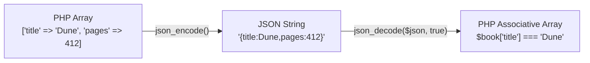

---
tags:
  - php
  - json
  - beginner
---

# JSON Encoding

## TL;DR

PHP arrays live only in memory while a script runs, so you need a text format to save them to a file or send them over the web. `json_encode()` turns a PHP array into a **JSON** string, and `json_decode()` turns that string back into PHP data.

> [!NOTE] Prerequisites: 17, 18
> New terms: JSON, serialization

> [!abstract] Core Idea
> Use `json_encode()` to convert PHP arrays into **JSON** text, and `json_decode($json, true)` to convert **JSON** text back into associative arrays.
> In Python, these match `json.dumps()` and `json.loads()`, except PHP's `json_decode()` returns an object by default unless you pass `true` as the second argument.

## Mental Model

Think of **JSON** like flat-packing a bookshelf for shipping. Your PHP associative array is the assembled shelf in your room; **serialization** packs it into a labeled text box (`json_encode()`), and unpacking it at the destination rebuilds the array (`json_decode()`).



- **JSON** (JavaScript Object Notation) is a lightweight, language-neutral text format for storing and sharing structured data.
- **Serialization** is the process of converting in-memory data (like an array) into a plain text string that can be saved or sent.

## Minimal Example

```php
<?php
$book = [
    'title' => 'Dune',
    'pages' => 412,
    'finished' => true,
];

$json = json_encode($book, JSON_PRETTY_PRINT | JSON_THROW_ON_ERROR);
echo $json . PHP_EOL;

$decoded = json_decode($json, true, flags: JSON_THROW_ON_ERROR);
echo $decoded['title'] . PHP_EOL;
```

Expected output:

```text
{
    "title": "Dune",
    "pages": 412,
    "finished": true
}
Dune
```

- `json_encode($book, ...)` converts the associative array into a **JSON** object string.
- `JSON_PRETTY_PRINT` formats the output with indentation and line breaks for readability.
- `|` combines multiple constant flags into one argument.
- `JSON_THROW_ON_ERROR` makes PHP throw a `JsonException` if encoding or decoding fails instead of failing silently.
- `json_decode($json, true, ...)` passes `true` for `$associative` so the result is a PHP associative array rather than an object.

## Compare

| Function        | Direction               | Key Parameter                       | Default Failure Behavior                            |
| --------------- | ----------------------- | ----------------------------------- | --------------------------------------------------- |
| `json_encode()` | PHP value → JSON string | `$flags` (e.g. `JSON_PRETTY_PRINT`) | Returns `false` unless `JSON_THROW_ON_ERROR` is set |
| `json_decode()` | JSON string → PHP value | `$associative = true` for arrays    | Returns `null` unless `JSON_THROW_ON_ERROR` is set  |

## ◈ Edge Case Analysis

✗ **Mistake 1:** Calling `json_decode($json)` without `true` returns a `stdClass` object instead of an array, so bracket access like `$decoded['title']` throws an `Error`.

```php
$decoded = json_decode('{"title":"Dune"}');
echo $decoded['title']; // Fatal error: Cannot use object of type stdClass as array
```

✓ **Fix:** Pass `true` as the second argument whenever you want an associative array.

```php
$decoded = json_decode('{"title":"Dune"}', true);
echo $decoded['title']; // "Dune"
```

✗ **Mistake 2:** Omitting `JSON_THROW_ON_ERROR` causes `json_decode()` to silently return `null` on broken JSON, making it look like the data was simply `null`.

```php
$data = json_decode('{title: "Dune"}', true); // returns null silently
```

✓ **Fix:** Always include `JSON_THROW_ON_ERROR` so invalid JSON stops immediately with a clear `JsonException`.

```php
$data = json_decode('{title: "Dune"}', true, flags: JSON_THROW_ON_ERROR);
```

✗ **Mistake 3:** Writing single quotes or unquoted keys in JSON text fails because valid JSON strictly requires double quotes around keys and string values.

```php
$bad = "{'title': 'Dune'}"; // Invalid JSON
```

✓ **Fix:** Use `json_encode()` to build JSON strings instead of writing them by hand, or ensure all keys and strings use double quotes.

```php
$good = json_encode(['title' => 'Dune'], JSON_THROW_ON_ERROR);
```

## Try It

1. Encode `$shelf = ['books' => ['Dune', '1984'], 'count' => 2]` into a pretty-printed JSON string using `JSON_THROW_ON_ERROR`.
2. Decode `'{"title":"The Hobbit","pages":310}'` into an associative array with `JSON_THROW_ON_ERROR` and echo `"The Hobbit: 310"`.

<details>
<summary>◈ View Solution</summary>

1. Encode the shelf array:

```php
<?php
$shelf = ['books' => ['Dune', '1984'], 'count' => 2];
$json = json_encode($shelf, JSON_PRETTY_PRINT | JSON_THROW_ON_ERROR);
echo $json;
```

2. Decode into an associative array and print:

```php
<?php
$raw = '{"title":"The Hobbit","pages":310}';
$book = json_decode($raw, true, flags: JSON_THROW_ON_ERROR);
echo "{$book['title']}: {$book['pages']}";
```

</details>

## Topic Mastery Quiz

**Q1: What does `json_decode('{"title":"Dune"}')` return when you omit the second argument?**

- [ ] A) `['title' => 'Dune']`
- [ ] B) A `stdClass` object
- [ ] C) `null`
- [ ] D) `'{"title":"Dune"}'`

**Q2: What happens when you run `json_decode('not json', true)` without `JSON_THROW_ON_ERROR`?**

- [ ] A) It throws a `JsonException`
- [ ] B) It returns `[]`
- [ ] C) It returns `null`
- [ ] D) It returns `false`

**Q3: What does `json_encode(['Dune', '1984'])` output?**

- [ ] A) `'["Dune","1984"]'`
- [ ] B) `'{"0":"Dune","1":"1984"}'`
- [ ] C) `'['Dune','1984']'`
- [ ] D) `'Dune,1984'`

**Q4: Which flag makes `json_decode()` throw a `JsonException` instead of returning `null` on malformed JSON?**

- [ ] A) `JSON_PRETTY_PRINT`
- [ ] B) `JSON_FORCE_OBJECT`
- [ ] C) `JSON_THROW_ON_ERROR`
- [ ] D) `JSON_NUMERIC_CHECK`

**Q5: Why does `json_decode("{'title':'Dune'}", true, flags: JSON_THROW_ON_ERROR)` throw an exception?**

- [ ] A) `true` is not allowed with `JSON_THROW_ON_ERROR`
- [ ] B) Valid JSON requires double quotes, not single quotes
- [ ] C) Associative keys must be integers
- [ ] D) The string is too short

**Q6: Which call decodes `$json` into an associative array AND throws on invalid JSON?**

- [ ] A) `json_decode($json, false, flags: JSON_THROW_ON_ERROR)`
- [ ] B) `json_encode($json, JSON_THROW_ON_ERROR)`
- [ ] C) `json_decode($json, true)`
- [ ] D) `json_decode($json, true, flags: JSON_THROW_ON_ERROR)`

<details>
<summary>◈ View Answers & Explanations</summary>

1. **B** — By default, `$associative` is `false`, so `json_decode()` decodes JSON objects into `stdClass` objects. A requires passing `true`, C only happens on error or JSON `null`, and D is the raw input string.
2. **C** — Without `JSON_THROW_ON_ERROR`, `json_decode()` returns `null` when decoding fails. It does not throw an exception (A), return an empty array (B), or return `false` (D).
3. **A** — Indexed PHP arrays with sequential integer keys encode as JSON arrays using double quotes. B would only happen with `JSON_FORCE_OBJECT`, C uses invalid single quotes, and D is not JSON.
4. **C** — `JSON_THROW_ON_ERROR` turns silent JSON failures into `JsonException` errors. A formats output, B forces objects, and D converts numeric strings.
5. **B** — The JSON specification strictly requires double quotes around keys and strings, so single-quoted `{'title':'Dune'}` is malformed JSON. A, C, and D are all false.
6. **D** — Passing `true` gives an associative array, and `JSON_THROW_ON_ERROR` ensures malformed input throws `JsonException`. A returns an object, B encodes instead of decoding, and C fails silently.

</details>

## One-Liner

> [!tip] Safe JSON
> **Always decode with `true` for arrays and `JSON_THROW_ON_ERROR` so bad JSON fails loudly.**

> [!quote] Sources
>
> - [json_encode - PHP Manual](https://www.php.net/manual/en/function.json-encode.php)
> - [json_decode - PHP Manual](https://www.php.net/manual/en/function.json-decode.php)
> - [JsonException - PHP Manual](https://www.php.net/manual/en/class.jsonexception.php)
