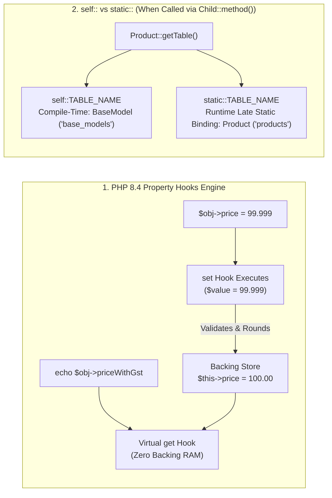

---
tags:
  - php
  - oop
  - property-hooks
  - asymmetric-visibility
  - constructor-promotion
---

# Classes, Constructor Promotion & Property Hooks in PHP

#### TL;DR (Quick Revision)

**PHP Modern OOP (`class`)** = Reference-handle object instances (`new ClassName()`) accessed via the **`->` object operator** (where `$this->prop` drops the `$` on the property name!) and **`::` scope resolution operator**, supercharged in PHP 8.0–8.5 with **Constructor Property Promotion**, **`readonly` classes/properties**, **PHP 8.4 Property Hooks (`get` / `set`)**, **PHP 8.4 Asymmetric Visibility (`public private(set)`)**, and **PHP 8.4 parenthesis-free instantiation (`new MyClass()->method()`)**.

> [!abstract] Core Idea
> Unlike PHP arrays (which use Copy-on-Write value semantics), PHP objects are passed by **Object Handle ID** in the Zend Engine—meaning assigning `$b = $a` points both variables to the **exact same object instance** in memory ([PHP Objects and References](https://www.php.net/manual/en/language.oop5.references.php)). Modern PHP (`8.0–8.5+`) eliminates 80% of traditional OOP getter/setter and constructor boilerplate through **Constructor Property Promotion**, **Property Hooks (`get`/`set`)**, and **Asymmetric Visibility** ([PHP 8.4 Release Notes](https://www.php.net/releases/8.4/en.php))[cite: 1].

> [!question] Why Master Modern PHP 8.4/8.5+ Classes?
>
> - **Master the `$this->prop` Dollar-Sign Rule**: In PHP, `$this->name` accesses the property `$name`, whereas `$this->$name` is a **dynamic variable property** that looks up the string inside `$name`! Mixing these up is the #1 beginner OOP bug in PHP ([PHP Properties Manual](https://www.php.net/manual/en/language.oop5.properties.php)).
> - **Zero Boilerplate DTOs & Entities**: **Constructor Property Promotion** declares, type-hints, and assigns class properties right inside `__construct(public readonly string $id)` in a single line ([Constructor Promotion Docs](https://www.php.net/manual/en/language.oop5.decon.php#language.oop5.decon.constructor.promotion))[cite: 1].
> - **Native Computed & Validated Properties (PHP 8.4 Property Hooks)**: Instead of cluttering classes with `getFullName()` / `setEmail()` methods, PHP 8.4 lets you attach `get` and `set` hooks directly to a property (`public string $email { set => strtolower($value); }`) ([PHP 8.4 Property Hooks](https://www.php.net/manual/en/language.oop5.property-hooks.php))[cite: 1].
> - **Public Read, Private Write without Getters (PHP 8.4 Asymmetric Visibility)**: Writing `public private(set) int $balance = 0;` lets outside code read `$account->balance` directly while forbidding external mutation ([PHP 8.4 Asymmetric Visibility](https://www.php.net/manual/en/language.oop5.visibility.php#language.oop5.visibility-members-aviz))[cite: 1].

#### Quick Reference Table: Legacy OOP Boilerplate vs. Modern PHP 8.4/8.5+

| OOP Concept / Feature         | Legacy PHP OOP                                                | Modern PHP 8.4/8.5+ (The Right Way)                      | Engine Rule & Official Docs                                                                                                                                                            |
| :---------------------------- | :------------------------------------------------------------ | :------------------------------------------------------- | :------------------------------------------------------------------------------------------------------------------------------------------------------------------------------------- |
| **Constructor Assignment**    | Declare properties + repeat `$this->x = $x;` in `__construct` | `public function __construct(private string $x) {}`      | **[Constructor Property Promotion](https://www.php.net/manual/en/language.oop5.decon.php#language.oop5.decon.constructor.promotion)** auto-declares and assigns the property[cite: 1]. |
| **Getters & Setters**         | Verbose `getPrice()` / `setPrice($v)` methods                 | `public float $price { get => ...; set => ...; }`        | **[PHP 8.4 Property Hooks](https://www.php.net/releases/8.4/en.php#property-hooks)** intercept property reads/writes natively[cite: 1].                                                |
| **Read-Only Outside Class**   | `private int $score;` + `public function getScore()`          | `public private(set) int $score = 0;`                    | **[PHP 8.4 Asymmetric Visibility](https://www.php.net/releases/8.4/en.php#asymmetric-visibility)** allows public reading and private/protected writing[cite: 1].                       |
| **Immutable Value Object**    | All private properties + getters                              | `readonly class Money { ... }`                           | **[Readonly Classes (PHP 8.2+)](https://www.php.net/manual/en/language.oop5.basic.php#language.oop5.basic.class.readonly)** makes every property `readonly` (write-once).              |
| **Chaining on `new`**         | `(new Request())->withHeader(...)`                            | `new Request()->withHeader(...)`                         | **[PHP 8.4 `new` Without Parentheses](https://www.php.net/releases/8.4/en.php#new_without_parentheses)** allows direct `->` chaining on `new Class()`.                                 |
| **Undeclared Property Write** | `$obj->typoProp = 123;` _(Created silently!)_                 | **Deprecated in PHP 8.2+** (`#[AllowDynamicProperties]`) | **[Dynamic Properties Deprecation](https://www.php.net/manual/en/migration82.deprecated.php#migration82.deprecated.core.dynamic-properties)** catches property name typos immediately. |

---

## The Learning Concept

### What Problem Does It Solve?

When writing classes in PHP, three classic traps trip developers up:

1. **The `$this->$prop` vs `$this->prop` Syntax Trap**: Writing `$this->$username` instead of `$this->username` tells PHP to look for a local variable named `$username` and use its string value as the property name!
2. **Typed Property `Uninitialized` State**: Unlike untyped properties (which default to `null`), a typed property like `public string $token;` starts in a special **`uninitialized`** state before it is assigned ([PHP Typed Properties](https://www.php.net/manual/en/language.oop5.properties.php#language.oop5.properties.typed-properties)). Reading it before assignment throws a fatal `Error: Typed property::$token must not be accessed before initialization`!
3. **50 Lines of Getter/Setter Boilerplate**: Writing manual properties, constructors, `getX()`, and `setX()` methods for a 3-field class.

Look at this **`// BAD`** legacy PHP class demonstrating these exact problems:

```php
<?php
// BAD - Verbose boilerplate, $this->$prop bug, and uninitialized typed property crash!

class LegacyUser
{
    public string $username;
    public string $apiToken; // Typed property with NO default value -> starts UNINITIALIZED!

    public function __construct(string $username)
    {
        // BUG 1: Extra $ sign before username ($this->$username) looks up a dynamic property
        // named after the VALUE of $username (e.g. $this->valay = 'valay')!
        $this->$username = $username;
    }
}

$u = new LegacyUser('valay');
// BUG 2: Reading $u->apiToken throws Fatal Error:
// Typed property LegacyUser::$apiToken must not be accessed before initialization!
// echo $u->apiToken;
```

**Why this fails:** In PHP, the `$` sigil belongs to the object reference (`$this`), **not** the property identifier (`->username`). Furthermore, any typed property (`string $apiToken` or even `?string $apiToken`) without a default value (`= null`) is `uninitialized` until assigned in the constructor or declaration.

Now look at the **`// GOOD`** modern **PHP 8.4/8.5 + _PHP: The Right Way_** solution using Constructor Promotion, Property Hooks, Asymmetric Visibility, and parenthesis-free `new`[cite: 1]:

```php
<?php

declare(strict_types=1);

// GOOD - Constructor Property Promotion, Asymmetric Visibility (public private(set)),
// and PHP 8.4 Property Hooks (backed & virtual properties) in 20 clean lines!

class Account
{
    // 1. PHP 8.4 Asymmetric Visibility: Anyone can READ $balance, only Account can MODIFY it!
    public private(set) float $balance = 0.0;

    // 2. PHP 8.4 Backed Property Hook: Automatically trims and lowercases $email on every write!
    public string $email {
        set (string $value) {
            if (!str_contains($value, '@')) {
                throw new InvalidArgumentException("Invalid email: {$value}");
            }
            $this->email = strtolower(trim($value));
        }
    }

    // 3. PHP 8.4 Virtual Property Hook: Has NO backing memory slot (computed on-the-fly on read!)
    public string $displayLabel {
        get => "{$this->holderName} <{$this->email}> (₹{$this->balance})";
    }

    // 4. Constructor Property Promotion: Declares and assigns $holderName in one step!
    public function __construct(
        public readonly string $holderName,
        string $email,
    ) {
        $this->email = $email; // Triggers the 'set' property hook above!
    }

    public function deposit(float $amount): self
    {
        $this->balance += $amount; // Allowed inside class because of private(set)
        return $this;
    }
}

// 5. PHP 8.4+ Instantiation chaining without wrapping parentheses around (new Account(...))!
$acc = new Account('Valay', '  VALAY@Example.com  ')->deposit(1500.0);

echo $acc->displayLabel . PHP_EOL; // Valay <valay@example.com> (₹1500)
// $acc->balance = 999999;         // Fatal Error: Cannot modify private(set) property Account::$balance!
```

---

### How PHP Implements Objects, Visibility & Late Static Binding Under the Hood

> [!tip] 4 Core Mechanics of the Zend Object Engine
>
> 1. **Object Handles vs. Value Copies (`=` vs `clone`)**:
>    When you run `$u1 = new User();`, the Zend Engine allocates the object in the **Zend Object Store** and puts an integer **Object Handle ID** inside `$u1`'s `zval` ([PHP Objects and References](https://www.php.net/manual/en/language.oop5.references.php)).
>    - Writing `$u2 = $u1;` copies the **Object Handle ID**, so `$u1` and `$u2` point to the **same object** in RAM (`$u1 === $u2` is `true`).
>    - Writing `$u3 = clone $u1;` allocates a **brand-new shallow copy** in the Object Store (`$u1 === $u3` is `false`, though `$u1 == $u3` is `true` if their property values match!).
> 2. **Backed vs. Virtual Property Hooks (PHP 8.4+)**:
>    In **[PHP 8.4 Property Hooks](https://www.php.net/manual/en/language.oop5.property-hooks.php)**, how you write the hook determines whether PHP allocates memory for that property on the object[cite: 1]:
>    - **Backed Property**: If either `get` or `set` references `$this->propName` inside its body, PHP creates a backing storage slot in memory. Inside `set`, if the parameter matches the property type, you can even use the shorthand `set => strtolower($value);` (where `$value` is the default parameter name!).
>    - **Virtual Property**: If neither `get` nor `set` references `$this->propName` (for example, `public string $fullName { get => "{$this->first} {$this->last}"; }`), PHP allocates **zero backing memory** on the object—it behaves like a virtual getter method accessed with property syntax!
> 3. **Typed Class Constants (`public const string ROLE = 'admin';` — PHP 8.3+)**:
>    Since **[PHP 8.3](https://www.php.net/manual/en/language.oop5.constants.php)**, class constants support both visibility modifiers (`public`, `protected`, `private`) and explicit type declarations (`public const int MAX_ATTEMPTS = 5;`), preventing child classes from overriding a constant with an incompatible type.
> 4. **`self::` vs. `static::` (Late Static Binding) vs. `parent::`**:
>    Inside a class ([PHP Late Static Bindings](https://www.php.net/manual/en/language.oop5.late-static-bindings.php)):
>    - **`self::`**: Always resolves at **compile-time** to the exact class where the method/code is **written**.
>    - **`static::`**: Resolves at **runtime** to the class that was actually **called** (so if `AdminUser extends User`, calling `AdminUser::create()` inside a method defined on `User` resolves `new static()` to `AdminUser`, whereas `new self()` would always return a base `User`!).
>    - **`parent::`**: Calls the overridden method or constant on the immediate parent class (`parent::__construct(...)`).

#### Full Runnable Example

Run this script via `php 06_classes_modern_oop.php` to see Constructor Promotion, Typed Constants, `readonly` properties, PHP 8.4 Asymmetric Visibility, PHP 8.4 Property Hooks, and `self::` vs `static::` Late Static Binding[cite: 1]:

```php
<?php

declare(strict_types=1);

class BaseModel
{
    // PHP 8.3+ Typed Class Constant with visibility
    public const string TABLE_NAME = 'base_models';

    // PHP 8.4+ Asymmetric Visibility (Public read, Protected write for child classes!)
    public protected(set) int $version = 1;

    // Demonstrating self:: (Compile-time) vs static:: (Late Static Binding at runtime)
    public static function getTableViaSelf(): string
    {
        return self::TABLE_NAME; // Always returns 'base_models'!
    }

    public static function getTableViaStatic(): string
    {
        return static::TABLE_NAME; // Resolves to child class's TABLE_NAME at runtime!
    }
}

class Product extends BaseModel
{
    public const string TABLE_NAME = 'products';

    // PHP 8.4 Shorthand Backed Property Hook: arrow expression automatically assigns to $this->priceInRupees!
    public float $priceInRupees {
        set => $value < 0 ? throw new ValueError('Price cannot be negative') : round($value, 2);
    }

    // PHP 8.4 Virtual Property Hook (Read-only computed property)
    public float $priceWithGst {
        get => round($this->priceInRupees * 1.18, 2);
    }

    // Constructor Property Promotion + Default Values
    public function __construct(
        public readonly string $sku,
        public string $title,
        float $priceInRupees,
    ) {
        $this->priceInRupees = $priceInRupees; // Runs the 'set' hook!
    }

    public function bumpVersion(): self
    {
        $this->version++; // Allowed because BaseModel declared protected(set)!
        return $this;
    }
}

// PHP 8.4 new without parentheses + method chaining
$laptop = new Product(sku: 'NITRO-5', title: 'Gaming Laptop', priceInRupees: 65000.556)
    ->bumpVersion();

echo "SKU: {$laptop->sku} (v{$laptop->version})" . PHP_EOL;
echo "Base Price: ₹{$laptop->priceInRupees} | With GST: ₹{$laptop->priceWithGst}" . PHP_EOL;
echo "self::   -> " . Product::getTableViaSelf() . PHP_EOL;   // base_models
echo "static:: -> " . Product::getTableViaStatic() . PHP_EOL; // products
```

**Output:**

```
SKU: NITRO-5 (v2)
Base Price: ₹65000.56 | With GST: ₹76700.66
self::   -> base_models
static:: -> products
```

---

### Visual Diagram: PHP 8.4 Property Hooks (`get`/`set`) & `self::` vs `static::`



---

### Key Terminology (Syntax Decoder)

1. **`->` (Object Operator) vs. `::` (Scope Resolution Operator / _Paamayim Nekudotayim_)**:
   - **`$obj->property` / `$obj->method()`**: Accesses an **instance** property or method on a specific object instance (`$this->id`). Notice there is **no `$` before `id`**!
   - **`ClassName::$staticProp` / `ClassName::CONST` / `ClassName::staticMethod()`**: Accesses class-level constants, static properties, or static methods ([PHP Scope Resolution Operator](https://www.php.net/manual/en/language.oop5.paamayim-nekudotayim.php)). **Crucial Syntax Rule**: Static properties **keep** their `$` sign (`Self::$instance`), whereas constants (`Self::MAX`) and instance properties (`$this->max`) do **not** have a `$` sign!
     Syntax: `$this->instanceProp` vs `self::$staticProp` vs `self::CLASS_CONSTANT`

2. **Constructor Property Promotion ([PHP 8.0+](https://www.php.net/manual/en/language.oop5.decon.php#language.oop5.decon.constructor.promotion))**:
   Adding a visibility modifier (`public`, `protected`, `private`)—or `readonly`—directly to a parameter in `__construct(...)` tells PHP to automatically declare that property on the class and assign the constructor argument to `$this->param` before the constructor body runs[cite: 1].
   - **Rule**: You cannot promote a `callable` type or a variadic parameter (`...$args`), because properties cannot be typed as `callable`. Use `Closure` instead!
     Syntax: `public function __construct(private readonly Closure $handler) {}`

3. **`readonly` Properties (PHP 8.1+) & `readonly class` (PHP 8.2+)**:
   A [`readonly`](https://www.php.net/manual/en/language.oop5.properties.php#language.oop5.properties.readonly-properties) property can only be initialized **once** (either in the constructor or later), and throws an `Error: Cannot modify readonly property` on any subsequent write[cite: 1].
   - **Rules**:
     1. A `readonly` property **must** have a type declaration (use `readonly mixed $prop` if any type is allowed).
     2. A `readonly` property cannot have a default value in its declaration (`public readonly int $x = 5;` is forbidden because that would count as the single initialization! Initialize it in `__construct()` instead).
     3. Declaring `readonly class UserDTO { ... }` automatically marks every property in that class as `readonly` and forbids dynamic properties.
        Syntax: `public readonly string $uuid`

4. **Property Hooks (`get` & `set` — [PHP 8.4+](https://www.php.net/manual/en/language.oop5.property-hooks.php))**:
   Allows attaching `get` and/or `set` interceptors directly to a property declaration[cite: 1]:
   - **Full vs Shorthand `get`**: `get { return strtoupper($this->name); }` or `get => strtoupper($this->name);`.
   - **Full vs Shorthand `set`**: `set (string $value) { $this->name = trim($value); }` or `set => trim($value);` (in shorthand `set => expr`, PHP automatically assigns the returned value of `expr` into the backing property `$this->name`!).
   - **Widening Types in `set`**: A `set` hook can accept a **wider union type** than the property itself! For example, `public DateTimeImmutable $createdAt { set (DateTimeImmutable|string $value) => is_string($value) ? new DateTimeImmutable($value) : $value; }`.
     Syntax: `public string $slug { set => strtolower(trim($value)); }`

5. **Asymmetric Visibility (`public private(set)` — [PHP 8.4+](https://www.php.net/manual/en/language.oop5.visibility.php#language.oop5.visibility-members-aviz))**:
   Allows separate visibility rules for reading (`get`) and writing (`set`) a property: `ReadVisibility WriteVisibility(set) Type $prop`[cite: 1].
   - **Rule**: The `set` visibility must be **equal to or more restrictive** than the `get` visibility (`public protected(set)`, `public private(set)`, or `protected private(set)`).
   - **Shorthand (PHP 8.4+)**: If you omit the read visibility and write only `private(set) string $id;`, PHP automatically defaults the read visibility to `public` (`public private(set) string $id;`)!
   - **PHP 8.5 Asymmetric Visibility on Static Properties**: **[PHP 8.5](https://www.php.net/releases/8.5/en.php)** extends asymmetric visibility to `static` properties as well (`public private(set) static int $instanceCount = 0;`)!
     Syntax: `public private(set) string $status = 'pending';`

6. **`$obj::class` & `ClassName::class` (Class Name Resolution)**:
   Returns the fully qualified class name as a `string` at compile time (`User::class`) or runtime on an object instance (`$user::class`, introduced in PHP 8.0, replacing `get_class($user)`).
   Syntax: `echo $product::class; // "Product"`

> [!important] Key Rules to Remember
>
> - **Where Does the `$` Go?** → Instance property: `$this->name` (1 `$`). Dynamic property lookup: `$this->$varName` (2 `$`). Static property: `self::$count` (`$` after `::`). Class Constant: `self::MAX` (0 `$`).
> - **`readonly` Is Shallow on Objects, Deep on Arrays!** → If a `readonly` property holds an **Array**, you **cannot** mutate `$this->items[] = 'x'` (because PHP arrays are values!). If a `readonly` property holds an **Object** (`readonly Cart $cart`), you cannot reassign `$this->cart = new Cart()`, but you **can** mutate `$this->cart->addItem('x')` (unless `Cart` itself is also `readonly`)!
> - **References (`&$obj->prop`) Are Forbidden on Hooked or `private(set)` Properties** → Taking a reference to a property with a `set` hook throws an error because references would bypass the `set` validation hook!
> - **Use `static::` for Factory Methods** → Whenever a base class method returns `new static()` or reads an overridable class constant, use `static::` (Late Static Binding) instead of `self::`.

---

## Edge Case Analysis (Traps & Security Gotchas)

### 1. The `readonly` vs. `public private(set)` Reassignment Trap

- **Problem**: Before PHP 8.4, developers used `public readonly string $status` so outside callers could read `$order->status` without calling a getter method. However, because `readonly` only allows **one single write** during the object's entire lifetime, even internal methods _inside_ the `Order` class (`$this->status = 'shipped';`) threw a fatal error when trying to update the status!
- **Fix**: In **PHP 8.4+**, use **`public private(set)`** (or shorthand `private(set)`) for state that changes internally over time, and reserve `readonly` strictly for true immutable values (like `$id` or `$createdAt`)[cite: 1].

```php
<?php

declare(strict_types=1);

class Order
{
    public function __construct(
        // True immutable ID: never changes even inside Order
        public readonly int $id,
        // PHP 8.4 Asymmetric Visibility: readable outside, mutable ONLY inside Order!
        public private(set) string $status = 'created',
    ) {}

    public function markShipped(): void
    {
        // With readonly, this would throw a Fatal Error!
        // With public private(set), internal state transitions work cleanly:
        $this->status = 'shipped';
    }
}

$order = new Order(101);
$order->markShipped();
echo "Order #{$order->id}: {$order->status}" . PHP_EOL; // Order #101: shipped
```

### 2. Typed Properties: `null` vs. `uninitialized` State Crash

- **Problem**: If you declare `public ?string $nickname;` without `= null`, PHP does **not** initialize `$nickname` to `null`! Instead, its internal `zval` is marked `IS_UNDEF` (`uninitialized`) ([PHP Typed Properties](https://www.php.net/manual/en/language.oop5.properties.php#language.oop5.properties.typed-properties)). Reading `$user->nickname` before assigning a value throws a fatal `Error: Typed property User::$nickname must not be accessed before initialization`! Even weirder: calling `isset($user->nickname)` on an `uninitialized` property safely returns `false` without throwing an error!
- **Fix**: Always provide `= null` as the default value on nullable typed properties (`public ?string $nickname = null;`) unless it is guaranteed to be assigned in `__construct()`.

```php
<?php

declare(strict_types=1);

class Profile
{
    public ?string $uninitBio;        // Trap: Starts UNINITIALIZED, not null!
    public ?string $safeBio = null;   // Safe: Starts initialized to null
}

$p = new Profile();
var_dump(isset($p->uninitBio)); // bool(false) -> isset() safely checks initialization!
var_dump($p->safeBio);          // NULL
// var_dump($p->uninitBio);     // Fatal Error: must not be accessed before initialization!
```

### 3. Dynamic Property Creation Deprecation (PHP 8.2+) & `stdClass`

- **Problem**: In PHP 7 and 8.1, assigning to a non-existent property (`$user->isAdmn = true;` — a typo for `isAdmin`) silently created a brand-new public property on the fly, causing authentication or data-saving bugs!
- **Fix**: As of **[PHP 8.2+](https://www.php.net/manual/en/migration82.deprecated.php#migration82.deprecated.core.dynamic-properties)**, creating dynamic properties on standard classes emits a **Deprecation Notice** (and will become a fatal `Error` in PHP 9.0). Only `stdClass` (PHP's built-in generic empty object, returned by `(object) ['a' => 1]` or `json_decode($json)`) or classes explicitly marked with the `#[AllowDynamicProperties]` attribute allow dynamic properties.

```php
<?php

declare(strict_types=1);

// stdClass is PHP's built-in dynamic object container (like an object literal)
$dynamicBag = new stdClass();
$dynamicBag->arbitraryKey = 'Allowed on stdClass without deprecation!';
var_dump($dynamicBag->arbitraryKey);
```

### 4. Object Cloning Shallow-Copy Trap (Shared Nested Objects!)

- **Problem**: When you run `$copy = clone $original;`, PHP performs a **shallow copy** of all properties ([PHP Object Cloning](https://www.php.net/manual/en/language.oop5.cloning.php)). Scalar and array properties are safely independent (via Copy-on-Write), **but any property holding another mutable Object still points to the exact same nested object instance in both `$original` and `$copy`**!
- **Fix**: Implement the `__clone()` magic method to deep-clone any mutable child objects, or use `readonly` / immutable child objects (like `DateTimeImmutable`).

```php
<?php

declare(strict_types=1);

class Address
{
    public function __construct(public string $city) {}
}

class Customer
{
    public function __construct(public string $name, public Address $address) {}

    // Called automatically on the NEW cloned instance right after shallow copy!
    public function __clone(): void
    {
        $this->address = clone $this->address; // Deep-clones the nested Address object!
    }
}

$c1 = new Customer('Valay', new Address('Nagpur'));
$c2 = clone $c1;
$c2->address->city = 'Chennai'; // Because of __clone(), $c1->address->city stays 'Nagpur'!

echo "C1: {$c1->address->city} | C2: {$c2->address->city}" . PHP_EOL;
```

---

## Going Deeper (Intermediate -> Advanced & _PHP: The Right Way_ Integration)

### 1. PHP 8.4 Property Hooks in Interfaces!

One of the most powerful architectural upgrades in **[PHP 8.4](https://www.php.net/releases/8.4/en.php#property-hooks)** is that **Interfaces can now declare required properties using `get` and/or `set` hook signatures**!
An implementing class can satisfy an interface's `{ get; }` requirement using **any** of the following:

1. A standard public property (`public string $id;`)
2. An asymmetric visibility property (`public private(set) string $id;`)
3. A `readonly` property (`public readonly string $id;`)
4. A virtual or backed property hook (`public string $id { get => ...; }`)

```php
<?php

declare(strict_types=1);

interface Identifiable
{
    // PHP 8.4+: Interface requires any implementing class to provide a readable string $id!
    public string $id { get; }
}

class Invoice implements Identifiable
{
    // A promoted readonly property satisfies { get; } on Identifiable!
    public function __construct(public readonly string $id) {}
}
```

### 2. PHP 8.5 Constructor Property Promotion with `final`

In **[PHP 8.5](https://www.php.net/releases/8.5/en.php)**, properties (including Constructor Promoted properties) can be marked **`final`** (`public final string $id`), preventing child classes from overriding the property or its PHP 8.4 Property Hooks! Furthermore, in PHP 8.5, if you promote a `final` property in `__construct(final string $id)`, you can even omit `public` and PHP defaults its visibility to `public`!

### 3. How Frameworks (Laravel / Symfony) Use This Under the Hood

1. **Laravel `Model::query()` & ActiveRecord Uses `static::` (Late Static Binding)**:
   When you call `User::where('active', true)->get()`, `where()` is actually defined on the parent `Illuminate\Database\Eloquent\Model` class! How does `Model` know to query the `users` table and instantiate `User` objects? Because `Model` calls `new static()` under the hood using **Late Static Binding**!
2. **Symfony / Laravel Service Controllers Use Constructor Property Promotion**:
   In modern Laravel and Symfony controllers, instead of declaring 4 private properties and assigning them in `__construct()`, you simply write:
   ```php
   public function __construct(
       private readonly PaymentGateway $payments,
       private readonly LoggerInterface $logger,
   ) {}
   ```
   The framework's Dependency Injection container inspects those promoted constructor type hints and injects the instances automatically!

---

## Interview Corner

### Common Questions & Concise Answers

**Q1: What is the difference between `self::` and `static::` in PHP OOP?**
**A:** `self::` resolves at **compile-time** to the class in which the method is physically written. `static::` uses **Late Static Binding** ([PHP Manual](https://www.php.net/manual/en/language.oop5.late-static-bindings.php)), resolving at **runtime** to the class that was actually invoked by the caller (e.g., if `Admin extends User` and you call `Admin::create()`, `new static()` inside `User::create()` returns an `Admin` instance, whereas `new self()` returns a `User` instance).

**Q2: What is the difference between a Backed Property Hook and a Virtual Property Hook in PHP 8.4?**
**A:** In **[PHP 8.4 Property Hooks](https://www.php.net/manual/en/language.oop5.property-hooks.php)**, if either the `get` or `set` hook references `$this->propertyName` in its body (or uses shorthand `set => expr`), PHP allocates a **Backed Property** slot in memory to store the value[cite: 1]. If neither hook references `$this->propertyName` (e.g., `public string $fullName { get => "{$this->first} {$this->last}"; }`), it is a **Virtual Property** that uses zero storage memory on the object and computes its value dynamically on access.

**Q3: How does PHP 8.4's Asymmetric Visibility (`public private(set)`) differ from `public readonly`?**
**A:** A `public readonly` property can only be assigned **once** (even inside the class itself) and cannot have a default value in its declaration unless promoted. A `public private(set)` property ([PHP 8.4 Asymmetric Visibility](https://www.php.net/releases/8.4/en.php#asymmetric-visibility)) can have a default value and can be modified **as many times as needed inside the declaring class**, while still preventing external code or subclasses from mutating it[cite: 1].

**Q4: What happens when you compare two object variables using `$obj1 == $obj2` vs `$obj1 === $obj2`?**
**A:** Loose comparison (`$obj1 == $obj2`) returns `true` if both objects are instances of the **same class** and have equal property values (`==`). Strict comparison (`$obj1 === $obj2`) returns `true` **only** if both variables point to the **exact same object instance** (same Object Handle ID in memory) ([PHP Comparing Objects](https://www.php.net/manual/en/language.oop5.object-comparison.php)).

**Q5: Why does accessing `$this->$name` behave differently from `$this->name`?**
**A:** `$this->name` accesses the property literally named `name` on the current object. `$this->$name` is a **variable property** lookup: PHP first evaluates the local variable `$name` as a string (say `'email'`), and then accesses `$this->email`!

---

### Interactive Revision Quiz

**Q1: What is the output of the following Late Static Binding snippet?**

```php
class A {
    public const string TYPE = 'ClassA';
    public static function who(): string {
        return self::TYPE . '|' . static::TYPE;
    }
}
class B extends A {
    public const string TYPE = 'ClassB';
}
echo B::who();
```

- [ ] A) `ClassA|ClassA`
- [ ] B) `ClassB|ClassB`
- [ ] C) `ClassA|ClassB`
- [ ] D) `ClassB|ClassA`

**Q2: What happens when you execute this PHP 8.4 code?**

```php
class Wallet {
    public private(set) int $coins = 100;
    public function add(int $n): void {
        $this->coins += $n;
    }
}
$w = new Wallet();
$w->add(50);
echo $w->coins;
```

- [ ] A) Throws a Fatal Error inside `add()` because `private(set)` properties can only be written in `__construct()`.
- [ ] B) Throws a Fatal Error on `echo $w->coins` because `coins` is private.
- [ ] C) Outputs `150` cleanly because `coins` is publicly readable and privately mutable inside `Wallet`.
- [ ] D) Outputs `100`.

**Q3: In PHP 8.4+, which syntax allows chaining a method directly on a newly instantiated object without wrapping `(new Foo())` in parentheses?**

- [ ] A) `new Foo()->bar();`
- [ ] B) `new Foo::bar();`
- [ ] C) `Foo::new()->bar();`
- [ ] D) `new (Foo)->bar();`

**Q4: Given `class Box { public ?int $weight; } $b = new Box();`, what happens when you run `var_dump($b->weight);`?**

- [ ] A) Outputs `NULL`
- [ ] B) Outputs `int(0)`
- [ ] C) Throws a fatal `Error: Typed property Box::$weight must not be accessed before initialization`
- [ ] D) Emits a Deprecation Notice and outputs `NULL`

**Q5: Inside a PHP 8.4 `set` property hook without an explicit parameter list (`public string $name { set => trim($value); }`), what is the automatic variable name holding the incoming value?**

- [ ] A) `$this`
- [ ] B) `$new`
- [ ] C) `$value`
- [ ] D) `$input`

<details>
<summary>Show Quiz Answers & Explanations</summary>

1. **C** — `self::TYPE` binds at compile time to the class where `who()` was defined (`A` $\rightarrow$ `'ClassA'`), whereas `static::TYPE` uses Late Static Binding to resolve at runtime to the called class (`B` $\rightarrow$ `'ClassB'`)[cite: 1].
2. **C** — `public private(set)` (Asymmetric Visibility in **[PHP 8.4](https://www.php.net/releases/8.4/en.php#asymmetric-visibility)**) allows any scope to read `$w->coins`, and allows any method inside `Wallet` (like `add()`) to mutate `$this->coins` freely[cite: 1].
3. **A** — **[PHP 8.4](https://www.php.net/releases/8.4/en.php#new_without_parentheses)** updated the parser grammar so `new Foo()->bar()` works directly without requiring `(new Foo())->bar()`.
4. **C** — Even when a typed property is nullable (`?int`), if you omit `= null`, its initial state is **`uninitialized` (`IS_UNDEF`)**, and reading it before assignment throws a fatal `Error` ([PHP Typed Properties](https://www.php.net/manual/en/language.oop5.properties.php#language.oop5.properties.typed-properties)).
5. **C** — In **[PHP 8.4 Property Hooks](https://www.php.net/manual/en/language.oop5.property-hooks.php)**, if you omit the parameter declaration `(Type $customName)` on a `set` hook, the incoming value is automatically provided in the variable **`$value`**.

</details>

---

## Practice Exercises

### Exercise 1: Basic — Immutable DTO with `readonly class` & Constructor Promotion

Write a PHP 8.4+ `readonly class BookDTO` using `declare(strict_types=1);` and Constructor Property Promotion with `public string $isbn`, `public string $title`, and `public int $pages`[cite: 1]. Instantiate it using Named Arguments and PHP 8.4's parenthesis-free `new` chaining to call a method `summary(): string` on the same line.

### Exercise 2: Intermediate — PHP 8.4 Property Hooks & Asymmetric Visibility

Create a `Temperature` class with:

1. A `public private(set) int $readingsCount = 0;` property[cite: 1].
2. A backed property `public float $celsius` whose `set` hook validates that `$value >= -273.15` (throwing an `InvalidArgumentException` if below absolute zero), assigns `$this->celsius = $value`, and increments `$this->readingsCount++`[cite: 1].
3. A virtual property `public float $fahrenheit` with both a `get` hook (`($this->celsius * 9 / 5) + 32`) and a `set` hook (`$this->celsius = ($value - 32) * 5 / 9`)[cite: 1].

### Exercise 3: Architecture Pattern — ActiveRecord Factory with Late Static Binding (`static::`)

Create an abstract-style base class `Entity` with a static method `public static function fromArray(array $attributes): static` that instantiates `new static(...$attributes)` using Late Static Binding. Create a subclass `UserEntity extends Entity` with promoted properties `public readonly int $id` and `public readonly string $username`, and verify that `UserEntity::fromArray(['id' => 1, 'username' => 'valay'])` returns an instance of `UserEntity`.

---

## Memory Trick / One-Liner

> [!tip] The "Promote in Construct, Hook the Props, Static for Children" Rule
>
> - Writing `__construct`? **Promote** the parameters (`public readonly string $id`)[cite: 1].
> - Need validation or computed fields without `getX()`/`setX()`? **Hook** the property (`{ get => ...; set => ...; }`)[cite: 1].
> - Need public read but private write? **`public private(set)`**[cite: 1].
> - Calling a class constant or factory in an inheritance tree? **`static::`** (Late Static Binding) over `self::`!
>   **Takeaway Formula:** **`$this->prop` (No `$`) + Constructor Promotion + `private(set)` + Property Hooks + `static::` = Modern PHP 8.4/8.5 OOP.**

---

## Warning Block (Best Practice)

> [!warning] Common Mistake (Avoid This!)
>
> ```php
> <?php
> // BAD - Verbose legacy property repetition, uninitialized ?string trap, and self:: breaking inheritance!
> class BaseService
> {
>     protected const string NAME = 'base';
>     private ?string $apiKey; // Starts UNINITIALIZED (not null)!
>     private int $timeout;
>
>     public function __construct(int $timeout)
>     {
>         $this->timeout = $timeout;
>     }
>
>     public function getServiceName(): string
>     {
>         return self::NAME; // BUG: Ignores child class overrides of NAME!
>     }
> }
> ```
>
> ```php
> <?php
>
> declare(strict_types=1);
>
> // GOOD - Constructor Property Promotion, explicit = null default, and static:: Late Static Binding!
> class BaseService
> {
>     protected const string NAME = 'base';
>
>     public function __construct(
>         public private(set) int $timeout,
>         private ?string $apiKey = null,
>     ) {}
>
>     public function getServiceName(): string
>     {
>         return static::NAME; // Properly resolves child class NAME at runtime!
>     }
> }
> ```
