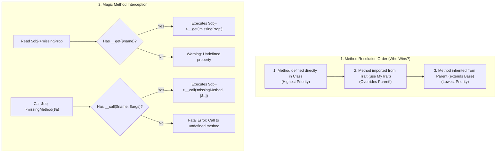

---
tags:
  - php
  - inheritance
  - traits
  - enums
  - magic-methods
---

# Inheritance, Interfaces, Traits, Enums & Magic in PHP

#### TL;DR (Quick Revision)

**PHP Polymorphism & Meta-Programming** = Single class inheritance (`extends`), multi-contract adherence (`implements`), compiler-assisted horizontal code reuse (`trait` + `use` inside a class), strongly-typed **Pure and Backed Enumerations (`enum Status: string`)**, **PHP 8.5 `clone($obj, ['prop' => $val])`** for immutable state updates, and **17 Magic Methods (`__get`, `__call`, `__invoke`, `__serialize`)** that power framework metaprogramming.

> [!abstract] Core Idea
> PHP enforces **single inheritance** (`class Child extends Parent`) to avoid the Diamond Problem, while solving multi-axis behavior sharing via **[Interfaces](https://www.php.net/manual/en/language.oop5.interfaces.php)** (contracts with method and PHP 8.4 property-hook signatures) and **[Traits](https://www.php.net/manual/en/language.oop5.traits.php)** (horizontal copy-paste of methods, properties, and constants into a class at compile time)[cite: 1]. Alongside first-class **[Enums (PHP 8.1+)](https://www.php.net/manual/en/language.enumerations.php)**, **[`#[\Override]` (PHP 8.3+)](https://www.php.net/manual/en/class.override.php)**, **[PHP 8.5 `clone($obj, [...])`](https://www.php.net/releases/8.5/en.php)**, and **[Magic Methods](https://www.php.net/manual/en/language.oop5.magic.php)**, these features form the exact architectural backbone of Laravel and Symfony[cite: 1].

> [!question] Why Master Traits, Enums, `clone()` & Magic Methods?
>
> - **Decode Framework "Magic"**: Have you ever wondered how `$user->email` works in an ORM when `$email` isn't even a declared property on the `User` class, or how `User::whereEmail('a@b.com')` works when `whereEmail()` doesn't exist? That is `__get()` and `__callStatic()` in action[cite: 1]!
> - **Eliminate Invalid String/Int Constants with Backed Enums**: Replacing loose `const STATUS_PAID = 'paid';` with `enum OrderStatus: string` guarantees a function parameter (`OrderStatus $status`) can never receive an invalid string, and translates DB values safely via `OrderStatus::from('paid')` or `OrderStatus::tryFrom($input)`[cite: 1].
> - **Share Behavior Across Unrelated Classes (`trait`)**: A `Trait` (`use HasTimestamps, SoftDeletes;`) injects reusable methods and properties into any class without wasting your single `extends` slot[cite: 1].
> - **Mutate `readonly` Objects Cleanly in PHP 8.5 (`clone($obj, [...])`)**: Instead of writing verbose `withX()` boilerplate, PHP 8.5 upgrades `clone` into a function accepting an array of modified properties during cloning (`clone($dto, ['status' => 'active'])`)[cite: 1]!

#### Quick Reference Table: PHP Polymorphism & Meta-Programming Tools

| Construct / Feature         | PHP 8.4/8.5+ Syntax                           | Can Have State (Properties)?                          | Can Be Instantiated?                         | Primary Use Case & Official Docs                                                                                                                                       |
| :-------------------------- | :-------------------------------------------- | :---------------------------------------------------- | :------------------------------------------- | :--------------------------------------------------------------------------------------------------------------------------------------------------------------------- |
| **`abstract class`**        | `abstract class BaseJob { ... }`              | **Yes** (Properties + Constants)                      | **No**                                       | Shared base template ("Is-A" relationship) with partial implementation ([Abstract Classes](https://www.php.net/manual/en/language.oop5.abstract.php))[cite: 1].        |
| **`interface`**             | `interface Loggable { ... }`                  | **Only via PHP 8.4 Property Hooks** (`{ get; set; }`) | **No**                                       | Strict capability contract ("Can-Do"); a class can `implements A, B, C` ([Interfaces](https://www.php.net/manual/en/language.oop5.interfaces.php))[cite: 1].           |
| **`trait`**                 | `trait HasUuid { ... }`                       | **Yes** (Properties + Constants since 8.2)            | **No**                                       | Horizontal code reuse ("Has-Behavior") injected via `use HasUuid;` inside class body ([Traits](https://www.php.net/manual/en/language.oop5.traits.php))[cite: 1].      |
| **`enum`**                  | `enum Role: string { case Admin = 'admin'; }` | **No** (Only `case`s, `const`s, methods, traits)      | **No** (`Role::Admin` is a singleton object) | Fixed finite set of type-safe domain states ([Enumerations](https://www.php.net/manual/en/language.enumerations.php))[cite: 1].                                        |
| **`final class` / `final`** | `final readonly class Token`                  | **Yes**                                               | **Yes**                                      | Prevents subclassing (`final class`) or method/property overriding (`final public function`) ([Final Keyword](https://www.php.net/manual/en/language.oop5.final.php)). |
| **Clone with Overrides**    | `$b = clone($a, ['id' => 2]);`                | N/A                                                   | Returns cloned Object                        | **[PHP 8.5 `clone()` Function](https://www.php.net/releases/8.5/en.php)**: Clones an object and updates `readonly` properties in one atomic step[cite: 1]!             |

---

## The Learning Concept

### What Problem Does It Solve?

Three major architectural headaches arise when building domain models in PHP:

1. **Silent Method Signature Typos During Inheritance**: If a parent class renames `protected function beforeSave()` to `beforePersist()`, or you misspell an overridden method in a child class, PHP silently treats your child method as a brand-new unrelated method instead of alerting you!
2. **Stringly-Typed Status Constants**: Using strings like `'pending'`, `'paid'`, `'cancelled'` as parameters (`function setStatus(string $status)`) allows callers to pass typos like `'payed'` or arbitrary input unless manually validated every time.
3. **Updating `readonly` Objects**: Before PHP 8.5, if you had a `readonly class Invoice` with 10 properties and wanted to create a copy with just `$isPaid = true`, `clone $invoice` still forbade modifying `$copy->isPaid = true` from outside or required complex `with*()` methods.

Look at this **`// BAD`** PHP snippet illustrating these pain points:

```php
<?php
// BAD - String constants allow invalid values, and misspelled child override silently fails!

class BaseWebhook
{
    public const string STATUS_PENDING = 'pending';
    public const string STATUS_SENT    = 'sent';

    public function verifySignature(string $payload): bool
    {
        return true;
    }
}

class StripeWebhook extends BaseWebhook
{
    // BUG 1: Misspelled verifySignatur() (missing 'e')!
    // PHP silently creates a new method instead of overriding BaseWebhook::verifySignature()!
    public function verifySignatur(string $payload): bool
    {
        return hash_equals('expected', $payload);
    }
}

// BUG 2: Accepts ANY string, even invalid typos like 'snt'!
function updateWebhook(string $status): void
{
    echo "Webhook status: {$status}" . PHP_EOL;
}

updateWebhook('snt_typo_bug'); // Silently runs with corrupted status!
```

**Why this fails:** Without compile-time override verification (`#[\Override]`), PHP has no way of knowing you intended `verifySignatur()` to override a parent method. And without a Backed Enum, `string $status` accepts any string on earth.

Now look at the **`// GOOD`** modern **PHP 8.4/8.5 + _PHP: The Right Way_** solution using **`#[\Override]` (PHP 8.3+)**, **Backed Enums (`enum`)**, **Traits**, and **PHP 8.5 `clone($obj, [...])`**[cite: 1]:

```php
<?php

declare(strict_types=1);

// GOOD - Backed Enum, Trait reuse, #[\Override] compile-time safety, and PHP 8.5 clone($obj, [...])!

// 1. Backed Enum (string) guarantees only valid cases can ever exist!
enum WebhookStatus: string
{
    case Pending = 'pending';
    case Sent    = 'sent';
    case Failed  = 'failed';

    public function isTerminal(): bool
    {
        return match ($this) {
            self::Sent, self::Failed => true,
            self::Pending            => false,
        };
    }
}

// 2. Trait for horizontal code reuse across any class or Enum
trait Auditable
{
    public function auditLog(string $action): string
    {
        return "[" . static::class . "] {$action}";
    }
}

abstract class BaseWebhook
{
    abstract public function verifySignature(string $payload): bool;
}

final readonly class StripeWebhook extends BaseWebhook
{
    use Auditable;

    public function __construct(
        public string $id,
        public WebhookStatus $status = WebhookStatus::Pending,
    ) {}

    // 3. PHP 8.3+ #[\Override] throws a compile-time Fatal Error if parent/interface lacks this exact method!
    #[\Override]
    public function verifySignature(string $payload): bool
    {
        return str_starts_with($payload, 'whsec_');
    }

    // 4. PHP 8.5 clone($this, [...]) updates readonly properties cleanly on the cloned copy!
    public function withStatus(WebhookStatus $newStatus): self
    {
        return clone($this, ['status' => $newStatus]);
    }
}

// Safely parse a string from HTTP/DB into an Enum (returns null if invalid!)
$incomingStatus = WebhookStatus::tryFrom('sent') ?? WebhookStatus::Failed;

$hook1 = new StripeWebhook(id: 'evt_101');
$hook2 = $hook1->withStatus($incomingStatus);

echo $hook2->auditLog("Transitioned to {$hook2->status->value}") . PHP_EOL;
echo "Is terminal? " . ($hook2->status->isTerminal() ? 'Yes' : 'No') . PHP_EOL;
```

**Output:**

```
[StripeWebhook] Transitioned to sent
Is terminal? Yes
```

---

### How PHP Implements Inheritance, Traits, Enums & Magic Methods Under the Hood

> [!tip] 4 Core Engine Mechanics (Liskov Variance, Trait Flattening, Enum Singletons & Magic Interception)
>
> 1. **Parameter Contravariance & Return Covariance ([PHP Object Variance](https://www.php.net/manual/en/language.oop5.variance.php))**:
>    When a child class overrides a parent method or implements an interface method:
>    - **Parameter Types Can Be _Wider_ (Contravariance)**: If `Parent::handle(Dog $pet)` accepts `Dog`, `Child::handle(Dog|Cat $pet)` (or `Animal $pet`) can accept a _more general_ type.
>    - **Return Types Can Be _Narrower_ (Covariance)**: If `Parent::make(): Animal` returns `Animal`, `Child::make(): Dog` can return a _more specific_ subtype!
>    - **Constructor Exception**: `__construct()` in PHP is **exempt** from signature compatibility rules—a child class's `__construct()` can have completely different parameters from its parent's `__construct()` (unless the parent declared `abstract public function __construct(...)` in an interface/abstract class).
> 2. **Trait Flattening & Precedence Hierarchy ([PHP Traits](https://www.php.net/manual/en/language.oop5.traits.php))**:
>    Traits are **not** part of the runtime inheritance tree (`$obj instanceof MyTrait` is **always `false`**!). At compile time, the Zend Engine copies the Trait's methods and properties directly into the using class.
>    - **Precedence Order**: **`Current Class Method` > `Trait Method` > `Inherited Parent Method`**! (A method defined inside a Trait overrides an inherited method of the same name from a `parent` class, while a method defined directly on the class overrides the Trait!).
> 3. **Pure vs. Backed Enums Are Singleton Objects ([PHP Enumerations](https://www.php.net/manual/en/language.enumerations.php))**:
>    Every `case` inside an `enum` (`WebhookStatus::Sent`) is compiled as a `readonly` singleton instance of that Enum class in memory (so `WebhookStatus::Sent === WebhookStatus::Sent` is `true`!)[cite: 1].
>    - **UnitEnum (Pure Enum)**: `enum Suit { case Hearts; }` implements the built-in `UnitEnum` interface (provides `Suit::cases()` and `$case->name`).
>    - **BackedEnum (`: int` or `: string`)**: `enum Suit: string { case Hearts = 'H'; }` implements `BackedEnum extends UnitEnum` (adds `$case->value`, `Suit::from($val)`, and `Suit::tryFrom($val)`). **Enums can only be backed by `int` or `string`** (never `float` or `bool`), cannot have properties, and cannot be extended (`enum` is implicitly `final`)[cite: 1].
> 4. **Magic Methods (`__*`) Intercept Engine Events ([PHP Magic Methods](https://www.php.net/manual/en/language.oop5.magic.php))**:
>    All methods starting with double underscores (`__`) are reserved by PHP and triggered automatically by the Zend Engine when specific operations occur on an object[cite: 1].

#### Full Runnable Example

Run this script via `php 07_polymorphism_magic.php` to see Trait conflict resolution (`insteadof` / `as`), Backed Enums implementing an Interface, Magic Methods (`__get`, `__set`, `__isset`, `__call`, `__invoke`, `__toString`), and PHP 8.5 `clone($obj, [...])`[cite: 1]:

```php
<?php

declare(strict_types=1);

// 1. Interface contract
interface Renderable
{
    public function toBadge(): string;
}

// 2. Backed Enum implementing an Interface!
enum Priority: int implements Renderable
{
    case Low      = 1;
    case Medium   = 2;
    case Critical = 3;

    #[\Override]
    public function toBadge(): string
    {
        // Every BackedEnum case automatically has ->name (string) and ->value (int|string)
        return "[P{$this->value}: {$this->name}]";
    }
}

// 3. Two Traits with a colliding method name ('format') to demonstrate insteadof / as resolution
trait JsonFormatter
{
    public function format(array $data): string
    {
        return json_encode($data, JSON_THROW_ON_ERROR);
    }
}

trait QueryFormatter
{
    public function format(array $data): string
    {
        return http_build_query($data);
    }
}

// 4. Class demonstrating Trait Conflict Resolution + Magic Methods (__get, __call, __invoke, __toString)
class DynamicTicket implements Stringable
{
    use JsonFormatter, QueryFormatter {
        // Resolve collision: use JsonFormatter's format() by default,
        // and alias QueryFormatter's format() as formatAsQuery()!
        JsonFormatter::format insteadof QueryFormatter;
        QueryFormatter::format as public formatAsQuery;
    }

    public function __construct(
        public readonly int $id,
        public readonly Priority $priority,
        private array $attributes = [],
    ) {}

    // Magic __get: Triggered when reading an inaccessible or non-existent property ($ticket->assignee)
    public function __get(string $name): mixed
    {
        return $this->attributes[$name] ?? null;
    }

    // Magic __set: Triggered when writing to an inaccessible or non-existent property
    public function __set(string $name, mixed $value): void
    {
        $this->attributes[$name] = $value;
    }

    // Magic __isset: Triggered when calling isset($ticket->assignee) or empty($ticket->assignee)
    public function __isset(string $name): bool
    {
        return isset($this->attributes[$name]);
    }

    // Magic __call: Triggered when calling an inaccessible/non-existent instance method ($ticket->getAssignee())
    public function __call(string $method, array $arguments): mixed
    {
        if (str_starts_with($method, 'get')) {
            $key = lcfirst(substr($method, 3));
            return $this->attributes[$key] ?? ($arguments[0] ?? null);
        }
        throw new BadMethodCallException("Method {$method} does not exist.");
    }

    // Magic __invoke: Allows calling the object itself like a function ($ticket('urgent'))!
    public function __invoke(string $note): self
    {
        // PHP 8.5 clone($obj, [...]) clones $this and updates private/readonly properties simultaneously!
        return clone($this, [
            'attributes' => [...$this->attributes, 'note' => $note],
        ]);
    }

    // Magic __toString: Triggered when object is treated as a string (automatically implements Stringable)
    #[\Override]
    public function __toString(): string
    {
        return "{$this->priority->toBadge()} Ticket #{$this->id} (" . $this->format($this->attributes) . ")";
    }
}

$ticket = new DynamicTicket(101, Priority::from(3));
$ticket->assignee = 'Valay'; // Triggers __set('assignee', 'Valay')

// Triggers __invoke() which uses PHP 8.5 clone($this, [...])!
$updatedTicket = $ticket('Fix XXE payload');

echo $updatedTicket . PHP_EOL; // Triggers __toString()
echo "Via __get  : " . $updatedTicket->assignee . PHP_EOL;
echo "Via __call : " . $updatedTicket->getNote('none') . PHP_EOL;
echo "Via Alias  : " . $updatedTicket->formatAsQuery(['id' => 101, 'p' => 3]) . PHP_EOL;
```

**Output:**

```
[P3: Critical] Ticket #101 ({"assignee":"Valay","note":"Fix XXE payload"})
Via __get  : Valay
Via __call : Fix XXE payload
Via Alias  : id=101&p=3
```

---

### Visual Diagram: Trait Precedence & The Magic Method Lifecycle



---

### Key Terminology (Syntax Decoder)

1. **`#[\Override]` Attribute ([PHP 8.3+](https://www.php.net/manual/en/class.override.php))**:
   Placed above a child method to declare explicit intent that this method overrides a parent method or implements an interface method.
   - **Why It's Mandatory Best Practice**: If the parent method is ever renamed/deleted, or you make a typo in the child method name, PHP immediately throws a **compile-time Fatal Error**!
     Syntax: `#[\Override] public function handle(): void`

2. **`trait` & Conflict Resolution (`insteadof` and `as` — [PHP Traits](https://www.php.net/manual/en/language.oop5.traits.php))**:
   - Notice the keyword `use` has **two completely different meanings** depending on where it sits!
     - **At the top of a file** (`use App\Services\Mailer;`): Imports a Namespace alias[cite: 1].
     - **Inside a `class { ... }` body** (`use LogsActivity;`): Copies a **Trait's** methods/properties into the class[cite: 1]!
   - If two Traits used in the same class define a method with the same name, PHP throws a **Fatal Error** unless you explicitly resolve the collision using `TraitA::method insteadof TraitB;` (and optionally alias the other method or change its visibility using `TraitB::method as private aliasedMethod;`).
     Syntax: `use TraitA, TraitB { TraitA::run insteadof TraitB; }`

3. **Pure Enums vs. Backed Enums (`from`, `tryFrom`, `cases` — [PHP 8.1+](https://www.php.net/manual/en/language.enumerations.backed.php))**:
   - **`EnumName::cases()`**: Static method on every Enum that returns a sequential array of all declared enum case instances (`[Suit::Hearts, Suit::Spades, ...]`).
   - **`BackedEnum::from(int|string $val)`**: Looks up the Enum case matching `$val`. Throws a **`ValueError`** if `$val` does not match any case!
   - **`BackedEnum::tryFrom(int|string $val)`**: Looks up the Enum case matching `$val`, or safely returns **`null`** if not found (ideal for validating untrusted HTTP/DB input: `$role = Role::tryFrom($_POST['role'] ?? '') ?? Role::Guest;`).
     Syntax: `$status = OrderStatus::tryFrom($rawInput);`

4. **PHP 8.5 `clone($object, array $withProperties)` ([PHP 8.5 Release Notes](https://www.php.net/releases/8.5/en.php))**:
   Prior to PHP 8.5, `clone $obj` was only a keyword operator, and modifying `readonly` properties on the cloned object was only allowed inside the `__clone()` magic method (PHP 8.3+).
   In **PHP 8.5**, `clone` can be called like a function (`clone($obj, ['prop' => $newValue])`—and Can even be passed as a First-Class Callable `clone(...)`!)[cite: 1]. It shallow-clones `$obj`, executes `__clone()` if defined, and then assigns each `'prop' => $newValue` pair—respecting visibility scope and **allowing `readonly` properties to be updated on the new clone**[cite: 1]!
   Syntax: `$updatedDto = clone($dto, ['price' => 499.0]);`

5. **The Essential Magic Methods Every PHP Developer Must Know ([PHP Magic Methods](https://www.php.net/manual/en/language.oop5.magic.php))**:
   - **Lifecycle**: `__construct(...)` (instantiation) and `__destruct()` (called when all references to the object are gone or during request shutdown).
   - **Property Overloading**:
     - `__get(string $name): mixed`: Triggered when reading an **inaccessible (`private`/`protected`) or non-existent** property[cite: 1].
     - `__set(string $name, mixed $value): void`: Triggered when writing to an inaccessible or non-existent property.
     - `__isset(string $name): bool` & `__unset(string $name): void`: Triggered when `isset()`/`empty()` or `unset()` is called on an inaccessible/non-existent property.
   - **Method Overloading**:
     - `__call(string $name, array $args): mixed`: Triggered when calling an inaccessible/non-existent **instance** method.
     - `__callStatic(string $name, array $args): mixed`: Triggered when calling an inaccessible/non-existent **static** method (`User::whereId(5)`).
   - **Representation & Invocation**:
     - `__toString(): string`: Triggered when object is echoed or cast to `(string)`. Automatically satisfies the built-in `Stringable` interface (PHP 8.0+)[cite: 1].
     - `__invoke(...$args): mixed`: Triggered when an object instance is called like a function (`$handler($request)`—used everywhere for Single-Action Controllers and Middleware!)[cite: 1].
     - `__debugInfo(): array`: Customizes what `var_dump($obj)` displays (used to hide database passwords or API keys from debug logs!).
   - **Serialization**:
     - `__serialize(): array` and `__unserialize(array $data): void` (PHP 7.4+): Modern, safe replacements for legacy `__sleep()` and `__wakeup()`.

6. **Anonymous Classes (`new class (...) extends ... implements ... {}`)**:
   One-off inline classes useful for lightweight test mocks, value objects, or single-use interface implementations ([PHP Anonymous Classes](https://www.php.net/manual/en/language.oop5.anonymous.php)).
   Syntax: `$logger = new class implements LoggerInterface { ... };`

> [!important] Key Rules to Remember
>
> - **`__get` and `__set` NEVER Run on Accessible Public Properties!** → They only fire when a property does **not exist** or is **invisible** (`private`/`protected`) from the calling scope! If you want to intercept reads/writes on a _declared public_ property, use **PHP 8.4 Property Hooks (`get`/`set`)** instead of `__get`/`__set`[cite: 1]!
> - **Always Implement `__isset()` Whenever You Implement `__get()`!** → If an object relies on `__get('email')`, calling `empty($obj->email)` or `isset($obj->email)` will return erroneous results unless `__isset('email')` is also implemented!
> - **Enums Cannot Hold State** → Neither pure nor backed Enums are allowed to have instance or static properties (because Enum cases are global singletons; mutating a property on an Enum case would leak state across the entire request!).
> - **Use `tryFrom()` Instead of `from()` on Untrusted Input** → `BackedEnum::from('invalid')` throws an uncaught `ValueError`, whereas `BackedEnum::tryFrom('invalid')` safely returns `null`.

---

## Edge Case Analysis (Traps & Security Gotchas)

### 1. The `empty($obj->magicProp)` False-Positive Trap (Missing `__isset()`)

- **Problem**: Suppose you create a class with `__get(string $key)` that returns values from a private `$data = ['role' => 'admin']` array, and you forget to implement `__isset(string $key)`. If someone writes `if (!empty($user->role))` or `if (isset($user->role))`, PHP does **not** call `__get('role')`! Instead, PHP checks if `__isset('role')` exists; if not, `isset($user->role)` returns **`false`** and `empty($user->role)` returns **`true`**—even though `$user->role` returns `'admin'`!
- **Fix**: **Always** pair `__get()` with `__isset()` ([PHP Overloading Manual](https://www.php.net/manual/en/language.oop5.overloading.php#object.isset)).

```php
<?php

declare(strict_types=1);

class MagicConfig
{
    public function __construct(private array $items = ['env' => 'production']) {}

    public function __get(string $key): mixed
    {
        return $this->items[$key] ?? null;
    }

    // Without __isset(), empty($cfg->env) returns TRUE (thinking it's empty!)
    public function __isset(string $key): bool
    {
        return isset($this->items[$key]);
    }
}

$cfg = new MagicConfig();
var_dump($cfg->env, isset($cfg->env), empty($cfg->env)); // "production", true, false
```

### 2. Insecure Deserialization / POP Chains via `__wakeup()` & `__destruct()` (CTF Vulnerability)

- **Problem**: In PHP, `serialize($obj)` converts an object into a string representation (`O:10:"FileLogger":1:{s:4:"path";s:8:"app.log";}`), and [`unserialize($str)`](https://www.php.net/manual/en/function.unserialize.php) reconstructs that object in memory[cite: 1]. If an application passes **user-controlled input** (like a cookie or token) into `unserialize()`, an attacker can craft a serialized string for **any class loaded in your codebase** and overwrite its private properties! When `unserialize()` runs (triggering `__wakeup()` or `__unserialize()`) or when the request ends (triggering `__destruct()` or `__toString()`), the attacker hijacks your class methods—an exploit known as **Property-Oriented Programming (POP Chain) / PHP Object Injection**[cite: 1]!
- **Fix**:
  1. **Never pass untrusted user input to `unserialize()`**—use `json_decode()` instead[cite: 1]!
  2. If you must use `unserialize()`, pass the strict `allowed_classes` option: `unserialize($payload, ['allowed_classes' => false])` (or a strict array of safe DTO classes).

```php
<?php

declare(strict_types=1);

class TempFileCleaner
{
    public function __construct(private string $tempFile = '/tmp/cache.tmp') {}

    // DANGER in CTFs: __destruct() runs automatically at the end of the script
    // on EVERY object created via unserialize()!
    public function __destruct()
    {
        // In a real POP chain, if an attacker controls $this->tempFile via unserialize(),
        // unlink($this->tempFile) would delete arbitrary server files!
        echo "Cleaning up: {$this->tempFile}" . PHP_EOL;
    }
}

$maliciousPayload = 'O:15:"TempFileCleaner":1:{s:25:"' . "\0" . 'TempFileCleaner' . "\0" . 'tempFile";s:15:"/important.conf";}';

// GOOD - Disabling object instantiation in unserialize() turns objects into harmless __PHP_Incomplete_Class!
$safeData = unserialize($maliciousPayload, ['allowed_classes' => false]);
var_dump(get_debug_type($safeData)); // string(22) "__PHP_Incomplete_Class" (__destruct never runs!)
```

### 3. Backed Enum Loose Comparison vs. `.value` Trap

- **Problem**: Because `enum Status: string { case Active = 'active'; }` is a `BackedEnum`, developers coming from other languages sometimes write `if ($status === 'active')` or `if ($status == 'active')`. In PHP, an Enum case (`Status::Active`) is an **Object instance**, NOT a string! Therefore, `Status::Active === 'active'` is `false` AND **`Status::Active == 'active'` is ALSO `false`** ([PHP Enumerations Manual](https://www.php.net/manual/en/language.enumerations.backed.php))!
- **Fix**: Either compare against the Enum case directly (`$status === Status::Active`) or read its scalar backing property explicitly (`$status->value === 'active'`).

```php
<?php

declare(strict_types=1);

enum AccountState: string
{
    case Active = 'active';
}

$state = AccountState::Active;

var_dump(
    $state == 'active',               // bool(false) -> Even loose == is FALSE for Enums!
    $state === AccountState::Active,  // bool(true)  -> Singleton object identity
    $state->value === 'active',        // bool(true)  -> Explicit backing scalar value
);
```

### 4. Protecting Sensitive Properties in Debug Dumps (`__debugInfo` & `#[\SensitiveParameter]`)

- **Problem**: If an exception occurs or someone calls `var_dump($dbConnection)` / `print_r($dbConnection)`, PHP prints all `public`, `protected`, and `private` properties of the object—including database passwords and API secrets—and stack traces log all function arguments in plain text!
- **Fix**:
  1. Implement **`__debugInfo(): array`** on classes holding secrets to redact sensitive properties from `var_dump()` / `print_r()`.
  2. Prefix sensitive function/constructor parameters with PHP 8.2+'s **`#[\SensitiveParameter]`** attribute ([PHP `SensitiveParameter` Docs](https://www.php.net/manual/en/class.sensitiveparameter.php)), which automatically replaces the argument's value with `Object(SensitiveParameterValue)` in all exception stack traces!

```php
<?php

declare(strict_types=1);

class DatabaseCredentials
{
    public function __construct(
        public readonly string $dsn,
        // Redacts $password from any Exception stack trace if a crash occurs inside __construct!
        #[\SensitiveParameter]
        private readonly string $password,
    ) {}

    // Redacts $password whenever var_dump() or print_r() is called on this object!
    public function __debugInfo(): array
    {
        return [
            'dsn'      => $this->dsn,
            'password' => '******** [REDACTED]',
        ];
    }
}

$creds = new DatabaseCredentials('mysql:host=localhost', 'SuperSecret123!');
var_dump($creds);
```

---

## Going Deeper (Intermediate -> Advanced & _PHP: The Right Way_ Integration)

### 1. _PHP: The Right Way_ — Reflection API (How Frameworks Inspect Classes at Runtime)

As covered in **[PHP: The Right Way — Meta Programming (Reflection)](https://phptherightway.com/#metaprogramming)**, alongside Magic Methods, PHP ships with a built-in **[Reflection API](https://www.php.net/manual/en/book.reflection.php)** (`ReflectionClass`, `ReflectionMethod`, `ReflectionProperty`, `ReflectionEnum`).
Reflection allows frameworks to inspect a class's constructor parameters, type hints, docblocks, and PHP 8 `#[Attributes]` at runtime to wire up Dependency Injection and routing automatically:

```php
<?php

declare(strict_types=1);

class PaymentService
{
    public function charge(int $amountInPaise, string $currency = 'INR'): bool
    {
        return $amountInPaise > 0;
    }
}

// Inspecting PaymentService::charge() parameter types dynamically via ReflectionMethod:
$refMethod = new ReflectionMethod(PaymentService::class, 'charge');

foreach ($refMethod->getParameters() as $param) {
    $type = $param->getType()?->__toString() ?? 'mixed';
    echo "Param \${$param->getName()} expects type: {$type}" . PHP_EOL;
}
```

### 2. How Frameworks (Laravel / Symfony) Use Traits, Enums & Magic Methods

1. **Laravel Eloquent Models (`__get`, `__set`, `__call`, `__callStatic`, and Traits)**:
   When you open a Laravel model:
   ```php
   class User extends Model {
       use HasFactory, Notifiable, SoftDeletes; // Traits!
   }
   ```

   - `SoftDeletes` is a **Trait** that injects `restore()`, `forceDelete()`, and query scopes horizontally into `User`.
   - Reading `$user->email` triggers `Model::__get('email')`, which looks up `'email'` inside `protected array $attributes`!
   - Calling `User::where('status', OrderStatus::Paid)` triggers `Model::__callStatic('where', ...)`, which instantiates a `Builder` query object and forwards the call!
   - In Eloquent (`$casts = ['status' => OrderStatus::class]`) and Symfony Serializer, Backed Enums are automatically hydrated via `OrderStatus::from($dbValue)`!
2. **Invokable Single-Action Controllers & Middleware (`__invoke`)**:
   In both Laravel (`Route::post('/checkout', CheckoutController::class)`) and Symfony, a controller with only a single responsibility implements **`public function __invoke(Request $request): Response`**—letting the router invoke the controller object directly as a callable!

---

## Interview Corner

### Common Questions & Concise Answers

**Q1: What is the difference between an `interface`, an `abstract class`, and a `trait` in PHP?**
**A:**

- An **`interface`** defines a pure contract (method signatures, constants, and PHP 8.4 property-hook signatures) with no method implementations; a class can implement multiple interfaces (`implements A, B`)[cite: 1].
- An **`abstract class`** provides a partial base implementation with state (properties) and both concrete and `abstract` methods, but PHP only allows single inheritance (`extends Base`)[cite: 1].
- A **`trait`** is a horizontal code-reuse mechanism (`use MyTrait;` inside a class) that copies concrete methods, properties, and constants directly into any number of unrelated classes at compile time without affecting the inheritance hierarchy[cite: 1].

**Q2: In what order does PHP resolve a method call if the same method name exists in a Parent class, a used Trait, and the Class itself?**
**A:** The precedence order is: **1. The Class itself** (highest priority) $\rightarrow$ **2. The Trait** $\rightarrow$ **3. The Parent class** (lowest priority) ([PHP Traits Precedence](https://www.php.net/manual/en/language.oop5.traits.php#language.oop5.traits.precedence)). A method imported via a Trait overrides an inherited method from a `parent` class!

**Q3: What is the difference between a Pure Enum (`UnitEnum`) and a Backed Enum (`BackedEnum`), and between `from()` and `tryFrom()`?**
**A:** A **Pure Enum** (`enum Status { case Pending; }`) has no scalar equivalent (only `$case->name`). A **Backed Enum** (`enum Status: string { case Pending = 'pending'; }`) associates each case with a unique `int` or `string` scalar (`$case->value`) for database/JSON serialization[cite: 1]. `Status::from($val)` throws a `ValueError` if `$val` is unknown, whereas `Status::tryFrom($val)` safely returns `null`.

**Q4: When are `__get()` and `__set()` triggered in PHP, and how do they differ from PHP 8.4 Property Hooks?**
**A:** `__get($name)` and `__set($name, $val)` **only** execute when accessing a property that **does not exist** or is **inaccessible** (`private`/`protected` from outside)[cite: 1]. They catch _all_ missing properties generically and defeat IDE autocompletion unless documented with `@property`. **PHP 8.4 Property Hooks** (`public string $email { get => ...; set => ...; }`) are attached to a specific, declared, type-safe property[cite: 1].

**Q5: How does PHP 8.5's `clone($obj, $withProperties)` improve working with `readonly` classes?**
**A:** Before PHP 8.5, cloning a `readonly` object (`$copy = clone $dto;`) did not allow modifying any `readonly` properties on `$copy` outside of `__clone()`. In **[PHP 8.5](https://www.php.net/releases/8.5/en.php)**, `clone($dto, ['status' => 'paid'])` clones the object and updates the specified properties atomically in a single expression while respecting visibility rules[cite: 1].

---

### Interactive Revision Quiz

**Q1: Given the following class hierarchy, what does `(new ChildClass())->greet()` return?**

```php
class ParentClass {
    public function greet(): string { return 'From Parent'; }
}
trait GreetingTrait {
    public function greet(): string { return 'From Trait'; }
}
class ChildClass extends ParentClass {
    use GreetingTrait;
}
```

- [ ] A) `'From Parent'`
- [ ] B) `'From Trait'`
- [ ] C) Throws a Fatal Trait Collision Error
- [ ] D) `null`

**Q2: What is the output of the following Backed Enum comparison in PHP 8.4/8.5?**

```php
enum HttpMethod: string {
    case Post = 'POST';
}
$m = HttpMethod::tryFrom('POST');
var_dump($m === HttpMethod::Post, $m == 'POST', $m->value === 'POST');
```

- [ ] A) `bool(true)`, `bool(true)`, `bool(true)`
- [ ] B) `bool(true)`, `bool(false)`, `bool(true)`
- [ ] C) `bool(false)`, `bool(true)`, `bool(true)`
- [ ] D) `bool(true)`, `bool(false)`, `bool(false)`

**Q3: What happens when a class has `public string $title = 'Book';` AND `public function __get(string $name): mixed`, and outside code accesses `$obj->title`?**

- [ ] A) `__get('title')` is called first and its return value is used.
- [ ] B) PHP returns `'Book'` directly and `__get()` is **never called**, because `$title` is an accessible `public` property!
- [ ] C) Both run and their strings are concatenated.
- [ ] D) Throws a Fatal Error because public properties cannot coexist with `__get()`.

**Q4: Why should you add `#[\Override]` (PHP 8.3+) above a method in a child class?**

- [ ] A) Without `#[\Override]`, PHP forbids overriding parent methods in `strict_types=1` mode.
- [ ] B) It makes the method `final` so no further subclasses can override it.
- [ ] C) It instructs the PHP compiler to verify that a matching method actually exists in a parent class or implemented interface, throwing a compile-time error if you misspelled the method name or the parent removed it.
- [ ] D) It bypasses visibility checks on `private` parent methods.

**Q5: Which magic method allows an object instance `$validator` to be called directly like a function (`$isValid = $validator($input);`)?**

- [ ] A) `__call()`
- [ ] B) `__invoke()`
- [ ] C) `__construct()`
- [ ] D) `__toString()`

<details>
<summary>Show Quiz Answers & Explanations</summary>

1. **B** — In PHP's method resolution hierarchy, a method imported from a **Trait** overrides an inherited method of the same name from a **Parent** class (`Class > Trait > Parent`) ([PHP Traits Precedence](https://www.php.net/manual/en/language.oop5.traits.php#language.oop5.traits.precedence)).
2. **B** — Enum cases are singleton object instances, so `$m === HttpMethod::Post` is `true` and `$m->value === 'POST'` is `true`. However, an Enum object is **never** equal to a raw string, even under loose `==` comparison (`$m == 'POST'` is `false`)!
3. **B** — Magic property methods (`__get`, `__set`, `__isset`, `__unset`) **only** trigger for non-existent or inaccessible (`private`/`protected`) properties ([PHP Overloading Manual](https://www.php.net/manual/en/language.oop5.overloading.php)).
4. **C** — [`#[\Override]`](https://www.php.net/manual/en/class.override.php) enforces at compile time that the method overrides a parent method or implements an interface method.
5. **B** — Implementing [`__invoke()`](https://www.php.net/manual/en/language.oop5.magic.php#object.invoke) makes any object instance a valid `callable` that can be invoked with `$obj(...)`[cite: 1].

</details>

---

## Practice Exercises

### Exercise 1: Basic — Backed Enum + Interface + `#[\Override]`

Create an interface `HasFee` with `public function feePercent(): float;`. Then create a string-backed Enum `PaymentMethod: string implements HasFee` with cases `Upi = 'upi'`, `Card = 'card'`, and `NetBanking = 'netbanking'`. Implement `feePercent()` on the Enum with `#[\Override]` using a `match ($this)` expression (`0.0` for UPI, `2.0` for Card, `1.5` for NetBanking), and test it using `PaymentMethod::tryFrom('upi')`[cite: 1].

### Exercise 2: Intermediate — PHP 8.5 Immutable Value Object with `clone($this, [...])` & `__invoke()`

Create a `final readonly class Money` with `public int $amountInPaise` and `public string $currency = 'INR'`. Add a method `public function add(int $paise): self` that returns a new instance using PHP 8.5's `clone($this, ['amountInPaise' => $this->amountInPaise + $paise])`[cite: 1]. Also implement `__toString(): string` to format it as `"INR 150.50"`.

### Exercise 3: Security & Framework Pattern — Safe Attribute Bag with `__get`, `__isset` & `__debugInfo`

Build a `SecureSessionBag` class storing `private array $data`. Implement `__get()`, `__set()`, and `__isset()` to access `$this->data`, and implement `__debugInfo(): array` so that any key containing `'token'` or `'secret'` (`str_contains($key, 'secret')`) has its value replaced with `'[REDACTED]'` when `var_dump()` is called.

---

## Memory Trick / One-Liner

> [!tip] The "Class > Trait > Parent, TryFrom for Input, Pair Get with Isset" Rule
>
> - Method collision? **Class beats Trait, and Trait beats Parent!**
> - Parsing user input into an Enum? **`Enum::tryFrom($input)`**, never `from()`!
> - Writing `__get()`? Always write **`__isset()`** right below it so `empty()` doesn't lie to you!
> - Updating a `readonly` object in PHP 8.5? **`clone($this, ['field' => $newVal])`**[cite: 1]!
>   **Takeaway Formula:** **`#[\Override]` + `trait` Horizontal Reuse + Backed `enum` + `clone($obj, [...])` + `__invoke`/`__get` = Framework-Grade PHP OOP.**

---

## Warning Block (Best Practice)

> [!warning] Common Mistake (Avoid This!)
>
> ```php
> <?php
> // BAD - Using BackedEnum::from() on raw user input (throws uncaught ValueError!),
> // comparing Enum to string with ==, and passing user input to unserialize()!
> $roleEnum = UserRole::from($_POST['role']); // Crashes if 'role' is invalid!
>
> if ($roleEnum == 'admin') { // BUG: Always false! Enum object != string!
>     $prefs = unserialize($_COOKIE['prefs']); // CRITICAL POP-Chain RCE vulnerability!
> }
> ```
>
> ```php
> <?php
>
> declare(strict_types=1);
>
> // GOOD - Safe tryFrom() with default fallback, strict Enum case identity, and json_decode()!
> $roleEnum = UserRole::tryFrom($_POST['role'] ?? '') ?? UserRole::Guest;
>
> if ($roleEnum === UserRole::Admin) {
>     $prefs = json_decode($_COOKIE['prefs'] ?? '{}', associative: true, flags: JSON_THROW_ON_ERROR);
> }
> ```
