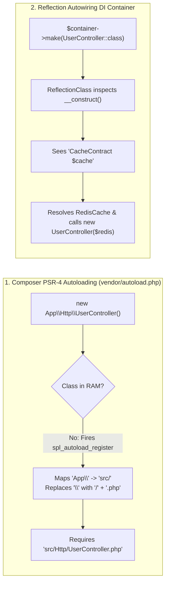

---
tags:
  - php
  - namespaces
  - composer
  - psr-4
  - attributes
  - dependency-injection
---

# Namespaces, Composer (PSR-4), Attributes & DI in PHP

#### TL;DR (Quick Revision)

**PHP Architecture & Ecosystem Pillars** = Virtual directory-like symbol containers (**`namespace App\Services;`** separated by backslashes `\`) paired with **[PSR-4](https://www.php-fig.org/psr/psr-4/) / [Composer](https://getcomposer.org/)** on-demand class autoloading (`vendor/autoload.php`), native machine-readable metadata (**`#[Attribute]`**), and **Dependency Injection (DI) Containers** that automatically wire object graphs via Reflection.

> [!abstract] Core Idea
> In legacy PHP, all classes lived in a single flat global scope, forcing developers to write dozens of `require_once` lines at the top of every file. Modern PHP solves this with **[Namespaces](https://www.php.net/manual/en/language.namespaces.php)** (`namespace Vendor\Package;`) and **[spl_autoload_register()](https://www.php.net/manual/en/function.spl-autoload-register.php)**—an engine hook triggered the exact moment you reference an unloaded class. **[Composer](https://phptherightway.com/#composer_and_packagist)** uses the **[PSR-4 Standard](https://www.php-fig.org/psr/psr-4/)** to map a class's namespace directly to its folder path on disk, loading the `.php` file automatically on first use.

> [!question] Why Master Namespaces, Composer, Attributes & DI?
>
> - **Eliminate Manual `require_once` Forever**: With Composer's `require __DIR__ . '/vendor/autoload.php';` in your entry file, referencing `new App\Models\User()` automatically locates and loads `src/Models/User.php`[cite: 1].
> - **Understand the Unqualified Class vs. Function Resolution Rule**: Inside `namespace App\Http;`, calling `new DateTimeImmutable()` without importing it looks for **`App\Http\DateTimeImmutable` (and crashes!)**, whereas calling `strlen('hi')` falls back to the global `\strlen()`! Knowing why saves hours of debugging ([PHP Namespace Fallback Rules](https://www.php.net/manual/en/language.namespaces.fallback.php)).
> - **Build Declarative Framework Features with `#[Attributes]`**: Native PHP 8+ **[Attributes](https://www.php.net/manual/en/language.attributes.overview.php)** (`#[Route('/api/users', methods: ['GET'])]`) replace fragile `/** @Annotation */` docblock comments with real, type-checked PHP classes inspectable via Reflection[cite: 1].
> - **Write Decoupled, Testable Code with Dependency Injection (DI)**: Understanding **[PHP: The Right Way — Dependency Injection](https://phptherightway.com/#dependency_injection)** and **[PSR-11 Containers](https://www.php-fig.org/psr/psr-11/)** demystifies how Laravel's Service Container and Symfony's Autowiring work under the hood.

#### Quick Reference Table: Legacy File Management vs. Modern PHP 8.4/8.5+ Ecosystem

| Concept / Task                 | Legacy PHP Approach                              | Modern PHP 8.4/8.5+ (The Right Way)                | Engine Rule & Official Docs                                                                                                                                           |
| :----------------------------- | :----------------------------------------------- | :------------------------------------------------- | :-------------------------------------------------------------------------------------------------------------------------------------------------------------------- |
| **Loading Classes**            | 20x `require_once 'classes/Foo.php';`            | 1x `require __DIR__ . '/vendor/autoload.php';`     | **[Composer PSR-4 Autoloader](https://getcomposer.org/doc/01-basic-usage.md#autoloading)** maps namespaces to directories lazily on first class use[cite: 1].         |
| **Preventing Name Collisions** | Prefixing class names (`Zend_Db_Table`)          | `namespace App\Database;` + `use`                  | **[PHP Namespaces](https://www.php.net/manual/en/language.namespaces.php)** isolate classes, interfaces, traits, functions, and constants[cite: 1].                   |
| **Importing Global Classes**   | `new \DateTimeImmutable()` inline everywhere     | `use DateTimeImmutable;` at top of file            | Inside a namespace, unimported `new Foo()` resolves to `CurrentNamespace\Foo` ([Name Resolution Rules](https://www.php.net/manual/en/language.namespaces.rules.php)). |
| **Class/Method Metadata**      | Regex parsing `/** @Route("/home") */` strings   | `#[Route('/home', methods: ['GET'])]`              | **[PHP 8+ Attributes](https://www.php.net/manual/en/language.attributes.php)** are compiled into the Zend AST and instantiated via `$ref->getAttributes()`[cite: 1].  |
| **Wiring Dependencies**        | Calling `new Database()` inside `UserRepository` | Injecting `DatabaseInterface $db` in `__construct` | **[Dependency Injection (DI)](https://phptherightway.com/#dependency_injection)** inverts control so services can be swapped and mocked in tests.                     |

---

## The Learning Concept

### What Problem Does It Solve?

Three major stumbling blocks hit developers when moving from standalone single-file scripts to multi-file PHP applications:

1. **The Global Class Trap Inside a Namespace**: The moment you add `namespace App\Services;` at the top of a file, writing `new PDO(...)`, `new DateTimeImmutable()`, or `catch (Exception $e)` without a leading backslash `\` or a top-level `use` statement causes a **Fatal Error: `Class "App\Services\DateTimeImmutable" not found`**!
2. **Confusing the Two `use` Keywords**: Putting `use App\Traits\Loggable;` at the top of a file only **aliases the name**—you still have to write `use Loggable;` _inside_ the `class { ... }` body to actually apply the Trait[cite: 1]!
3. **Hardcoding `new` Dependencies Inside Business Logic**: Instantiating `new SmtpMailer()` directly inside `OrderService::checkout()` makes it impossible to test `OrderService` without sending real emails.

Look at this **`// BAD`** PHP snippet demonstrating all three traps:

```php
<?php

declare(strict_types=1);

namespace App\Services;

// BAD - Forgot to import DateTimeImmutable and InvalidArgumentException!
// BAD - Hardcoded new SmtpMailer() inside OrderProcessor (Tight Coupling)!

class OrderProcessor
{
    public function process(int $amount): string
    {
        if ($amount <= 0) {
            // BUG 1: Looks for App\Services\InvalidArgumentException -> Fatal Error: Class not found!
            throw new InvalidArgumentException('Amount must be positive');
        }

        // BUG 2: Looks for App\Services\DateTimeImmutable -> Fatal Error: Class not found!
        $timestamp = new DateTimeImmutable();

        // BUG 3: Tightly coupled to concrete SmtpMailer — impossible to mock in unit tests!
        $mailer = new SmtpMailer();
        $mailer->send("Order processed at " . $timestamp->format('c'));

        return 'OK';
    }
}
```

**Why this fails:** According to **[PHP's Namespace Fallback Rules](https://www.php.net/manual/en/language.namespaces.fallback.php)**, unqualified **function** names (`strlen()`) and **constant** names (`PHP_EOL`) fall back to the global namespace if not found in the current namespace, **but unqualified Class, Interface, Trait, and Enum names NEVER fall back to the global namespace**!

Now look at the **`// GOOD`** modern **PHP 8.4/8.5 + _PHP: The Right Way_** solution using explicit `use` imports, `#[Attribute]` metadata, and Constructor Dependency Injection[cite: 1]:

```php
<?php

declare(strict_types=1);

namespace App\Services;

// GOOD - Explicitly import global classes at the top of the file (PSR-12 standard)
use DateTimeImmutable;
use InvalidArgumentException;

// 1. Define a custom PHP 8+ Attribute to tag routes or services declaratively
#[ \Attribute(\Attribute::TARGET_CLASS | \Attribute::TARGET_METHOD) ]
final readonly class Route
{
    public function __construct(
        public string $path,
        public string $method = 'GET',
    ) {}
}

// 2. Program to an Interface (Contract) for Dependency Injection
interface MailerInterface
{
    public function send(string $message): void;
}

final class LogMailer implements MailerInterface
{
    #[\Override]
    public function send(string $message): void
    {
        echo "[LOG MAILER] {$message}" . PHP_EOL;
    }
}

// 3. Inject MailerInterface via Constructor Promotion + Tag with #[Route] Attribute!
final readonly class OrderProcessor
{
    public function __construct(
        private MailerInterface $mailer,
    ) {}

    #[Route(path: '/orders/checkout', method: 'POST')]
    public function process(int $amount): string
    {
        if ($amount <= 0) {
            throw new InvalidArgumentException('Amount must be positive');
        }

        $now = new DateTimeImmutable('2026-11-15 18:30:00');
        $this->mailer->send("Order of ₹{$amount} processed at {$now->format('Y-m-d H:i')}");

        return 'SUCCESS';
    }
}

$processor = new OrderProcessor(new LogMailer());
echo "Status: " . $processor->process(2500) . PHP_EOL;
```

---

### How PHP Implements Autoloading, Attributes & DI Containers Under the Hood

> [!tip] 4 Core Mechanics That Power Every Modern PHP Framework
>
> 1. **Compile-Time Namespace Resolution (`use` Is Purely a Compile-Time Alias!)**:
>    In PHP, a `use App\Models\User;` statement at the top of a file **does NOT load any file or execute any code**! It simply tells the Zend Engine compiler: _"Whenever this file writes `User`, expand that string at compile time to the Fully Qualified Class Name (FQCN) `App\Models\User`"_ ([PHP Using Namespaces: Aliasing/Importing](https://www.php.net/manual/en/language.namespaces.importing.php)).
> 2. **How [`spl_autoload_register()`](https://www.php.net/manual/en/function.spl-autoload-register.php) & PSR-4 Work**:
>    When your code executes `new App\Models\User()` and `App\Models\User` is not yet in memory, PHP does **not** crash immediately. Instead, it passes the string `"App\\Models\\User"` to every callback registered via `spl_autoload_register()`.
>    **Composer's PSR-4 Autoloader** takes the configured namespace prefix (`"App\\" => "src/"`), replaces the prefix with `"src/"`, turns namespace backslashes `\` into directory slashes `/`, appends `".php"`, and executes `require __DIR__ . '/src/Models/User.php';`[cite: 1]!
> 3. **How PHP 8+ `#[Attributes]` Are Stored & Instantiated ([PHP Attributes Manual](https://www.php.net/manual/en/language.attributes.php))**:
>    When you decorate a class, method, property, parameter, or constant with `#[Route('/users')]`, PHP validates the syntax at compile time and stores the attribute name and arguments in the Zend Engine's internal metadata table (**zero runtime object allocation overhead** until inspected!). When a framework calls `$reflectionMethod->getAttributes(Route::class)`, calling `$attr->newInstance()` instantiates the actual `Route` class with those arguments[cite: 1]!
> 4. **How Autowiring DI Containers Work (Reflection + Recursion)**:
>    When you ask a framework container for `$container->get(OrderProcessor::class)`, the container uses `ReflectionClass` to inspect `OrderProcessor::__construct()`, sees the type hint `MailerInterface $mailer`, looks up which concrete class is bound to `MailerInterface` (`LogMailer`), instantiates `LogMailer`, and passes it into `new OrderProcessor($mailer)` automatically!

#### Full Runnable Example

Run this self-contained script via `php 08_autoload_attributes_di.php` to see a working **custom PSR-4 Autoloader**, **PHP 8+ `#[Attributes]` Reader**, and an **Autowiring Dependency Injection Container** built from scratch in 75 lines of pure PHP 8.4/8.5[cite: 1]:

```php
<?php

declare(strict_types=1);

namespace App\Core;

use Attribute;
use ReflectionClass;
use ReflectionNamedType;
use RuntimeException;

// 1. How Composer's PSR-4 Autoloader works under the hood via spl_autoload_register()!
spl_autoload_register(static function (string $fullyQualifiedClass): void {
    $prefix  = 'App\\';
    $baseDir = __DIR__ . '/src/';

    if (!str_starts_with($fullyQualifiedClass, $prefix)) {
        return; // Not our namespace prefix; let the next autoloader handle it
    }

    $relativeClass = substr($fullyQualifiedClass, strlen($prefix));
    $filePath      = $baseDir . str_replace('\\', '/', $relativeClass) . '.php';

    if (is_file($filePath)) {
        require $filePath;
    }
});

// 2. Defining a Custom Attribute for Auto-Binding Interfaces to Implementations!
#[Attribute(Attribute::TARGET_INTERFACE)]
final readonly class BindTo
{
    public function __construct(public string $concreteClass) {}
}

// 3. Using #[BindTo] Attribute on an Interface so our DI Container knows what to inject!
#[BindTo(concreteClass: RedisCache::class)]
interface CacheContract
{
    public function get(string $key): string;
}

final class RedisCache implements CacheContract
{
    #[\Override]
    public function get(string $key): string
    {
        return "cached_value_for_{$key}";
    }
}

final readonly class UserProfileService
{
    // Constructor Property Promotion — automatically wired by MiniContainer below!
    public function __construct(private CacheContract $cache) {}

    public function loadProfile(int $id): string
    {
        return $this->cache->get("user_{$id}");
    }
}

// 4. A Working Autowiring Dependency Injection Container using Reflection + Attributes!
final class MiniContainer
{
    public function make(string $classOrInterface): object
    {
        $ref = new ReflectionClass($classOrInterface);

        // If it's an Interface, check if it has a #[BindTo(...)] Attribute!
        if ($ref->isInterface()) {
            $attrs = $ref->getAttributes(BindTo::class);
            if ($attrs === []) {
                throw new RuntimeException("Unbound interface: {$classOrInterface}");
            }
            /** @var BindTo $binding */
            $binding = $attrs[0]->newInstance();
            return $this->make($binding->concreteClass);
        }

        $constructor = $ref->getConstructor();
        if ($constructor === null) {
            return $ref->newInstance(); // No constructor parameters needed!
        }

        // Recursively resolve every constructor parameter by its Type Hint!
        $dependencies = [];
        foreach ($constructor->getParameters() as $param) {
            $type = $param->getType();
            if (!$type instanceof ReflectionNamedType || $type->isBuiltin()) {
                throw new RuntimeException("Cannot autowire scalar parameter \${$param->getName()}");
            }
            $dependencies[] = $this->make($type->getName());
        }

        return $ref->newInstanceArgs($dependencies);
    }
}

// Zero manual "new RedisCache()" needed — MiniContainer inspects types & Attributes and wires everything!
$container = new MiniContainer();
/** @var UserProfileService $service */
$service = $container->make(UserProfileService::class);

echo "DI Container Result: " . $service->loadProfile(42) . PHP_EOL;
```

**Output:**

```
DI Container Result: cached_value_for_42
```

---

### Visual Diagram: Composer PSR-4 Autoloading & Autowiring DI Flow



---

### Key Terminology (Syntax Decoder)

1. **`namespace` Declaration & The Backslash `\` Separator ([PHP Namespaces](https://www.php.net/manual/en/language.namespaces.definition.php))**:
   Must be declared at the very top of the file right after `declare(strict_types=1);`[cite: 1].
   - **Unqualified Name (`User`)**: No backslash. Resolves to `use` import if present; otherwise resolves to `CurrentNamespace\User`.
   - **Qualified Name (`Models\User`)**: Relative backslash path. Resolves to `CurrentNamespace\Models\User` (unless `Models` was imported via `use`).
   - **Fully Qualified Name (`\App\Models\User` or `\DateTimeImmutable`)**: Starts with a leading backslash `\`, which works like `/` in a Linux filesystem—anchoring resolution directly to the **root global namespace**!
     Syntax: `namespace App\Http\Controllers;`

2. **`use`, `use ... as`, `use function`, and `use const` ([PHP Importing & Aliasing](https://www.php.net/manual/en/language.namespaces.importing.php))**:
   - **Class/Interface/Enum Import**: `use App\Models\User;` or aliased to avoid name collisions: `use App\Services\User as ServiceUser;`.
   - **Group Use Declarations**: `use App\Models\{User, Order, Invoice};`.
   - **Importing Functions & Constants**: To import a namespaced function or constant, explicitly add `function` or `const`: `use function App\Helpers\formatCurrency;` and `use const App\Config\DEFAULT_CURRENCY;`.
     Syntax: `use App\Contracts\PaymentGateway as GatewayContract;`

3. **Composer (`composer.json`, `composer.lock`, and PSR-4 — [PHP: The Right Way](https://phptherightway.com/#composer_and_packagist))**:
   **Composer** is PHP's official dependency manager (equivalent to `npm`/`pip`/`Maven`) powered by **[Packagist](https://packagist.org/)**[cite: 1]:
   - **`composer.json`**: Declares your project's PHP version constraint, required packages (`"require"`), dev-only tools like PHPUnit/PHPStan (`"require-dev"`), and your **PSR-4 autoload mapping**:
     ```json
     {
       "autoload": {
         "psr-4": {
           "App\\": "src/"
         }
       },
       "autoload-dev": {
         "psr-4": {
           "Tests\\": "tests/"
         }
       }
     }
     ```
   - **`composer.lock`**: Locks the **exact commit hashes and versions** of every installed dependency so every developer and production server installs identical code (`composer install` reads `composer.lock`; `composer update` upgrades versions and rewrites `composer.lock`). **Always commit `composer.lock` to Git for applications!**
   - **`composer dump-autoload -o`**: Regenerates `vendor/autoload.php` (the `-o` flag compiles a fast $O(1)$ static classmap array for production so PHP doesn't even have to check `is_file()` on disk!).

4. **PHP 8+ `#[Attribute]` Syntax & Built-in Core Attributes ([PHP Attributes](https://www.php.net/manual/en/language.attributes.php))**:
   Attributes can be stacked or comma-separated inside `#[...]` above classes, methods, functions, properties, class constants, or parameters[cite: 1]:
   - **`Attribute::TARGET_*` Bitmask**: Restricts where your custom attribute is allowed (`Attribute::TARGET_METHOD | Attribute::TARGET_CLASS`, and `Attribute::IS_REPEATABLE` if it can be applied multiple times to the same target).
   - **Core Built-in PHP 8.0–8.5 Attributes You Should Use Everywhere**:
     - `#[\Override]` (PHP 8.3+): Verifies a method overrides a parent or implements an interface.
     - `#[\Deprecated("Use newMethod() instead", since: "8.4")]` (**[New in PHP 8.4!](https://www.php.net/releases/8.4/en.php#deprecated_attribute)**): Brings engine-level `E_USER_DEPRECATED` warnings to userland functions, methods, class constants, and Enum cases (and in **PHP 8.5**, traits as well!).
     - `#[\NoDiscard]` (**[New in PHP 8.5!](https://www.php.net/releases/8.5/en.php)**): Warns if the caller ignores the function's return value[cite: 1].
     - `#[\SensitiveParameter]` (PHP 8.2+): Redacts passwords/tokens from exception stack traces.
     - `#[\DelayedTargetValidation]` (**[New in PHP 8.5!](https://www.php.net/releases/8.5/en.php)**): Delays compile-time target validation on internal attributes for backward-compatible cross-version code.
       Syntax: `#[\Deprecated(message: 'Use v2 API', since: '2.0')]`

5. **PSR-11 `ContainerInterface` & Service Lifecycles (Transient vs. Singleton)**:
   According to **[PSR-11 (`Psr\Container\ContainerInterface`)](https://www.php-fig.org/psr/psr-11/)**, standard PHP DI containers expose two core methods: `$container->get(string $id)` and `$container->has(string $id)`.
   - **Transient Binding (`bind`)**: Creates a fresh instance every time it is requested.
   - **Shared / Singleton Binding (`singleton`)**: Creates the instance once **per HTTP request** and reuses that same instance whenever injected during that request.

> [!important] Key Rules to Remember
>
> - **PSR-4 Case-Sensitivity Trap (Windows/macOS vs. Linux Production!)** → Under PSR-4, the class `App\Http\Controllers\UserController` **must** live at `src/Http/Controllers/UserController.php` with **100% matching uppercase/lowercase letters**! If you name the file `usercontroller.php`, it will work locally on Windows/macOS (case-insensitive filesystems) and **crash with a Fatal Error on Linux production servers** (case-sensitive filesystem)!
> - **`use` Statements Are Per-File, Not Per-Namespace** → Two separate `.php` files sharing `namespace App\Models;` do **not** share `use` imports; each file must declare its own `use` imports at the top.
> - **Never Put Service Locator Calls Inside Domain Entities** → As taught in **[PHP: The Right Way — Dependency Injection](https://phptherightway.com/#dependency_injection)**, pass dependencies in via `__construct()` rather than calling global helpers like `app(Mailer::class)` deep inside domain logic.

---

## Edge Case Analysis (Traps & Security Gotchas)

### 1. Dynamic Class Names (`new $className()`) Always Ignore `use` Imports!

- **Problem**: Remember that `use App\Plugins\StripePlugin;` is resolved at **compile time**. If you store a short class name in a string variable (`$driver = 'StripePlugin';`) and run `new $driver()`, PHP evaluates `$driver` at **runtime**, where compile-time `use` aliases no longer exist! PHP will look for `\StripePlugin` in the global namespace and crash with `Class "StripePlugin" not found` ([PHP Namespaces and Dynamic Language Features](https://www.php.net/manual/en/language.namespaces.dynamic.php))!
- **Fix**: Whenever instantiating classes dynamically from variables or arrays, always store the **Fully Qualified Class Name** using `::class` (`$driver = StripePlugin::class;`, which evaluates at compile time to `"App\\Plugins\\StripePlugin"`).

```php
<?php

declare(strict_types=1);

namespace App\Payments;

class RazorpayGateway {}

// BAD - Dynamic string 'RazorpayGateway' ignores current namespace & use imports at runtime!
$badClass = 'RazorpayGateway';
// new $badClass(); -> Fatal Error: Class "RazorpayGateway" not found!

// GOOD - ::class resolves to the full "App\Payments\RazorpayGateway" string at compile time!
$goodClass = RazorpayGateway::class;
$instance  = new $goodClass();
var_dump($instance::class); // string(29) "App\Payments\RazorpayGateway"
```

### 2. Namespace Function Shadowing / Hijacking Trick (Testing & Security Gotcha)

- **Problem**: Because unqualified function calls (`time()`, `exec()`, `file_get_contents()`) inside `namespace App\Services;` check **`App\Services\time()` FIRST** before falling back to the global `\time()`, defining a function `namespace App\Services; function time() { return 12345; }` anywhere in the project will silently hijack every unqualified `time()` call in that namespace! _(Note: While useful in unit tests for mocking `time()`, it can also cause unexpected shadowing bugs)._
- **Fix**: Either prefix performance/security-critical global functions with `\` (`\time()`) or import them via `use function time;`. (Bonus: prefixing `\strlen()` or importing it allows the Zend Engine to execute a dedicated fast Opcode instead of performing a runtime namespace fallback check!).

```php
<?php

declare(strict_types=1);

namespace App\Security;

// This namespaced function shadows global \time() for all unqualified calls in App\Security!
function time(): int
{
    return 1700000000; // Fixed mocked timestamp
}

echo "Shadowed time() : " . time() . PHP_EOL;   // 1700000000 (Calls App\Security\time)
echo "Global \\time()  : " . \time() . PHP_EOL; // Actual current Unix timestamp
```

### 3. PHP 8.4 Userland `#[\Deprecated]` Attribute vs. Legacy `@deprecated` Docblocks

- **Problem**: Prior to PHP 8.4, marking a user-defined function or method as deprecated required a `/** @deprecated */` comment (which only IDEs saw) or manually calling `trigger_error('...', E_USER_DEPRECATED)` inside the method body (which didn't work for class constants or Enum cases!).
- **Fix**: In **[PHP 8.4+](https://www.php.net/releases/8.4/en.php#deprecated_attribute)**, apply the native **`#[\Deprecated]`** attribute directly to functions, methods, class constants, or Enum cases (and in **PHP 8.5+**, traits!). The Zend Engine automatically emits `E_USER_DEPRECATED` whenever that symbol is used!

```php
<?php

declare(strict_types=1);

namespace App\Api;

enum ApiVersion: string
{
    #[\Deprecated(message: 'Use ApiVersion::V2 instead', since: '2026.1')]
    case V1 = 'v1';

    case V2 = 'v2';
}

// Accessing ApiVersion::V1 automatically triggers a native PHP 8.4+ Deprecation Warning!
$current = ApiVersion::V2;
echo "Active API: {$current->value}" . PHP_EOL;
```

### 4. Composer `files` Autoloading vs. PSR-4 Class Autoloading Memory Trap

- **Problem**: PSR-4 only autoloads **Classes, Interfaces, Traits, and Enums** (1 per file, where filename matches class name). It cannot autoload standalone helper functions! To load helper functions, developers add `"files": ["src/helpers.php"]` to `composer.json`. However, unlike PSR-4 (which loads files lazily **only when used**), every file listed in Composer's `"files"` array is `require`d unconditionally on **every single HTTP request**!
- **Fix**: Keep `"files"` in `composer.json` minimal, or organize stateless helpers as `final class StrHelper` static methods so PSR-4 loads them lazily only on routes that actually call them.

---

## Going Deeper (Intermediate -> Advanced & _PHP: The Right Way_ Integration)

### 1. _PHP: The Right Way_ — Composer Security Auditing & Production Optimization

As recommended in **[PHP: The Right Way — Dependency Management](https://phptherightway.com/#dependency_management)**, modern PHP projects rely on four essential Composer CLI commands across development and CI/CD pipelines:

1. **`composer audit`**: Scans your `composer.lock` against the official Packagist security advisory database for known CVEs in third-party packages!
2. **`composer validate --strict`**: Verifies that `composer.json` and `composer.lock` are in sync and valid.
3. **`composer install --no-dev --optimize-autoloader --classmap-authoritative`**:
   The gold-standard production deployment command!
   - `--no-dev`: Excludes testing/debugging packages (`phpunit`, `phpstan`, `faker`).
   - `--optimize-autoloader` (`-o`): Converts dynamic PSR-4 directory lookups into a pre-computed `vendor/composer/autoload_classmap.php` array.
   - `--classmap-authoritative` (`-a`): Tells Composer that if a class isn't in the pre-computed classmap array, **never touch the filesystem** to look for it—maximizing production throughput!

### 2. How Frameworks (Laravel / Symfony) Use PSR-4, Attributes & DI

1. **Symfony Routing & Dependency Injection via `#[Attributes]`**:
   In Symfony 7/8, almost all configuration is written using native PHP 8 Attributes:

   ```php
   #[AsController]
   final readonly class CheckoutController
   {
       public function __construct(
           #[Autowire(service: 'monolog.logger.payment')]
           private LoggerInterface $logger,
       ) {}

       #[Route('/checkout/{id}', name: 'app_checkout', methods: ['POST'])]
       #[IsGranted('ROLE_USER')]
       public function __invoke(int $id): JsonResponse { ... }
   }
   ```

2. **Laravel Contextual Attributes (`#[CurrentUser]`, `#[Config]`, `#[Storage]` — Laravel 11+)**:
   Modern Laravel uses native PHP 8 Attributes inside controller constructors and methods to resolve specific contextual dependencies from the Service Container without writing manual `ServiceProvider` bindings:
   ```php
   public function updateProfile(
       #[CurrentUser] User $user,
       #[Config('app.timezone')] string $timezone,
   ): Response { ... }
   ```

---

## Interview Corner

### Common Questions & Concise Answers

**Q1: How does PSR-4 autoloading work in PHP, and what role does `spl_autoload_register()` play?**
**A:** When PHP encounters a class name that has not been loaded yet, it invokes the callbacks registered with [`spl_autoload_register()`](https://www.php.net/manual/en/function.spl-autoload-register.php) before throwing an error. Under **[PSR-4](https://www.php-fig.org/psr/psr-4/)**, a namespace prefix (such as `App\`) is mapped to a base directory (`src/`). The autoloader strips the prefix, converts remaining namespace separators (`\`) into directory separators (`/`), appends `.php` (`App\Services\AuthService` $\rightarrow$ `src/Services/AuthService.php`), and includes that file[cite: 1].

**Q2: Inside `namespace App\Controllers;`, why does calling `strlen('abc')` work without importing `strlen`, whereas `new DateTimeImmutable()` throws a `Class "App\Controllers\DateTimeImmutable" not found` error?**
**A:** According to **[PHP's Namespace Fallback Rules](https://www.php.net/manual/en/language.namespaces.fallback.php)**, unqualified **functions** and **constants** check the current namespace first and automatically **fall back to the global namespace** if not found. Unqualified **class, interface, trait, and enum** names **never** fall back to the global namespace (because doing so would trigger expensive filesystem autoloader checks for `App\Controllers\DateTimeImmutable` on disk first).

**Q3: What is the difference between `composer install` and `composer update`?**
**A:** `composer install` reads **`composer.lock`** (if present) and installs the exact locked versions recorded there, guaranteeing reproducible builds across machines and production servers. `composer update` reads **`composer.json`**, resolves the newest available versions matching your version constraints, installs them, and overwrites `composer.lock`.

**Q4: How do PHP 8+ `#[Attributes]` differ from legacy PHPDoc `@Annotations`?**
**A:** Legacy `@Annotations` were plain text inside `/** ... */` docblock comments that required third-party userland regex parsers at runtime and could easily break if `opcache.save_comments=0` was set. **[PHP 8+ `#[Attributes]`](https://www.php.net/manual/en/language.attributes.php)** are first-class language syntax validated by the Zend compiler and inspected natively via Reflection (`$ref->getAttributes()`)[cite: 1].

**Q5: What is Dependency Injection (DI), and how does an Autowiring DI Container resolve dependencies automatically?**
**A:** **Dependency Injection** is the practice of passing a class's dependencies (typically typed as interfaces) from the outside via its constructor rather than instantiating them internally with `new` ([PHP: The Right Way — DI](https://phptherightway.com/#dependency_injection)). An **Autowiring Container** uses PHP's `ReflectionClass` API to read the constructor parameter type hints of a requested class, recursively resolves each dependency from its container bindings, and instantiates the class automatically.

---

### Interactive Revision Quiz

**Q1: Given a PSR-4 mapping of `"App\\": "src/"` in `composer.json`, what exact file path on a Linux server must contain the class `App\Billing\Invoices\PdfGenerator`?**

- [ ] A) `App/Billing/Invoices/PdfGenerator.php`
- [ ] B) `src/billing/invoices/pdfgenerator.php`
- [ ] C) `src/Billing/Invoices/PdfGenerator.php`
- [ ] D) `src/App/Billing/Invoices/PdfGenerator.php`

**Q2: What happens when the following code runs?**

```php
namespace App\Jobs;

use App\Services\Mailer;

$className = 'Mailer';
$instance = new $className();
```

- [ ] A) It instantiates `App\Services\Mailer` because `use App\Services\Mailer;` is at the top of the file.
- [ ] B) It instantiates `App\Jobs\Mailer`.
- [ ] C) It throws a Fatal Error (`Class "Mailer" not found`) because dynamic class instantiation (`new $className()`) resolves at runtime in the global scope and completely ignores compile-time `namespace` and `use` statements!
- [ ] D) It returns `null`.

**Q3: Which statement is TRUE regarding the `use` keyword in PHP?**

- [ ] A) `use App\Models\User;` immediately executes `require_once` on `User.php` at the top of the file.
- [ ] B) `use App\Models\User;` is purely a compile-time alias; `User.php` is not loaded by the PSR-4 autoloader until `User` is actually referenced/instantiated at runtime.
- [ ] C) A `use` statement at the top of `FileA.php` automatically applies to all other files in the same namespace.
- [ ] D) `use` cannot be used to import functions or constants.

**Q4: How do you instantiate a PHP 8+ Attribute object (`#[Route('/home')]`) when inspecting a method via `ReflectionMethod $ref`?**

- [ ] A) `$ref->getDocComment()`
- [ ] B) `$ref->getAttributes(Route::class)[0]->newInstance()`
- [ ] C) `new Route($ref)`
- [ ] D) `Attribute::from($ref, Route::class)`

**Q5: Which native attribute was introduced in PHP 8.4 to emit engine-level `E_USER_DEPRECATED` warnings on userland functions, methods, constants, and Enum cases?**

- [ ] A) `#[\Obsolete]`
- [ ] B) `#[\NoDiscard]`
- [ ] C) `#[\Deprecated]`
- [ ] D) `#[\Legacy]`

<details>
<summary>Show Quiz Answers & Explanations</summary>

1. **C** — Under **[PSR-4](https://www.php-fig.org/psr/psr-4/)**, the namespace prefix `"App\\"` is replaced by `"src/"`, and the remaining sub-namespaces and class name map 1:1 with exact case sensitivity to `src/Billing/Invoices/PdfGenerator.php`.
2. **C** — In PHP, `use` aliases only exist at compile time. When instantiating a class from a string variable (`new $className()`), PHP looks up the literal string in the global namespace unless the string contains the Fully Qualified Class Name (`Mailer::class` $\rightarrow$ `'App\Services\Mailer'`) ([PHP Dynamic Namespaces](https://www.php.net/manual/en/language.namespaces.dynamic.php)).
3. **B** — `use` at the file level only aliases symbol names at compile time; actual file loading happens lazily via `spl_autoload_register()` when the class is touched at runtime[cite: 1].
4. **B** — `$ref->getAttributes(Route::class)` returns an array of `ReflectionAttribute` objects, and calling `->newInstance()` constructs the `Route` instance with the declared arguments ([PHP ReflectionAttribute](https://www.php.net/manual/en/class.reflectionattribute.php)).
5. **C** — **[PHP 8.4](https://www.php.net/releases/8.4/en.php#deprecated_attribute)** added the native `#[\Deprecated(message: '...', since: '...')]` attribute for userland code.

</details>

---

## Practice Exercises

### Exercise 1: Basic — Namespace Resolution & `composer.json` Blueprint

Write a valid `composer.json` file that requires PHP `^8.4`, maps the PSR-4 namespace `"Valay\\BookBuddy\\"` to `"src/"`, and maps `"Valay\\BookBuddy\\Tests\\"` to `"tests/"` under `"autoload-dev"`. Then write a PHP class `Valay\BookBuddy\Catalog\BookFinder` that imports global `DateTimeImmutable` and `InvalidArgumentException` via `use` statements and uses them cleanly.

### Exercise 2: Intermediate — Custom `#[Validate]` Property Attribute & Validator Engine

Create a PHP 8.4+ Attribute class `#[Attribute(Attribute::TARGET_PROPERTY)] final readonly class Length { public function __construct(public int $min, public int $max) {} }`. Apply `#[Length(min: 3, max: 12)]` to `public string $username` on a `RegisterRequest` DTO class. Write a function `validateObject(object $dto): array` that loops over `(new ReflectionClass($dto))->getProperties()`, reads any `Length` attribute via `getAttributes(Length::class)`, and verifies `mb_strlen($prop->getValue($dto))` is within `[min, max]`.

### Exercise 3: Architecture Pattern — Singleton-Supporting DI Container

Extend the `MiniContainer` from the runnable example above by adding a `private array $singletons = [];` cache and a `public function singleton(string $abstract, string $concrete): void` method so that resolving a singleton interface twice (`$c->make(LoggerInterface::class) === $c->make(LoggerInterface::class)`) returns the exact same object instance (`true`).

---

## Memory Trick / One-Liner

> [!tip] The "Backslash for Namespace, Slash for Disk, ::class for Strings" Rule
>
> - Writing a PHP namespace? Use **Backslashes (`namespace App\Services;`)**[cite: 1].
> - Mapping it in `composer.json`? Map `"App\\"` to `"src/"` with **exact UpperCamelCase filenames**[cite: 1].
> - Inside a namespace and need `DateTimeImmutable` or `PDO`? Add **`use DateTimeImmutable;`** at the top or PHP will hunt for `App\Services\DateTimeImmutable`!
> - Storing a class name in a variable or array? Always use **`MyClass::class`**, never `'MyClass'`!
>   **Takeaway Formula:** **PSR-4 Autoloading + Explicit `use` Imports + `#[Attributes]` + Constructor DI = Modern PHP Application Architecture.**

---

## Warning Block (Best Practice)

> [!warning] Common Mistake (Avoid This!)
>
> ```php
> <?php
>
> declare(strict_types=1);
>
> namespace App\Controllers;
>
> // BAD - Hardcoded require_once, unimported global Exception/PDO inside a namespace,
> // and instantiating dependencies directly with 'new' inside controller method!
> require_once __DIR__ . '/../Services/PaymentGateway.php';
>
> class PaymentController
> {
>     public function pay(): void
>     {
>         try {
>             $gateway = new \App\Services\PaymentGateway(new PDO('sqlite::memory:')); // Tight coupling!
>         } catch (Exception $e) { // BUG: Catches App\Controllers\Exception (doesn't exist!), misses \Exception!
>             echo $e->getMessage();
>         }
>     }
> }
> ```
>
> ```php
> <?php
>
> declare(strict_types=1);
>
> namespace App\Controllers;
>
> // GOOD - Rely on Composer PSR-4 autoloading, import global Throwable/Exception at top,
> // and inject interfaces via Constructor Property Promotion!
> use App\Contracts\PaymentGatewayInterface;
> use Throwable;
>
> final readonly class PaymentController
> {
>     public function __construct(
>         private PaymentGatewayInterface $gateway,
>     ) {}
>
>     public function pay(int $amount): void
>     {
>         try {
>             $this->gateway->charge($amount);
>         } catch (Throwable $e) { // Properly catches root \Throwable!
>             echo $e->getMessage();
>         }
>     }
> }
> ```
