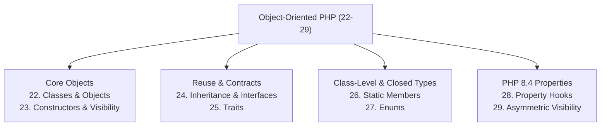

---
tags:
  - php
  - overview
  - oop
  - beginner
---

# Overview: Object-Oriented PHP

## TL;DR

This folder covers how PHP organizes data and behavior into classes, protects internal state, shares code across classes, and uses modern PHP 8.4 features like **property hook**s and **asymmetric visibility**.

> [!NOTE] Prerequisites: 22, 23, 24, 25, 26, 27, 28, 29
> New terms: None (all terms introduced in notes 22 through 29)

> [!abstract] Core Idea
> Model entities with typed classes, promoted constructors, **inheritance**, **interfaces**, **traits**, **static member**s, and **enum**s, and use PHP 8.4 hooks and **asymmetric visibility** to eliminate getter/setter boilerplate.
> Like Java and Python OOP, PHP groups state and behavior into classes, except it accesses instance members with `->`, static/enum members with `::`, and supports inline `{ get; set; }` hooks and `private(set)`.

## Concept Map

## Folder Cheat Sheet

| Note                            | Core Syntax / Tool                                            | Key Rule to Remember                                                                         |
| ------------------------------- | ------------------------------------------------------------- | -------------------------------------------------------------------------------------------- |
| `22. Classes & Objects`         | `class`, `new`, `->`, `$this`                                 | Use `$this->prop` (no `$` on `prop`); uninitialized typed properties throw `Error`           |
| `23. Constructors & Visibility` | `__construct()`, `public`, `protected`, `private`, `readonly` | Constructor promotion declares and assigns properties; `callable` is forbidden on properties |
| `24. Inheritance & Interfaces`  | `extends`, `parent::`, `interface`, `implements`              | Single class inheritance only; child methods cannot narrow parent visibility                 |
| `25. Traits`                    | `trait`, `use`                                                | Traits cannot be instantiated; resolve method collisions with `insteadof`                    |
| `26. Static Members`            | `static`, `const`, `self::`, `::`                             | Static properties keep `$` (`self::$total`); `$this` is forbidden in `static` methods        |
| `27. Enums`                     | `enum`, `case`, `::from()`, `::tryFrom()`                     | Backed enums support `int` or `string` (never both); `tryFrom()` returns `null` on miss      |
| `28. Property Hooks`            | `get => ...`, `set => ...`                                    | PHP 8.4; incompatible with `readonly` and `static`; no `;` after closing `}`                 |
| `29. Asymmetric Visibility`     | `public private(set)`, `public protected(set)`                | PHP 8.4; typed properties only; `set` must be same or stricter than `get`                    |

## Boss Quiz

**Q1: Inside a `Book` method, what happens if you write `$this->$title` instead of `$this->title`?**

- [ ] A) Both mean the exact same thing
- [ ] B) PHP treats `$title` as a local variable name to look up dynamically
- [ ] C) It makes `$title` `readonly`
- [ ] D) It accesses a static property

**Q2: What happens if you try to narrow a `public` parent method to `private` in a child class?**

- [ ] A) It hides the method from outside code
- [ ] B) PHP throws a fatal error because child classes cannot narrow visibility
- [ ] C) PHP silently keeps it `public`
- [ ] D) It works only inside `traits`

**Q3: Inside a `static` method, how do you read `private static int $count = 0;`?**

- [ ] A) `$this->count`
- [ ] B) `self::count`
- [ ] C) `self::$count`
- [ ] D) `static->count`

**Q4: What happens when you call `ReadingStatus::from('unknown')` on a backed enum?**

- [ ] A) Returns `null`
- [ ] B) Throws a `ValueError`
- [ ] C) Returns the first case
- [ ] D) Returns `false`

**Q5: Which PHP 8.4 property declaration is INVALID?**

- [ ] A) `public string $title { set => trim($value); }`
- [ ] B) `public private(set) string $title;`
- [ ] C) `public readonly string $label { get => $this->title; }`
- [ ] D) `public protected(set) int $pages;`

**Q6: Which statement about `protected public(set) int $pages;` in PHP 8.4 is true?**

- [ ] A) It allows reading in subclasses and writing anywhere
- [ ] B) It causes a syntax error because **set visibility** cannot be wider than read visibility
- [ ] C) It makes `$pages` `readonly`
- [ ] D) It requires a `trait`

◈ View Answers & Explanations

1. **B** - Adding `$` after `->` makes PHP evaluate the local variable `$title` and use its string value as the property name. A, C, and D are false.

2. **B** - Overriding a parent method may widen visibility (`protected` to `public`) but never narrow it, or PHP throws a fatal error. A, C, and D are false.

3. **C** - Static properties are accessed with `self::` inside the class and keep their `$` sigil (`self::$count`). `$this` (A) fails in static methods, and `self::count` (B) looks for a constant.

4. **B** - `::from()` throws a `ValueError` when no case matches; use `::tryFrom()` when you want `null` instead (A). C and D are false.

5. **C** - **Property hook**s are incompatible with `readonly` in PHP 8.4. A, B, and D are all valid PHP 8.4 declarations.

6. **B** - In **asymmetric visibility**, **set visibility** must be equal to or stricter than read visibility, so `protected public(set)` is invalid. A, C, and D are false.

> [!quote] Sources
>
> - [Classes and Objects - PHP Manual](https://www.php.net/manual/en/language.oop5.php)
> - [Property Hooks - PHP Manual](https://www.php.net/manual/en/language.oop5.property-hooks.php)
> - [Visibility - PHP Manual](https://www.php.net/manual/en/language.oop5.visibility.php)
