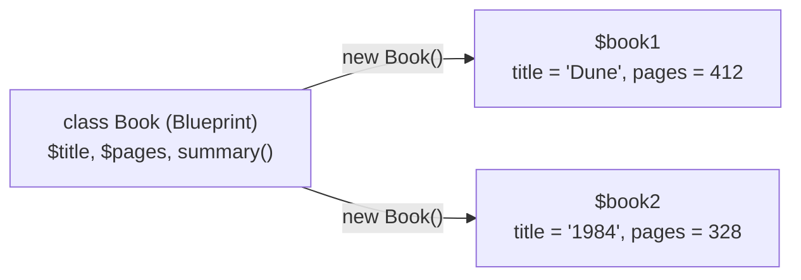

---
tags:
  - php
  - oop
  - beginner
---

# Classes & Objects

## TL;DR

Instead of keeping a book's title, pages, and formatting logic in separate arrays and functions, you can group them into one blueprint called a `class`. Each book you create from that blueprint with `new` is an independent object holding its own data.

> [!NOTE] Prerequisites: 03, 13
> New terms: property, method

> [!abstract] Core Idea
> A `class` bundles typed **property** variables and **method** functions into one blueprint, and `new` creates a live object from it.
> Like Python's `class` and `self`, PHP uses `$this` inside the class, but accesses members with `->` instead of a dot `.`.

## Mental Model

Think of a `class` as the blank index-card template at a library, and each `object` as a filled-out card for a specific book. Every card has the same fields (**properties**) and knows how to format itself (**methods**), while keeping its own title and page count.



- A **property** is a variable declared inside a class that stores data on each object.
- A **method** is a function declared inside a class that describes what each object can do.

## Minimal Example

```php
<?php
class Book
{
    public string $title = '';
    public int $pages = 0;

    public function summary(): string
    {
        return "{$this->title} ({$this->pages} pages)";
    }
}

$book = new Book();
$book->title = 'Dune';
$book->pages = 412;
echo $book->summary() . PHP_EOL;
```

Expected output:

```text
Dune (412 pages)
```

- `class Book { ... }` defines the blueprint named `Book`.
- `public string $title = '';` declares a typed **property** with a default empty string; `public` means code outside the class can read and change it.
- `$this->title` reads the current object's `title` **property** from inside a **method** (note there is no `$` before `title`).
- `new Book()` creates a new `Book` object and stores it in `$book`.
- `->` (the object operator) accesses a **property** (`$book->title`) or calls a **method** (`$book->summary()`).

## ◈ Edge Case Analysis

✗ **Mistake 1:** Writing `$this->$title` with an extra `$` before the property name tells PHP to look up a local variable `$title` and use its value as the property name.

```php
return $this->$title; // Warning: Undefined variable $title
```

✓ **Fix:** Put `$` only on `$this`, never on the property name after `->`.

```php
return $this->title;
```

✗ **Mistake 2:** Using a dot `.` like `$book.title` instead of `->` makes PHP try string concatenation on the object and throw a fatal `Error`.

```php
echo $book.title; // Error: Object of class Book could not be converted to string
```

✓ **Fix:** Always use `->` to access properties and call methods on a PHP object.

```php
echo $book->title;
```

✗ **Mistake 3:** Reading a typed property before giving it a default value or assigning to it throws a fatal `Error` in PHP 8.4.

```php
class Book { public int $pages; }
$b = new Book();
echo $b->pages; // Error: Typed property Book::$pages must not be accessed before initialization
```

✓ **Fix:** Give typed properties a default value (like `= 0`) or assign them before reading.

```php
class Book { public int $pages = 0; }
```

## Try It

1. Add a `public bool $finished = false;` **property** to `Book` and a `isLong(): bool` **method** that returns `true` when `$this->pages >= 400`.
2. Create two `Book` objects (`"Dune"` with `412` pages and `"Animal Farm"` with `112` pages) and echo each book's `summary()`.

<details>
<summary>◈ View Solution</summary>

1. Updated `Book` class with `$finished` and `isLong()`:

```php
<?php
class Book
{
    public string $title = '';
    public int $pages = 0;
    public bool $finished = false;

    public function summary(): string
    {
        return "{$this->title} ({$this->pages} pages)";
    }

    public function isLong(): bool
    {
        return $this->pages >= 400;
    }
}
```

2. Creating and printing two independent `Book` objects:

```php
<?php
$b1 = new Book();
$b1->title = 'Dune';
$b1->pages = 412;

$b2 = new Book();
$b2->title = 'Animal Farm';
$b2->pages = 112;

echo $b1->summary() . PHP_EOL;
echo $b2->summary() . PHP_EOL;
```

</details>

## Topic Mastery Quiz

**Q1: Inside a `Book` method, how do you read the object's `$pages` property?**

- [ ] A) `$this->$pages`
- [ ] B) `$this->pages`
- [ ] C) `self.pages`
- [ ] D) `Book->pages`

**Q2: What happens if you write `echo $book.title;` in PHP?**

- [ ] A) It prints the `title` property
- [ ] B) It prints `null`
- [ ] C) PHP treats `.` as concatenation and throws an `Error`
- [ ] D) It creates a new property named `title`

**Q3: What happens if you declare `public string $title;` with no default value, create `$b = new Book();`, and immediately `echo $b->title;`?**

- [ ] A) It prints an empty string `""`
- [ ] B) It prints `null`
- [ ] C) It throws an `Error` because the typed property is uninitialized
- [ ] D) It returns `false`

**Q4: Which keyword creates a new object from `class Book`?**

- [ ] A) `create Book()`
- [ ] B) `Book()`
- [ ] C) `new Book()`
- [ ] D) `object Book()`

**Q5: In `public function summary(): string`, what is `summary`?**

- [ ] A) A property
- [ ] B) A method
- [ ] C) A constant
- [ ] D) A closure

**Q6: If `$b1 = new Book();` and `$b2 = new Book();`, what happens when you set `$b1->title = 'Dune';`?**

- [ ] A) Both `$b1->title` and `$b2->title` become `'Dune'`
- [ ] B) Only `$b1->title` becomes `'Dune'`; `$b2->title` keeps its own value
- [ ] C) PHP throws an error because two objects cannot share a class
- [ ] D) `$b2` is overwritten by `$b1`

<details>
<summary>◈ View Answers & Explanations</summary>

1. **B** — `$this->pages` accesses the `pages` property on the current object. A uses a variable property name, C is Python syntax, and D tries to use `->` on a class name.
2. **C** — In PHP, `.` is string concatenation, so `$book.title` tries to convert `$book` to a string and fails with an `Error`. A is JS/Python syntax, and B and D do not happen.
3. **C** — Typed properties without a default value start uninitialized, and reading them before assignment throws a fatal `Error`. PHP does not auto-fill `""` (A), `null` (B), or `false` (D).
4. **C** — PHP instantiates classes with the `new` keyword (`new Book()`). `create` (A), bare `Book()` (B), and `object` (D) are invalid syntax for instantiation.
5. **B** — A function declared inside a class is a method. A property (A) is a class variable, a constant (C) holds a fixed value, and a closure (D) is an anonymous function.
6. **B** — Each `new Book()` creates a separate object with its own independent properties. Changing `$b1->title` does not affect `$b2->title` (A, D), and creating multiple objects from one class is normal (C).

</details>

## One-Liner > [!tip] Object Access > **Use `new` to build the object, `->` to reach its members, and `$this->name` inside methods.**

> [!quote] Sources
>
> - [The Basics - Classes and Objects - PHP Manual](https://www.php.net/manual/en/language.oop5.basic.php)
> - [Properties - Classes and Objects - PHP Manual](https://www.php.net/manual/en/language.oop5.properties.php)
