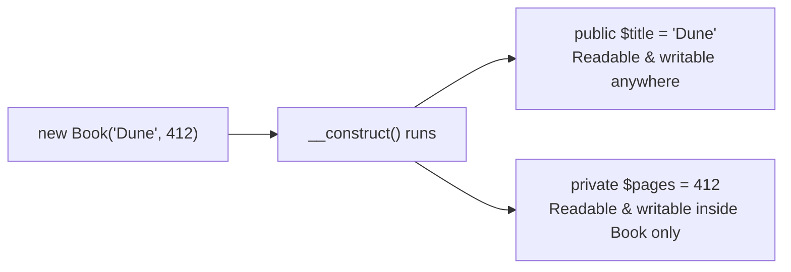

---
tags:
  - php
  - oop
  - beginner
---

# Constructors & Visibility

## TL;DR

Manually setting every property on a new object one line at a time is tedious and error-prone. A **constructor** sets up an object the moment you create it, while **visibility** rules protect sensitive properties from accidental outside changes.

> [!NOTE] Prerequisites: 22
> New terms: constructor, visibility

> [!abstract] Core Idea
> Define `__construct()` to initialize an object during `new`, and use **visibility** modifiers (`public`, `protected`, `private`) to control where properties and methods can be accessed.
> Like Python's `__init__`, `__construct()` runs automatically on instantiation, except PHP 8 lets you declare and assign properties directly in the parameter list.

## Mental Model

Think of a Book Tracker card created at a library desk. The **constructor** is the intake form that requires a title and page count before the card can exist, while **visibility** is the glass case: anyone can read the public summary, but only the librarian's desk (`private`) can change the internal page count.



- A **constructor** (`__construct()`) is a special method that PHP runs automatically whenever `new` creates an object.
- **Visibility** controls which code can read or modify a class member: `public` (anywhere), `protected` (the class and its children), or `private` (only the defining class).

## Minimal Example

```php
<?php
class Book
{
    public function __construct(
        public readonly string $title,
        private int $pages,
    ) {}

    public function summary(): string
    {
        return "{$this->title} ({$this->pages} pages)";
    }
}

$book = new Book('Dune', 412);
echo $book->title . PHP_EOL;
echo $book->summary() . PHP_EOL;
```

Expected output:

```text
Dune
Dune (412 pages)
```

- `public function __construct(...)` runs automatically when `new Book('Dune', 412)` is called.
- Putting `public` or `private` on a constructor parameter is called **constructor property promotion**: PHP declares the property and assigns the argument to `$this->title` and `$this->pages` automatically.
- `readonly` allows `$title` to be set once during construction and prevents anyone from overwriting it later.
- `$book->title` works outside the class because `$title` is `public`, while `$pages` is `private` and only used inside `summary()`.

## Compare

| Modifier    | Inside Same Class | In Child Classes        | Outside Class           | Extra Rule                 |
| ----------- | ----------------- | ----------------------- | ----------------------- | -------------------------- |
| `public`    | ✓                 | ✓                       | ✓                       | Default if omitted         |
| `protected` | ✓                 | ✓                       | ✗                       | Shared with subclasses     |
| `private`   | ✓                 | ✗                       | ✗                       | Hidden from subclasses too |
| `readonly`  | Write once        | Write once (if visible) | Read only (if `public`) | Requires a type hint       |

## ◈ Edge Case Analysis

✗ **Mistake 1:** Reading or changing a `private` property from outside the class throws a fatal `Error`.

```php
echo $book->pages; // Error: Cannot access private property Book::$pages
```

✓ **Fix:** Keep `$pages` private and expose a `public` method (like `summary()` or `pages()`) to read it safely.

```php
public function pages(): int { return $this->pages; }
```

✗ **Mistake 2:** Trying to overwrite a `readonly` property after the object is constructed throws a fatal `Error`.

```php
$book->title = '1984'; // Error: Cannot modify readonly property Book::$title
```

✓ **Fix:** Only use `readonly` for values that should never change after `new` creates the object.

```php
// Create a new Book if the title is different
$next = new Book('1984', 328);
```

✗ **Mistake 3:** Using `callable` as the type of a promoted constructor property fails because PHP forbids `callable` on class properties.

```php
public function __construct(private callable $formatter) {} // Fatal error
```

✓ **Fix:** Omit the `callable` type on properties or use `\Closure` when storing a function in a property.

```php
public function __construct(private \Closure $formatter) {}
```

## Try It

1. Create a `Book` class with promoted properties: `public readonly string $isbn`, `public string $title`, and `private bool $finished = false`.
2. Add a `public function markFinished(): void` method that sets `$this->finished = true;` and a `public function isFinished(): bool` method that returns `$this->finished`.

<details>
<summary>◈ View Solution</summary>

1. Promoted properties with a default value and methods:

```php
<?php
class Book
{
    public function __construct(
        public readonly string $isbn,
        public string $title,
        private bool $finished = false,
    ) {}

    public function markFinished(): void
    {
        $this->finished = true;
    }

    public function isFinished(): bool
    {
        return $this->finished;
    }
}
```

2. Creating an instance and testing the methods:

```php
<?php
$b = new Book('978-0441172719', 'Dune');
$b->markFinished();
var_dump($b->isFinished()); // bool(true)
```

</details>

## Topic Mastery Quiz

**Q1: When does `__construct()` execute?**

- [ ] A) Only when you call `$book->__construct()` manually
- [ ] B) Automatically when `new Book(...)` creates the object
- [ ] C) After the script finishes running
- [ ] D) Only when a property is `private`

**Q2: Which visibility modifier allows access inside the defining class AND its child classes, but blocks outside code?**

- [ ] A) `public`
- [ ] B) `private`
- [ ] C) `protected`
- [ ] D) `readonly`

**Q3: What happens if you run `$book->pages = 500;` when `$pages` is `private`?**

- [ ] A) `$pages` updates to `500`
- [ ] B) PHP silently ignores the assignment
- [ ] C) PHP throws a fatal `Error` because `$pages` is `private`
- [ ] D) `$pages` becomes `public`

**Q4: In `public function __construct(public readonly string $title)`, what does `public` before `$title` do?**

- [ ] A) Nothing; it is a syntax error
- [ ] B) Promotes `$title` into a `public` property and assigns the argument to it
- [ ] C) Makes the constructor return a string
- [ ] D) Makes `$title` a global variable

**Q5: What happens if you try to reassign a `public readonly string $title` property outside the constructor after `new Book('Dune')`?**

- [ ] A) It updates `$title` normally because it is `public`
- [ ] B) It throws an `Error` because `readonly` properties cannot be modified after initialization
- [ ] C) It resets `$title` to `null`
- [ ] D) It creates a second property

**Q6: Which type hint is NOT allowed on a promoted constructor property in PHP 8.4?**

- [ ] A) `int`
- [ ] B) `string`
- [ ] C) `callable`
- [ ] D) `?array`

<details>
<summary>◈ View Answers & Explanations</summary>

1. **B** — PHP automatically calls `__construct()` during `new Book(...)`. You do not call it manually (A), it does not wait until shutdown (C), and it runs regardless of property visibility (D).
2. **C** — `protected` allows the defining class and subclasses, while blocking outside code. `public` (A) allows everyone, `private` (B) blocks subclasses too, and `readonly` (D) controls modification rather than scope.
3. **C** — Accessing or writing a `private` property from outside its class throws a fatal `Error`. PHP never silently ignores it (B) or changes its visibility (D).
4. **B** — Adding a visibility modifier to a constructor parameter enables constructor property promotion, which declares `$this->title` and assigns the argument automatically. A, C, and D are false.
5. **B** — `readonly` allows one-time initialization (typically in the constructor) and throws a fatal `Error` on any later reassignment, even when `public`. A, C, and D are false.
6. **C** — PHP forbids `callable` on class properties, so promoted properties cannot use `callable`. `int` (A), `string` (B), and `?array` (D) are all valid property types.

</details>

## One-Liner

> [!tip] Safe Objects
> **Promote properties in `__construct()`, hide internals with `private`, and lock constants with `readonly`.**

> [!quote] Sources
>
> - [Constructors and Destructors - PHP Manual](https://www.php.net/manual/en/language.oop5.decon.php)
> - [Visibility - PHP Manual](https://www.php.net/manual/en/language.oop5.visibility.php)
