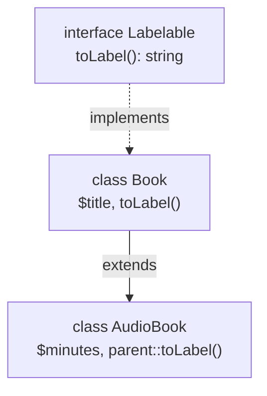

---
tags:
  - php
  - oop
  - beginner
---

# Inheritance & Interfaces

## TL;DR

When classes share behavior or need to follow the same rules, you do not have to copy-paste methods. **Inheritance** lets a child class build on a parent class with `extends`, while an **interface** defines a shared contract of required methods using `implements`.

> [!NOTE] Prerequisites: 22, 23
> New terms: inheritance, interface

> [!abstract] Core Idea
> Use `extends` to inherit and customize one parent class, and `implements` to guarantee a class provides every method listed in an **interface**.
> Like Java's `extends` and `implements`, PHP allows only one parent class per child, but a class can implement multiple interfaces.

## Mental Model

Think of your Book Tracker having standard `Book` items and specialized `AudioBook` items. **Inheritance** means `AudioBook` _is a_ `Book` that adds audio length; an **interface** like `Labelable` is a stamp-of-approval rule saying _any_ item with `toLabel()` can be printed on a shelf tag, even if it is not a `Book`.


- An **interface** (`interface`) is a pure contract listing `public` method signatures with no bodies that implementing classes must define.

## Minimal Example

```php
<?php
interface Labelable
{
    public function toLabel(): string;
}

class Book implements Labelable
{
    public function __construct(public string $title) {}

    public function toLabel(): string
    {
        return $this->title;
    }
}

class AudioBook extends Book
{
    public function __construct(string $title, public int $minutes)
    {
        parent::__construct($title);
    }

    public function toLabel(): string
    {
        return parent::toLabel() . " ({$this->minutes} min)";
    }
}

$audio = new AudioBook('Dune', 1260);
echo $audio->toLabel() . PHP_EOL;
```

Expected output:

```text
Dune (1260 min)
```

- `interface Labelable` requires any class using `implements Labelable` to define `public function toLabel(): string`.
- `class AudioBook extends Book` inherits `$title` and `toLabel()` from `Book`.
- `parent::__construct($title)` calls the parent class's constructor so `$this->title` is initialized.
- `parent::toLabel()` calls `Book::toLabel()` inside the overridden method so `AudioBook` builds on the parent result.

## Compare

| Feature                         | `extends` (Class Inheritance) | `implements` (Interface Contract) |
| ------------------------------- | ----------------------------- | --------------------------------- |
| Limit per class                 | One parent class only         | Multiple interfaces (`A, B`)      |
| Can include properties & bodies | ✓                             | ✗ (method signatures only)        |
| Relationship                    | "Is a" specialization         | "Can do" capability               |
| Call parent version             | `parent::method()`            | Not applicable                    |

## ◈ Edge Case Analysis

✗ **Mistake 1:** Trying to extend two parent classes at once fails with a syntax error because PHP supports single class inheritance only.

```php
class EBook extends Book, DigitalFile {} // Parse error: syntax error
```

✓ **Fix:** Extend one primary parent class and use interfaces (or traits) for extra capabilities.

```php
class EBook extends Book implements Labelable {}
```

✗ **Mistake 2:** Declaring a `protected` or `private` method inside an `interface` throws a fatal error because all interface methods must be `public`.

```php
interface Labelable { protected function toLabel(): string; } // Fatal error
```

✓ **Fix:** Always mark every method signature in an `interface` as `public`.

```php
interface Labelable { public function toLabel(): string; }
```

✗ **Mistake 3:** Overriding a parent's `public` method with `protected` or `private` in a child class throws a fatal error because child classes cannot narrow visibility.

```php
class AudioBook extends Book {
    private function toLabel(): string { return $this->title; } // Fatal error
}
```

✓ **Fix:** Keep the overridden method's visibility at least as open as the parent's (`public` stays `public`).

```php
class AudioBook extends Book {
    public function toLabel(): string { return $this->title; }
}
```

## Try It

1. Create an `interface Measurable` with `public function size(): int;` and make `Book` implement it by returning `$this->pages`.
2. Write a function `printSize(Measurable $item): void` that echoes `$item->size()` and test it with a `Book` object.

<details>
<summary>◈ View Solution</summary>

1. `Measurable` interface implemented by `Book`:

```php
<?php
interface Measurable
{
    public function size(): int;
}

class Book implements Measurable
{
    public function __construct(public string $title, private int $pages) {}

    public function size(): int
    {
        return $this->pages;
    }
}
```

2. Function accepting any `Measurable` object:

```php
function printSize(Measurable $item): void
{
    echo $item->size() . PHP_EOL;
}

printSize(new Book('Dune', 412)); // 412
```

</details>

## Topic Mastery Quiz

**Q1: How many parent classes can a PHP class extend using `extends`?**

- [ ] A) Unlimited
- [ ] B) Two
- [ ] C) One
- [ ] D) None if it implements an interface

**Q2: What visibility must every method declared in an `interface` have?**

- [ ] A) `private`
- [ ] B) `protected`
- [ ] C) `public`
- [ ] D) Any visibility is allowed

**Q3: Inside `AudioBook extends Book`, how do you call `Book`'s version of `toLabel()` after overriding it?**

- [ ] A) `super::toLabel()`
- [ ] B) `parent::toLabel()`
- [ ] C) `$this->parent->toLabel()`
- [ ] D) `base::toLabel()`

**Q4: What happens if `Book` has `public function toLabel(): string`, and `AudioBook extends Book` redeclares it as `protected function toLabel(): string`?**

- [ ] A) It works, hiding `toLabel()` from outside code
- [ ] B) PHP throws a fatal error because visibility cannot be narrowed
- [ ] C) PHP silently keeps it `public`
- [ ] D) `AudioBook` ignores `Book` completely

**Q5: Which statement about interfaces is true?**

- [ ] A) You can instantiate an interface with `new Labelable()`
- [ ] B) A class can implement multiple interfaces separated by commas
- [ ] C) An interface can only be implemented by one class
- [ ] D) Interface methods must contain a full body

**Q6: Why does `AudioBook::__construct()` call `parent::__construct($title)`?**

- [ ] A) PHP automatically runs the parent constructor only if you do not define one in the child; defining one in `AudioBook` skips `Book::__construct()` unless you call it
- [ ] B) `parent::__construct()` deletes the parent object
- [ ] C) Without it, `AudioBook` cannot have its own properties
- [ ] D) PHP requires every method in a child class to call `parent::`

<details>
<summary>◈ View Answers & Explanations</summary>

1. **C** — PHP supports single inheritance, so a class can `extends` only one parent class. It can still `implements` multiple interfaces (D is false).
2. **C** — An interface defines a public contract, so all interface methods must be `public`. Declaring `private` (A) or `protected` (B) causes a fatal error.
3. **B** — `parent::method()` invokes the parent class's implementation. `super` (A) is Java/Python, `$this->parent` (C) is not a built-in property, and `base` (D) is C#.
4. **B** — A child class can widen visibility (for example, `protected` to `public`), but narrowing `public` to `protected` or `private` is a fatal error.
5. **B** — A class can implement as many interfaces as needed (`implements A, B`). Interfaces cannot be instantiated (A), can be implemented by any number of classes (C), and contain signatures without bodies (D).
6. **A** — When a child class defines its own `__construct()`, PHP does not automatically invoke the parent's `__construct()`, so calling `parent::__construct($title)` ensures the parent's setup runs. B, C, and D are false.

</details>

## One-Liner

> [!tip] Hierarchy vs Contract

> [!quote] Sources
>
> - [Object Inheritance - PHP Manual](https://www.php.net/manual/en/language.oop5.inheritance.php)
> - [Object Interfaces - PHP Manual](https://www.php.net/manual/en/language.oop5.interfaces.php)
