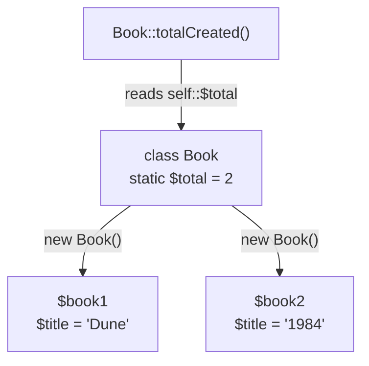

---
tags:
  - php
  - oop
  - beginner
---

# Static Members

## TL;DR

Normal properties and methods belong to one specific object, like one book's title. When data or a helper belongs to the class as a whole—such as counting how many `Book` objects exist—you mark it `static` and reach it with `::`.

> [!NOTE] Prerequisites: 07, 22
> New terms: static member, scope resolution operator (::)

> [!abstract] Core Idea
> A **static member** belongs to the class itself rather than any instance, and is accessed with the **scope resolution operator (`::`)** (`ClassName::member` outside, `self::member` inside).
> Like Python's `@staticmethod` or Java's `static`, PHP static members need no `new` object, except static properties keep their `$` sigil (`Book::$count`).

## Mental Model

Think of `class Book` as a library branch. Each `Book` object (`$this->title`) is a single book on a shelf, while a **static member** (`self::$total`) is the counter on the front desk shared by the entire branch.



- A **static member** (`static` property or method) lives on the class itself and is shared across all objects of that class.
- The **scope resolution operator (`::`)** (a double colon) accesses class constants and static members on a class name, `self`, or `parent`.

## Minimal Example

```php
<?php
class Book
{
    public const DEFAULT_STATUS = 'unread';
    private static int $total = 0;

    public function __construct(public string $title)
    {
        self::$total++;
    }

    public static function totalCreated(): int
    {
        return self::$total;
    }
}

echo Book::DEFAULT_STATUS . PHP_EOL;
new Book('Dune');
new Book('1984');
echo Book::totalCreated() . PHP_EOL;
```

Expected output:

```text
unread
2
```

- `public const DEFAULT_STATUS = 'unread';` declares a fixed **constant** on the `Book` class, read with `Book::DEFAULT_STATUS`.
- `private static int $total = 0;` declares one shared counter for the whole `Book` class.
- `self::$total++` increments that shared counter inside the constructor (`self` refers to the current class, and `$` stays on `$total`).
- `public static function totalCreated(): int` can be called directly as `Book::totalCreated()` without creating an object first.

## Compare

| Member Kind                | Belongs To  | Inside Class                 | Outside Class                | Can Use `$this`? |
| -------------------------- | ----------- | ---------------------------- | ---------------------------- | ---------------- |
| Instance property / method | One object  | `$this->prop`, `$this->fn()` | `$book->prop`, `$book->fn()` | ✓                |
| Static property / method   | Whole class | `self::$prop`, `self::fn()`  | `Book::$prop`, `Book::fn()`  | ✗                |
| Class constant (`const`)   | Whole class | `self::NAME`                 | `Book::NAME`                 | ✗                |

## ◈ Edge Case Analysis

✗ **Mistake 1:** Using `$this` inside a `static` method throws a fatal `Error` because there is no object instance.

```php
public static function label(): string {
    return $this->title; // Error: Using $this when not in object context
}
```

✓ **Fix:** Only read `self::` static members or arguments passed into the static method.

```php
public static function label(string $title): string {
    return $title . ' (' . self::DEFAULT_STATUS . ')';
}
```

✗ **Mistake 2:** Leaving off the `$` when reading a static property makes PHP look for a class constant instead and throw an `Error`.

```php
return self::total; // Error: Undefined constant Book::total
```

✓ **Fix:** Always include `$` on static properties (`self::$total`, `Book::$total`), and omit `$` only on constants and methods.

```php
return self::$total;
```

✗ **Mistake 3:** Trying to read a `static` property with `->` on an object looks for an instance property instead of the class's static property.

```php
$b = new Book('Dune');
echo $b->total; // Warning: Undefined property: Book::$total
```

✓ **Fix:** Always access static properties with `::` on the class name (or `self::` inside the class).

```php
echo Book::totalCreated();
```

## Try It

1. Add a `public const MAX_PAGES = 2000;` constant to `Book` and echo `Book::MAX_PAGES`.
2. Add a `public static function isTooLong(int $pages): bool` method that returns `$pages > self::MAX_PAGES`, and test it with `2500`.

<details>
<summary>◈ View Solution</summary>

1. Class constant and `isTooLong()` static method:

```php
<?php
class Book
{
    public const MAX_PAGES = 2000;

    public static function isTooLong(int $pages): bool
    {
        return $pages > self::MAX_PAGES;
    }
}
```

2. Calling the constant and static method with `::`:

```php
echo Book::MAX_PAGES . PHP_EOL;        // 2000
var_dump(Book::isTooLong(2500));      // bool(true)
```

</details>

## Topic Mastery Quiz

**Q1: Which operator accesses a static method or class constant?**

- [ ] A) `->`
- [ ] B) `.`
- [ ] C) `::`
- [ ] D) `=>`

**Q2: Inside `class Book`, how do you read `private static int $total`?**

- [ ] A) `$this->total`
- [ ] B) `self::total`
- [ ] C) `self::$total`
- [ ] D) `$this::$total`

**Q3: What happens if you use `$this->title` inside a `public static function`?**

- [ ] A) It reads the last created object's `$title`
- [ ] B) It throws a fatal `Error` because `$this` is not available in a static context
- [ ] C) It returns `null`
- [ ] D) It converts the method into an instance method

**Q4: What happens if you write `self::total` instead of `self::$total`?**

- [ ] A) PHP reads `$total` normally
- [ ] B) PHP looks for a class constant named `total` and throws an `Error`
- [ ] C) PHP returns `0`
- [ ] D) PHP creates a new static property

**Q5: How many copies of `private static int $total` exist if you create 5 `Book` objects?**

- [ ] A) 5 (one per object)
- [ ] B) 1 (shared across the `Book` class)
- [ ] C) 0 until a method is called
- [ ] D) 6

**Q6: Which statement about class constants (`public const DEFAULT_STATUS = 'unread'`) is true?**

- [ ] A) They require a `$` sigil when read (`Book::$DEFAULT_STATUS`)
- [ ] B) They can be reassigned at runtime inside `__construct()`
- [ ] C) They are accessed with `::` (`Book::DEFAULT_STATUS` or `self::DEFAULT_STATUS`)
- [ ] D) You must create a `new Book()` before reading them

<details>
<summary>◈ View Answers & Explanations</summary>

1. **C** — The **scope resolution operator (`::`)** accesses static properties, static methods, and class constants. `->` (A) is for instance members, `.` (B) is string concatenation, and `=>` (D) is for array/match pairs.
2. **C** — Inside the class, `self::$total` uses `self::` plus the `$` sigil on the property name. `$this->total` (A) is for instance properties, `self::total` (B) looks for a constant, and `$this::$total` (D) fails in static methods.
3. **B** — Static methods run on the class without an object instance, so referencing `$this` throws `Error: Using $this when not in object context`. A, C, and D are false.
4. **B** — Without `$`, `self::total` refers to a class constant `total`, not the static property `$total`, so PHP throws `Error: Undefined constant Book::total`. A, C, and D do not happen.
5. **B** — Static properties belong to the class itself, so only one shared copy exists regardless of how many `Book` objects you instantiate. A, C, and D are false.
6. **C** — Class constants have no `$` sigil, cannot be reassigned at runtime, and are read directly with `Book::DEFAULT_STATUS` or `self::DEFAULT_STATUS` without creating an object. A, B, and D are false.

</details>

## One-Liner

> [!tip] Shared Class State
> **Use `self::` and `::` for class-wide constants and `static` helpers, and keep `$` on static properties.**

> [!quote] Sources
>
> - [Static Keyword - PHP Manual](https://www.php.net/manual/en/language.oop5.static.php)
> - [Scope Resolution Operator (::) - PHP Manual](https://www.php.net/manual/en/language.oop5.paamayim-nekudotayim.php)
