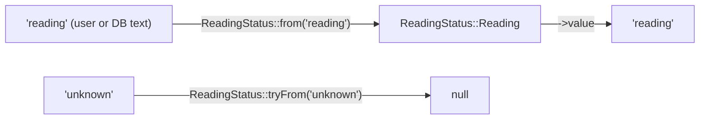

---
tags:
  - php
  - oop
  - beginner
---

# Enums

## TL;DR

Representing a book's reading status with plain strings like `'done'` or `'finished'` invites typos that PHP cannot catch. An **enum** locks a type down to an exact closed list of allowed values so invalid states become impossible.

> [!NOTE] Prerequisites: 11, 26
> New terms: enum, backed enum

> [!abstract] Core Idea
> Declare an `enum` with fixed `case` options for type-safe choices, or add `: string` / `: int` for a **backed enum** that converts to and from scalar values.
> Like Python's `Enum` or Java's `enum`, PHP enums use `::` to pick a case (`Status::Done`) and work directly inside `match` expressions.

## Mental Model

Think of an **enum** like the stamped status buttons on a library desk: _Unread_, _Reading_, and _Done_. Nobody can invent a fourth status like `"sorta-done"`, and with a **backed enum** each button also has an official database code (`'unread'`, `'reading'`, `'done'`) printed underneath.



- An **enum** (enumeration) is a special type that restricts a value to one of a fixed set of named `case` options.
- A **backed enum** pairs every `case` with a unique `string` or `int` value so you can save it to JSON or a database and load it back.

## Minimal Example

```php
<?php
enum ReadingStatus: string
{
    case Unread = 'unread';
    case Reading = 'reading';
    case Done = 'done';
}

$status = ReadingStatus::from('reading');
echo $status->name . ': ' . $status->value . PHP_EOL;

$maybe = ReadingStatus::tryFrom('paused');
var_dump($maybe);
```

Expected output:

```text
Reading: reading
NULL
```

- `enum ReadingStatus: string` defines a **backed enum** whose cases each hold a `string`.
- `ReadingStatus::from('reading')` converts `'reading'` into `ReadingStatus::Reading` (and throws a `ValueError` if no case matches).
- `$status->name` reads the case name (`'Reading'`), and `$status->value` reads its backed string (`'reading'`).
- `ReadingStatus::tryFrom('paused')` safely returns `null` when the input does not match any case.

## Compare

| Enum Kind   | Declaration                                   | Built-in Properties    | Lookup Methods                                 |
| ----------- | --------------------------------------------- | ---------------------- | ---------------------------------------------- |
| Pure Enum   | `enum Status { case Done; }`                  | `->name` only          | None (`::cases()` lists all)                   |
| Backed Enum | `enum Status: string { case Done = 'done'; }` | `->name` and `->value` | `::from()` (throws) and `::tryFrom()` (`null`) |

## ◈ Edge Case Analysis

✗ **Mistake 1:** Calling `::from()` with untrusted input throws a `ValueError` when the value does not match any case.

```php
$s = ReadingStatus::from('paused'); // Uncaught ValueError: "paused" is not a valid backing value
```

✓ **Fix:** Use `::tryFrom()` with `??` whenever the input comes from a user, file, or API.

```php
$s = ReadingStatus::tryFrom('paused') ?? ReadingStatus::Unread;
```

✗ **Mistake 2:** Mixing `int` and `string` values or reusing the same backed value on two cases throws a fatal error.

```php
enum Status: string { case A = 'ok'; case B = 'ok'; } // Fatal error: Duplicate value
```

✓ **Fix:** Pick one scalar type (`int` or `string`) for the whole enum and give every case a unique value.

```php
enum Status: string { case A = 'ok'; case B = 'done'; }
```

✗ **Mistake 3:** Comparing enum cases with `<` or `>` always returns `false` because enum cases are objects, not ordered numbers.

```php
var_dump(ReadingStatus::Unread < ReadingStatus::Done); // bool(false)
```

✓ **Fix:** Compare enum cases with `===` or branch on them with `match`.

```php
$isDone = $status === ReadingStatus::Done;
```

## Try It

1. Define a pure `enum Priority` with cases `Low`, `Medium`, and `High`, and write a function `label(Priority $p): string` using `match`.
2. Define a `string`-backed `enum Format: string` with `Paperback = 'pb'` and `Hardcover = 'hc'`, then look up `'hc'` with `Format::tryFrom()`.

<details>
<summary>◈ View Solution</summary>

1. Pure enum with `match`:

```php
<?php
enum Priority
{
    case Low;
    case Medium;
    case High;
}

function label(Priority $p): string
{
    return match ($p) {
        Priority::Low => 'Later',
        Priority::Medium => 'Soon',
        Priority::High => 'Read next',
    };
}

echo label(Priority::High) . PHP_EOL; // Read next
```

2. Backed enum lookup:

```php
<?php
enum Format: string
{
    case Paperback = 'pb';
    case Hardcover = 'hc';
}

$fmt = Format::tryFrom('hc');
echo $fmt?->name . PHP_EOL; // Hardcover
```

</details>

## Topic Mastery Quiz

**Q1: How do you access the `Done` case of `enum ReadingStatus`?**

- [ ] A) `new ReadingStatus('Done')`
- [ ] B) `ReadingStatus->Done`
- [ ] C) `ReadingStatus::Done`
- [ ] D) `ReadingStatus['Done']`

**Q2: What happens when you call `ReadingStatus::from('invalid')` on a backed enum?**

- [ ] A) It returns `null`
- [ ] B) It returns the first case
- [ ] C) It throws a `ValueError`
- [ ] D) It returns `false`

**Q3: Which method returns `null` instead of throwing an error when a backed value is not found?**

- [ ] A) `::from()`
- [ ] B) `::tryFrom()`
- [ ] C) `::cases()`
- [ ] D) `::find()`

**Q4: Which backing types are allowed on a backed enum in PHP 8.4?**

- [ ] A) `int`, `string`, `float`, or `bool`
- [ ] B) `int` or `string` (one type per enum, never `int|string`)
- [ ] C) `array` or `object`
- [ ] D) Only `string`

**Q5: On `$status = ReadingStatus::Done;` (where `case Done = 'done';`), what does `$status->name` return?**

- [ ] A) `'done'`
- [ ] B) `'Done'`
- [ ] C) `'ReadingStatus::Done'`
- [ ] D) `null`

**Q6: What does `ReadingStatus::Unread < ReadingStatus::Done` evaluate to?**

- [ ] A) `true`, because `Unread` is declared first
- [ ] B) `false`, because enum cases are objects and `<` / `>` comparisons always return `false`
- [ ] C) A `TypeError`
- [ ] D) `true`, because `'unread' < 'done'`

<details>
<summary>◈ View Answers & Explanations</summary>

1. **C** — Enum cases are accessed on the enum name using `::` (`ReadingStatus::Done`). Enums cannot be instantiated with `new` (A), and `->` (B) or `[]` (D) are invalid here.
2. **C** — `::from()` throws a `ValueError` when no case matches the given backing value. `::tryFrom()` is the method that returns `null` (A).
3. **B** — `::tryFrom()` returns the matching enum case or `null` if not found. `::from()` throws (A), `::cases()` returns all cases (C), and `::find()` does not exist (D).
4. **B** — Backed enums support only `int` or `string`, and a single enum can use only one of them (no `int|string` union). A, C, and D are false.
5. **B** — `->name` always holds the case-sensitive identifier of the case itself (`'Done'`), while `->value` holds the backed scalar (`'done'`). A, C, and D are false.
6. **B** — Enum cases are special objects, so ordering comparisons with `<` or `>` are not meaningful and always return `false` in PHP. A, C, and D are false.

</details>

## One-Liner

> [!tip] Closed Choices
> **Use an `enum` to make invalid states unrepresentable, and `tryFrom()` when loading untrusted values.**

> [!quote] Sources
>
> - [Basic enumerations - PHP Manual](https://www.php.net/manual/en/language.enumerations.basics.php)
> - [Backed enumerations - PHP Manual](https://www.php.net/manual/en/language.enumerations.backed.php)
