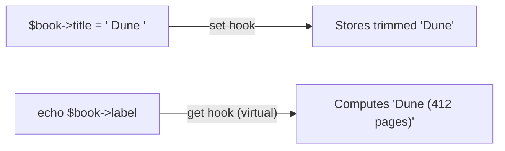

---
tags:
  - php
  - oop
  - php84
  - beginner
---

# Property Hooks

## TL;DR

Writing tiny `getTitle()` and `setTitle()` methods for every property adds clutter to your classes. In PHP 8.4, **property hooks** let you attach `get` and `set` logic right onto a property so `$book->title` looks like a plain property while still cleaning or computing values.

> [!NOTE] Prerequisites: 22, 23
> New terms: property hook, virtual property

> [!abstract] Core Idea
> Attach `get` or `set` **property hooks** inside `{ ... }` on a property to intercept reads and writes without separate getter/setter methods.
> Like Python's `@property`, PHP property hooks run code on attribute access, except PHP places `get` and `set` inline on the property and gives `set` an automatic `$value` variable.

## Mental Model

Think of a **property hook** as a smart library shelf label. When someone writes a messy title (`$book->title = '  dune  '`), the `set` hook trims the spaces before storing it; when someone reads `$book->label`, a **virtual property**'s `get` hook formats the title and pages on the fly without storing a second string.



- A **property hook** (`get` or `set`) is a small block attached to a property inside `{ ... }` that runs automatically when that property is read or written.
- A **virtual property** is a hooked property that does not store its own value in memory because its hooks compute or forward everything on the fly.

## Minimal Example

```php
<?php
class Book
{
    public function __construct(public int $pages) {}

    public string $title = '' {
        set => trim($value);
    }

    public string $label {
        get => "{$this->title} ({$this->pages} pages)";
    }
}

$book = new Book(412);
$book->title = '  Dune  ';
echo $book->label . PHP_EOL;
```

Expected output:

```text
Dune (412 pages)
```

- `public string $title = '' { set => trim($value); }` is a backed property: it stores `$title`, and its short `set =>` hook trims `$value` before saving it.
- `$value` is the automatic parameter inside a `set` hook holding the incoming value being assigned.
- `public string $label { get => ...; }` is a **virtual property** because its `get` hook never reads or writes `$this->label` directly.
- Notice there is no semicolon `;` after the closing `}` of a hooked property.

## Compare

| Property Type                | Stores Value in Object? | Hooks Allowed                      | What Happens on Write Without `set`? |
| ---------------------------- | ----------------------- | ---------------------------------- | ------------------------------------ |
| Backed property (with hooks) | ✓                       | `get`, `set`, or both              | Uses normal property assignment      |
| Virtual property             | ✗ (computed on the fly) | `get` (read-only) or `get` + `set` | Throws `Error` (read-only)           |

## ◈ Edge Case Analysis

✗ **Mistake 1:** Combining `readonly` with property hooks throws a fatal error because `readonly` and hooks are incompatible in PHP 8.4.

```php
public readonly string $label { get => $this->title; } // Fatal error
```

✓ **Fix:** Remove `readonly`; a virtual property with only a `get` hook is already read-only from outside.

```php
public string $label { get => $this->title; }
```

✗ **Mistake 2:** Trying to assign to a virtual property that only defines a `get` hook throws a fatal `Error` because it is read-only.

```php
$book->label = 'Custom'; // Error: Property Book::$label is read-only
```

✓ **Fix:** Only assign to backed properties or properties that define a `set` hook.

```php
$book->title = 'Dune';
```

✗ **Mistake 3:** Putting a semicolon `;` after the closing brace `}` of a hooked property causes a syntax error.

```php
public string $title { set => trim($value); }; // Parse error: syntax error
```

✓ **Fix:** End a hooked property right at the closing `}` with no trailing semicolon.

```php
public string $title { set => trim($value); }
```

## Try It

1. Add a backed `public int $rating = 0` property to `Book` with a `set` hook that clamps values to `1..5` (or throws `ValueError` if out of range).
2. Add a virtual `public bool $isLong` property with a `get` hook that returns `$this->pages >= 400`.

<details>
<summary>◈ View Solution</summary>

1. Validating `$rating` with a full `set` hook:

```php
<?php
class Book
{
    public function __construct(public int $pages) {}

    public int $rating = 0 {
        set {
            if ($value < 1 || $value > 5) {
                throw new ValueError('Rating must be 1 to 5');
            }
            $this->rating = $value;
        }
    }

    public bool $isLong {
        get => $this->pages >= 400;
    }
}
```

2. Testing both hooks:

```php
$b = new Book(412);
$b->rating = 5;
var_dump($b->isLong); // bool(true)
```

</details>

## Topic Mastery Quiz

**Q1: In which PHP version were property hooks introduced?**

- [ ] A) PHP 7.4
- [ ] B) PHP 8.0
- [ ] C) PHP 8.2
- [ ] D) PHP 8.4

**Q2: Inside a `set => trim($value);` hook, what is `$value`?**

- [ ] A) The previous value of the property
- [ ] B) The new value being assigned to the property
- [ ] C) A global constant
- [ ] D) Always `null`

**Q3: What makes a hooked property a "virtual property"?**

- [ ] A) It is marked with the `virtual` keyword
- [ ] B) Its hooks do not reference `$this->propName`, so it stores no value in memory
- [ ] C) It is `static`
- [ ] D) It has no type hint

**Q4: What happens if you try to write `$book->label = 'Hi';` on `public string $label { get => $this->title; }`?**

- [ ] A) `$label` becomes `'Hi'`
- [ ] B) PHP silently ignores the write
- [ ] C) PHP throws an `Error` because the virtual property is read-only
- [ ] D) `$this->title` becomes `'Hi'`

**Q5: Can a `readonly` property also define a `get` or `set` hook?**

- [ ] A) Yes, both `get` and `set`
- [ ] B) Yes, `get` only
- [ ] C) No, property hooks are incompatible with `readonly`
- [ ] D) Only on `static` properties

**Q6: Which syntax is valid for a hooked property in PHP 8.4?**

- [ ] A) `public string $title { set => trim($value); };`
- [ ] B) `public string $title { set => trim($value); }`
- [ ] C) `public static string $title { get => 'Dune'; }`
- [ ] D) `public readonly string $title { get => 'Dune'; }`

<details>
<summary>◈ View Answers & Explanations</summary>

1. **D** — Property hooks were introduced in PHP 8.4. Earlier versions (A, B, C) do not support `{ get ...; set ...; }` syntax.
2. **B** — `$value` is the automatic parameter passed to a `set` hook containing the incoming value being assigned. A, C, and D are false.
3. **B** — A property is virtual when its hooks do not access the property's own backing storage (`$this->propName`), so PHP allocates no storage for it. There is no `virtual` keyword (A), hooks do not work on `static` properties (C), and type hints are allowed (D).
4. **C** — A virtual property with only a `get` hook has no `set` hook and no backing storage, so writing to it throws a fatal `Error`. A, B, and D do not happen.
5. **C** — PHP forbids combining `readonly` with property hooks; use asymmetric visibility or a `get`-only virtual property instead. A, B, and D are false.
6. **B** — Hooked properties end with `}` without a trailing semicolon (unlike A), cannot be `static` (C), and cannot be `readonly` (D).

</details>

## One-Liner

> [!tip] Smart Properties
> **Use PHP 8.4 property hooks to validate on `set` and compute on `get` without getter/setter boilerplate.**

> [!quote] Sources
>
> - [Property Hooks - PHP Manual](https://www.php.net/manual/en/language.oop5.property-hooks.php)
