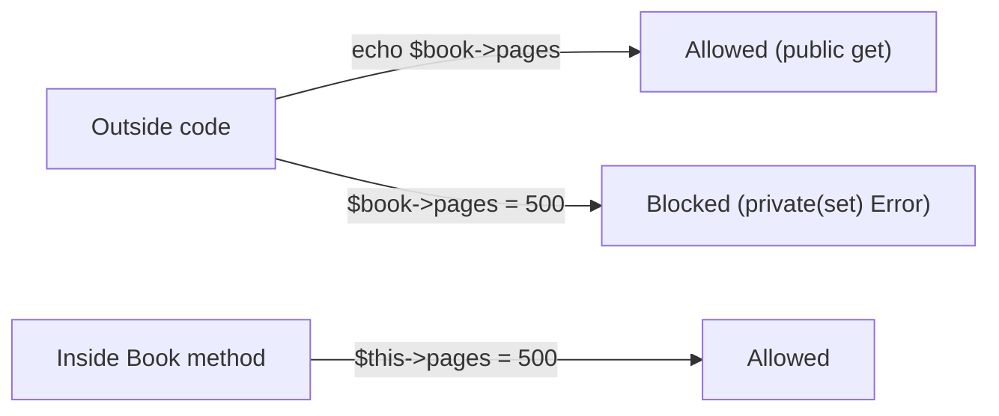

---
tags:
  - php
  - oop
  - php84
  - beginner
---

# Asymmetric Visibility

## TL;DR

Before PHP 8.4, if you wanted outside code to _read_ a property like `$book->pages` without letting it _overwrite_ `$book->pages`, you had to make it `private` and write a getter method. **Asymmetric visibility** lets you declare one visibility for reading and a stricter one for writing on the same property.

> [!NOTE] Prerequisites: 23, 24
> New terms: asymmetric visibility, set visibility

> [!abstract] Core Idea
> Use PHP 8.4 **asymmetric visibility** (`public private(set)` or `public protected(set)`) so code outside the class can read a typed property directly while only the class (or subclasses) can modify it.
> Neither Python nor Java has this built in; in PHP 8.4 it replaces boilerplate getter methods on mutable internal state.

## Mental Model

Think of a museum display case with a lock on the back. Visitors (`public`) can look through the glass at a book's page count anytime, while only the curator (`private(set)`) or assistant curators (`protected(set)`) can open the back and update the number.



- **Asymmetric visibility** means giving a property a wider scope for reading than for writing.
- **Set visibility** (`private(set)` or `protected(set)`) specifies which scope is allowed to assign or modify that property.

## Minimal Example

```php
<?php
class Book
{
    public function __construct(
        public private(set) string $title,
        public protected(set) int $pages,
    ) {}

    public function addPages(int $extra): void
    {
        $this->pages += $extra;
    }
}

$book = new Book('Dune', 412);
echo $book->title . ': ' . $book->pages . PHP_EOL;

$book->addPages(10);
echo $book->pages . PHP_EOL;
```

Expected output:

```text
Dune: 412
422
```

- `public private(set) string $title` allows anyone to read `$book->title`, while only `Book` itself can assign to `$this->title`.
- `public protected(set) int $pages` allows anyone to read `$book->pages`, while `Book` and any child class extending `Book` can update `$this->pages`.
- `$book->addPages(10)` works because `addPages()` runs inside `Book`, whereas `$book->pages = 500;` outside `Book` would throw a fatal `Error`.

## Compare

| Modifier                | Read Outside | Write Outside | Write in Subclass | Can Change Again Inside Class?   |
| ----------------------- | ------------ | ------------- | ----------------- | -------------------------------- |
| `public readonly`       | ✓            | ✗             | Write once only   | ✗ (after initialization)         |
| `public private(set)`   | ✓            | ✗             | ✗                 | ✓ (anytime inside `Book`)        |
| `public protected(set)` | ✓            | ✗             | ✓                 | ✓ (inside `Book` and subclasses) |

## ◈ Edge Case Analysis

✗ **Mistake 1:** Making **set visibility** wider than get visibility (such as `protected public(set)`) causes a syntax error because writing can never be more open than reading.

```php
protected public(set) int $pages; // Parse error: syntax error
```

✓ **Fix:** Always make the `set` visibility equal to or stricter than the read visibility (`public private(set)`, `public protected(set)`, or `protected private(set)`).

```php
public protected(set) int $pages;
```

✗ **Mistake 2:** Putting spaces inside `private(set)` like `private( set )` causes a parse error in PHP 8.4.

```php
public private( set ) string $title; // Parse error
```

✓ **Fix:** Write `private(set)` or `protected(set)` with no spaces inside the parentheses.

```php
public private(set) string $title;
```

✗ **Mistake 3:** Using asymmetric visibility on an untyped property fails because only typed properties support separate **set visibility**.

```php
public private(set) $title; // Fatal error: Property with asymmetric visibility must have type
```

✓ **Fix:** Always include a type hint (`string`, `int`, etc.) on properties that use `private(set)` or `protected(set)`.

```php
public private(set) string $title;
```

## Try It

1. Create a `Book` class with `public private(set) int $bookmarks = 0;` and a `public function addBookmark(): void` method that increments `$this->bookmarks`.
2. Verify that reading `$book->bookmarks` works outside the class, while `$book->bookmarks = 99;` throws a fatal `Error`.

<details>
<summary>◈ View Solution</summary>

1. `Book` with `public private(set)` counter:

```php
<?php
class Book
{
    public private(set) int $bookmarks = 0;

    public function addBookmark(): void
    {
        $this->bookmarks++;
    }
}
```

2. Reading succeeds, direct outside write fails:

```php
$b = new Book();
$b->addBookmark();
echo $b->bookmarks . PHP_EOL; // 1
// $b->bookmarks = 99;        // Fatal error: Cannot modify private(set) property
```

</details>

## Topic Mastery Quiz

**Q1: What does `public private(set) int $pages` allow?**

- [ ] A) Reading and writing `$pages` anywhere
- [ ] B) Reading `$pages` anywhere, but writing `$pages` only inside the defining class
- [ ] C) Reading `$pages` only inside the class, and writing it anywhere
- [ ] D) Making `$pages` `readonly` forever, even inside the class

**Q2: How does `public private(set)` differ from `public readonly`?**

- [ ] A) `readonly` can be updated multiple times inside the class; `private(set)` cannot
- [ ] B) `private(set)` lets the class itself update the property multiple times; `readonly` allows only one initialization
- [ ] C) They are identical in every way
- [ ] D) `readonly` requires PHP 8.4, while `private(set)` was added in PHP 8.1

**Q3: Which declaration is a syntax error in PHP 8.4?**

- [ ] A) `public protected(set) int $pages;`
- [ ] B) `protected private(set) int $pages;`
- [ ] C) `protected public(set) int $pages;`
- [ ] D) `private(set) int $pages;`

**Q4: Why does `public private(set) $title;` fail?**

- [ ] A) `string` values cannot use `private(set)`
- [ ] B) Only typed properties can have asymmetric visibility
- [ ] C) `private(set)` only works inside `__construct()`
- [ ] D) You must write `public` after `private(set)`

**Q5: What happens if a child class tries to redeclare a parent's `public private(set) string $title` property?**

- [ ] A) It works normally
- [ ] B) It fails because `private(set)` properties are automatically `final`
- [ ] C) It widens `private(set)` to `public`
- [ ] D) It deletes the parent property

**Q6: Which spacing is valid for set visibility?**

- [ ] A) `private( set )`
- [ ] B) `private (set)`
- [ ] C) `private(set)`
- [ ] D) `set(private)`

<details>
<summary>◈ View Answers & Explanations</summary>

1. **B** — `public` sets read visibility to everywhere, while `private(set)` restricts writes to the defining class. A, C, and D are false.
2. **B** — A `private(set)` property can still be updated as many times as needed by methods inside the class, whereas `readonly` locks after its first assignment. A, C, and D are reversed or false.
3. **C** — **Set visibility** cannot be wider than read visibility, so `protected public(set)` is a syntax error. A, B, and D (`private(set)` alone implies `public` read) are all valid.
4. **B** — Asymmetric visibility is only supported on typed properties, so omitting the type (`string`) causes a fatal error. A, C, and D are false.
5. **B** — Properties with `private(set)` are automatically `final` and cannot be redeclared in a child class. A, C, and D are false.
6. **C** — PHP requires `private(set)` with no spaces inside the parentheses. A, B, and D are invalid syntax.

</details>

## One-Liner

> [!tip] Read Freely, Write Safely
> **Use `public private(set)` when outsiders should read a typed property directly without ever mutating it.**

> [!quote] Sources
>
> - [Visibility - PHP Manual](https://www.php.net/manual/en/language.oop5.visibility.php)
