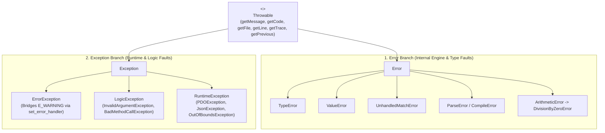

---
tags:
  - php
  - files
  - streams
  - exceptions
  - error-handling
  - xdebug
---

# Files, Streams, Error/Exception Hierarchy & Xdebug in PHP

#### TL;DR (Quick Revision)

**PHP File I/O, Streams & Error Architecture** = High-level atomic file helpers (**`file_get_contents`** / **`file_put_contents(..., LOCK_EX)`**) and low-level chunked **[Streams](https://www.php.net/manual/en/book.stream.php)** (**`fopen`** / **`fgets`** / **`php://`** wrappers)[cite: 1], paired with a unified **[`Throwable`](https://www.php.net/manual/en/class.throwable.php)** root interface splitting into **[`Error`](https://www.php.net/manual/en/class.error.php)** (internal engine/type faults) and **[`Exception`](https://www.php.net/manual/en/class.exception.php)** (application/runtime faults)[cite: 1], fortified by **`ErrorException`** conversion and **[Xdebug 3](https://xdebug.org/docs/)** step debugging.

> [!abstract] Core Idea
> Under the hood, every file operation in PHP (`file_get_contents`, `fopen`, `include`) runs on top of the **[PHP Streams Layer](https://www.php.net/manual/en/intro.stream.php)**—a unified C abstraction that treats local disk files, HTTP URLs, compressed ZIPs, and in-memory buffers (`php://memory`, `php://temp`, `php://filter`) identically via `scheme://target` wrappers[cite: 1]. Meanwhile, modern PHP (`8.0–8.5+`) unifies error handling under the **`Throwable`** interface[cite: 1] while converting legacy non-fatal PHP warnings (`E_WARNING` from failed `fopen()` calls) into catchable **`ErrorException`** objects via [`set_error_handler()`](https://www.php.net/manual/en/function.set-error-handler.php) as recommended by **[PHP: The Right Way — Errors and Exceptions](https://phptherightway.com/#errors_and_exceptions)**.

> [!question] Why Master PHP Streams, `Throwable` & Error Handlers?
>
> - **Prevent OOM Crashes on Large Files**: `file_get_contents('2gb_access.log')` loads the entire 2GB file into a single PHP string in RAM, immediately crashing with `Allowed memory size exhausted`! Streaming line-by-line with `fopen()` + `fgets()` (or `SplFileObject`) uses `< 1 MB` of constant RAM.
> - **Catch Legacy Warnings Before They Corrupt Execution**: Many built-in C functions from PHP's procedural era (`fopen`, `file_get_contents`, `unlink`) **do not throw Exceptions on failure**—they emit a non-fatal `E_WARNING` and return `false`! Knowing how to promote warnings to `ErrorException` stops silent data corruption.
> - **Master the `Throwable` (`Error` vs `Exception`) Split**: Catching `Exception` alone misses `TypeError`, `ValueError`, `ParseError`, and `UnhandledMatchError` (which extend `Error`, not `Exception`!)[cite: 1].
> - **Understand CTF `php://filter` & Stream Wrapper Exploits**: Knowing how `php://filter/convert.base64-encode/resource=...` and `php://temp` work is essential for both high-performance I/O and cybersecurity/CTF code auditing[cite: 1].

#### Quick Reference Table: File I/O & Error Handling Approaches in PHP 8.4/8.5+

| Task / Concept              | Legacy / Dangerous PHP                         | Modern PHP 8.4/8.5+ (The Right Way)                           | Engine Behavior & Official Docs                                                                                                                                                                                         |
| :-------------------------- | :--------------------------------------------- | :------------------------------------------------------------ | :---------------------------------------------------------------------------------------------------------------------------------------------------------------------------------------------------------------------- |
| **Read Small File (<2MB)**  | `$f = fopen(...); fread(...);`                 | `$str = file_get_contents($path);`                            | Reads entire file into a string in 1 C call; returns `false` (and emits Warning) on failure ([`file_get_contents`](https://www.php.net/manual/en/function.file-get-contents.php))[cite: 1].                             |
| **Write File Concurrently** | `file_put_contents($p, $d);`                   | `file_put_contents($p, $d, LOCK_EX);`                         | `LOCK_EX` acquires an exclusive `flock` lock so concurrent requests don't interleave/corrupt the file ([`file_put_contents`](https://www.php.net/manual/en/function.file-put-contents.php))[cite: 1].                   |
| **Read Huge File (>50MB)**  | `file($path)` or `file_get_contents()`         | `fopen()` + `while (($line = fgets($h)) !== false)`           | Streams 1 line at a time in $O(1)$ memory; always ensure `fclose($h)` runs inside a `finally` block ([`fgets`](https://www.php.net/manual/en/function.fgets.php))[cite: 1].                                             |
| **Suppress Warnings**       | `@file_get_contents($path)`                    | Register `set_error_handler()` $\rightarrow$ `ErrorException` | In **PHP 8.0+**, the `@` silence operator **no longer silences fatal errors**! Convert warnings to `ErrorException` instead ([PHP Error Operators](https://www.php.net/manual/en/language.operators.errorcontrol.php)). |
| **Catch Any Crash**         | `catch (Exception $e)` _(Misses `TypeError`!)_ | `catch (Throwable $e)` (or specific subtypes)                 | [`Throwable`](https://www.php.net/manual/en/class.throwable.php) is the root interface implemented by both `Exception` and `Error`[cite: 1].                                                                            |
| **Format CSV Safely**       | Manual `implode(',', $row)`                    | `fputcsv($stream, $row, escape: '')`                          | **[PHP 8.4 Deprecation](https://www.php.net/releases/8.4/en.php#deprecate_csv_escape)**: Always pass named arguments or explicit `$escape = ''` to `fputcsv()` / `fgetcsv()`.                                           |

---

## The Learning Concept

### What Problem Does It Solve?

Three major bugs plague PHP file handling and error management in production:

1. **Assuming Failed File Functions Throw Exceptions**: A developer wraps `file_get_contents('/missing/file.json')` inside `try { ... } catch (Throwable $e) { ... }` expecting it to jump to the `catch` block if the file doesn't exist. **It doesn't!** By default, `file_get_contents()` emits an `E_WARNING`, returns `false`, and continues straight to the next line of the `try` block!
2. **Catching `Exception` Instead of `Throwable`**: Writing `catch (Exception $e)` in a top-level handler fails to catch `TypeError`, `ValueError`, `DivisionByZeroError`, or `ParseError` because those inherit from `Error`, not `Exception`[cite: 1]!
3. **Leaving File Handles Open or Corrupting Concurrent Writes**: Writing to a shared file without `LOCK_EX`, or forgetting to close a file stream inside a `finally` block when an exception occurs mid-read[cite: 1].

Look at this **`// BAD`** PHP snippet illustrating all three traps:

```php
<?php
// BAD - Expecting file_get_contents() to throw an Exception by default,
// catching Exception instead of Throwable, and writing without LOCK_EX!

try {
    // BUG 1: If config.json is missing, file_get_contents() DOES NOT throw an Exception!
    // It emits a PHP Warning, returns bool(false), and keeps executing the next line!
    $raw = file_get_contents(__DIR__ . '/missing_config.json');

    // Passing bool(false) to a function expecting string under strict_types=1 throws a TypeError!
    // BUG 2: catch (Exception $e) below CANNOT catch TypeError because TypeError extends Error!
    $data = json_decode($raw, true, 512, JSON_THROW_ON_ERROR);

    // BUG 3: No LOCK_EX — two concurrent HTTP requests writing at the same time will corrupt the file!
    file_put_contents(__DIR__ . '/audit.log', "Loaded config\n");
} catch (Exception $e) {
    echo "Caught exception: " . $e->getMessage();
}
```

**Why this fails:** PHP has two historical error systems running side-by-side: legacy procedural **Errors/Warnings** (`E_WARNING`, `E_NOTICE`, `E_DEPRECATED`) emitted by older C functions like `file_get_contents()`, and modern object-oriented **`Throwable`s (`Exception` & `Error`)**[cite: 1]. Unless you bridge them with `set_error_handler()`, `try/catch` completely ignores `E_WARNING`!

Now look at the **`// GOOD`** modern **PHP 8.4/8.5 + _PHP: The Right Way_** solution:

```php
<?php

declare(strict_types=1);

// GOOD - Convert all PHP Warnings/Notices into catchable ErrorExceptions,
// use try/catch/finally with Throwable, and use LOCK_EX on concurrent writes!

// 1. PHP: The Right Way standard — Promote legacy PHP warnings/notices into ErrorException!
set_error_handler(static function (int $severity, string $message, string $file, int $line): bool {
    if (!(error_reporting() & $severity)) {
        return false; // Respect error_reporting mask
    }
    throw new ErrorException($message, 0, $severity, $file, $line);
});

// 2. Atomic append write with LOCK_EX (Exclusive File Lock)
$logFile = sys_get_temp_dir() . '/app_audit.log';
file_put_contents(
    filename: $logFile,
    data:     "[" . date('c') . "] Starting stream read" . PHP_EOL,
    flags:    FILE_APPEND | LOCK_EX,
);

// 3. Memory-safe streaming read with try / catch (Throwable) / finally resource cleanup!
$handle = null;
try {
    $handle = fopen($logFile, 'rb'); // If missing, set_error_handler throws ErrorException!
    while (($line = fgets($handle)) !== false) {
        echo "Read Line: " . trim($line) . PHP_EOL;
    }
} catch (ErrorException $e) {
    echo "I/O Error caught cleanly as Exception: {$e->getMessage()}" . PHP_EOL;
} catch (Throwable $e) {
    echo "Caught Engine Error or Exception: {$e->getMessage()}" . PHP_EOL;
} finally {
    // 4. finally ALWAYS runs (even after return or uncaught throw!)
    if (is_resource($handle)) {
        fclose($handle);
    }
    if (is_file($logFile)) {
        unlink($logFile); // Clean up temp file
    }
}
```

**Output:**

```
Read Line: [2026-11-18T22:55:00+05:30] Starting stream read
```

---

### How PHP Implements the `Throwable` Hierarchy & Streams Under the Hood

> [!tip] 4 Core Mechanics of PHP's Error & Stream Architecture
>
> 1. **The Complete `Throwable` Class Hierarchy ([PHP `Throwable` Manual](https://www.php.net/manual/en/class.throwable.php))**:
>    In PHP 7.0+, both engine errors and user exceptions implement the root **`Throwable`** interface[cite: 1] (you cannot implement `Throwable` directly on a custom class; you must extend `Exception` or `Error`):
>    - **`Error implements Throwable`** (Internal Engine & Code Bugs):
>      - `TypeError` (wrong argument/return/property type)
>      - `ValueError` (PHP 8.0+: valid type, invalid value—e.g., `array_rand([])` or negative length)
>      - `UnhandledMatchError` (PHP 8.0+: non-exhaustive `match` expression)
>      - `ParseError` & `CompileError` (syntax error in an `include`d file or `eval()`)
>      - `ArithmeticError` $\rightarrow$ `DivisionByZeroError` (`10 / 0` or `10 % 0`)
>      - `AssertionError` (failed `assert()`)
>    - **`Exception implements Throwable`** (Runtime & Domain Exceptions):
>      - `ErrorException` (wrapper used by `set_error_handler()` to turn `E_WARNING` into an exception)
>      - `LogicException` (bugs in program logic that should be fixed in code: `BadMethodCallException`, `InvalidArgumentException`, `DomainException`, `LengthException`, `OutOfRangeException`)
>      - `RuntimeException` (errors that can only be detected at runtime: `OutOfBoundsException`, `OverflowException`, `UnderflowException`, `UnexpectedValueException`, `PDOException`, `JsonException`)
> 2. **In-Memory Streams (`php://memory` vs. `php://temp`) ([PHP `php://` Wrappers](https://www.php.net/manual/en/wrappers.php.php))**:
>    Need to use file-handle functions like `fputcsv()` or stream downloads without creating messy temporary files on disk?
>    - `fopen('php://memory', 'r+')`: Stores stream data **100% in RAM** (fast, but can exhaust memory if huge).
>    - `fopen('php://temp', 'r+')`: Stores data in RAM up to a threshold (default **2 MB**, configurable via `php://temp/maxmemory:5242880`), and **automatically spills over to a temporary file on disk** if the data exceeds 2 MB!
> 3. **Stream Filters (`php://filter`) — Both a High-Speed Pipeline & a Famous CTF Vector**:
>    PHP allows attaching transformation filters (`string.toupper`, `convert.base64-encode`, `zlib.deflate`, `convert.iconv.*`) directly to any stream while reading or writing[cite: 1].
>    - In **CTFs**, if a script has `include $_GET['page'];`, passing `php://filter/convert.base64-encode/resource=index.php` forces PHP to Base64-encode `index.php` _before_ the parser looks for `<?php` tags—leaking the raw PHP source code instead of executing it[cite: 1]!
> 4. **Zero-Copy Stream Piping ([`stream_copy_to_stream($src, $dest)`](https://www.php.net/manual/en/function.stream-copy-to-stream.php))**:
>    Instead of reading a 500MB file into PHP strings and writing it out, `stream_copy_to_stream($inputStream, $outputStream)` pipes bytes directly between C file descriptors in constant memory!

#### Full Runnable Example

Run this script via `php 10_streams_exceptions.php` to see in-memory CSV generation via `php://temp`, PHP 8.0+ non-capturing `catch (TypeError)`, multi-catch `catch (InvalidArgumentException|ValueError $e)`, custom domain exceptions, and PHP 8.5 `get_error_handler()` inspection[cite: 1]:

```php
<?php

declare(strict_types=1);

// 1. Custom Domain Exception Hierarchy (Extending RuntimeException / LogicException)
final class InsufficientStorageException extends RuntimeException
{
    public static function forBytes(int $requested, int $available): self
    {
        return new self("Requested {$requested} bytes, but only {$available} bytes free.");
    }
}

// 2. Generating a CSV in-memory using php://temp (Zero disk clutter, spills to disk only if > 2MB!)
function exportUsersToCsvString(array $users): string
{
    $stream = fopen('php://temp', 'r+b');
    if ($stream === false) {
        throw new RuntimeException('Failed to open php://temp stream');
    }

    try {
        // Write CSV Header & Rows (PHP 8.4+: explicitly pass escape: '' to avoid deprecation!)
        fputcsv($stream, ['ID', 'Username', 'Role'], separator: ',', enclosure: '"', escape: '');

        foreach ($users as $user) {
            fputcsv($stream, [$user['id'], $user['name'], $user['role']], separator: ',', enclosure: '"', escape: '');
        }

        rewind($stream); // Move stream pointer back to byte 0 before reading!
        return (string) stream_get_contents($stream);
    } finally {
        fclose($stream); // Guaranteed cleanup
    }
}

$csvOutput = exportUsersToCsvString([
    ['id' => 1, 'name' => 'Valay',  'role' => 'Admin'],
    ['id' => 2, 'name' => 'Arushi', 'role' => 'Member'],
]);
echo "--- Generated In-Memory CSV ---" . PHP_EOL . trim($csvOutput) . PHP_EOL . PHP_EOL;

// 3. Modern PHP 8+ Exception Features:
//    - Multi-catch (TypeA | TypeB)
//    - Non-capturing catch: catch (DivisionByZeroError) without unused $e variable!
//    - throw as an EXPRESSION inside ??, ?:, match(), or arrow functions!
function getQuotaLimit(?int $customLimit): int
{
    // In PHP 8.0+, 'throw' is an expression, so it can live on the right side of ?? or match!
    $limit = $customLimit ?? throw new InvalidArgumentException('Quota limit cannot be null');

    if ($limit > 10_000) {
        throw InsufficientStorageException::forBytes($limit, 10_000);
    }
    return $limit;
}

foreach ([500, null, 50_000] as $testValue) {
    try {
        $approved = getQuotaLimit($testValue);
        echo "Approved quota: {$approved} bytes" . PHP_EOL;
    } catch (InvalidArgumentException|ValueError) {
        // Non-capturing catch (PHP 8.0+): no need to declare $e if we don't inspect it!
        echo "Validation Error: Null or invalid quota supplied." . PHP_EOL;
    } catch (InsufficientStorageException $e) {
        echo "Storage Quota Exceeded: {$e->getMessage()}" . PHP_EOL;
    }
}
```

**Output:**

```
--- Generated In-Memory CSV ---
ID,Username,Role
1,Valay,Admin
2,Arushi,Member

Approved quota: 500 bytes
Validation Error: Null or invalid quota supplied.
Storage Quota Exceeded: Requested 50000 bytes, but only 10000 bytes free.
```

---

### Visual Diagram: The PHP 8.4/8.5 `Throwable` Hierarchy (`Error` vs `Exception`)



---

### Key Terminology (Syntax Decoder)

1. **`throw` as an Expression ([PHP 8.0+](https://www.php.net/manual/en/language.exceptions.php))**:
   Before PHP 8.0, `throw new Exception()` was a statement (only valid on its own line). In PHP 8.0+, **`throw` is an expression**, meaning you can put it anywhere an expression is expected:
   - Null Coalescing: `$user = $repo->find($id) ?? throw new UserNotFoundException();`
   - Arrow Functions: `$fail = fn() => throw new RuntimeException();`
   - Match Arms: `$rate = match ($tier) { 'pro' => 10, default => throw new InvalidArgumentException() };`
     Syntax: `$apiKey = getenv('API_KEY') ?: throw new RuntimeException('Missing API_KEY');`

2. **[`SplFileObject`](https://www.php.net/manual/en/class.splfileobject.php) & [`DirectoryIterator`](https://www.php.net/manual/en/class.directoryiterator.php) (OOP File & Directory Streaming)**:
   Instead of procedural `fopen()`/`fgets()` or `opendir()`/`readdir()`, PHP's SPL provides object-oriented iterators that work directly inside `foreach` loops:
   - `$file = new SplFileObject('data.csv', 'rb');` lets you iterate line-by-line with `foreach ($file as $lineNum => $line)` or automatically parse CSV rows by calling `$file->setFlags(SplFileObject::READ_CSV | SplFileObject::SKIP_EMPTY);`!
   - `new FilesystemIterator(__DIR__)` iterates over files in a directory as `SplFileInfo` objects (`$fileInfo->getFilename()`, `$fileInfo->getSize()`, `$fileInfo->getMTime()`).
     Syntax: `foreach (new SplFileObject('large.log') as $line) { ... }`

3. **[`error_reporting(E_ALL)`](https://www.php.net/manual/en/function.error-reporting.php), `display_errors`, and `log_errors` ([PHP: The Right Way — Error Reporting](https://phptherightway.com/#error_reporting))**:
   As emphasized in _PHP: The Right Way_:
   - **Always set `error_reporting(E_ALL);`** in **both** development and production so you never blind yourself to warnings or deprecations!
   - **In Development**: Set `ini_set('display_errors', '1');` and `ini_set('display_startup_errors', '1');` so errors print on screen.
   - **In Production**: **Always set `display_errors = Off` (`'0'`) and `log_errors = On` (`'1'`)** in `php.ini`! Leaving `display_errors = On` in production leaks database table names, file paths, and stack traces to attackers!
     Syntax: `error_reporting(E_ALL); ini_set('display_errors', '0');`

4. **Global Handlers: [`set_error_handler()`](https://www.php.net/manual/en/function.set-error-handler.php), [`set_exception_handler()`](https://www.php.net/manual/en/function.set-exception-handler.php), and PHP 8.5 Inspection**:
   - `set_error_handler($fn)`: Intercepts non-fatal procedural warnings/notices (`E_WARNING`, `E_NOTICE`, `E_DEPRECATED`) and typically converts them into `throw new ErrorException(...)`.
   - `set_exception_handler($fn)`: The last-resort safety net called when a `Throwable` goes completely uncaught; used to log the crash to Sentry/Monolog and render a clean `500 Internal Server Error` page.
   - **PHP 8.5 Upgrades**: **[PHP 8.5](https://www.php.net/releases/8.5/en.php)** introduces **[`get_error_handler(): ?callable`](https://www.php.net/releases/8.5/en.php)** and **[`get_exception_handler(): ?callable`](https://www.php.net/releases/8.5/en.php)** (previously, the only way to inspect the active handler was a hacky `set_error_handler(null); restore_error_handler();` dance!), plus **`fatal_error_backtraces`** enabled by default so even fatal out-of-memory or max-execution-time errors print full stack traces!

5. **Safe Path Resolution ([`realpath()`](https://www.php.net/manual/en/function.realpath.php), [`basename()`](https://www.php.net/manual/en/function.basename.php), [`dirname()`](https://www.php.net/manual/en/function.dirname.php))**:
   - `basename('/etc/passwd')` $\rightarrow$ `'passwd'` (strips all parent directory components).
   - `realpath($path)`: Expands all symbolic links and resolves `/../` relative hops against the actual filesystem, returning the canonical absolute path string, or **`false` if the target file does not exist**!
     Syntax: `$canonical = realpath($baseDir . '/' . $userFile);`

> [!important] Key Rules to Remember
>
> - **Always Order `catch` Blocks from Most Specific to Most General** → Put `catch (InvalidArgumentException $e)` before `catch (Exception $e)`, and put `catch (Throwable $e)` last. If you put `catch (Throwable $e)` first, none of the blocks below it will ever be reached!
> - **Return Inside `finally` Swallows Uncaught Exceptions!** → If an exception is thrown inside `try {}` and not caught, PHP still executes `finally {}` before unwinding the stack. However, if you put a **`return` statement inside `finally {}`**, PHP **discards the uncaught exception completely** and returns normally! **Never put `return` inside a `finally` block!**
> - **The `@` Operator No Longer Silences Fatal Errors in PHP 8.0+!** → Legacy scripts used `@` to hide fatal errors or combined it with `error_reporting() === 0` inside custom error handlers. In PHP 8.0+, `error_reporting()` inside a handler under `@` returns `E_ERROR | E_CORE_ERROR | E_COMPILE_ERROR | E_USER_ERROR | E_RECOVERABLE_ERROR | E_PARSE` instead of `0` ([PHP 8.0 Backward Incompatible Changes](https://www.php.net/manual/en/migration80.incompatible.php))!

---

## Edge Case Analysis (Traps & Security Gotchas)

### 1. The `return` Inside `finally` Exception-Swallowing Bug

- **Problem**: A developer writes a `try { ... } finally { return $fallback; }` block without a `catch` block, assuming the exception will still bubble up or thinking `finally` only returns if `try` succeeded. In PHP, executing `return` inside a `finally` block **overrides any `return` from the `try` block AND completely silences/destroys any uncaught `Throwable` thrown inside `try`**!
- **Fix**: Only use `finally` for resource cleanup (`fclose()`, releasing locks, stopping timers). Never place `return` inside `finally`.

```php
<?php

declare(strict_types=1);

function dangerousFinally(): string
{
    try {
        throw new RuntimeException('CRITICAL DATABASE FAILURE!');
    } finally {
        // BAD - Returning inside finally SWALLOWS the RuntimeException completely!
        // The caller never knows an exception occurred!
        return 'Everything is fine (Lie!)';
    }
}

echo dangerousFinally() . PHP_EOL; // Prints "Everything is fine (Lie!)" — Zero exception thrown!
```

### 2. Path Traversal (`../../`) Prevention with `realpath()` Prefix Verification

- **Problem**: Suppose your app lets users download reports via `?file=report_q4.pdf` using `file_get_contents(__DIR__ . '/reports/' . $_GET['file'])`. If an attacker passes `?file=../../../../etc/passwd`, only checking `str_replace('../', '', $file)` can be bypassed with `....//`!
- **Fix**: Resolve the base directory and the target file using **[`realpath()`](https://www.php.net/manual/en/function.realpath.php)**, and verify with `str_starts_with($realTarget, $realBaseDir . DIRECTORY_SEPARATOR)` that the resolved canonical path lives strictly inside the allowed base folder!

```php
<?php

declare(strict_types=1);

function readSafeReport(string $baseDir, string $requestedFilename): string
{
    $realBase = realpath($baseDir);
    if ($realBase === false) {
        throw new RuntimeException('Base directory does not exist.');
    }

    // Resolve all symlinks and '../' hops on the requested path
    $realTarget = realpath($realBase . DIRECTORY_SEPARATOR . $requestedFilename);

    // Verify file exists AND starts strictly with the canonical base directory path!
    if (
        $realTarget === false
        || !str_starts_with($realTarget, $realBase . DIRECTORY_SEPARATOR)
        || !is_file($realTarget)
    ) {
        throw new InvalidArgumentException('Access denied: Path traversal or missing file detected!');
    }

    return (string) file_get_contents($realTarget);
}
```

### 3. SSRF & Arbitrary Wrapper Access in `file_get_contents()` (Security Gotcha)

- **Problem**: Because `file_get_contents($path)` uses PHP's Streams Layer, if `$path` is controlled by the user (e.g., an image URL fetcher), an attacker isn't limited to `https://`! When `allow_url_fopen=1` (enabled by default in `php.ini`), passing `/etc/passwd`, `file:///etc/passwd`, `php://filter/...`, or internal cloud metadata URLs (`http://169.254.169.254/latest/meta-data/`) causes `file_get_contents()` to read local server files or trigger **Server-Side Request Forgery (SSRF)**! (And if the `phar://` wrapper is reached on PHP < 8.0, it even triggered deserialization!).
- **Fix**: Never pass an unvalidated path/URL to `file_get_contents()` or `fopen()`. For outbound HTTP requests, use **cURL** (or Symfony HttpClient / Guzzle) restricted strictly to `CURLPROTO_HTTPS | CURLPROTO_HTTP` and block private IP ranges (`FILTER_FLAG_NO_PRIV_RANGE | FILTER_FLAG_NO_RES_RANGE`).

### 4. PHP 8.4 `fputcsv()` / `fgetcsv()` `$escape` Parameter Deprecation

- **Problem**: Historically, PHP's `fputcsv()`, `fgetcsv()`, and `str_getcsv()` defaulted their `$escape` parameter to a backslash `'\\'`, which violated strict RFC 4180 CSV rules (where quotes inside quoted fields are escaped by doubling `""`, and a trailing `\` before `"` corrupted the column boundary!).
- **Fix**: **[PHP 8.4 deprecates relying on the default `$escape = "\\"` value](https://www.php.net/releases/8.4/en.php#deprecate_csv_escape)**! Always pass `escape: ''` (empty string) explicitly via named arguments so PHP uses standard RFC 4180 CSV escaping without emitting deprecation warnings:

```php
<?php

declare(strict_types=1);

$csvLine = '"Laptop 15\"",65000';
// PHP 8.4+ compliant call: explicitly pass escape: ''
$parsed = str_getcsv($csvLine, separator: ',', enclosure: '"', escape: '');
var_dump($parsed);
```

---

## Going Deeper (Intermediate -> Advanced & _PHP: The Right Way_ Integration)

### 1. _PHP: The Right Way_ — Step Debugging & Profiling with Xdebug 3

As highlighted in **[PHP: The Right Way — Xdebug](https://phptherightway.com/#xdebug)**, scattering `var_dump()` and `die()` across files is the slow way to debug complex applications. **[Xdebug 3](https://xdebug.org/docs/)** integrates directly into the Zend Engine to provide:

1. **Step Debugging (`xdebug.mode=debug`)**: Connects PHP (running in CLI, WSL2, or Docker on port `9003`) directly to VS Code (`php-debug` extension) or PhpStorm. You can set breakpoints, step line-by-line (`F10`/`F11`), inspect every local `$variable`, superglobal, and call stack frame live, and evaluate expressions on the fly!
2. **Code Coverage (`xdebug.mode=coverage`)**: Used by PHPUnit / Pest to measure exact line, branch, and path test coverage.
3. **Performance Profiling (`xdebug.mode=profile`)**: Generates `cachegrind.out.*` files showing exact execution time and memory allocation per function call (visualized in QCacheGrind or PhpStorm).
   - **Pro Tip**: Only enable `xdebug.mode=debug` locally; never load Xdebug on production servers as its opcode hooks add execution overhead!

### 2. _PHP: The Right Way_ — Structured Logging with PSR-3 (`Psr\Log\LoggerInterface` / Monolog)

Instead of writing ad-hoc `file_put_contents('error.log', ...)` calls, modern PHP follows **[PSR-3 (`Psr\Log\LoggerInterface`)](https://www.php-fig.org/psr/psr-3/)**, implemented by **[Monolog](https://github.com/Seldaek/monolog)** (the default logger in both Laravel and Symfony).
PSR-3 defines 8 standard RFC 5424 severity methods (`emergency`, `alert`, `critical`, `error`, `warning`, `notice`, `info`, `debug`), each accepting a message string and a structured **context array** (where passing `'exception' => $e` automatically logs the full exception chain and stack trace to files, `stderr`, Slack, or Elasticsearch!):

```php
<?php
// How PSR-3 Structured Logging works in Monolog / Laravel / Symfony:
// $logger->error('Payment webhook failed', [
//     'order_id'  => $orderId,
//     'exception' => $e, // Automatically formats stack trace & getPrevious() chain!
// ]);
```

---

## Interview Corner

### Common Questions & Concise Answers

**Q1: What is the difference between `Error` and `Exception` in PHP, and how do you catch both?**
**A:** Both `Error` and `Exception` implement the root **[`Throwable`](https://www.php.net/manual/en/class.throwable.php)** interface[cite: 1]. **`Error`** represents internal engine, syntax, and type errors (`TypeError`, `ValueError`, `ParseError`, `DivisionByZeroError`, `UnhandledMatchError`) that usually indicate bugs in code. **`Exception`** represents runtime or domain conditions (`RuntimeException`, `PDOException`, `JsonException`, `InvalidArgumentException`). To catch both branches in a top-level boundary, catch `Throwable` (`catch (Throwable $e)`)[cite: 1].

**Q2: Why doesn't `try { file_get_contents('missing.txt'); } catch (Throwable $e) {}` enter the `catch` block by default, and how do you make it throw?**
**A:** Legacy procedural filesystem functions like `file_get_contents()`, `fopen()`, and `unlink()` do not throw exceptions on failure—they emit a non-fatal `E_WARNING` and return `false`. To make them throw catchable exceptions, register a global error handler with [`set_error_handler()`](https://www.php.net/manual/en/function.set-error-handler.php) that converts PHP warnings into `throw new ErrorException(...)`.

**Q3: When should you use `fopen()` + `fgets()` (or `SplFileObject`) instead of `file_get_contents()` or `file()`?**
**A:** `file_get_contents()` loads the **entire file** into a single string in RAM, and `file()` loads every line of the file into a massive PHP `array` in RAM[cite: 1]. For large files (e.g., 500MB CSVs or log files), both will exhaust `memory_limit` and crash. Using `fopen()` + `fgets()` (or iterating over `SplFileObject`) streams the file **one line at a time** in constant $O(1)$ memory[cite: 1].

**Q4: What is the difference between `php://memory` and `php://temp` streams?**
**A:** Both are read-write virtual file streams opened via `fopen()` ([PHP `php://` Manual](https://www.php.net/manual/en/wrappers.php.php)). `php://memory` stores all written bytes strictly in RAM (which can exhaust `memory_limit` on large payloads). `php://temp` stores data in RAM up to a threshold (2 MB by default) and transparently switches to a temporary file on disk if the stream grows larger.

**Q5: What happens if you put a `return` statement inside a `finally` block when an uncaught exception was thrown inside the `try` block?**
**A:** The `return` statement inside `finally` **completely swallows (discards) the uncaught exception** and returns the value from `finally` as if no error ever occurred! For this reason, you should never write `return` inside a `finally` block.

---

### Interactive Revision Quiz

**Q1: Which of the following error classes is NOT caught by `catch (Exception $e)` in PHP 8.4/8.5?**

- [ ] A) `PDOException`
- [ ] B) `InvalidArgumentException`
- [ ] C) `TypeError`
- [ ] D) `ErrorException`

**Q2: What is the output of this code snippet?**

```php
function test(): string {
    try {
        throw new RuntimeException('Boom');
    } finally {
        return 'From Finally';
    }
}
echo test();
```

- [ ] A) Throws an uncaught `RuntimeException: Boom`
- [ ] B) Outputs `From Finally` and completely swallows the `RuntimeException`!
- [ ] C) Throws a `CompileError` because `return` is forbidden in `finally`
- [ ] D) Outputs `BoomFrom Finally`

**Q3: Why is `include $_GET['page'];` vulnerable to source-code disclosure via `php://filter/convert.base64-encode/resource=config.php`?**

- [ ] A) Because `php://filter` disables `declare(strict_types=1);`.
- [ ] B) Because `include` uses PHP's Streams Layer, and `php://filter` encodes `config.php` into a Base64 text string _before_ the PHP parser scans for `<?php` tags—causing `include` to output the Base64-encoded source code straight to the HTTP response instead of executing it!
- [ ] C) Because `php://filter` bypasses database passwords.
- [ ] D) Because `convert.base64-encode` overwrites `config.php` on disk.

**Q4: When appending log lines to a file shared by multiple concurrent PHP-FPM workers using `file_put_contents($file, $line, $flags)`, which flag combination prevents corrupted interleaved writes?**

- [ ] A) `FILE_USE_INCLUDE_PATH`
- [ ] B) `FILE_APPEND | LOCK_EX`
- [ ] C) `FILE_BINARY | LOCK_SH`
- [ ] D) `FILE_TEXT`

**Q5: What are the recommended `php.ini` settings for `error_reporting`, `display_errors`, and `log_errors` on a live PRODUCTION server according to _PHP: The Right Way_?**

- [ ] A) `error_reporting = 0`, `display_errors = Off`, `log_errors = Off`
- [ ] B) `error_reporting = E_ALL`, `display_errors = On`, `log_errors = On`
- [ ] C) `error_reporting = E_ALL`, `display_errors = Off`, `log_errors = On`
- [ ] D) `error_reporting = E_ERROR`, `display_errors = On`, `log_errors = Off`

<details>
<summary>Show Quiz Answers & Explanations</summary>

1. **C** — `TypeError` (along with `ValueError`, `ParseError`, `DivisionByZeroError`, and `UnhandledMatchError`) extends **`Error`**, not `Exception` ([PHP `Throwable` Hierarchy](https://www.php.net/manual/en/class.throwable.php))[cite: 1]. Only `catch (Error $e)`, `catch (TypeError $e)`, or `catch (Throwable $e)` will catch it.
2. **B** — Executing a `return` statement inside a `finally` block aborts the active exception unwinding and returns normally, silently discarding the `RuntimeException`!
3. **B** — Because `include` accepts any PHP stream wrapper, `php://filter/convert.base64-encode/resource=config.php` pipes the raw bytes of `config.php` through a Base64 stream filter first. Since Base64 text contains no `<?php` tags, `include` treats it as plain HTML text and echoes it directly to the browser[cite: 1]!
4. **B** — `FILE_APPEND` seeks to the end of the file instead of truncating it, and `LOCK_EX` acquires an exclusive OS advisory file lock during the write so concurrent worker processes wait cleanly ([`file_put_contents` Docs](https://www.php.net/manual/en/function.file-put-contents.php)).
5. **C** — **[PHP: The Right Way — Error Reporting](https://phptherightway.com/#error_reporting)** mandates keeping `error_reporting = E_ALL` and `log_errors = On` so every issue is recorded in server logs, while setting `display_errors = Off` so stack traces and secrets are never shown to visitors.

</details>

---

## Practice Exercises

### Exercise 1: Basic — Stream Line Counter with `ErrorException` & `finally`

Write a PHP 8.4+ script with `declare(strict_types=1);` that registers `set_error_handler()` to convert warnings into `ErrorException`. Then write a function `countNonEmptyLines(string $filePath): int` that opens `$filePath` with `fopen($filePath, 'rb')`, reads line-by-line with `fgets()`, counts lines where `trim($line) !== ''`, and guarantees `fclose()` inside a `finally` block[cite: 1]. Test it on both `__FILE__` (the current script itself!) and a non-existent path caught via `catch (ErrorException $e)`.

### Exercise 2: Intermediate — Memory-Efficient CSV Filter using `php://temp` & Generators

Write a function `filterLargeCsvStream($inputStream, int $minScore): string` that reads CSV rows from `$inputStream` one row at a time using `fgetcsv($inputStream, escape: '')`, writes rows where `(int) $row[1] >= $minScore` into a `php://temp` output stream using `fputcsv($out, $row, escape: '')`, rewinds `$out`, and returns `stream_get_contents($out)`.

### Exercise 3: Security & Architecture — Exception Chaining (`$previous`) & Safe Path Resolver

Write a `FileStorageService` class with `public function loadJson(string $relativePath): array` that:

1. Uses `realpath()` to verify `$relativePath` stays strictly inside `$this->baseStorageDir` (throwing an `InvalidArgumentException` on path traversal `../`).
2. Wraps `json_decode($contents, true, 512, JSON_THROW_ON_ERROR)` in a `try / catch (JsonException $e)` block and re-throws a custom `StorageCorruptedException("Invalid JSON in {$relativePath}", previous: $e)` preserving the original exception chain (`$e->getPrevious()`).

---

## Memory Trick / One-Liner

> [!tip] The "Stream the Big, Lock the Write, Catch the Throwable, Never Return in Finally" Rule
>
> - File > 10MB? **Stream it (`fopen` + `fgets`)**, never `file_get_contents()`[cite: 1]!
> - Writing a shared file? Add **`LOCK_EX`**[cite: 1]!
> - Legacy functions emitting warnings instead of throwing? Bridge them with **`set_error_handler()` $\rightarrow$ `ErrorException`**!
> - Top-level error boundary? **`catch (Throwable $e)`** (and **never `return` inside `finally`**!)[cite: 1].
>   **Takeaway Formula:** **`fopen`/`fgets` for Large I/O + `LOCK_EX` for Writes + `ErrorException` Bridge + `Throwable` Hierarchy = Production-Hardened PHP.**

---

## Warning Block (Best Practice)

> [!warning] Common Mistake (Avoid This!)
>
> ```php
> <?php
> // BAD - Loading a massive file into RAM with file(), using @ error suppression,
> // catching only Exception (misses TypeError), and returning inside finally!
> function parseHugeLog(string $path): int
> {
>     try {
>         $lines = @file($path); // Exhausts RAM on huge files + hides warnings with @!
>         return count($lines);  // Throws TypeError in PHP 8+ if $lines is bool(false)!
>     } catch (Exception $e) {   // BUG: Does NOT catch TypeError!
>         return -1;
>     } finally {
>         return 0;              // BUG: Swallows TypeError AND overwrites return count($lines)!
>     }
> }
> ```
>
> ```php
> <?php
>
> declare(strict_types=1);
>
> // GOOD - Stream line-by-line in O(1) memory, close handle in finally, and catch Throwable!
> function parseHugeLog(string $path): int
> {
>     if (!is_file($path) || !is_readable($path)) {
>         throw new InvalidArgumentException("Log file not readable: {$path}");
>     }
>
>     $handle = fopen($path, 'rb');
>     if ($handle === false) {
>         throw new RuntimeException("Failed to open stream: {$path}");
>     }
>
>     $lineCount = 0;
>     try {
>         while (fgets($handle) !== false) {
>             $lineCount++;
>         }
>         return $lineCount;
>     } finally {
>         fclose($handle); // Only cleanup in finally — NEVER return in finally!
>     }
> }
> ```
