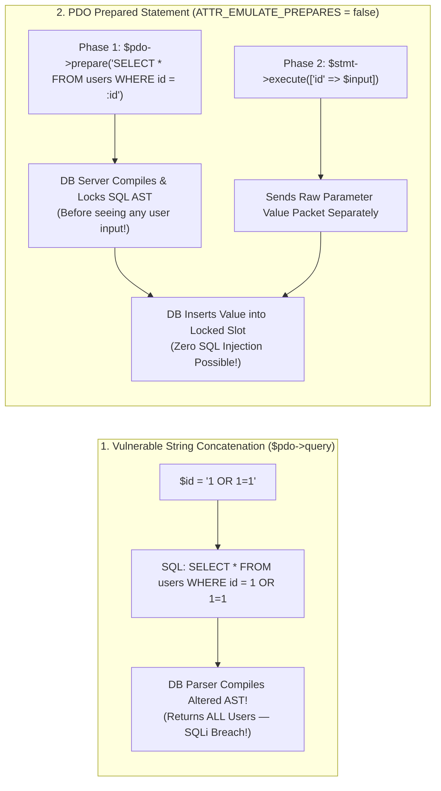

---
tags:
  - php
  - pdo
  - sql-injection
  - transactions
  - caching
---

# Databases with PDO, Transactions & Caching in PHP

#### TL;DR (Quick Revision)

**PHP Database & Caching Layer** = **[PDO (PHP Data Objects)](https://www.php.net/manual/en/book.pdo.php)**—a unified, C-backed database abstraction interface supporting MySQL, PostgreSQL, and SQLite via **DSN (Data Source Name)** strings[cite: 1], using **true server-side Prepared Statements** (`:named` or `?` placeholders with `ATTR_EMULATE_PREPARES => false`) to eliminate SQL Injection[cite: 1], **ACID Transactions (`beginTransaction` / `commit` / `rollBack`)**[cite: 1], **PHP 8.4 Driver-Specific Subclasses (`Pdo\Mysql::connect()`)**, and **Object Caching (APCu / Redis)** from **[PHP: The Right Way](https://phptherightway.com/#databases)**.

> [!abstract] Core Idea
> Historically, PHP had separate procedural extensions for every database (`mysql_*` removed in PHP 7.0, `mysqli_*`, `pg_*`). **[PDO (`PDO` & `PDOStatement`)](https://www.php.net/manual/en/intro.pdo.php)** provides a single consistent OOP API across 12+ database engines. When you execute a **Prepared Statement** (`$pdo->prepare('SELECT * FROM users WHERE email = :email')`), PDO sends the SQL query template and the parameter data in **two separate binary packets** over the wire—making it mathematically impossible for user input inside `:email` to alter the SQL AST or trigger SQL Injection[cite: 1]!

> [!question] Why Master PDO, Transactions & Object Caching?
>
> - **Eliminate SQL Injection by Design**: True prepared statements (`PDO::ATTR_EMULATE_PREPARES => false`) separate SQL code from user data at the database protocol level[cite: 1].
> - **Avoid the MySQL `utf8` 3-Byte Truncation Trap**: In MySQL/MariaDB, `charset=utf8` is a broken 3-byte alias (`utf8mb3`) that crashes or truncates 4-byte UTF-8 emojis (🔥, 🚀)! Always specify **`charset=utf8mb4`** in your PDO DSN ([PHP: The Right Way — UTF-8 at the DB Level](https://phptherightway.com/#utf8_at_the_database_level)).
> - **Understand Why `PDO::ATTR_DEFAULT_FETCH_MODE` Defaults to `FETCH_BOTH`**: Without setting `PDO::ATTR_DEFAULT_FETCH_MODE => PDO::FETCH_ASSOC`, every single fetched row duplicates every column by both string name AND integer index (`['id' => 1, 0 => 1]`), wasting double the RAM!
> - **Master PHP 8.4's New `Pdo\Mysql`, `Pdo\Pgsql`, and `Pdo\Sqlite` Subclasses**: PHP 8.4 replaces messy `PDO::MYSQL_ATTR_*` constants with dedicated driver subclasses via `PDO::connect()` ([PHP 8.4 PDO Subclasses](https://www.php.net/releases/8.4/en.php#pdo_driver_specific_subclasses)).

#### Quick Reference Table: Legacy Database Code vs. Modern PHP 8.4/8.5+ PDO

| Database Operation               | Legacy / Vulnerable PHP                                 | Modern PHP 8.4/8.5+ (The Right Way)                                           | Engine Behavior & Official Docs                                                                                                                                                                                                         |
| :------------------------------- | :------------------------------------------------------ | :---------------------------------------------------------------------------- | :-------------------------------------------------------------------------------------------------------------------------------------------------------------------------------------------------------------------------------------- |
| **Connecting to DB**             | `mysqli_connect(...)`                                   | `new PDO($dsn, $u, $p, $opts)` or `PDO::connect(...)`                         | **[PDO Connections](https://www.php.net/manual/en/pdo.connections.php)** (+ **[PHP 8.4 `PDO::connect()`](https://www.php.net/releases/8.4/en.php#pdo_driver_specific_subclasses)** returning `Pdo\Mysql`, `Pdo\Sqlite`, etc.)[cite: 1]. |
| **Parameterized Query**          | `"SELECT * FROM u WHERE id = " . $_GET['id']` _(SQLi!)_ | `$stmt = $pdo->prepare('... WHERE id = :id'); $stmt->execute(['id' => $id]);` | **[Prepared Statements](https://www.php.net/manual/en/pdo.prepared-statements.php)** send SQL structure and parameter values separately[cite: 1].                                                                                       |
| **Error Handling Mode**          | Manual `if (!$res) die(mysqli_error())`                 | `PDO::ATTR_ERRMODE => PDO::ERRMODE_EXCEPTION`                                 | Default in **PHP 8.0+**: all failed queries automatically throw [`PDOException`](https://www.php.net/manual/en/class.pdoexception.php).                                                                                                 |
| **Default Row Format**           | `FETCH_BOTH` (duplicates keys: `['id' => 1, 0 => 1]`)       | `PDO::ATTR_DEFAULT_FETCH_MODE => PDO::FETCH_ASSOC`                            | Returns clean associative arrays (or map directly to DTOs with `PDO::FETCH_CLASS`)[cite: 1].                                                                                                                                            |
| **Native Types (`int`/`float`)** | Every DB integer returned as PHP `string` `"42"`        | `PDO::ATTR_EMULATE_PREPARES => false` + `ATTR_STRINGIFY_FETCHES => false`     | Native MySQL binary protocol returns `INTEGER` columns as actual PHP `int`s instead of strings!                                                                                                                                         |
| **Dynamic `IN (...)` List**      | `WHERE id IN (:ids)` _(Binds as 1 string!)_             | Generate `?,?,?` via `implode(',', array_fill(0, count($ids), '?'))`          | One placeholder (`?`) can only represent **one scalar value**, never an array of values!                                                                                                                                                |

---

## The Learning Concept

### What Problem Does It Solve?

Three major pitfalls catch developers when querying databases in PHP:

1. **String Interpolation in SQL (SQL Injection)**: Putting `"{$userInput}"` inside a SQL string passed to `$pdo->query()` or `$pdo->exec()` completely bypasses PDO's protection and enables full SQL Injection[cite: 1].
2. **Emulated Prepared Statements & Stringified Integers**: By default, PDO's MySQL driver has `PDO::ATTR_EMULATE_PREPARES` set to **`true`**! Instead of using MySQL's real binary prepared statement protocol, PHP interpolates escaped strings locally and returns every `INT` or `DECIMAL` column from the database as a PHP `string` (`"101"` instead of `101`), breaking strict `===` comparisons!
3. **Partial Writes Without Transactions**: Executing two `UPDATE` statements (e.g., deducting money from Wallet A and adding it to Wallet B) without wrapping them in `$pdo->beginTransaction()` / `$pdo->commit()` / `$pdo->rollBack()` leaves the database corrupted if the second query fails[cite: 1].

Look at this **`// BAD`** PHP snippet demonstrating all three bugs:

```php
<?php
// BAD - Missing charset=utf8mb4, emulated prepares ON, SQL Injection via string interpolation,
// and multi-step balance transfer without a Transaction!

$pdo = new PDO('mysql:host=localhost;dbname=shop', 'root', 'secret');

$searchEmail = $_POST['email']; // Attacker sends: ' OR '1'='1

// BUG 1 (CRITICAL SQL INJECTION): Interpolating variables into $pdo->query()!
$stmt = $pdo->query("SELECT * FROM users WHERE email = '{$searchEmail}'");
// BUG 2: Default fetch mode is FETCH_BOTH, duplicating every column in RAM!
$user = $stmt->fetch();

// BUG 3: No transaction! If the second query crashes, ₹500 disappears into thin air!
$pdo->exec("UPDATE wallets SET balance = balance - 500 WHERE user_id = 1");
$pdo->exec("UPDATE wallets SET balance = balance + 500 WHERE user_id = 2");
```

**Why this fails:** Merely using the `PDO` class does **not** protect you from SQL Injection if you concatenate variables into `$pdo->query()`[cite: 1]! Furthermore, without an atomic transaction, a network drop or constraint violation between the two `UPDATE` statements permanently corrupts user balances.

Now look at the **`// GOOD`** modern **PHP 8.4/8.5 + _PHP: The Right Way_** solution using the **Gold-Standard PDO Connection Factory**, true Prepared Statements, and an ACID Transaction[cite: 1]:

```php
<?php

declare(strict_types=1);

// GOOD - Gold-standard PDO options, true prepared statements (:named placeholders),
// FETCH_ASSOC / FETCH_CLASS, and atomic ACID transaction with rollBack() safety!

// 1. In-memory SQLite DSN for instant runnable demo (For MySQL use: "mysql:host=127.0.0.1;dbname=app;charset=utf8mb4")
$pdo = new PDO(
    dsn:      'sqlite::memory:',
    username: null,
    password: null,
    options:  [
        PDO::ATTR_ERRMODE            => PDO::ERRMODE_EXCEPTION, // Throw PDOException on SQL errors (default in PHP 8+)
        PDO::ATTR_DEFAULT_FETCH_MODE => PDO::FETCH_ASSOC,       // Return clean associative arrays (no index duplication)
        PDO::ATTR_EMULATE_PREPARES   => false,                  // Use REAL DB server-side prepared statements & native int/float types!
        PDO::ATTR_STRINGIFY_FETCHES  => false,                  // Keep DB integers/floats as PHP int/float
    ],
);

// Setup demo schema
$pdo->exec('CREATE TABLE wallets (user_id INTEGER PRIMARY KEY, holder TEXT NOT NULL, balance INTEGER NOT NULL)');
$pdo->exec("INSERT INTO wallets (user_id, holder, balance) VALUES (1, 'Valay', 5000), (2, 'Arushi', 2000)");

// 2. Atomic ACID Transaction Function with Prepared Statements (:named placeholders)
function transferFunds(PDO $pdo, int $fromId, int $toId, int $amount): void
{
    $pdo->beginTransaction();

    try {
        $deductStmt = $pdo->prepare('UPDATE wallets SET balance = balance - :amt WHERE user_id = :id AND balance >= :amt');
        $deductStmt->execute(['amt' => $amount, 'id' => $fromId]);

        // Verify that the sender actually existed and had sufficient funds!
        if ($deductStmt->rowCount() !== 1) {
            throw new RuntimeException('Insufficient balance or sender wallet not found.');
        }

        $creditStmt = $pdo->prepare('UPDATE wallets SET balance = balance + :amt WHERE user_id = :id');
        $creditStmt->execute(['amt' => $amount, 'id' => $toId]);

        if ($creditStmt->rowCount() !== 1) {
            throw new RuntimeException('Recipient wallet not found.');
        }

        $pdo->commit(); // Atomically persists both updates!
    } catch (Throwable $e) {
        if ($pdo->inTransaction()) {
            $pdo->rollBack(); // Reverts the deduction if anything failed!
        }
        throw $e;
    }
}

transferFunds($pdo, fromId: 1, toId: 2, amount: 1500);

// 3. Parameterized SELECT with fetchAll()
$stmt = $pdo->prepare('SELECT user_id, holder, balance FROM wallets WHERE balance >= :minBalance');
$stmt->execute(['minBalance' => 1000]);
$wallets = $stmt->fetchAll();

foreach ($wallets as $w) {
    echo "User #{$w['user_id']} ({$w['holder']}): ₹{$w['balance']} (Type: " . get_debug_type($w['balance']) . ")" . PHP_EOL;
}
```

**Output:**

```
User #1 (Valay): ₹3500 (Type: int)
User #2 (Arushi): ₹3500 (Type: int)
```

---

### How PDO Prepared Statements, Fetch Modes & Caching Work Under the Hood

> [!tip] 4 Core Mechanics of PHP's Database & Caching Architecture
>
> 1. **The 2-Phase Binary Protocol of `ATTR_EMULATE_PREPARES => false`**:
>    When emulation is disabled (`false`) and you call `$stmt = $pdo->prepare('SELECT * FROM users WHERE id = ?')` ([PDO Prepared Statements](https://www.php.net/manual/en/pdo.prepared-statements.php)):
>    - **Phase 1 (`COM_STMT_PREPARE`)**: PHP sends the raw SQL template with `?` placeholders to the MySQL/PostgreSQL server. The DB server parses and compiles the SQL execution plan **before seeing any user data**!
>    - **Phase 2 (`COM_STMT_EXECUTE`)**: When you call `$stmt->execute([$id])`, PHP sends only the raw parameter bytes. Because the query tree is already compiled on the DB server, injected quotes `' OR 1=1 --` are treated strictly as literal data bytes—never executable SQL[cite: 1]!
> 2. **All 5 Essential PDO Fetch Modes ([`PDOStatement::fetch`](https://www.php.net/manual/en/pdostatement.fetch.php))**:
>    - **`PDO::FETCH_ASSOC`**: Returns an associative array `['id' => 1, 'name' => 'Valay']`[cite: 1].
>    - **`PDO::FETCH_OBJ`**: Returns an anonymous `stdClass` object (`$row->id`, `$row->name`).
>    - **`PDO::FETCH_CLASS` / `$stmt->fetchObject(UserDTO::class)`**: Hydrates columns directly into properties of your own typed PHP class!
>    - **`PDO::FETCH_COLUMN`**: Returns a 1D array of a single column (`$stmt->fetchAll(PDO::FETCH_COLUMN, 0)` $\rightarrow$ `[101, 102, 103]`), or combine with [`$stmt->fetchColumn()`](https://www.php.net/manual/en/pdostatement.fetchcolumn.php) for scalar `COUNT(*)` queries!
>    - **`PDO::FETCH_KEY_PAIR`**: Fetches a 2-column query (`SELECT id, username FROM users`) directly into a `key => value` dictionary (`[101 => 'valay', 102 => 'arushi']`) in a single C step!
> 3. **Streaming 1,000,000 DB Rows in $O(1)$ Memory (`while ($row = $stmt->fetch())` vs `fetchAll()`)**:
>    Calling `$stmt->fetchAll()` loads **every matching row** into a single giant PHP array in RAM. For large datasets or exports, iterate over `$stmt` directly using `while (($row = $stmt->fetch()) !== false)` (or `foreach ($stmt as $row)`), which holds only **1 row in memory at a time**!
> 4. **PHP 8.4 Driver-Specific PDO Subclasses ([PHP 8.4 Release Notes](https://www.php.net/releases/8.4/en.php#pdo_driver_specific_subclasses))**:
>    Prior to PHP 8.4, the `PDO` class was cluttered with driver-specific constants and methods like `PDO::MYSQL_ATTR_INIT_COMMAND` or `$pdo->sqliteCreateFunction()`. **PHP 8.4 introduces dedicated subclasses** inside the `Pdo\` namespace (**`Pdo\Mysql`**, **`Pdo\Pgsql`**, **`Pdo\Sqlite`**, **`Pdo\Odbc`**, **`Pdo\Dblib`**, **`Pdo\Firebird`**) instantiated via **`PDO::connect($dsn, $user, $pass, $opts)`** or `new Pdo\Sqlite($dsn)`!

#### Full Runnable Example

Run this script via `php 11_pdo_advanced_php84.php` to see **PHP 8.4's `Pdo\Sqlite` driver subclass (`PDO::connect`)**, **`PDO::FETCH_KEY_PAIR`**, **`PDO::FETCH_GROUP`**, **Hydrating Typed DTO Objects**, and a **Safe Dynamic `IN (?, ?, ?)` Query Builder**[cite: 1]:

```php
<?php

declare(strict_types=1);

// 1. Typed Domain Entity hydrated directly by PDO!
class CourseRecord
{
    public int $id;
    public string $category;
    public string $title;
    public int $price;

    public function badge(): string
    {
        return "[{$this->category}] #{$this->id} {$this->title} (₹{$this->price})";
    }
}

// 2. PHP 8.4+ PDO::connect() automatically returns the driver-specific subclass (Pdo\Sqlite)!
$db = PDO::connect('sqlite::memory:', options: [
    PDO::ATTR_ERRMODE            => PDO::ERRMODE_EXCEPTION,
    PDO::ATTR_DEFAULT_FETCH_MODE => PDO::FETCH_ASSOC,
    PDO::ATTR_EMULATE_PREPARES   => false,
]);

echo "Connected Driver Class (PHP 8.4+): " . $db::class . PHP_EOL; // Pdo\Sqlite

// PHP 8.4 Pdo\Sqlite subclass exposes createFunction() cleanly on the subclass itself!
$db->createFunction('rupees_to_usd', static fn(int $inr): float => round($inr / 84.0, 2));

$db->exec('CREATE TABLE courses (id INTEGER PRIMARY KEY, category TEXT, title TEXT, price INTEGER)');

// 3. Reusing a Prepared Statement inside a transaction for fast batch inserts!
$insertStmt = $db->prepare('INSERT INTO courses (category, title, price) VALUES (:cat, :title, :price)');
$seedData   = [
    ['cat' => 'Security', 'title' => 'HTB XXE & JWT Exploitation', 'price' => 4200],
    ['cat' => 'Backend',  'title' => 'Modern PHP 8.5 Mastery',     'price' => 3360],
    ['cat' => 'Security', 'title' => 'Active Directory Pentesting', 'price' => 5040],
];

$db->beginTransaction();
foreach ($seedData as $row) {
    $insertStmt->execute($row); // Reuses the pre-compiled SQL plan on every iteration!
}
$db->commit();

// 4. Safe Dynamic IN (?, ?, ?) Prepared Statement Pattern
$targetIds    = [1, 3];
$placeholders = implode(',', array_fill(0, count($targetIds), '?')); // Generates "?,?"

$inStmt = $db->prepare("SELECT id, category, title, price FROM courses WHERE id IN ({$placeholders})");
$inStmt->execute($targetIds);

// Hydrate directly into CourseRecord class instances!
$courses = $inStmt->fetchAll(PDO::FETCH_CLASS, CourseRecord::class);
foreach ($courses as $course) {
    echo "Hydrated DTO: " . $course->badge() . PHP_EOL;
}

// 5. Power Fetch Modes: FETCH_KEY_PAIR (id => title dictionary) & Custom SQL Function
$pairStmt = $db->query('SELECT id, title FROM courses');
$idToTitleMap = $pairStmt->fetchAll(PDO::FETCH_KEY_PAIR);
var_dump($idToTitleMap);

$usdStmt = $db->query('SELECT title, rupees_to_usd(price) AS price_usd FROM courses WHERE id = 2');
var_dump($usdStmt->fetch());
```

**Output:**

```
Connected Driver Class (PHP 8.4+): Pdo\Sqlite
Hydrated DTO: [Security] #1 HTB XXE & JWT Exploitation (₹4200)
Hydrated DTO: [Security] #3 Active Directory Pentesting (₹5040)
array(3) {
  [1]=>
  string(26) "HTB XXE & JWT Exploitation"
  [2]=>
  string(22) "Modern PHP 8.5 Mastery"
  [3]=>
  string(27) "Active Directory Pentesting"
}
array(2) {
  ["title"]=>
  string(22) "Modern PHP 8.5 Mastery"
  ["price_usd"]=>
  float(40)
}
```

---

### Visual Diagram: True Server-Side Prepared Statements vs. SQL Injection



---

### Key Terminology (Syntax Decoder)

1. **DSN (Data Source Name) & `charset=utf8mb4` ([PDO Connections](https://www.php.net/manual/en/pdo.connections.php))**:
   The connection string identifying the PDO driver, host, port, database name, and character encoding[cite: 1]:
   - **MySQL / MariaDB**: `'mysql:host=127.0.0.1;port=3306;dbname=bookbuddy;charset=utf8mb4'`
   - **PostgreSQL**: `'pgsql:host=127.0.0.1;port=5432;dbname=bookbuddy'`
   - **SQLite**: `'sqlite:/path/to/database.sqlite'` or `'sqlite::memory:'`
     _(Pro Tip: Use `127.0.0.1` instead of `localhost` in MySQL DSNs when connecting to Docker containers over TCP, because `localhost` tells the MySQL C driver to look for a local Unix domain socket `/var/run/mysqld/mysqld.sock` instead of TCP port `3306`!)._

2. **Named Placeholders (`:name`) vs. Positional Placeholders (`?`)**:
   - **Named (`:email`, `:status`)**: Self-documenting; passed as an associative array to `$stmt->execute(['email' => $e, 'status' => $s])` (the leading colon `:` in the array keys is optional in `execute()`!)[cite: 1].
   - **Positional (`?`)**: Compact and essential for dynamic `IN (?, ?, ?)` lists; passed as a 0-indexed list array `$stmt->execute([$val1, $val2])` (or bound 1-indexed via `$stmt->bindValue(1, $val1)`)[cite: 1].
   - **Rule**: You **cannot mix** `:named` and `?` placeholders in the same query!

3. **[`bindValue()`](https://www.php.net/manual/en/pdostatement.bindvalue.php) vs. [`bindParam()`](https://www.php.net/manual/en/pdostatement.bindparam.php) vs. [`execute([...])`](https://www.php.net/manual/en/pdostatement.execute.php)**:
   - **`$stmt->execute(['id' => $id])`**: Binds all values as strings (`PDO::PARAM_STR`) by default (unless `ATTR_EMULATE_PREPARES => false` is set, where the driver infers types or sends values safely).
   - **`$stmt->bindValue(':limit', $limit, PDO::PARAM_INT)`**: Binds the **immediate value** of `$limit` with an explicit PDO data type (`PDO::PARAM_INT`, `PDO::PARAM_BOOL`, `PDO::PARAM_NULL`, `PDO::PARAM_STR`, `PDO::PARAM_LOB`).
   - **`$stmt->bindParam(':limit', $limit, PDO::PARAM_INT)`**: Binds `$limit` **by reference (`&$limit`)** and only reads the variable's value at the moment `$stmt->execute()` is called! _(Avoid `bindParam()` inside loops as its by-reference behavior causes unexpected bugs; prefer `execute([...])` or `bindValue()`!)._
     Syntax: `$stmt->bindValue(':limit', 20, PDO::PARAM_INT);`

4. **[`$pdo->lastInsertId()`](https://www.php.net/manual/en/pdo.lastinsertid.php) & [`$stmt->rowCount()`](https://www.php.net/manual/en/pdostatement.rowcount.php)**:
   - `$pdo->lastInsertId()`: Returns the auto-incremented ID (`string`) of the last row inserted on that connection during the current session.
   - `$stmt->rowCount()`: Returns the exact number of rows affected by an `INSERT`, `UPDATE`, or `DELETE` statement. _(Warning: Never rely on `$stmt->rowCount()` for `SELECT` queries, as many SQL drivers do not return a `SELECT` count until all rows are fetched; use `SELECT COUNT(*)` with `$stmt->fetchColumn()` instead!)._

> [!important] Key Rules to Remember
>
> - **Placeholders (`:col` or `?`) Can ONLY Represent Data Values, NEVER Identifiers!** → You **cannot** use a prepared statement placeholder for a **table name**, **column name**, or **`ORDER BY` direction (`ASC`/`DESC`)** (`ORDER BY :col :dir` will sort by a constant string literal and do nothing!). Always validate dynamic column names and `ASC`/`DESC` against a strict **`match ()` allowlist** before interpolating them!
> - **Re-Using the Same Named Placeholder Twice (`WHERE a = :q OR b = :q`)** → When `PDO::ATTR_EMULATE_PREPARES => false` is active, repeating the exact same placeholder name `:q` twice in one SQL query throws `SQLSTATE[HY093]: Invalid parameter number` on several drivers! Always use distinct placeholder names (`WHERE a = :q1 OR b = :q2`).
> - **MySQL `DDL` Statements (`CREATE`, `ALTER`, `DROP`, `TRUNCATE`) Implicitly Commit Active Transactions!** → In MySQL/MariaDB (unlike PostgreSQL or SQLite), running a schema statement like `CREATE TABLE` or `TRUNCATE TABLE` in the middle of `$pdo->beginTransaction()` forces an **immediate implicit commit** of the transaction, and a subsequent `$pdo->rollBack()` will throw `PDOException: There is no active transaction` ([PHP `PDO::beginTransaction` Notes](https://www.php.net/manual/en/pdo.begintransaction.php))!

---

## Edge Case Analysis (Traps & Security Gotchas)

### 1. Second-Order SQL Injection via Dynamic `ORDER BY` Column & Direction

- **Problem**: Because PDO placeholders (`?` / `:col`) only work for literal data values (strings/numbers), developers who need dynamic sorting (`?sort=price&dir=DESC`) often fall back to interpolating `$_GET['sort']` into `"SELECT * FROM products ORDER BY " . $_GET['sort']`. That immediately re-opens **SQL Injection** (`?sort=(SELECT password FROM users LIMIT 1)`)!
- **Fix**: Pass any dynamic table name, column name, or sort direction (`ASC`/`DESC`) through a strict **`match` expression allowlist** of hardcoded strings!

```php
<?php

declare(strict_types=1);

function getSortedProducts(PDO $pdo, string $rawSortCol, string $rawSortDir, string $category): array
{
    // GOOD - Strict match() allowlist for SQL identifiers (Column names & ASC/DESC keywords)
    $orderColumn = match ($rawSortCol) {
        'price'      => 'price',
        'created_at' => 'created_at',
        default      => 'id',
    };

    $orderDirection = match (strtoupper($rawSortDir)) {
        'DESC'  => 'DESC',
        default => 'ASC',
    };

    // Safe: $orderColumn and $orderDirection can ONLY be our hardcoded strings above,
    // while user data ($category) is bound via a prepared statement placeholder (:category)!
    $sql  = "SELECT id, title, price FROM products WHERE category = :category ORDER BY {$orderColumn} {$orderDirection}";
    $stmt = $pdo->prepare($sql);
    $stmt->execute(['category' => $category]);

    return $stmt->fetchAll();
}
```

### 2. The `LIKE %...%` Wildcard Injection & Binding Trap

- **Problem**: Two mistakes happen with `LIKE` queries in PDO:
  1. Writing `WHERE title LIKE '%:search%'` inside quotes in SQL—PDO treats `'%:search%'` as a literal string `'%' + ':search' + '%'` and **does not recognize `:search` as a placeholder**! You must write `WHERE title LIKE :search` and add the `%` signs in PHP (`'%' . $search . '%'`).
  2. If a user searches for `"100%"` or `"admin_1"`, `%` and `_` are SQL `LIKE` wildcards! Without escaping `%` and `_` inside the user's search term, an attacker can pass `"%%%"` to trigger expensive full-table regex scans (DoS) or enumerate records character-by-character with `_`!
- **Fix**: Escape literal `\`, `%`, and `_` in the user's search string using `addcslashes($input, '\\%_')`, then wrap it in `'%' . $escaped . '%'` and use `LIKE :search ESCAPE '\\'`!

```php
<?php

declare(strict_types=1);

function buildSafeLikePattern(string $rawSearch): string
{
    // Escape literal \, %, and _ characters in the user's input so they aren't treated as SQL wildcards!
    $escaped = addcslashes($rawSearch, '\\%_');
    return "%{$escaped}%";
}

var_dump(buildSafeLikePattern('50%_off')); // string(11) "%50\%\_off%"
// Use in SQL as: WHERE promo_code LIKE :pattern ESCAPE '\'
```

### 3. The `LIMIT :limit OFFSET :offset` Emulated-Prepare String Trap

- **Problem**: If `PDO::ATTR_EMULATE_PREPARES` is left at its default `true` in MySQL and you call `$stmt->execute(['limit' => 10])` on `SELECT * FROM posts LIMIT :limit`, PDO binds `10` as a **quoted string** (`LIMIT '10'`), causing MySQL to throw a syntax error!
- **Fix**:
  1. Always set **`PDO::ATTR_EMULATE_PREPARES => false`** in your PDO connection options (so native integer types are preserved), OR
  2. Bind `:limit` and `:offset` explicitly with **`$stmt->bindValue(':limit', (int) $limit, PDO::PARAM_INT);`**.

### 4. Connection Credentials Leaking in Stack Traces

- **Problem**: If your database server is temporarily down when `new PDO($dsn, $user, $password)` runs, `PDO::__construct()` throws a `PDOException`. If your exception logger or an accidental error display dumps the stack trace arguments of `PDO::__construct()`, your plaintext database `$password` can be exposed! _(Note: PHP 8.2+ added `#[\SensitiveParameter]` to internal `PDO::__construct`'s `$password` parameter, but wrapping connection failures in a clean domain exception or redacting DSN passwords in custom wrappers remains critical)._

---

## Going Deeper (Intermediate -> Advanced & _PHP: The Right Way_ Integration)

### 1. _PHP: The Right Way_ — Object Caching (APCu & Redis / PSR-6 / PSR-16)

As detailed in **[PHP: The Right Way — Caching (Object Caching)](https://phptherightway.com/#caching)**, even a well-indexed PDO query takes `1–10 ms` over a network socket. For frequently read data (configuration, user permissions, leaderboards, rate-limit counters), modern PHP uses a **2-Tier Caching Strategy** standardized by **[PSR-16 (`Psr\SimpleCache\CacheInterface`)](https://www.php-fig.org/psr/psr-16/)** and **[PSR-6](https://www.php-fig.org/psr/psr-6/)**:

1. **Tier 1 — [APCu (`apcu_fetch` / `apcu_store`)](https://www.php.net/manual/en/book.apcu.php)**:
   In-memory userland key-value cache stored directly inside the **shared RAM of your local PHP-FPM master process**! Reading from APCu takes nanoseconds (zero network I/O, zero serialization overhead for scalars/arrays), making it ideal for single-server caches and local metadata.
2. **Tier 2 — Redis (`ext-redis` / `Predis`)**:
   Networked in-memory data store shared across multiple load-balanced PHP application servers for distributed cache-aside queries, session storage, and job queues.

```php
<?php

declare(strict_types=1);

/**
 * The Standard "Cache-Aside" (Remember) Pattern in Modern PHP:
 * Checks cache first; on miss, runs the PDO query Closure and stores the result with a TTL!
 */
function cacheRemember(string $key, int $ttlSeconds, Closure $databaseQuery): mixed
{
    // If APCu extension is loaded, check shared memory first:
    if (function_exists('apcu_fetch')) {
        $success = false;
        $cached  = apcu_fetch($key, $success);
        if ($success) {
            return $cached;
        }
    }

    // Cache Miss: Execute the PDO query Closure
    $freshData = $databaseQuery();

    if (function_exists('apcu_store')) {
        apcu_store($key, $freshData, $ttlSeconds);
    }

    return $freshData;
}
```

### 2. _PHP: The Right Way_ — Query Builders & ORMs (DataMapper vs. ActiveRecord)

As explained in **[PHP: The Right Way — Databases (Abstraction Layers)](https://phptherightway.com/#database_abstraction_layers)**, every major PHP ORM and Query Builder sits directly on top of **PDO**:

1. **ActiveRecord Pattern (Laravel Eloquent)**:
   Each model class (`class User extends Model`) wraps a database row and knows how to save itself (`$user->save()`), running PDO prepared statements under the hood. Fast to write and intuitive for CRUD apps.
2. **DataMapper Pattern (Doctrine ORM — Default in Symfony)**:
   Your domain entities (`class User`) are 100% pure PHP classes that know nothing about the database (`extends` nothing!). A separate `EntityManager` maps `User` objects to and from PostgreSQL/MySQL tables via PDO and Reflection.

---

## Interview Corner

### Common Questions & Concise Answers

**Q1: How do PDO Prepared Statements prevent SQL Injection at the protocol level?**
**A:** When `PDO::ATTR_EMULATE_PREPARES => false` is set, `$pdo->prepare()` sends the SQL statement structure (with `?` or `:named` placeholders) to the database server first, where the DB compiles and locks the SQL execution plan (AST)[cite: 1]. When `$stmt->execute($params)` runs, the parameter values are sent in a separate data packet and inserted directly into the pre-compiled parameter slots—so user input can never be interpreted as SQL syntax[cite: 1].

**Q2: Why should you always set `PDO::ATTR_EMULATE_PREPARES => false` and `charset=utf8mb4` when connecting to MySQL with PDO?**
**A:**

1. **`ATTR_EMULATE_PREPARES => false`**: Disables PHP-side string interpolation of prepared statements, forcing PDO to use MySQL's real binary prepared statement protocol (which also returns database `INT` and `FLOAT` columns as native PHP `int` and `float` types rather than strings!).
2. **`charset=utf8mb4`**: MySQL's legacy `utf8` charset (`utf8mb3`) only supports up to 3 bytes per character and fails on 4-byte Unicode characters (like emojis or mathematical symbols); `utf8mb4` supports full 4-byte UTF-8 ([PHP: The Right Way — UTF-8](https://phptherightway.com/#utf8_at_the_database_level)).

**Q3: Why can't you bind an array to a single placeholder in `WHERE id IN (:ids)`, and how do you execute a safe `IN (...)` query with PDO?**
**A:** A PDO placeholder (`:id` or `?`) can only represent a single scalar value (`bind`ing `'1,2,3'` to `WHERE id IN (?)` executes `WHERE id IN ('1,2,3')`, comparing against a single string!). To bind an array of $N$ elements safely, dynamically generate $N$ positional placeholders (`$in = implode(',', array_fill(0, count($ids), '?'));`), prepare `"SELECT * FROM table WHERE id IN ({$in})"`, and pass `array_values($ids)` into `$stmt->execute()`.

**Q4: Why can't you use a PDO placeholder for a table name or `ORDER BY :column` clause?**
**A:** Database engines require table and column identifiers to be known during Phase 1 (`PREPARE`) so the query optimizer can verify schema permissions and select indexes. If you bind `:column` as a parameter, the database treats it as a constant string literal (e.g., `ORDER BY 'price'`), which has zero sorting effect. Dynamic identifiers must be validated against an explicit PHP `match` allowlist before query preparation.

**Q5: What happens in MySQL if you execute a `CREATE TABLE` or `TRUNCATE TABLE` statement inside a `PDO` transaction (`$pdo->beginTransaction()`)?**
**A:** Unlike PostgreSQL or SQLite (which support transactional DDL), MySQL/MariaDB automatically performs an **implicit commit** whenever a DDL statement (`CREATE`, `ALTER`, `DROP`, `TRUNCATE`) runs! Because the transaction is already implicitly ended by MySQL, calling `$pdo->rollBack()` later in a `catch` block will throw a `PDOException` (`There is no active transaction`) unless guarded with `if ($pdo->inTransaction())` ([PHP Manual: `PDO::beginTransaction`](https://www.php.net/manual/en/pdo.begintransaction.php)).

---

### Interactive Revision Quiz

**Q1: Which PDO fetch mode turns a 2-column query (`SELECT code, country_name FROM countries`) directly into a single flat associative array (`['IN' => 'India', 'JP' => 'Japan']`)?**

- [ ] A) `PDO::FETCH_ASSOC`
- [ ] B) `PDO::FETCH_BOTH`
- [ ] C) `PDO::FETCH_KEY_PAIR`
- [ ] D) `PDO::FETCH_COLUMN`

**Q2: What happens if you leave `PDO::ATTR_DEFAULT_FETCH_MODE` at its default setting (`PDO::FETCH_BOTH`) when calling `$stmt->fetch()`?**

- [ ] A) It returns both an array and an object simultaneously.
- [ ] B) It returns an array where every single column value is duplicated under both its column name key AND its 0-indexed integer position (`['name' => 'Valay', 0 => 'Valay']`), doubling array memory usage!
- [ ] C) It throws a `PDOException`.
- [ ] D) It fetches both the current row and the next row.

**Q3: Why is the following PDO code STILL vulnerable to SQL Injection?**

```php
$stmt = $pdo->prepare("SELECT * FROM users WHERE role = '{$_GET['role']}'");
$stmt->execute();
```

- [ ] A) Because `prepare()` does not work on `SELECT` queries.
- [ ] B) Because `$_GET['role']` was interpolated directly into the SQL string passed to `prepare()` instead of using a `:role` or `?` placeholder!
- [ ] C) Because `fetchAll()` was not called.
- [ ] D) Because SQLite does not support prepared statements.

**Q4: When processing 500,000 rows from a database report in PHP, why should you use `while (($row = $stmt->fetch()) !== false)` instead of `foreach ($stmt->fetchAll() as $row)`?**

- [ ] A) `fetchAll()` only returns a maximum of 1,000 rows in PDO.
- [ ] B) `fetchAll()` loads all 500,000 rows into a single PHP array in RAM at once (risking an Out-Of-Memory fatal error), whereas `while ($row = $stmt->fetch())` streams one row at a time in constant memory.
- [ ] C) `fetch()` automatically caches results in Redis.
- [ ] D) `fetchAll()` disables prepared statement security.

**Q5: What did PHP 8.4 introduce with `PDO::connect($dsn, $user, $pass, $options)`?**

- [ ] A) It removed support for SQLite.
- [ ] B) It returns driver-specific `PDO` subclasses (`Pdo\Mysql`, `Pdo\Pgsql`, `Pdo\Sqlite`, etc.) that expose clean driver-specific methods and constants without polluting the base `PDO` class.
- [ ] C) It automatically runs migrations on connection.
- [ ] D) It makes all queries asynchronous without fibers.

<details>
<summary>Show Quiz Answers & Explanations</summary>

1. **C** — `PDO::FETCH_KEY_PAIR` maps column 1 as the array key and column 2 as the array value across all returned rows ([`PDOStatement::fetchAll` Docs](https://www.php.net/manual/en/pdostatement.fetchall.php)).
2. **B** — PDO defaults to `PDO::FETCH_BOTH`, which populates both associative string keys and numeric index keys for every column in every row. Always set `PDO::ATTR_DEFAULT_FETCH_MODE => PDO::FETCH_ASSOC`[cite: 1].
3. **B** — Calling `$pdo->prepare()` provides zero SQL Injection protection if you interpolate variables directly into the SQL string instead of binding them via `:named` or `?` placeholders[cite: 1]!
4. **B** — `$stmt->fetch()` retrieves one row at a time from the statement cursor ($O(1)$ PHP array memory), whereas `$stmt->fetchAll()` allocates a 500,000-element array in memory immediately.
5. **B** — **[PHP 8.4](https://www.php.net/releases/8.4/en.php#pdo_driver_specific_subclasses)** introduced `PDO::connect()` and the `Pdo\Mysql`, `Pdo\Pgsql`, `Pdo\Sqlite`, `Pdo\Odbc`, `Pdo\Dblib`, and `Pdo\Firebird` driver subclasses.

</details>

---

## Practice Exercises

### Exercise 1: Basic — Gold-Standard PDO Repository Class

Write a `final readonly class UserRepository` that takes `private PDO $pdo` via Constructor Property Promotion[cite: 1]. Implement:

1. `findById(int $id): ?array` using a prepared statement with `:id` and `$stmt->fetch() ?: null`.
2. `countActiveUsers(): int` using `SELECT COUNT(*) FROM users WHERE is_active = 1` and `(int) $stmt->fetchColumn()`.
3. `createUser(string $username, string $email): int` using an `INSERT` prepared statement and returning `(int) $this->pdo->lastInsertId()`.

### Exercise 2: Intermediate — Safe Dynamic Multi-Filter & `IN (...)` Query

Write a function `findOrdersByStatusesAndSort(PDO $pdo, array $statuses, string $sortBy): array` that:

1. Throws an `InvalidArgumentException` if `$statuses` is empty (`$statuses === []`).
2. Validates `$sortBy` via a `match` expression allowing only `'created_at'` or `'total_amount'` (defaulting to `'id'`).
3. Builds positional `?` placeholders for `WHERE status IN (?, ?, ...)` and executes the query safely with `array_values($statuses)`.

### Exercise 3: Transaction + Caching Pattern — Atomic Stock Checkout

Write a function `purchaseItem(PDO $pdo, int $itemId, int $quantity): bool` that wraps an inventory deduction (`UPDATE inventory SET stock = stock - :qty WHERE item_id = :id AND stock >= :qty`) and an order creation (`INSERT INTO orders ...`) inside `$pdo->beginTransaction()`. If `$updateStmt->rowCount() === 0`, throw an `OutOfStockException` and ensure `$pdo->rollBack()` runs inside the `catch (Throwable $e)` block if `$pdo->inTransaction()` is `true`[cite: 1].

---

## Memory Trick / One-Liner

> [!tip] The "Prepare the Data, Match the Columns, Disable Emulation, Guard Rollback" Rule
>
> - Passing user values (`WHERE`, `VALUES`)? **Prepared Statement (`:named` or `?`)**[cite: 1]!
> - Passing dynamic column names or `ASC`/`DESC`? **Strict `match ()` Allowlist**, never placeholders or raw input!
> - Connecting to MySQL? **`charset=utf8mb4` + `ATTR_EMULATE_PREPARES => false` + `ATTR_DEFAULT_FETCH_MODE => FETCH_ASSOC`**!
> - Rolling back in a `catch` block? Check **`if ($pdo->inTransaction()) { $pdo->rollBack(); }`**!
>   **Takeaway Formula:** **`PDO::connect()` + `ATTR_EMULATE_PREPARES => false` + Prepared Placeholders + `match` Identifier Allowlist + ACID Transactions = Zero-SQLi Database Layer.**

---

## Warning Block (Best Practice)

> [!warning] Common Mistake (Avoid This!)
>
> ```php
> <?php
> // BAD - Interpolating variables inside prepare(), binding an array to a single placeholder,
> // and calling rollBack() without checking inTransaction()!
> try {
>     $pdo->beginTransaction();
>     $ids = [1, 2, 3];
>
>     // BUG 1: :ids cannot bind an array!
>     // BUG 2: $_GET['order'] interpolated directly = SQL Injection!
>     $stmt = $pdo->prepare("SELECT * FROM items WHERE id IN (:ids) ORDER BY {$_GET['order']}");
>     $stmt->execute(['ids' => $ids]); // Throws Array to string conversion TypeError / Warning!
>
>     $pdo->commit();
> } catch (Throwable $e) {
>     $pdo->rollBack(); // BUG 3: Throws secondary PDOException if transaction already auto-committed!
> }
> ```
>
> ```php
> <?php
>
> declare(strict_types=1);
>
> // GOOD - Dynamic ? placeholder expansion for IN (...), strict match() allowlist for ORDER BY,
> // and safe inTransaction() check before rollBack()!
> try {
>     $pdo->beginTransaction();
>
>     $ids          = [1, 2, 3];
>     $placeholders = implode(',', array_fill(0, count($ids), '?'));
>     $orderCol     = match ($_GET['order'] ?? '') {
>         'price' => 'price',
>         'name'  => 'name',
>         default => 'id',
>     };
>
>     $stmt = $pdo->prepare("SELECT id, name, price FROM items WHERE id IN ({$placeholders}) ORDER BY {$orderCol} ASC");
>     $stmt->execute(array_values($ids));
>
>     $pdo->commit();
> } catch (Throwable $e) {
>     if ($pdo->inTransaction()) {
>         $pdo->rollBack();
>     }
>     throw $e;
> }
> ```
