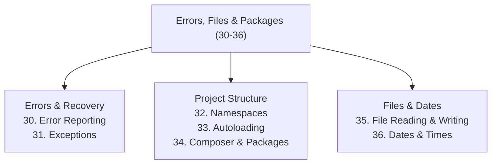

---
tags:
  - php
  - overview
  - beginner
---

# Overview: Errors, Files & Packages

## TL;DR

This folder covers how PHP reports and catches errors, organizes code across files with **namespace**s and **Composer**, reads and writes files safely, and handles dates without accidental mutation.

> [!NOTE] Prerequisites: 30, 31, 32, 33, 34, 35, 36
> New terms: None (all terms introduced in notes 30 through 36)

> [!abstract] Core Idea
> Catch `Exception` and `Throwable` cleanly, organize classes into **PSR-4** **namespace**s loaded by **Composer**, lock disk writes with `LOCK_EX`, and use `DateTimeImmutable` for dates.
> Like Python's `try`/`except`, `pip`, `Path.write_text()`, and `datetime`, PHP uses `try`/`catch`, Composer (`vendor/autoload.php`), `file_put_contents()`, and `DateTimeImmutable`.

## Concept Map

## Folder Cheat Sheet

| Note                              | Core Syntax / Tool                                      | Key Rule to Remember                                                                                  |
| --------------------------------- | ------------------------------------------------------- | ----------------------------------------------------------------------------------------------------- |
| `30. Error Reporting & Debugging` | `error_reporting(E_ALL)`, `var_dump()`, `print_r()`     | Keep `display_errors` on in dev and `'0'` in production                                               |
| `31. Exceptions`                  | `try`, `catch`, `finally`, `throw`, `Throwable`         | `catch (Exception)` misses `Error` (`ValueError`, `TypeError`); custom exceptions `extends Exception` |
| `32. Namespaces`                  | `namespace`, `use`, `as`, `\`                           | `namespace` must be first; prefix global classes with `\` or `use`                                    |
| `33. Autoloading`                 | `spl_autoload_register()`, **PSR-4**                    | Autoloaders load classes/interfaces/traits/enums only—not standalone functions                        |
| `34. Composer & Packages`         | `composer.json`, `composer.lock`, `vendor/autoload.php` | Commit `composer.json` + `composer.lock`; run `composer install` on servers                           |
| `35. File Reading & Writing`      | `file_get_contents()`, `file_put_contents()`, `LOCK_EX` | Pass `FILE_APPEND \| LOCK_EX` to append; never pass raw user paths                                    |
| `36. Dates & Times`               | `DateTimeImmutable`, `DateTimeZone`, `->modify()`       | Always save the new object returned by `->modify()`                                                   |

## Boss Quiz

**Q1: Why does `catch (Exception $e)` miss a `ValueError` thrown by `explode('', 'Dune')`?**

- [ ] A) `ValueError` cannot be caught
- [ ] B) `ValueError` extends `Error`, not `Exception` (use `catch (ValueError $e)` or `catch (Throwable $e)`)
- [ ] C) `explode()` never throws exceptions
- [ ] D) You must enable `E_ALL` first

**Q2: Inside `namespace BookTracker\App;`, what happens if you write `throw new Exception('Oops');` without `use Exception;`?**

- [ ] A) It throws `\Exception` from the global namespace
- [ ] B) PHP looks for `BookTracker\App\Exception` and fails with class not found
- [ ] C) It prints a warning and continues
- [ ] D) PHP creates `BookTracker\App\Exception` automatically

**Q3: Which item should you `require` once at the top of your entry script to load Composer dependencies and PSR-4 classes?**

- [ ] A) `composer.json`
- [ ] B) `composer.lock`
- [ ] C) `vendor/autoload.php`
- [ ] D) `src/autoload.php`

**Q4: What happens when you call `file_put_contents('tracker.log', "Line 2\n")` without `FILE_APPEND`?**

- [ ] A) It appends `"Line 2\n"` at the end
- [ ] B) It overwrites and erases the previous contents of `tracker.log`
- [ ] C) It throws a `ValueError`
- [ ] D) It creates a second file named `tracker.log.1`

**Q5: After `$d = new DateTimeImmutable('2026-11-22'); $d->modify('+7 days');`, what does `$d->format('Y-m-d')` output?**

- [ ] A) `'2026-11-29'`
- [ ] B) `'2026-11-22'`
- [ ] C) `null`
- [ ] D) `'2026-11-15'`

**Q6: Which statement about `spl_autoload_register()` is true?**

- [ ] A) It automatically loads standalone functions defined outside classes
- [ ] B) It triggers only when an unloaded class, interface, trait, or enum is referenced
- [ ] C) You can only register one autoloader per script
- [ ] D) It requires `vendor/` to exist

◈ View Answers & Explanations

1. **B** - Both `Exception` and `Error` implement **Throwable**, and `ValueError` extends `Error` rather than `Exception`. A, C, and D are false.

2. **B** - Unqualified class names inside a namespace resolve relative to the current namespace (`BookTracker\App\Exception`), so you need `use Exception;` or `\Exception`. A, C, and D are false.

3. **C** - Composer builds `vendor/autoload.php` to autoload all installed packages and your configured **PSR-4** namespaces. A, B, and D are wrong.

4. **B** - `file_put_contents()` overwrites the existing file unless `FILE_APPEND` is passed. A, C, and D are false.

5. **B** - Because `DateTimeImmutable` is **immutable**, calling `->modify()` without assigning its return value leaves `$d` unchanged at `'2026-11-22'`. A, C, and D are false.

6. **B** - PHP's autoloader queue runs on demand for class-like symbols (classes, interfaces, traits, enums), never standalone functions (A). Multiple autoloaders can be registered (C), and Composer is optional (D).

> [!quote] Sources
>
> - [Throwable errors - PHP Manual](https://www.php.net/manual/en/language.error-handling.throwable.php)
> - [Basic usage - Composer](https://getcomposer.org/doc/01-basic-usage.md)
> - [DateTimeImmutable - PHP Manual](https://www.php.net/manual/en/class.datetimeimmutable.php)
