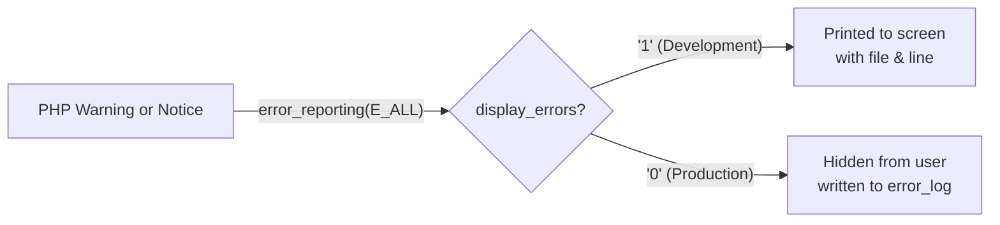

---
tags:
  - php
  - debugging
  - beginner
---

# Error Reporting & Debugging

## TL;DR

Silent failures are the hardest bugs to fix. By turning on full error reporting during development and inspecting live values with `var_dump()` or `print_r()`, you can see exactly what your Book Tracker is doing before a bug ships.

> [!NOTE] Prerequisites: 01, 03
> New terms: error level, stack trace

> [!abstract] Core Idea
> Enable `error_reporting(E_ALL)` and `display_errors` in development so PHP reports every warning, and inspect arrays or objects with `var_dump()` or `print_r()`.
> Unlike Python's automatic tracebacks, PHP lets you configure which **error level**s are reported and whether they print on screen or go to a log file.

## Mental Model

Think of error reporting like a smoke alarm and a flashlight. `error_reporting(E_ALL)` sets the smoke alarm to maximum sensitivity so even small warnings ring; `display_errors` decides whether the alarm flashes on screen (dev) or writes quietly to a logbook (production), while `var_dump()` is your flashlight for inspecting variables.



- An **error level** (such as `E_ALL`, `E_WARNING`, or `E_DEPRECATED`) controls which categories of problems PHP reports.
- A **stack trace** is the list of function calls that were active when an error happened, showing the file and line number for each step.

## Minimal Example

```php
<?php
error_reporting(E_ALL);
ini_set('display_errors', '1');

$book = ['title' => 'Dune', 'pages' => 412];
print_r($book);
var_dump($book);
```

Expected output:

```text
Array
(
    [title] => Dune
    [pages] => 412
)
array(2) {
  ["title"]=>
  string(4) "Dune"
  ["pages"]=>
  int(412)
}
```

- `error_reporting(E_ALL)` tells PHP to report all errors, warnings, and deprecation notices for the current script.
- `ini_set('display_errors', '1')` turns on screen error output at runtime for debugging.
- `print_r($book)` prints a clean, human-readable view of arrays and objects without type details.
- `var_dump($book)` prints exact types and lengths (`string(4)`, `int(412)`), making `null`, `false`, and `""` easy to tell apart.

> [!warning] Security angle
> Always set `display_errors` to `'0'` (`Off`) on a live production server and enable `log_errors` instead. Printed error messages and **stack trace**s can expose server file paths and configuration details to visitors.

## Compare

| Tool                     | Best For                              | Shows Types & Lengths? | Safe on Live Site?              |
| ------------------------ | ------------------------------------- | ---------------------- | ------------------------------- |
| `var_dump($x)`           | Checking exact types (`null` vs `""`) | ✓                      | ✗ (dev only)                    |
| `print_r($x)`            | Quick readable array/object layout    | ✗                      | ✗ (dev only)                    |
| `error_reporting(E_ALL)` | Catching warnings & deprecations      | Not applicable         | ✓ (with `display_errors = '0'`) |

## ◈ Edge Case Analysis

✗ **Mistake 1:** Putting `ini_set('display_errors', '1');` at the top of a file that has a syntax error still produces a blank page if `php.ini` has `display_errors = Off`.

```php
<?php
ini_set('display_errors', '1');
echo 'Dune' // Missing semicolon: whole file fails to parse before ini_set() runs
```

✓ **Fix:** Turn `display_errors = On` and `error_reporting = E_ALL` directly in your local `php.ini` file for development.

```text
; In local development php.ini:
error_reporting = E_ALL
display_errors = On
```

✗ **Mistake 2:** Using `echo` to inspect an array fails with an `Array to string conversion` warning and prints the word `Array` instead of your data.

```php
$book = ['title' => 'Dune'];
echo $book; // Warning: Array to string conversion
```

✓ **Fix:** Use `print_r($book)` for readable layout or `var_dump($book)` when you need exact types.

```php
var_dump($book);
```

✗ **Mistake 3:** Leaving `display_errors` turned on in production exposes internal file paths to every user who triggers a warning.

```php
ini_set('display_errors', '1'); // Unsafe on a public server
```

✓ **Fix:** Keep `display_errors` off in production and check your server's `error_log` instead.

```php
ini_set('display_errors', '0');
```

## Try It

1. Run `var_dump()` on `['0', 0, false, null]` to see how PHP labels each type and value.
2. Check your current error reporting level by calling `echo error_reporting() . PHP_EOL;` and compare it with `echo E_ALL . PHP_EOL;`.

<details>
<summary>◈ View Solution</summary>

1. Inspecting look-alike values with `var_dump()`:

```php
<?php
$values = ['0', 0, false, null];
var_dump($values);
```

2. Comparing current `error_reporting()` with `E_ALL`:

```php
<?php
error_reporting(E_ALL);
echo error_reporting() . ' === ' . E_ALL . PHP_EOL;
```

</details>

## Topic Mastery Quiz

**Q1: Which `error_reporting()` constant tells PHP to report all error, warning, and deprecation levels?**

- [ ] A) `E_NONE`
- [ ] B) `E_ALL`
- [ ] C) `E_DEBUG`
- [ ] D) `E_STRICT_ALL`

**Q2: Which debugging function shows exact data types and string lengths like `string(4) "Dune"`?**

- [ ] A) `echo`
- [ ] B) `print_r()`
- [ ] C) `var_dump()`
- [ ] D) `error_reporting()`

**Q3: Why does `ini_set('display_errors', '1')` at line 2 fail to show a syntax error on line 5 when `php.ini` has `display_errors = Off`?**

- [ ] A) `ini_set()` only works inside classes
- [ ] B) PHP parses the entire file before running line 2, so the syntax error stops execution before `ini_set()` executes
- [ ] C) `display_errors` cannot be changed with `ini_set()`
- [ ] D) Syntax errors are never reported in PHP

**Q4: What should `display_errors` be set to on a live production website?**

- [ ] A) `'1'` (`On`) so users can report bugs
- [ ] B) `'0'` (`Off`), with errors written to a log file instead
- [ ] C) `E_ALL`
- [ ] D) `true`

**Q5: What happens when you run `echo ['Dune', '1984'];` with `E_ALL` enabled?**

- [ ] A) It prints `Dune, 1984`
- [ ] B) It prints `["Dune","1984"]`
- [ ] C) It triggers an `Array to string conversion` warning and prints `Array`
- [ ] D) It prints nothing

**Q6: Which statement best compares `var_dump()` and `print_r()`?**

- [ ] A) Both only work on strings
- [ ] B) `var_dump()` includes types and lengths; `print_r()` prints a cleaner human-readable layout without types
- [ ] C) `print_r()` stops the script; `var_dump()` does not
- [ ] D) `var_dump()` hides `null` values

<details>
<summary>◈ View Answers & Explanations</summary>

1. **B** — `E_ALL` enables reporting for all error levels in PHP. `E_NONE` (A), `E_DEBUG` (C), and `E_STRICT_ALL` (D) are not valid `E_ALL` equivalents.
2. **C** — `var_dump()` outputs each value's type and size (for example, `string(4)` or `int(412)`). `print_r()` (B) omits types, `echo` (A) only prints strings, and `error_reporting()` (D) sets error levels.
3. **B** — PHP parses the entire script before executing any statement; if a syntax error prevents parsing, `ini_set()` never runs. A, C, and D are false.
4. **B** — Production servers must keep `display_errors` off (`'0'`) so internal paths and **stack trace**s are never leaked to visitors, logging errors privately instead. A, C, and D are wrong.
5. **C** — Passing an array to `echo` triggers an `Array to string conversion` warning and outputs the literal word `Array`. A, B, and D do not happen.
6. **B** — `var_dump()` displays exact types and lengths (great for spotting `null` vs `""`), while `print_r()` displays a simpler readable structure. A, C, and D are false.

</details>

## One-Liner

> [!tip] Loud in Dev, Quiet in Prod
> **Turn `E_ALL` and `display_errors` on locally, inspect values with `var_dump()`, and log instead of displaying on live servers.**

> [!quote] Sources
>
> - [error_reporting - PHP Manual](https://www.php.net/manual/en/function.error-reporting.php)
> - [Error Handling Configuration - PHP Manual](https://www.php.net/manual/en/errorfunc.configuration.php)
