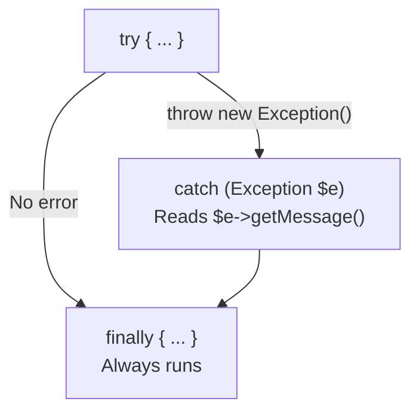

---
tags:
  - php
  - exceptions
  - beginner
---

# Exceptions

## TL;DR

When something goes wrong—such as a negative page count or bad JSON—you do not want your whole app to crash without a friendly message. **Exceptions** let you `throw` an error object and `catch` it cleanly in a `try` block, with `finally` for cleanup that must always run.

> [!NOTE] Prerequisites: 24, 30
> New terms: exception, Throwable

> [!abstract] Core Idea
> Wrap risky code in `try`, handle failures in `catch`, run guaranteed cleanup in `finally`, and signal invalid states with `throw`.
> Like Python's `try`/`except`/`finally`/`raise`, PHP uses `try`/`catch`/`finally`/`throw`, with a root **Throwable** interface sitting above both `Exception` and engine `Error`s.

## Mental Model

Think of `try...catch...finally` like checking a returned book at a library desk. You `try` to process the return; if a page is missing, you `throw` a damaged-book slip (`Exception`) so the `catch` desk handles it, and `finally` stamps the logbook whether the check succeeded or failed.



- An **exception** is an object (an instance of `Exception` or a subclass) thrown to interrupt normal flow when an error occurs.
- **Throwable** is PHP's root interface implemented by both recoverable `Exception` objects and engine `Error` objects (like `TypeError` or `ValueError`).

## Minimal Example

```php
<?php
function createPages(int $pages): int
{
    if ($pages <= 0) {
        throw new InvalidArgumentException('Pages must be greater than zero');
    }
    return $pages;
}

try {
    echo createPages(-5) . PHP_EOL;
} catch (InvalidArgumentException $e) {
    echo 'Invalid input: ' . $e->getMessage() . PHP_EOL;
} finally {
    echo 'Validation finished' . PHP_EOL;
}
```

Expected output:

```text
Invalid input: Pages must be greater than zero
Validation finished
```

- `throw new InvalidArgumentException(...)` stops `createPages()` immediately and sends the **exception** object up the call stack.
- `try { ... }` marks the block of code that might throw.
- `catch (InvalidArgumentException $e)` catches matching exceptions and puts the object in `$e`, where `$e->getMessage()` reads the error text.
- `finally { ... }` runs after `try` and `catch` whether an exception was thrown or not.

## Compare

| Type        | Parent / Role           | Examples                                    | Caught by `catch (Exception $e)`? | Caught by `catch (Throwable $e)`? |
| ----------- | ----------------------- | ------------------------------------------- | --------------------------------- | --------------------------------- |
| `Exception` | Recoverable app errors  | `InvalidArgumentException`, `JsonException` | ✓                                 | ✓                                 |
| `Error`     | Engine & type errors    | `TypeError`, `ValueError`                   | ✗                                 | ✓                                 |
| `Throwable` | Root interface for both | All throwable objects                       | Not applicable                    | ✓                                 |

## ◈ Edge Case Analysis

✗ **Mistake 1:** Using `catch (Exception $e)` to catch a `TypeError` or `ValueError` misses it completely because those extend `Error`, not `Exception`.

```php
try {
    explode('', 'Dune'); // throws ValueError (an Error, not Exception)
} catch (Exception $e) {
    echo 'Missed!';
}
```

✓ **Fix:** Catch the specific `Error` class (such as `ValueError`) or `Throwable` when you need to catch both `Exception` and `Error`.

```php
try {
    explode('', 'Dune');
} catch (ValueError $e) {
    echo $e->getMessage();
}
```

✗ **Mistake 2:** Putting a broad `catch (Throwable $e)` before a specific `catch (InvalidArgumentException $e)` makes the specific block unreachable.

```php
try {
    throw new InvalidArgumentException('Bad');
} catch (Throwable $e) {
    echo 'Always hits this first';
} catch (InvalidArgumentException $e) {
    echo 'Never reached';
}
```

✓ **Fix:** Always list the most specific `catch` types first and broader types (`Exception`, `Throwable`) last.

```php
catch (InvalidArgumentException $e) { /* specific */ }
catch (Throwable $e) { /* fallback */ }
```

✗ **Mistake 3:** Writing `class BookError implements Throwable` throws a fatal error because PHP forbids user classes from implementing `Throwable` directly.

```php
class BookError implements Throwable {} // Fatal error: Class BookError cannot implement interface Throwable
```

✓ **Fix:** Create custom exceptions by extending `Exception` (or a built-in subclass like `RuntimeException`).

```php
class BookError extends Exception {}
```

## Try It

1. Write a `try...catch` block around `json_decode('{bad}', true, flags: JSON_THROW_ON_ERROR)` that catches `JsonException` and echoes `$e->getMessage()`.
2. Create a custom `class EmptyTitleException extends Exception {}` and throw it if a trimmed book title is `''`.

<details>
<summary>◈ View Solution</summary>

1. Catching `JsonException`:

```php
<?php
try {
    json_decode('{bad}', true, flags: JSON_THROW_ON_ERROR);
} catch (JsonException $e) {
    echo 'JSON error: ' . $e->getMessage() . PHP_EOL;
}
```

2. Custom exception class:

```php
<?php
class EmptyTitleException extends Exception {}

function setTitle(string $title): string
{
    $clean = trim($title);
    if ($clean === '') {
        throw new EmptyTitleException('Title cannot be empty');
    }
    return $clean;
}
```

</details>

## Topic Mastery Quiz

**Q1: Which keyword is used to raise an exception in PHP?**

- [ ] A) `raise`
- [ ] B) `throw`
- [ ] C) `catch`
- [ ] D) `trigger`

**Q2: What does `catch (Exception $e)` do when `explode('', 'Dune')` throws a `ValueError`?**

- [ ] A) Catches it and puts it in `$e`
- [ ] B) Misses it because `ValueError` extends `Error`, not `Exception`
- [ ] C) Converts `ValueError` into `null`
- [ ] D) Automatically retries `explode()`

**Q3: When does a `finally` block run?**

- [ ] A) Only when no exception is thrown
- [ ] B) Only when an exception is caught
- [ ] C) Always after `try` and `catch`, whether an exception was thrown or not (unless `exit()` is called)
- [ ] D) Before `try` starts

**Q4: How should you define your own custom exception class in PHP?**

- [ ] A) `class BookError implements Throwable`
- [ ] B) `class BookError extends Exception`
- [ ] C) `trait BookError extends Exception`
- [ ] D) `enum BookError implements Throwable`

**Q5: If you have multiple `catch` blocks on one `try`, in what order should you write them?**

- [ ] A) Broadest (`Throwable`) first, most specific last
- [ ] B) Most specific first, broadest (`Throwable`) last
- [ ] C) Alphabetical order
- [ ] D) Order does not matter

**Q6: Which method on `$e` returns the human-readable error description?**

- [ ] A) `$e->message()`
- [ ] B) `$e->getMessage()`
- [ ] C) `$e->text`
- [ ] D) `$e->reason()`

<details>
<summary>◈ View Answers & Explanations</summary>

1. **B** — PHP raises exceptions with `throw` (for example, `throw new Exception('...')`). `raise` (A) is Python, `catch` (C) handles thrown errors, and `trigger` (D) is not the exception keyword.
2. **B** — `ValueError` and `TypeError` inherit from `Error`, which implements `Throwable` directly rather than extending `Exception`. You must catch `ValueError`, `Error`, or `Throwable` instead.
3. **C** — `finally` is guaranteed cleanup code that executes after `try` and any matching `catch`, even if an exception is uncaught or a `return` is hit (only abrupt termination like `exit()` skips it). A, B, and D are false.
4. **B** — Custom exceptions must extend `Exception` (or one of its subclasses). PHP throws a fatal error if a user class tries to `implements Throwable` directly (A, D), and traits cannot extend classes (C).
5. **B** — PHP runs the first matching `catch` block from top to bottom, so specific classes must come before broad ones like `Exception` or `Throwable`. A, C, and D are wrong.
6. **B** — `$e->getMessage()` returns the exception's message string. A, C, and D do not exist on `Throwable`.

</details>

## One-Liner

> [!tip] Clean Recovery
> **Throw specific `Exception`s, catch specific types before `Throwable`, and put guaranteed cleanup in `finally`.**

> [!quote] Sources
>
> - [Throwable errors - PHP Manual](https://www.php.net/manual/en/language.error-handling.throwable.php)
> - [try...catch - PHP Manual](https://www.php.net/manual/en/control-structures.try-catch.php)
> - [finally - PHP Manual](https://www.php.net/manual/en/control-structures.finally.php)
