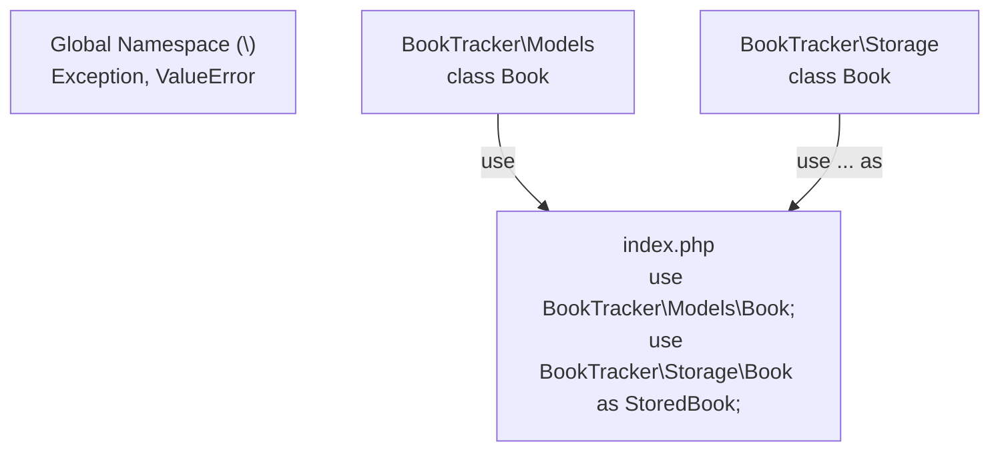

---
tags:
  - php
  - namespaces
  - beginner
---

# Namespaces

## TL;DR

As your Book Tracker grows, two files or libraries might both define a class named `Book` or `Formatter`. **Namespaces** put your classes into named folders in code so names never collide, and `use` lets you import them with short names.

> [!NOTE] Prerequisites: 22, 31
> New terms: namespace, global namespace

> [!abstract] Core Idea
> Declare a `namespace` at the top of a file to group its classes, and import classes from other namespaces with `use` (or `use ... as ...` to rename them).
> Like Java's `package` and `import`, PHP separates **namespace** levels with backslashes `\` instead of dots `.`, and uses a leading `\` to reach the **global namespace**.

## Mental Model

Think of a **namespace** like a folder path on your computer. You can have two files named `Book.php` as long as one is in `Library\` and one is in `Store\`; `use Library\Book;` is like creating a desktop shortcut so you can just write `new Book()` in that file.



- A **namespace** is a named container declared with `namespace Vendor\Sub;` at the top of a file to prevent class, function, and constant name collisions.
- The **global namespace** (`\`) is the root space where PHP's built-in classes (such as `Exception` and `ValueError`) live when no `namespace` is declared.

## Minimal Example

```php
<?php
namespace BookTracker\Models;

class Book
{
    public function __construct(public string $title) {}
}

// In another file under namespace BookTracker\App:
// use BookTracker\Models\Book;
// use Exception;
// $book = new Book('Dune');
```

- `namespace BookTracker\Models;` puts `Book` inside `BookTracker\Models`, so its full name is `\BookTracker\Models\Book`.
- `use BookTracker\Models\Book;` imports `Book` into another file so you can write `new Book('Dune')` instead of the full path.
- `use Exception;` (or `\Exception`) is needed inside a namespaced file to reach PHP's built-in classes in the **global namespace**.

## Compare

| Syntax                     | Meaning Inside `namespace BookTracker\App;`                       |
| -------------------------- | ----------------------------------------------------------------- |
| `new Book()`               | Looks for `BookTracker\App\Book` (or an imported `use ...` alias) |
| `new \Exception()`         | Leading `\` starts at the **global namespace** (`\Exception`)     |
| `use A\Book as ModelBook;` | Imports `A\Book` under the local alias `ModelBook`                |

## ◈ Edge Case Analysis

✗ **Mistake 1:** Writing `new Exception('Bad')` inside a namespaced file without `use Exception;` or `\Exception` makes PHP look for `BookTracker\Models\Exception` and fail.

```php
namespace BookTracker\Models;
throw new Exception('Bad'); // Error: Class "BookTracker\Models\Exception" not found
```

✓ **Fix:** Import built-in classes at the top with `use Exception;` or prefix them with a leading backslash `\Exception`.

```php
namespace BookTracker\Models;
use Exception;
throw new Exception('Bad');
```

✗ **Mistake 2:** Putting `echo` or any statement before `namespace ...;` causes a fatal compile error because `namespace` must be the very first statement (except `declare`).

```php
<?php
echo 'Starting...';
namespace BookTracker\Models; // Fatal error: Namespace declaration must be the very first statement
```

✓ **Fix:** Place `namespace` immediately after `<?php` (or right after `declare(strict_types=1);`).

```php
<?php
declare(strict_types=1);
namespace BookTracker\Models;
```

✗ **Mistake 3:** Writing `use BookTracker\Models;` expecting all classes inside `Models` to be imported only imports the namespace name `Models`, not `Book`.

```php
use BookTracker\Models;
$b = new Book('Dune'); // Error: Class "Book" not found
```

✓ **Fix:** Import each class you need explicitly (or use grouped syntax `use BookTracker\Models\{Book, Author};`).

```php
use BookTracker\Models\Book;
$b = new Book('Dune');
```

## Try It

1. Put `class Shelf` inside `namespace BookTracker\Storage;` and write the `use` statement another file needs to refer to `Shelf` as `BookShelf`.
2. Inside `namespace BookTracker\Storage;`, show two ways to throw PHP's built-in `InvalidArgumentException`.

<details>
<summary>◈ View Solution</summary>

1. Declaring and aliasing `Shelf`:

```php
<?php
namespace BookTracker\Storage;
class Shelf {}

// In another file:
use BookTracker\Storage\Shelf as BookShelf;
```

2. Reaching a global exception from inside a namespace:

```php
<?php
namespace BookTracker\Storage;
use InvalidArgumentException;

// Option 1 (via use):
throw new InvalidArgumentException('Empty');

// Option 2 (via leading backslash):
throw new \InvalidArgumentException('Empty');
```

</details>

## Topic Mastery Quiz

**Q1: Which character separates levels in a PHP namespace?**

- [ ] A) `.` (dot)
- [ ] B) `/` (forward slash)
- [ ] C) `\` (backslash)
- [ ] D) `::` (double colon)

**Q2: Inside `namespace BookTracker\App;`, what class does `new Exception('x')` look for if you did NOT write `use Exception;`?**

- [ ] A) `\Exception` in the global namespace
- [ ] B) `BookTracker\App\Exception`
- [ ] C) `BookTracker\Exception`
- [ ] D) PHP automatically imports all built-in classes

**Q3: Where must the `namespace` declaration appear in a PHP file?**

- [ ] A) Anywhere above the class definition
- [ ] B) At the very bottom of the file
- [ ] C) As the first statement after `<?php` (only `declare` may come before it)
- [ ] D) Inside `class { ... }`

**Q4: How do you import two classes named `Book` from different namespaces into the same file?**

- [ ] A) `use A\Book, B\Book;` without an alias
- [ ] B) Give at least one an alias with `as`, such as `use B\Book as StoredBook;`
- [ ] C) You cannot use both in the same file
- [ ] D) Put both inside `namespace A, B;`

**Q5: What does `use BookTracker\Models;` import?**

- [ ] A) Every class inside `BookTracker\Models`
- [ ] B) Only the symbol `Models` (so you would write `new Models\Book()`, not `new Book()`)
- [ ] C) Nothing; it is a syntax error
- [ ] D) All functions in `Models`

**Q6: Which statement about `use` imports is true?**

- [ ] A) A `use` import in `a.php` automatically applies to files it includes
- [ ] B) `use` imports are per-file only
- [ ] C) `use` requires a leading backslash (`use \A\B;`)
- [ ] D) `use` runs at runtime inside functions

<details>
<summary>◈ View Answers & Explanations</summary>

1. **C** — PHP namespaces use backslashes (`\`), such as `BookTracker\Models\Book`. Dots (A) are string concatenation, `/` (B) is division, and `::` (D) is static/constant access.
2. **B** — Unqualified class names inside a namespace resolve relative to the current namespace (`BookTracker\App\Exception`). Unlike functions, classes do not fall back to the global namespace automatically (A, D).
3. **C** — `namespace` must be the first statement in the file, with `declare(...)` as the only allowed exception before it. A, B, and D cause compile/syntax errors.
4. **B** — Importing two classes with the same short name collides unless you alias at least one using `as`. A fails with a fatal name conflict, and C and D are false.
5. **B** — PHP does not have wildcard `use Namespace\*` imports; `use BookTracker\Models;` aliases `Models` itself, so you must write `new Models\Book()` or import `BookTracker\Models\Book` directly. A, C, and D are false.
6. **B** — Import rules (`use`) apply only to the single file where they are written and are not inherited by included files (A). Leading backslashes in `use` are unnecessary (C), and `use` is resolved at compile time at file/namespace scope (D).

</details>

## One-Liner

> [!tip] Clean Imports
> **Put `namespace` first, import classes with `use`, and prefix global classes with `\` or `use`.**

> [!quote] Sources
>
> - [Defining namespaces - PHP Manual](https://www.php.net/manual/en/language.namespaces.definition.php)
> - [Aliasing and Importing - PHP Manual](https://www.php.net/manual/en/language.namespaces.importing.php)
> - [Name resolution rules - PHP Manual](https://www.php.net/manual/en/language.namespaces.rules.php)
