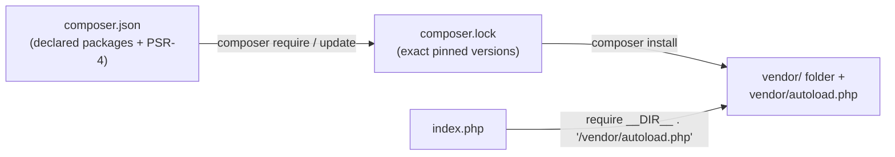

---
tags:
  - php
  - composer
  - beginner
---

# Composer & Packages

## TL;DR

Writing your own autoloader and copying third-party libraries by hand does not scale. **Composer** is PHP's package manager: it downloads libraries into `vendor/`, records exact versions in a **lock file**, and builds one `vendor/autoload.php` file for your entire app.

> [!NOTE] Prerequisites: 21, 33
> New terms: Composer, lock file

> [!abstract] Core Idea
> Use **Composer** (`composer.json` + `composer.lock`) to install packages and generate `vendor/autoload.php`, then `require` that one file in your app.
> Like Python's `pip` or JavaScript's `npm`, Composer manages dependencies in `vendor/`, while also acting as your **PSR-4** **autoloader**.

## Mental Model

Think of `composer.json` as your project's shopping list (_"I need a logger library"_), `composer.lock` as the printed receipt showing the exact version numbers you bought, and `vendor/autoload.php` as the single master key that unlocks both your own `src/` classes and every installed package.


- A **lock file** (`composer.lock`) records the exact package versions installed so every developer and server gets identical dependencies.

## Minimal Example

```json
{
  "name": "valay/book-tracker",
  "autoload": {
    "psr-4": {
      "BookTracker\\": "src/"
    }
  },
  "require": {
    "monolog/monolog": "^3.0"
  }
}
```

```php
<?php
require __DIR__ . '/vendor/autoload.php';

$book = new BookTracker\Models\Book('Dune');
```

- `"psr-4": { "BookTracker\\": "src/" }` tells Composer to autoload your own `BookTracker\` classes from `src/` too (note the escaped `\\` in JSON).
- `composer require monolog/monolog` adds the package to `composer.json`, updates `composer.lock`, and downloads files into `vendor/`.
- `require __DIR__ . '/vendor/autoload.php';` at the top of your entry script loads both third-party packages and your own `src/` classes automatically.

## Compare

| File / Command     | Purpose                                      | Commit to Git?                       |
| ------------------ | -------------------------------------------- | ------------------------------------ |
| `composer.json`    | Lists required packages & PSR-4 rules        | ✓ Yes                                |
| `composer.lock`    | Pins exact installed versions                | ✓ Yes (for apps)                     |
| `vendor/`          | Downloaded package code + `autoload.php`     | ✗ No (rebuilt by `composer install`) |
| `composer install` | Installs exact versions from `composer.lock` | Command                              |
| `composer update`  | Upgrades packages & rewrites `composer.lock` | Command                              |

## ◈ Edge Case Analysis

✗ **Mistake 1:** Forgetting `require __DIR__ . '/vendor/autoload.php';` in your PHP script causes `Class not found` errors even after running `composer install`.

```php
<?php
$log = new Monolog\Logger('books'); // Error: Class "Monolog\Logger" not found
```

✓ **Fix:** Include `vendor/autoload.php` once at the top of your entry file.

```php
<?php
require __DIR__ . '/vendor/autoload.php';
```

✗ **Mistake 2:** Editing `"psr-4"` in `composer.json` without regenerating the autoloader means PHP still cannot find your new namespace.

```text
// Added "BookTracker\\": "src/" to composer.json, but forgot to refresh vendor/autoload.php
```

✓ **Fix:** Run `composer dump-autoload` after changing the `"autoload"` section in `composer.json`.

```powershell
composer dump-autoload
```

✗ **Mistake 3:** Running `composer update` on a server instead of `composer install` can pull newer, untested package versions and ignore `composer.lock`.

```powershell
composer update   # Upgrades dependencies and changes composer.lock
```

✓ **Fix:** Always run `composer install` on teammates' machines and servers so Composer installs the exact versions pinned in `composer.lock`.

```powershell
composer install
```

## Try It

1. Write the PowerShell command to add a package named `vlucas/phpdotenv` to a project and regenerate the **lock file**.
2. Given `"psr-4": { "BookTracker\\": "src/" }`, where should `BookTracker\Storage\JsonStore` be saved, and what single `require` line loads it?

<details>
<summary>◈ View Solution</summary>

1. Requiring a package with Composer:

```powershell
composer require vlucas/phpdotenv
```

2. File location and autoload include:

- Save the class at `src/Storage/JsonStore.php`
- Load it in your entry script with:

```php
<?php
require __DIR__ . '/vendor/autoload.php';
```

</details>

## Topic Mastery Quiz

**Q1: Which file should you `require` at the top of your entry script to load Composer packages and PSR-4 classes?**

- [ ] A) `composer.json`
- [ ] B) `composer.lock`
- [ ] C) `vendor/autoload.php`
- [ ] D) `src/autoload.php`

**Q2: What is the difference between `composer install` and `composer update` when `composer.lock` exists?**

- [ ] A) `composer install` installs the exact versions in `composer.lock`; `composer update` resolves newer versions and rewrites `composer.lock`
- [ ] B) `composer update` deletes `vendor/`; `composer install` does not
- [ ] C) They are identical commands
- [ ] D) `composer install` ignores `composer.lock`

**Q3: Which item should you NOT commit to Git in a normal PHP project?**

- [ ] A) `composer.json`
- [ ] B) `composer.lock`
- [ ] C) `src/`
- [ ] D) `vendor/`

**Q4: After adding a new `"psr-4"` mapping to `composer.json`, which command refreshes `vendor/autoload.php` without updating packages?**

- [ ] A) `composer refresh`
- [ ] B) `composer dump-autoload`
- [ ] C) `composer clear-cache`
- [ ] D) `composer init`

**Q5: Why does `"BookTracker\\": "src/"` in `composer.json` have two backslashes?**

- [ ] A) PHP namespaces require double backslashes everywhere
- [ ] B) JSON strings use `\` as an escape character, so a literal backslash must be written as `\\`
- [ ] C) It tells Composer to go up two directories
- [ ] D) One backslash is for Windows and one is for Linux

**Q6: What does `composer require vendor/package` do?**

- [ ] A) Only checks if the package exists online
- [ ] B) Adds the package to `composer.json`, updates `composer.lock`, and downloads it into `vendor/`
- [ ] C) Deletes unused files in `src/`
- [ ] D) Runs your PHP unit tests

<details>
<summary>◈ View Answers & Explanations</summary>

1. **C** — Composer generates `vendor/autoload.php` as the single entry point for autoloading all installed packages and your configured `"psr-4"` namespaces. A and B are metadata files, and D is not generated by Composer.
2. **A** — `composer install` reproduces the exact pinned versions in `composer.lock`, whereas `composer update` checks for newer matching versions and updates `composer.lock`. B, C, and D are false.
3. **D** — `vendor/` contains downloaded third-party files and can be rebuilt anytime from `composer.json` and `composer.lock` via `composer install`, so it is kept out of Git. A, B, and C should be committed.
4. **B** — `composer dump-autoload` regenerates `vendor/autoload.php` from your `"autoload"` rules without fetching packages. A is not a Composer command, C clears download caches, and D creates a new `composer.json`.
5. **B** — `composer.json` is standard JSON, where `\` starts an escape sequence, so `\\` represents one literal backslash. A, C, and D are false.
6. **B** — `composer require` updates `composer.json`, resolves dependencies into `composer.lock`, and installs the package into `vendor/`. A, C, and D are false.

</details>

## One-Liner

> [!tip] One Entry Include

> [!quote] Sources
>
> - [Basic usage - Composer](https://getcomposer.org/doc/01-basic-usage.md)
> - [Command-line interface - Composer](https://getcomposer.org/doc/03-cli.md)
