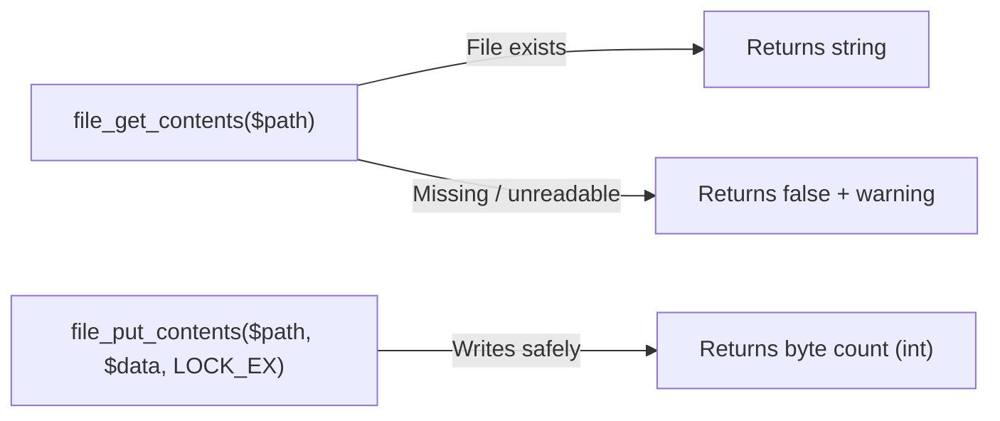

---
tags:
  - php
  - files
  - beginner
---

# File Reading & Writing

## TL;DR

To keep your Book Tracker's shelf between runs, you need to save data to disk and read it back later. PHP gives you two simple functions—`file_get_contents()` and `file_put_contents()`—to read and write whole files in one step.

> [!NOTE] Prerequisites: 21, 31
> New terms: file lock

> [!abstract] Core Idea
> Read a whole file into a string with `file_get_contents()`, and write or append safely with `file_put_contents()` using `LOCK_EX` (and `FILE_APPEND` when adding to the end).
> Like Python's `Path.read_text()` and `Path.write_text()`, PHP handles opening and closing for you, except `file_put_contents()` supports `LOCK_EX` to prevent overlapping writes.

## Mental Model

Think of `file_get_contents()` as photocopying a whole notebook page in one press, and `file_put_contents()` as replacing the page (or adding a line at the bottom with `FILE_APPEND`). Adding a **file lock** (`LOCK_EX`) puts a _"Do Not Disturb"_ sign on the door so two requests cannot scribble over each other at the same time.



- A **file lock** (`LOCK_EX`) prevents another PHP process from writing to the same file at the exact same moment while your write is in progress.

## Minimal Example

```php
<?php
$path = __DIR__ . '/books.json';
$books = [['title' => 'Dune', 'pages' => 412]];

$json = json_encode($books, JSON_PRETTY_PRINT | JSON_THROW_ON_ERROR);
file_put_contents($path, $json, LOCK_EX);

if (file_exists($path)) {
    $raw = file_get_contents($path);
    $loaded = json_decode($raw, true, flags: JSON_THROW_ON_ERROR);
    echo $loaded[0]['title'] . PHP_EOL;
}
```

Expected output:

```text
Dune
```

- `file_put_contents($path, $json, LOCK_EX)` creates `books.json` if missing, overwrites any old content, acquires an exclusive **file lock**, writes `$json`, and closes the file.
- `file_exists($path)` checks whether the file is on disk before reading so you avoid warnings on a missing file.
- `file_get_contents($path)` reads the entire file into `$raw` as a single `string` (or returns `false` on failure).

> [!warning] Security angle
> Never pass raw user input (such as a filename from a URL) directly into `file_get_contents()` or `file_put_contents()`. Attackers can use `../` segments to read or overwrite sensitive files outside your app folder.

## Compare

| Call                                                | Behavior                     | If File Exists         | If File Missing                |
| --------------------------------------------------- | ---------------------------- | ---------------------- | ------------------------------ |
| `file_get_contents($p)`                             | Reads whole file as `string` | Returns contents       | Emits warning, returns `false` |
| `file_put_contents($p, $d, LOCK_EX)`                | Writes `$d` with lock        | Overwrites old content | Creates the file               |
| `file_put_contents($p, $d, FILE_APPEND \| LOCK_EX)` | Appends `$d` with lock       | Adds `$d` to the end   | Creates the file               |

## ◈ Edge Case Analysis

✗ **Mistake 1:** Calling `file_put_contents($log, $line)` without `FILE_APPEND` erases all previous lines in the file on every call.

```php
file_put_contents('tracker.log', "Added Dune\n"); // Overwrites entire file
```

✓ **Fix:** Combine `FILE_APPEND | LOCK_EX` when you want to add new text to the end of a file.

```php
file_put_contents('tracker.log', "Added Dune\n", FILE_APPEND | LOCK_EX);
```

✗ **Mistake 2:** Writing to a path inside a folder that does not exist yet fails and returns `false`, because `file_put_contents()` creates files, not missing directories.

```php
file_put_contents(__DIR__ . '/missing_dir/books.json', '[]'); // Warning + returns false
```

✓ **Fix:** Ensure the folder exists first with `is_dir()` and `mkdir(..., recursive: true)`.

```php
if (!is_dir(__DIR__ . '/data')) {
    mkdir(__DIR__ . '/data', 0755, true);
}
```

✗ **Mistake 3:** Assuming `file_get_contents()` throws an exception when a file is missing causes a `TypeError` or silent bug when `false` is passed to `json_decode()`.

```php
$raw = file_get_contents('missing.json'); // Emits warning and returns false
```

✓ **Fix:** Check `file_exists($path)` first and verify `$raw !== false` before decoding.

```php
$raw = file_exists($path) ? file_get_contents($path) : false;
```

## Try It

1. Append `"Finished Dune\n"` to `__DIR__ . '/history.log'` using both `FILE_APPEND` and `LOCK_EX`.
2. Safely read `__DIR__ . '/history.log'` only if `file_exists()` is true, and echo its contents (or `"No history yet"` if missing).

<details>
<summary>◈ View Solution</summary>

1. Appending with a lock:

```php
<?php
$log = __DIR__ . '/history.log';
file_put_contents($log, "Finished Dune\n", FILE_APPEND | LOCK_EX);
```

2. Checking before reading:

```php
<?php
$log = __DIR__ . '/history.log';
if (file_exists($log)) {
    $text = file_get_contents($log);
    echo ($text !== false) ? $text : 'Could not read log';
} else {
    echo 'No history yet' . PHP_EOL;
}
```

</details>

## Topic Mastery Quiz

**Q1: What does `file_put_contents($path,$data)` do by default if `$path` already exists?**

- [ ] A) Appends `$data` to the end
- [ ] B) Overwrites the existing file contents
- [ ] C) Throws an `Exception`
- [ ] D) Creates a backup copy first

**Q2: Which flags should you pass to add a new log line to the end of a file while blocking simultaneous writes?**

- [ ] A) `FILE_APPEND | LOCK_EX`
- [ ] B) `LOCK_EX` only
- [ ] C) `FILE_USE_INCLUDE_PATH`
- [ ] D) `JSON_PRETTY_PRINT`

**Q3: What does `file_get_contents('missing.txt')` return if the file does not exist?**

- [ ] A) `""` (empty string)
- [ ] B) `null`
- [ ] C) `false` (after emitting a warning)
- [ ] D) It throws a `FileNotFoundException`

**Q4: What happens if you call `file_put_contents(__DIR__ . '/new_folder/books.json', '[]')` when `new_folder` does not exist?**

- [ ] A) PHP creates `new_folder` and `books.json` automatically
- [ ] B) It fails with a warning and returns `false`
- [ ] C) It saves `books.json` in `__DIR__` instead
- [ ] D) It deletes `__DIR__`

**Q5: What does `file_put_contents()` return when it succeeds?**

- [ ] A) `true`
- [ ] B) The number of bytes written (an `int`)
- [ ] C) The file path string
- [ ] D) `null`

**Q6: Why should you never pass a raw user-supplied filename directly to `file_get_contents()`?**

- [ ] A) `file_get_contents()` cannot read `.txt` files
- [ ] B) User input with `../` can escape your folder and read private server files
- [ ] C) It automatically deletes the file after reading
- [ ] D) `file_get_contents()` only works on JSON

<details>
<summary>◈ View Answers & Explanations</summary>

1. **B** — Without `FILE_APPEND`, `file_put_contents()` clears and overwrites existing files. It does not append (A), throw an exception (C), or create backups (D).
2. **A** — `FILE_APPEND` keeps existing content and writes at the end, while `LOCK_EX` acquires an exclusive **file lock** during the write. B overwrites, C searches include paths, and D is a JSON flag.
3. **C** — `file_get_contents()` emits a warning and returns `false` on failure, rather than returning `""` (A), `null` (B), or throwing an exception (D).
4. **B** — `file_put_contents()` creates a missing file, but it will not create missing parent directories, so it emits a warning and returns `false`. A, C, and D are false.
5. **B** — On success, `file_put_contents()` returns the integer count of bytes written (or `false` on failure). A, C, and D are false.
6. **B** — Untrusted paths can include `../` to traverse directories and expose sensitive files. A, C, and D are false.

</details>

## One-Liner

> [!tip] Safe Disk I/O

> [!quote] Sources
>
> - [file_get_contents - PHP Manual](https://www.php.net/manual/en/function.file-get-contents.php)
> - [file_put_contents - PHP Manual](https://www.php.net/manual/en/function.file-put-contents.php)
